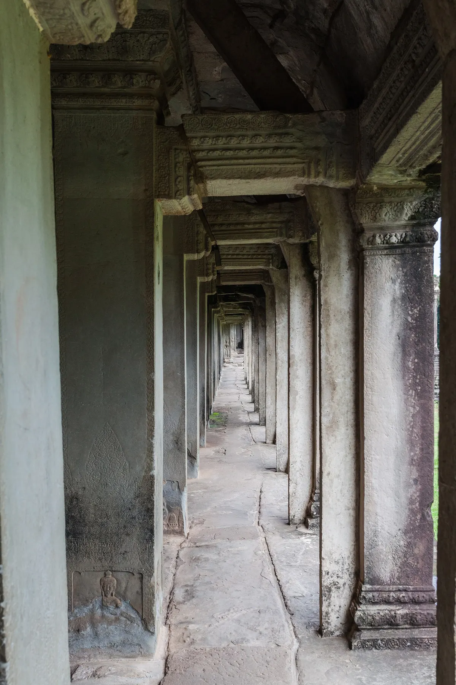
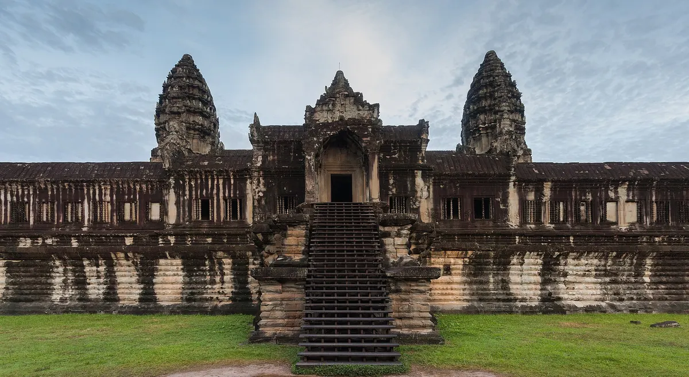
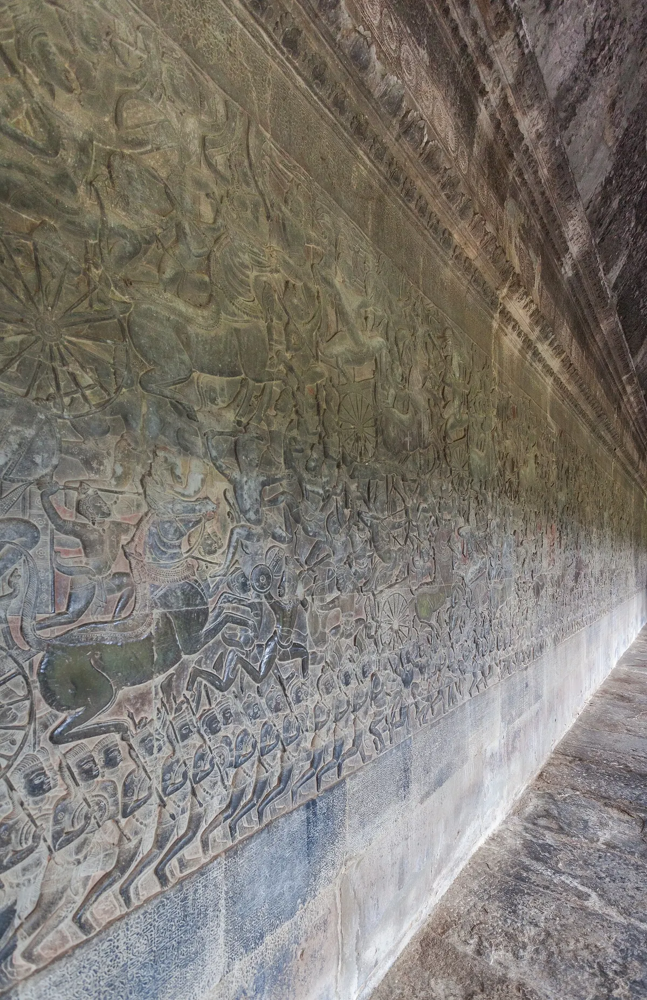
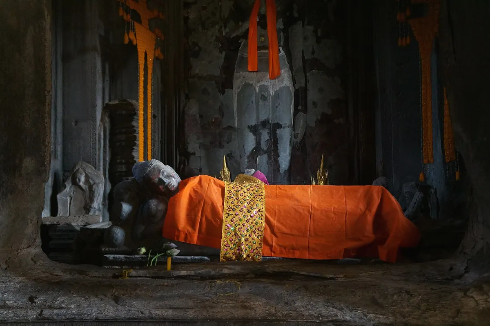

import { tpkDeep } from '../../data/affiliate.js';

## Один храм, целый парк и отдельный верхний ярус

**Ангкор** — археологический парк с множеством храмов. **Ангкор-Ват** — один из его комплексов, тот самый с пятью башнями. **Бакан** — его верхний ярус с собственными часами и ограничениями. Эта разница определяет и билет, и нагрузку: пропуск на весь парк не гарантирует доступ наверх в любой момент.

Для первого знакомства заложите на сам Ангкор-Ват **около трёх часов** без дороги из отеля. APSARA оценивает посещение в 2–3 часа; очередь, фотографии и отдых могут добавить времени. Если идёте медленно или внимательно рассматриваете рельефы, уберите ещё один храм из дня, а не сокращайте Ангкор-Ват до получасового снимка у воды.

| Ваш приоритет | Как построить утро |
|---|---|
| Отражение башен и предрассветный свет | Ранний выезд, затем галереи и ожидание открытия Бакана |
| Архитектура и рельефы | Приезд после открытия, спокойный обход без погони за рассветом |
| Сложно подниматься по крутым ступеням | Нижние галереи и дворы, без Бакана |
| Хочется увидеть ещё Байон и Та-Пром | Оставить Ангкор-Ват полноценным первым блоком, не добавлять дальний круг |

## Самостоятельно или с гидом по парку

Пропуска продаёт [Angkor Enterprise](https://www.angkorenterprise.gov.kh/en/available-tickets). **Один день — $37**, около **3000 ₽**; **три дня — $62**, примерно **5030 ₽**, использовать их можно в течение **семи дней**; **семь дней — $72**, около **5840 ₽**, срок использования **30 дней**. Это разные сроки действия, а не три или семь обязательных прогулок подряд.

Для одного Ангкор-Вата и ещё пары ближних храмов подойдёт однодневный пропуск, если вам подходит полный день на ногах. Трёхдневный имеет смысл, когда выделены дополнительные дни на парк. Не покупайте его только из страха, что без него не пустят в главный храм.

По [правилам оператора](https://www.angkorenterprise.gov.kh/en/faqs), детям **младше 12 лет** вход бесплатный при подтверждении возраста. На Бакан при этом допускают только **с 12 лет**: семейный пропуск не отменяет ограничение верхнего уровня. Фотография нужна для трёх- и семидневного билета; старое требование фотографироваться для любого вида пропуска больше не универсально.

Самостоятельный вариант — купить официальный пропуск и отдельно договориться о машине или тук-туке из Сиемреапа. До выезда согласуйте конкретный храм, время встречи после осмотра и порядок поездки к следующему объекту. Внешний вид одинаковых машин и длинная стоянка не помогают найти своего водителя в толпе.

Для объяснения храмов на русском есть <a href={tpkDeep('sputnik8', 'https://www.sputnik8.com/ru/siem-reap/activities/78230-zagadochnye-i-neveroyatno-krasivye-hramy-angkor', 'angkor_ru_guide')} target="_blank" rel="sponsored noopener">восьмичасовая поездка по Ангкору с гидом</a>: **$150 за группу 1–4 человека**, около **12 170 ₽**. Машина с кондиционером и вода включены, **входные пропуска — отдельно**. Для четырёх взрослых с однодневными билетами это $298, примерно 24 180 ₽, до еды и прочих расходов.

Программа включает также Байон, Та-Пром и другие точки парка. Это предложение на день по нескольким храмам, а не восемь часов только в Ангкор-Вате. В форме были дневные старты на 24–25 октября; **рассвет этим описанием не гарантирован**. Если он принципиален, согласуйте ранний выезд до оплаты. Успешная оплата российской картой нами не проверялась.

## Рассвет: кому он нужен и как не потерять остальное утро

Рассвет интересен прежде всего светом и силуэтом башен у воды. Он не означает, что сам храм внутри в этот момент будет пустым или что облака обязательно дадут яркое небо. У популярных точек отражения одновременно собираются люди; приезжать ради спокойствия к наиболее известному пруду — спорный выбор.

Если рассвет выбран, подготовьте пропуск заранее, договоритесь о точке посадки и возьмите свет для подхода. Оператор разрешает после **16:45** купить билет на следующий день и посетить закат накануне. Это не разрешение оставаться в закрывшемся храме: часы конкретных объектов продолжают действовать.

После утренних фотографий не уезжайте сразу к следующей вывеске. Пройдите галереи, посмотрите дворы, а затем решите вопрос Бакана. На справочной странице [APSARA](https://apsaraauthority.gov.kh/2021/06/14/angkor-wat/) часы Ангкор-Вата — **05:00–17:30**, Бакана — **07:40–17:00**. Общие часы парка **05:00–18:30** из билетной страницы не продлевают доступ в этот храм.

Порядок закрытий Бакана изменился: в [объявлении Министерства культуры от 13 июня 2026 года](https://mcfa.gov.kh/public-announcement-on-the-daily-opening-of-the-bakan-tower-of-angkor-wat-except-on-the-afternoons-of-the-14th-and-28th-of-each-month/) указан ежедневный доступ **кроме второй половины 14-го и 28-го числа каждого месяца**. Старое правило о полном закрытии в религиозные дни не стоит переносить из путеводителей в текущий план. На эти даты выбирайте утренний подъём и уточняйте ограничения на месте.

## Что смотреть между прудом и башнями

Подход через ров помогает понять устройство комплекса: храм отделён от окружающего пространства водой и протяжённым переходом. Не воспринимайте весь этот путь как очередь к единственному кадру. По мере приближения башни перекрывают друг друга, а огромный силуэт превращается в систему дворов и переходов.

Ангкор-Ват начали строить в первой половине XII века при Сурьявармане II как индуистский храм; позднее он стал буддийским местом. Поэтому здесь важны одновременно каменная архитектура и продолжающаяся религиозная жизнь. Пять башен отсылают к горе Меру, центру мира в индуистской космологии: перед вами пространственная модель, а не случайный набор одинаковых вершин.

**Остановитесь у рельефа Пахтания Молочного океана.** Боги и асуры тянут змея Нага, используя его как верёвку, чтобы получить напиток бессмертия. Ищите не отдельный красивый орнамент, а длинную общую сцену с противостоящими группами фигур. Короткое объяснение сюжета до обхода помогает заметить композицию; у [Smarthistory](https://smarthistory.org/angkor-wat/) есть разбор архитектуры и этой сцены.

В другой части комплекса можно увидеть буддийские изображения. Не трогайте статуи и ткань на них, не занимайте место перед молящимися ради фотографии. Одежда с закрытыми плечами и коленями нужна не для фотосессии в «древних руинах», а для посещения действующего священного места.

## Подниматься ли на Бакан

Верхний ярус даёт близкий взгляд на центральные башни и дворы сверху. Но крутая лестница — самостоятельная физическая задача. Если вас пугают ступени, подводят колени или стало тяжело после рассвета, нижний обход остаётся полноценным посещением: главные рельефы не требуют обязательного подъёма.

Детям младше 12 лет путь наверх закрыт; для семьи заранее решите, кто остаётся внизу. APSARA также указывает ограничение для беременных и требует снимать головной убор на верхнем уровне. Закрытие на обслуживание или временное ограничение потока нельзя устранить покупкой более дорогой экскурсии.

Не рассчитывайте прийти к верхней лестнице за минуту до 17:00. Час закрытия не обещает, что очередь ещё принимают. Лучше принять решение о подъёме в первой половине своего обхода и оставить запас на спуск.

## Что подготовить накануне

Возьмите воду, защиту от солнца и обувь с устойчивой подошвой. Подходы, дворы и лестницы дают разную поверхность; после дождя камень требует осторожности. Еду держите убранной и не кормите обезьян: возможность близко сфотографировать животное не стоит превращать в контакт.

Запишите номер водителя и точку встречи, сохраните билет офлайн, проверьте заряд телефона. Для рассвета добавьте отдельный свет. Оставьте завтрак или отдых после раннего блока, вместо того чтобы немедленно ехать по ещё более длинному списку храмов.

В [общем путеводителе по Камбодже](/blog/cambodia-guide-2026/) разобраны страна и поездка по парку, а на [странице направления](/cambodia/) — сезон. Здесь задача конкретнее: провести хорошее утро в одном храме и понять увиденное, прежде чем отправляться дальше.
