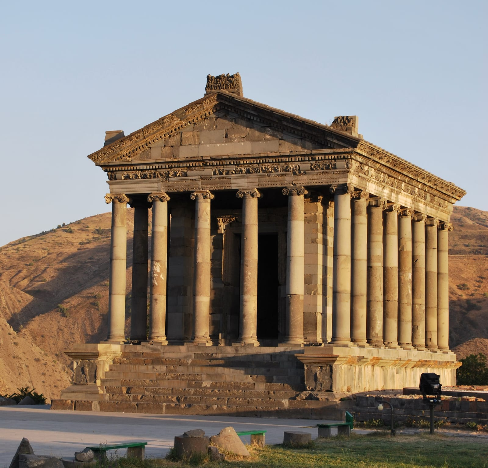
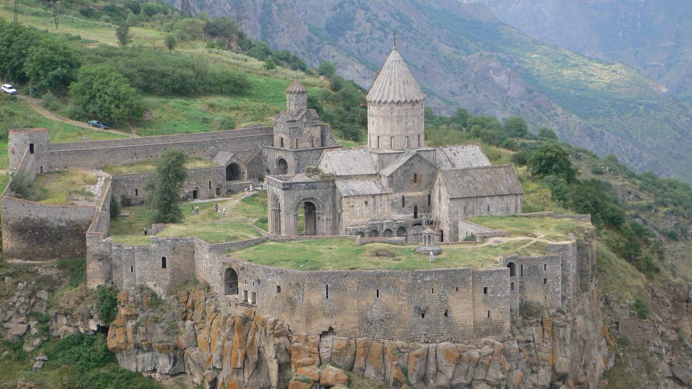
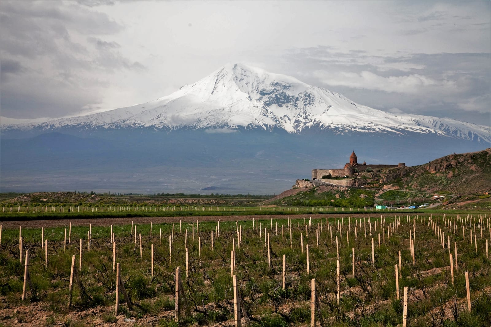
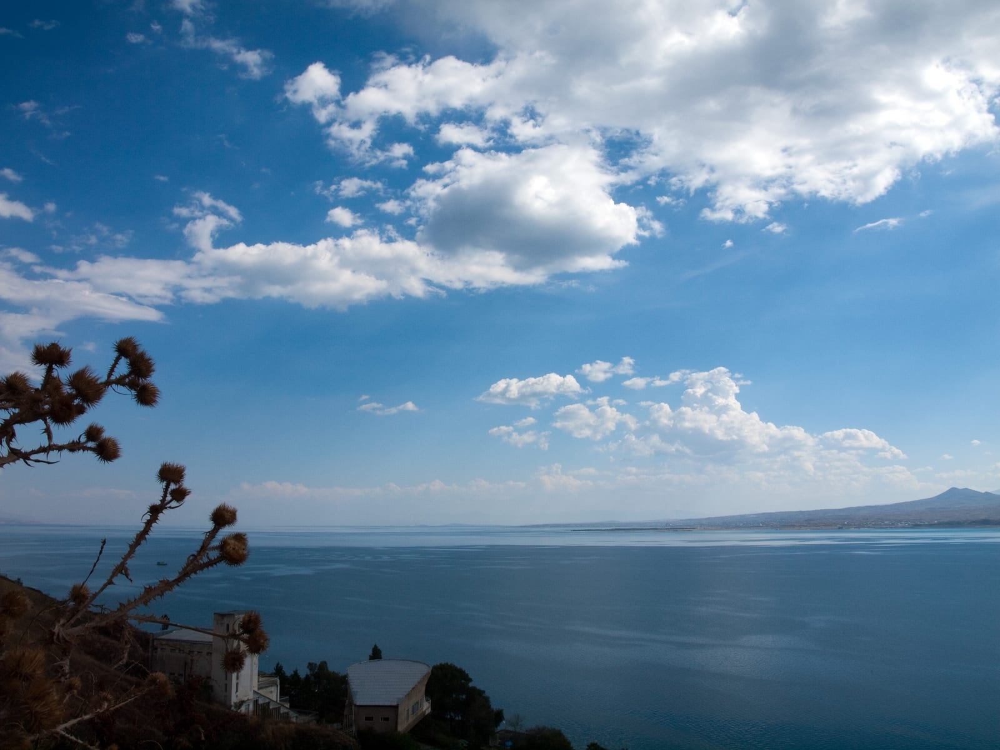

import PricingCards from '../../components/post/PricingCards.astro';
import CountryMap from '../../components/CountryMap.astro';
import { aviasalesRoute, ostrovokCity, youtravelCountry } from '../../data/affiliate.js';

export const aviaYerevan = aviasalesRoute('MOW', 'EVN', 'armenia_guide_2026');
export const hotelsYerevan = ostrovokCity('armenia', 'yerevan', 'armenia_guide_2026_stay');
export const hotelsDilijan = ostrovokCity('armenia', 'dilijan', 'armenia_guide_2026_north');
export const hotelsGoris = ostrovokCity('armenia', 'goris', 'armenia_guide_2026_south');

Армения подходит для поездки с городскими прогулками и выездами к монастырям: начните с Еревана, затем выберите север с Дилижаном или юг с Татевом. Главная ошибка в планировании — считать столицу удобной базой для любой точки страны. На короткий отпуск оставляйте один отель, на неделю добавляйте ночёвки в одном регионе.

> **Для первой поездки:** на 3 ночи выбирайте Ереван; на 6 — Ереван и две ночи в Дилижане либо Горисе, с возвращением в столицу перед рейсом. <a href={hotelsYerevan} rel="sponsored noopener">Сравнить жильё в Ереване</a> лучше после выбора района. Россиянам виза для туристической поездки не нужна; общий безвизовый предел — до 180 дней в течение одного года, если международное соглашение не устанавливает иное; на прямой перелёт из России подходит внутренний паспорт, для наземного маршрута нужен заграничный. Документы детей проверяйте отдельно. На оплату российской картой повсюду не рассчитывайте.

---

## Нужна ли виза в Армению россиянам в 2026?

**Нет, для туристической поездки виза не нужна.** Для безвизовых посещений МИД Армении указывает **до 180 дней в течение одного года**, если международным соглашением не установлен иной срок. Для длительного пребывания проверяйте применимый к вашей ситуации порядок в миграционной службе или консульстве. Безвизовый режим не отменяет требования к документам.

Ключевые условия:

- Общий безвизовый срок — **до 180 дней в течение одного года**, если международное соглашение не предусматривает иное
- Отдельная виза, приглашение или ваучер для туриста не требуются
- Для длительного пребывания уточняйте требования к учёту и документам в миграционной службе или консульстве до поездки
- Для проживания дольше 180 дней, работы или учёбы оформляется отдельный статус

При выборе жилья уточните язык общения и способ связи с хозяином. Для загородного размещения полезно сохранить адрес и инструкции по заселению офлайн.

---

## Можно ли въехать в Армению по внутреннему паспорту?

**Да, но только на прямом авиарейсе.** Это главная особенность Армении: при перелёте напрямую из России пограничники пропускают **по внутреннему паспорту РФ** — загранпаспорт не нужен.

Но есть нюансы, из-за которых загран всё же стоит взять:

- **По земле — только по загранпаспорту.** Если въезжаешь наземным транспортом (например, из Грузии по маршруту Кавказа), внутренний паспорт не подойдёт
- **Для банковских услуг и длительного пребывания** заранее уточняйте перечень документов в конкретном банке и миграционном органе
- **Стыковочные рейсы** через третью страну — загран

Практичный вывод: для короткой поездки прямым рейсом взрослому подходит внутренний паспорт; для наземных выездов нужен заграничный. У детей проверяйте собственные документы по действующим правилам. Правила пересечения границы могут меняться — перед поездкой сверяйся с официальными источниками (см. дисклеймер в конце).

---

## Как добраться из России в Армению в 2026?

Для поездки через Ереван сравните прямой перелёт со стыковочным, учитывая багаж, время прилёта и дорогу до жилья. Код аэропорта Звартноц — **EVN**. Если летите только с внутренним паспортом РФ, выбирайте прямой маршрут из России; пересадка в третьей стране требует отдельной проверки документов.

<a href={aviaYerevan} rel="sponsored noopener">Сравнить билеты Москва — Ереван</a> можно после выбора длительности поездки. Подставьте обе даты и всех пассажиров: цена одного места без багажа не равна стоимости перелёта семьи. Ночной прилёт согласуйте с отелем до оплаты невозвратного номера.

Наземный путь через Грузию подходит для отдельного кавказского маршрута. Для него нужен заграничный паспорт; время в пути зависит от отправления, дорожных условий и границы. Не привязывайте такой переезд к короткой стыковке с самолётом.

---

## Где базироваться: Ереван на всю поездку или ночёвки по стране

**На короткую поездку выбирайте Ереван, на неделю — Ереван и один регион.** Дилижан добавляет лесные прогулки и спокойные вечера в горах; Горис позволяет посмотреть Татев без возвращения в столицу в тот же день. Пытаться из одного отеля ежедневно ездить на противоположные концы страны неудобно, даже если на карте расстояния выглядят небольшими.

### Три варианта распределения ночей

Считайте именно ночи между заездом и выездом. Четыре дня поездки могут означать три ночи, а ночной прилёт способен потребовать бронирования за предыдущую календарную дату. Эти планы предполагают прилёт и вылет через Ереван; время рейсов может сократить первый и последний день.

| Срок | Где ночевать | Что успевает маршрут | Что исключить |
|---|---|---|---|
| **3 ночи** | Все 3 в Ереване | Центр города, Гарни и Гегард, один дополнительный выезд по интересам | Не добавлять Татев; Севан и Дилижан не превращать в обязательную гонку |
| **6 ночей, север** | Ереван 3, Дилижан 2, Ереван 1 | Город и Гарни, Севан по дороге, полный день в Дилижане | Дальний юг с Татевом оставить на другую поездку |
| **6 ночей, юг** | Ереван 3, Горис 2, Ереван 1 | Город и Гарни, Хор Вирап и Нораванк по пути, отдельный день на Татев | Не добавлять Дилижан в день возвращения с юга |
| **9 ночей** | Ереван 3, Горис 2, Ереван 1, Дилижан 2, Ереван 1 | Север и юг с промежуточным отдыхом в столице | Не забивать каждую остановку экскурсиями; оставить запас на погоду |

Это варианты маршрута, а не расписание транспорта. Последняя ночь в Ереване убирает необходимость привязывать перелёт к длинному горному переезду. Зимой выбирайте отдельные выезды из столицы после проверки дороги; летняя петля через высокие перевалы не переносится на снег по тому же плану.

### Когда удобнее все ночи провести в Ереване

Одна база подходит, если не хочется собирать чемодан, вы путешествуете с маленьким ребёнком, много работаете из поездки или берёте отдельные экскурсии с возвращением в город. Гарни и Гегард, Эчмиадзин, Хор Вирап можно распределить по дням, а между ними оставить музеи и прогулки. Вечером проще выбирать кафе и покупать нужное в городе.

Цена этого удобства — повторная дорога. Севан с короткой остановкой в Дилижане может быть дневной экскурсией, но прогулки по лесу и вечер в Дилижане тогда выпадают. Татев из Еревана означает длинный день в машине: если он важен, меняйте распределение ночей, а не добавляйте его к обычному городскому дню.

Для первой поездки смотрите **Кентрон около площади Республики, Оперы или нижней части Каскада**. В этом случае важна реальная пешеходная дорога до ваших мест, а не слово «центр» в карточке. Жильё выше по склону может иметь красивый вид и неудобный подъём; окно на оживлённую улицу — шуметь вечером.

Два ориентира для поиска: **Republica Hotel Yerevan** на улице Пап Тагавор, 7/1, рядом с площадью Республики, и **Grand Hotel Yerevan** для остановки в центральной части города. Первый имеет отдельные семейные категории: сравните их с обычным двухместным номером, если едете втроём или вчетвером. У второго открытый бассейн, поэтому его наличие не означает купание в любой сезон. <a href={hotelsYerevan} rel="sponsored noopener">Сравнить жильё в Ереване</a> стоит после выбора района и числа ночей.

### Кому нужны две ночи в Дилижане

**Оставляйте две ночи, если нужен полный день без переезда.** Приехать через Севан, переночевать и утром уехать — это остановка по дороге; прогулка по национальному парку потребует отдельного времени. Для маршрута с тропами заранее выбирайте начало прогулки и транспорт до него: адрес «Дилижан» не означает, что лесная тропа начинается у двери.

Из реальных вариантов есть **Dilijani Tun** и **Cozy House**. У Dilijani Tun проверяйте доступ к открытым зонам по сезону. Cozy House находится дальше от центра: это вариант для тех, кому подходят отдельные домики и поездки на машине или такси, а не выход из номера прямо к городской прогулке. У домиков уточняйте планировку, полноценные спальные места и отопление.

<a href={hotelsDilijan} rel="sponsored noopener">Подобрать жильё на две ночи в Дилижане</a> можно вместе с транспортом из Еревана. До оплаты выясните время заселения: ранний выезд из столицы не гарантирует ранний доступ в номер. Чемодан в Ереване оставляйте только по согласованию с отелем, без предположения, что хранение включено.

### Где ночевать ради Татева

**Горис удобен как база на две ночи:** в первый день добираетесь с остановками, следующий оставляете Татеву и окрестностям, затем возвращаетесь в Ереван. Это снижает нагрузку одного дня, но не убирает потребность в машине, водителе или согласованных местных трансферах. До канатной дороги ещё предстоит доехать.

Для городского размещения сравните **«Мирхав» на улице Маштоца, 100**, и **Popock Goris на улице Мовсеса Хоренаци, 92/1**. Проверяйте адрес, а не только название: в каталогах могут встречаться разные карточки одного объекта. Уточните парковку, завтрак до раннего выезда и возможность заказать поездку к канатной дороге; эти услуги не следует считать включёнными без подтверждения.

<a href={hotelsGoris} rel="sponsored noopener">Посмотреть жильё в Горисе</a> лучше до окончательного распределения дней. Если цель — только монастырь, возможна ночёвка ближе к Татеву или Алидзору, но выбор ужина и вечернего транспорта нужно решить заранее. Работу канатной дороги проверяйте отдельно: сильный ветер и обслуживание могут изменить план.

### Севан, Цахкадзор и Джермук — когда менять маршрут ради отеля

Ночёвка на Севане нужна ради времени у воды, а не для обязательного осмотра монастыря: последний помещается в поездку по дороге в Дилижан. На озере проверяйте конкретный берег, выход к воде и отопление вне лета. Цахкадзор имеет смысл как самостоятельная горная часть отдыха, Джермук — как курортная остановка; оба не стоит вставлять на одну ночь только ради ещё одной точки.

Выбор по фотографиям, устройству отеля и особенностям номера вынесен в [подборку отелей Армении](/hotels/armenia/). Здесь важнее сначала распределить ночи: дорогой отель в неподходящей части страны не сократит дорогу до вашей программы.

Перед оплатой сведите все брони в один список дат. У двух последовательных отелей дата выезда из первого совпадает с датой заезда во второй; проверьте, что между ними не пропущена ночь и не оплачены два номера одновременно. Для позднего прилёта письменно согласуйте ночное заселение, для апартаментов — передачу ключей, для загородного жилья — подъезд и способ оплаты остатка.

## Как посчитать бюджет поездки в Армению

Сначала выберите ночёвки и транспорт. **Бюджет = перелёт туда-обратно + все ночи жилья + переезды + питание + входные билеты и экскурсии + страховка и резерв.** У пары стоимость комнаты и машины делится на двоих, у одиночного путешественника — нет; дневной бюджет «на человека» без этого пояснения вводит в заблуждение.

Сравнивайте номера на одни даты, с одинаковым питанием и условиями отмены. К загородному жилью прибавьте дорогу до ресторана и нужных мест; к апартаментам — уборку или депозит, если они предусмотрены. Цена в карточке без дат не подтверждает стоимость вашего проживания.

---

## Как платить в Армении россиянину?

**Не стройте поездку на одной российской карте.** Возможность снять деньги зависит от конкретной карты, её эмитента и обслуживающего банка. До вылета уточните доступные банкоматы, лимит и комиссии у своего банка; найдите резервный способ оплаты.

**Как устроена оплата:**

1. **Наличные рубли на обмен** — основной способ. Сравнивайте курс покупки драмов и возможный сбор в доступных обменных пунктах; не меняйте весь запас до понимания условий.
2. **Карта МИР** — условия ВТБ (Армения) для собственной карты не доказывают приём любой карты российского банка. Уточните свою связку карты и банкомата до поездки.
3. **Такси через приложение** — проверьте доступные способы оплаты при заказе в нужном городе и держите наличные на случай, если карта не пройдёт.
4. **Счёт в местном банке** — отдельная задача. Не рассчитывайте открыть его во время короткого отпуска без предварительного подтверждения требований и возможности обслуживания нерезидента.

Практичная схема: **наличные на первые дни и резервный способ оплаты**, возможность которого вы подтвердили заранее. Перед заселением уточните валюту и способ оплаты остатка за жильё. Подробный разбор всех схем — в гайде [Как платить за границей россиянам 2026](/blog/pay-abroad-2026/).

---

## Когда лучше ехать в Армению?

**Лучшее время — май-июнь и сентябрь-октябрь:** тепло, но без изнуряющей летней жары, работают и город, и горы, и Севан.

**По сезонам:**

- **Весна (апрель-май):** цветёт природа, +18…+22°, подходит для Еревана и экскурсий. Март-апрель бывают дождливыми.
- **Лето (июнь-август):** в Ереване жарко, в июле-августе до +40°. Зато это сезон **Севана** — вода прогревается, на озеро едут купаться. В горах Дилижана и на юге прохладнее.
- **Осень (сентябрь-октябрь):** бархатный сезон и лучшее время года — спадает жара, поспевает виноград, золотится Дилижан. Один из самых приятных периодов.
- **Зима (декабрь-февраль):** в Ереване прохладно, около 0…+5°. Работает горнолыжный **Цахкадзор**, а в Джермук едут на минеральные источники и спа.

**Чего ждать:** июль-август в Ереване душно и жарко — если едете гулять по городу и монастырям, берите май или сентябрь; если купаться на Севане — тогда как раз лето. Подобрать месяц под формат отдыха можно в разделе [Сезоны путешествий](/seasons/).

---

<CountryMap slug="armenia" countryNom="Армения" />

## Что посмотреть в Ереване за 2-3 дня?

**Ереван компактный и «свой» для русского туриста — центр обходится пешком, а вечерами он оживает.** Розовый туф, широкие проспекты и Арарат на горизонте — узнаваемое лицо города.

Минимальная программа на 2–3 дня:

- **День 1 — центр:** **площадь Республики** с поющими фонтанами, **Каскад** (гигантская лестница с современным искусством и видом на Арарат сверху), бульвары и кофейни. Вечером — ужин с местным вином.
- **День 2 — история и вкус:** **Матенадаран** (хранилище древних рукописей), рынок **Вернисаж** (сувениры, ковры, украшения), мемориал **Цицернакаберд**, вид от статуи **Мать-Армения**. Отдельная тема — армянский коньяк: на завод «Арарат» или «Ной» водят на дегустации.
- **День 3 — рядом с городом:** выезд к храму **Гарни** и монастырю **Гегард** (об этом ниже) или на **Севан**.

**Что попробовать:** долму, хаш, хоровац (шашлык), лаваш из тонира, сыры, гату и, конечно, армянский коньяк и вино из Арени. Смотрите состав заказа и сервисный сбор до оплаты.

---

## Гарни, Гегард и Хор Вирап — храмы рядом с Ереваном?

**Да, главные святыни Армении — в пределах часа-двух от Еревана, и их реально захватить одной-двумя радиальными поездками.** Именно ради древних монастырей на фоне гор сюда и едут.

- **Гарни** (~30 км от Еревана) — единственный сохранившийся **языческий храм** в стране, построен почти две тысячи лет назад богу солнца Митре. Рядом — «симфония камней», базальтовые органные скалы в ущелье.
- **Гегард** (рядом с Гарни) — **пещерный монастырь**, частично вырубленный прямо в скале, объект ЮНЕСКО. Выделите время на внутренние помещения, а не только фасад.
- **Хор Вирап** (~40 км к югу) — монастырь на холме **с открыточным видом на Арарат**; сама библейская гора находится на территории Турции, но смотрится отсюда во всю мощь. Лучшие фото — утром в ясную погоду.

Эти точки удобно брать организованной поездкой с гидом или на такси/арендованной машине: расстояния небольшие, но общественным транспортом добираться неудобно. У готовой экскурсии проверяйте даты, расписание, место отправления и состав остановок до оплаты.

---

## Севан и Дилижан — стоит ли ехать?

**Стоит: за полтора-два часа от Еревана попадаешь к высокогорному озеру Севан и в зелёные горы Дилижана — это совсем другая Армения.** Одна из лучших однодневных или двухдневных вылазок.

<PricingCards
  caption="Что смотреть к северу от Еревана"
  tiers={[
    {
      tier: 'Озеро Севан',
      price: '1 день',
      priceNote: '«голубое око» Армении',
      featured: true,
      badge: 'Главное',
      features: [
        'Монастырь Севанаванк на полуострове (874 год)',
        'Купание в июле-августе, вода прогревается',
        'Севанский рак и сиг в прибрежных кафе',
        'Высота ~1900 м — даже летом свежо',
      ],
    },
    {
      tier: 'Дилижан',
      price: '+1 день',
      priceNote: '«армянская Швейцария»',
      features: [
        'Дилижанский национальный парк, зелёные горы',
        'Старая улица Шарамбеян, ремёсла',
        'Монастыри Агарцин и Гошаванк рядом',
        'Прохладнее Еревана — спасение летом',
      ],
    },
    {
      tier: 'Как добраться',
      price: '1,5–2 ч из Еревана',
      priceNote: 'машина, трансфер или тур',
      features: [
        'Своим ходом — аренда авто (дорога хорошая)',
        'Проще всего — организованный тур Севан + Дилижан',
        'Дилижан в ~110 км к северо-востоку от Еревана',
      ],
    },
  ]}
/>

Дороги в Армении для самостоятельной поездки за рулём приятные, а виды — половина удовольствия, поэтому аренда машины здесь оправдана.

---

## Татев и юг Армении — ехать ли дальше?

**Если есть лишний день-два, юг Армении стоит того: там монастырь Татев и самая длинная в мире реверсивная канатка.** Это полноценное путешествие, а не выезд из города.

<a href={youtravelCountry('armenia', 'armenia_south_tour')} rel="sponsored noopener">Сравнить туры по Армении</a> — проверьте, есть ли в программе Татев, ночёвки на юге и нужный вам транспорт.

- **Татев** — средневековый монастырь на краю ущелья, к которому ведёт канатная дорога **«Крылья Татева»** длиной 5,7 км (занесена в Книгу рекордов). Дорога от Еревана дальняя (около 250 км), поэтому Татев обычно берут с ночёвкой или длинным туром.
- **Нораванк** — монастырь из красного камня в узком каньоне, по пути на юг; один из самых живописных в стране.
- **Арени** — винная деревня рядом с Нораванком: здесь нашли древнейшую в мире винодельню, а сейчас дегустируют местное вино.
- **Джермук** — горный курорт с водопадом и минеральными источниками, для спа и лечения.

На юг удобнее всего либо на арендованной машине, либо **готовым многодневным туром** — логистика и ночёвки собраны за вас.

---

## Связь и интернет в Армении: eSIM или SIM?

Для дороги и связи с жильём выберите мобильный интернет и сохраните карту офлайн. Покрытие на конкретной горной тропе и качество Wi-Fi в номере нужно проверять отдельно.

Варианты:

1. **eSIM** — подключить ещё до вылета, работает сразу по прилёту.
2. **Местная SIM** — операторы Team (бывший Beeline), Ucom, Viva-MTS. Продаются в аэропорту и салонах по паспорту, туристический пакет с интернетом стоит недорого. Самый дешёвый вариант для долгой поездки.
3. **Wi-Fi** — уточните наличие в номере, если планируете работать. Доступ в общем холле не обещает устойчивую связь в любом номере.

Детальное сравнение eSIM, SIM и роуминга по странам — в гайде [Связь за границей 2026](/blog/esim-zagranicey-2026/).

---

## Главные ошибки туристов в Армении — что не делать

Самое ценное — не «что посмотреть», а чего избежать:

- **Рассчитывать на одну карту.** Проверьте её работу, лимиты и сборы, подготовьте наличные на первые дни и оплату жилья. Информация об одной карте не описывает все российские банки.
- **Ехать в Ереван гулять в июльскую жару.** +40° в городе тяжело переносятся. Для прогулок и монастырей — май или сентябрь; июль-август оставь для Севана.
- **Сводить поездку только к Еревану.** Гарни, Гегард, Севан, Дилижан и юг с Татевом дают стране объём — без них ты видел один (пусть и уютный) город.
- **Лететь без загранпаспорта, если планируешь наземные выезды.** По внутреннему пустят только на прямой авиарейс; выезд в Грузию или открытие счёта потребуют загран.
- **Недооценивать высоту и вечернюю прохладу.** Севан на 1900 м, в горах даже летом свежо — куртка не помешает.
- **Лезть в политику в разговорах.** К туристам относятся тепло, но темы региона чувствительные — обсуждать их с незнакомыми лишнее.

---

## FAQ

**Нужна ли виза в Армению россиянам в 2026?**
Для туристической поездки россиянам виза не нужна. Общий безвизовый предел — до 180 дней в течение одного года, если международное соглашение не предусматривает иное. Для длительного пребывания проверьте применимые условия отдельно.

**Можно ли въехать в Армению по внутреннему паспорту?**
**Да, но только на прямом авиарейсе** из России — пограничники пропускают по внутреннему паспорту РФ. Для наземной поездки через Грузию нужен загранпаспорт; документы для пересадки и банковских услуг проверяйте отдельно.

**Нужна ли регистрация в Армении?**
Для длительного пребывания уточняйте действующий порядок учёта, документы и основания проживания в миграционной службе или консульстве. Туристическую поездку на неделю не используйте как образец оформления длительного проживания.

**Как добраться в Армению из России в 2026?**
Сравнивайте прямой маршрут до Звартноца и стыковки на свои даты. Проверяйте багаж и время прибытия; наличие мест на нужный рейс подтверждается при бронировании.

**Работают ли карты МИР в Армении?**
Проверяйте конкретную карту у её эмитента и обслуживающего банка: доступность банкомата, лимит и комиссии. Условия карты ВТБ (Армения) не распространяются автоматически на любую карту российского банка. В приложении такси смотрите доступный способ оплаты при заказе.

**Сколько денег брать в Армению на неделю?**
Сложите перелёт туда-обратно, все ночи жилья, переезды, питание и программу. Для недели сначала выберите одну региональную базу: транспорт и число оплачиваемых ночей влияют на сумму сильнее условного дневного бюджета.

**Когда лучше ехать в Армению?**
**Май-июнь и сентябрь-октябрь** — лучшая погода для города и гор. Купаться на Севане — июль-август. Зимой работает горнолыжный Цахкадзор и спа-курорт Джермук.

**Нужно ли знать армянский язык?**
Для короткой поездки можно заранее выбрать русскоязычное сопровождение и жильё с подходящим языком общения. В небольшом населённом пункте это нужно уточнять, а не предполагать.

**Что посмотреть в Армении кроме Еревана?**
**Гарни и Гегард** (языческий храм и пещерный монастырь), **Хор Вирап** (вид на Арарат), **Севан** и **Дилижан** (озеро и «армянская Швейцария»), а на юге — **Нораванк**, винная деревня **Арени** и **Татев** с длиннейшей канаткой.

**Безопасно ли в Армении туристу?**
Оценивайте конкретный маршрут: дорогу, погоду, близость границы и доступность связи. План прогулок по Еревану и поездка в удалённые районы требуют разной подготовки; перед выездом проверяйте официальные рекомендации.

**Что попробовать из еды в Армении?**
Долму, хаш, хоровац (шашлык), лаваш из тонира, местные сыры, гату. Из напитков — армянский коньяк, вино из Арени и минеральную воду Джермук и Бжни.

---

Для короткого приезда сравните [районы и гостиницы Еревана](/blog/gde-ostanovitsya-v-erevane/).

## Что почитать дальше

- [Как платить за границей россиянам 2026](/blog/pay-abroad-2026/) — наличные, виртуальные карты, схемы оплаты
- [Связь за границей 2026](/blog/esim-zagranicey-2026/) — eSIM, SIM, роуминг по странам
- [Отдых в Грузии 2026](/blog/georgia-guide-2026/) — соседнее безвизовое направление, можно совместить в один кавказский маршрут
- [Азербайджан 2026 для россиян](/blog/azerbaijan-guide-2026/) — третья страна Кавказа рядом
- [Отдых в Дагестане 2026](/blog/dagestan-guide-2026/) — российская часть Кавказа, без загранпаспорта
- [Армения — кратко: виза, сезоны, бюджет](/armenia/) — справка с календарём по месяцам
- [Сезоны путешествий](/seasons/) — выбор месяца под направление и погоду

---

*Безвизовые условия, требования к документам, цены на билеты и правила оплаты меняются. Перед поездкой сверьтесь с официальными источниками: [Посольство России в Армении](https://armenia.mid.ru/), [МИД РФ — поездки за рубеж](https://www.mid.ru/ru/), [форум Винского — раздел Армения](https://forum.awd.ru/viewforum.php?f=336). Если что-то устарело — напишите в [Telegram-канал @traveltriberu](https://t.me/traveltriberu), обновлю.*
