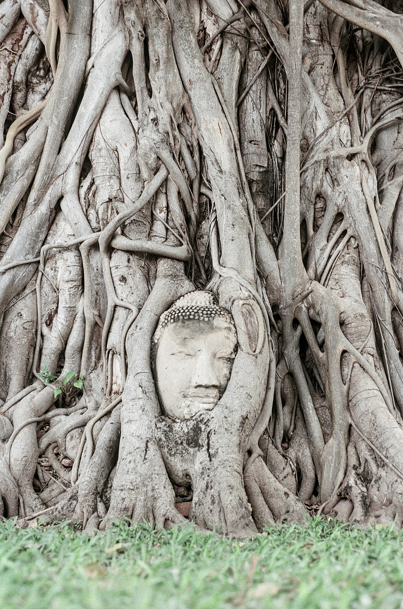
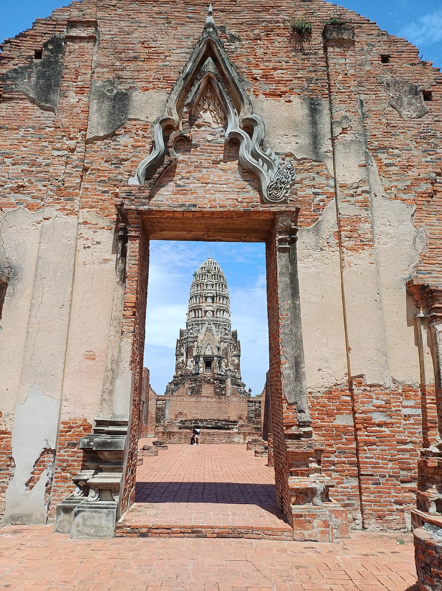
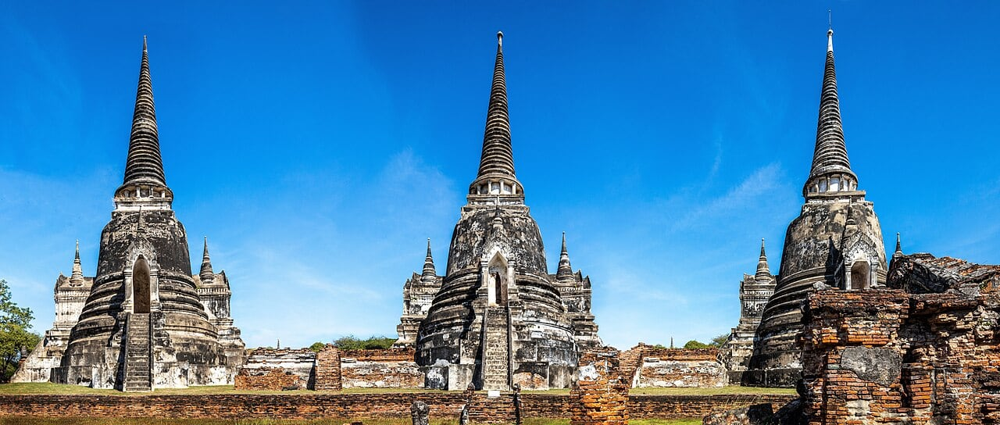

import { tpkDeep } from '../../data/affiliate.js';
export const guidedTour = tpkDeep('tripster', 'https://experience.tripster.ru/experience/51307/', 'tt_ayutthaya_iz_bangkoka');

Для первого знакомства с Аюттхаей хватит трёх остановок. Утром зайдите в Ват Махатхат и соседний Ват Ратчабурана, а после обеда доберитесь до Ват Чайваттханарам на другом берегу Чаупхраи. Если хочется увидеть ещё и остатки королевского дворца, добавьте Ват Пхра Си Санпхет между утренней прогулкой и переездом через реку. Получится четыре платные остановки. Именно с четырёх начинает окупаться общий билет при опубликованных тарифах.

Если хотите увидеть храмы на обоих берегах и предпочитаете готовый трансфер, сравните самостоятельный маршрут с <a href={guidedTour} target="_blank" rel="sponsored noopener">девятичасовой экскурсией из Бангкока</a> с обедом и входными билетами.

## Почему храмы стоят в разных частях города

Старая столица Сиама выросла на острове между тремя реками. Валы, каналы и дороги связывали дворец и монастыри, а часть храмов построили на соседних берегах. После разгрома города в 1767 году столицу перенесли. Сегодня по остаткам башен, дворов и стен можно прочитать план города. Поэтому лучше пройти один участок пешком, а на дальний берег переехать. Так день складывается в прогулку, а не в череду высадок у кассы. [Описание исторического города ЮНЕСКО](https://whc.unesco.org/en/list/576/)

## Маршрут по трём или четырём храмам

| Остановка | Что там искать | Когда идти |
|---|---|---|
| **Ват Махатхат** (Wat Mahathat) | Голова Будды среди корней дерева и остатки высокой храмовой башни, пранга | Утром, пока впереди весь день |
| **Ват Ратчабурана** (Wat Ratchaburana) | Высокий пранг даёт представление о том, как выглядели башни Аюттхаи. Сравните его с основанием в соседнем Махатхате | Сразу после Махатхата, между ними не нужен транспорт |
| **Ват Пхра Си Санпхет** (Wat Phra Si Sanphet) | Три башни-ступы на одной террасе и территория бывшего дворца | Если до обеда ещё есть время |
| **Ват Чайваттханарам** (Wat Chaiwatthanaram) | С другого берега виден весь ансамбль, где вокруг центральной башни стоят меньшие. На площадке хорошо читается симметрия плана | После обеда, с запасом на дорогу к вокзалу |

Если приехали поздно и хочется провести день пешком, оставайтесь в центре. Начните с пары Махатхат и Ратчабурана, затем дойдите до Пхра Си Санпхет. Если важнее увидеть Чайваттханарам, отправляйтесь туда после первых двух храмов. Вечернюю подсветку проверяйте отдельно. У парка бывают специальные программы, и их часы отличаются от обычных. [Карта и маршрут туристического управления Таиланда](https://www.tourismthailand.org/Articles/slow-lane-in-ayutthaya)

## Когда общий билет дешевле

В таблице тарифов из королевского вестника для иностранного посетителя указаны **80 бат за один объект** или **300 бат за семь объектов**. По курсу Банка России на 24 ноября это примерно 190 ₽ и 725 ₽. На трёх остановках отдельные билеты стоят 240 бат, примерно 580 ₽. На четырёх — 320 бат, примерно 775 ₽. Абонемент в этом случае экономит 20 бат. Число посещений важнее размера скидки. Покупать дополнительный билет ради пятого храма не требуется.

В абонемент входят четыре площадки из маршрута выше, а также Ват Пхра Рам, Ват Махейонг и Ват Куди Дао. За выставки, транспорт и площадки вне этого перечня считайте расходы отдельно. В 2026 году парк повторил тариф 80/300 в программе Сонгкрана. В особые дни проверяйте, какие кассы и площадки работают. [Тарифы в королевском вестнике](https://ratchakitcha.soc.go.th/documents/71714.pdf) · [Объявление парка о Сонгкране](https://www.finearts.go.th/main/result-search/63042) · [Карточка Ват Ратчабурана](https://www.tourismthailand.org/Attraction/วัดราชบูรณะ-2) · [Курсы Банка России на 24 ноября](https://www.cbr.ru/currency_base/daily/?UniDbQuery.Posted=True&UniDbQuery.To=24.11.2026)

## Как доехать и вернуться

В расписании тайской железной дороги выберите станцию **Ayutthaya**, затем проверьте вокзал отправления конкретного поезда. В Бангкоке встречаются Хуалампонг (Hua Lamphong) и Крунг Тхеп Апхиват (Krung Thep Aphiwat). Дорога к ним по городу разная. Запишите номер поезда и посмотрите обратный рейс до того, как добавлять дальний храм в план. [Расписание государственной железной дороги Таиланда](https://ttsview.railway.co.th/timetable_modern.php?ln=en)

Станция в Аюттхае находится у восточного берега, исторический центр — по другую сторону реки. Из района вокзала можно добраться через местную переправу, когда она работает, или по мосту на машине. От Чайваттханарама до станции заложите отдельную поездку. Покажите водителю название **Ayutthaya Railway Station** и оставьте запас до отправления. [Туристическая карта железнодорожного маршрута](https://api-tourismproduct.tourismthailand.org/uploads/2025/12/ebook/RR_MAP_for_Printing_2510/file/1f6aae17-abad-4c4f-80f6-825ced5b97d4.pdf?test=1)

## Когда удобнее экскурсия

Групповая поездка пригодится, если хочется за день увидеть храмы на обоих берегах, а переговоры с водителями и обратный билет добавляют лишних пересадок. В программе Tripster из Бангкока заявлены девять часов, русскоязычное сопровождение, трансфер, обед и входные билеты. Взрослый тариф в проверенной карточке — 91 доллар, около 7 500 ₽ по курсу Банка России на 24 ноября. Посмотрите, откуда забирает группа и куда возвращает. В этой программе начало у Lat Krabang, а обратный путь заканчивается на окраине Бангкока. Сравнивайте цену целой поездки, включая дорогу из отеля до места встречи. <a href={guidedTour} target="_blank" rel="sponsored noopener">Программа и условия экскурсии</a>

Если это единственный выезд из столицы, сильный короткий маршрут получается и без экскурсии. Центральная пара храмов отвечает на вопрос, каким был город, а поездка в Чайваттханарам показывает, зачем ему нужны были реки. [Путеводитель по Таиланду](/blog/thailand-guide-2026/)
