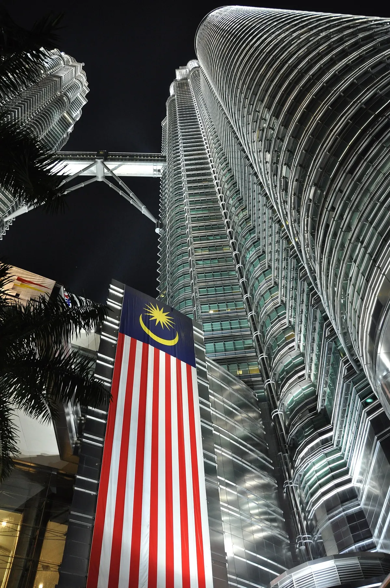
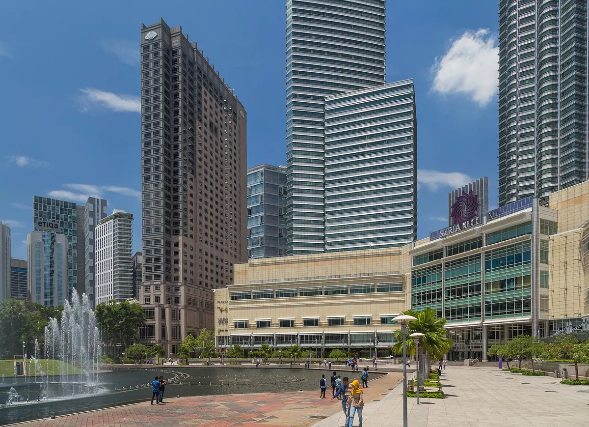
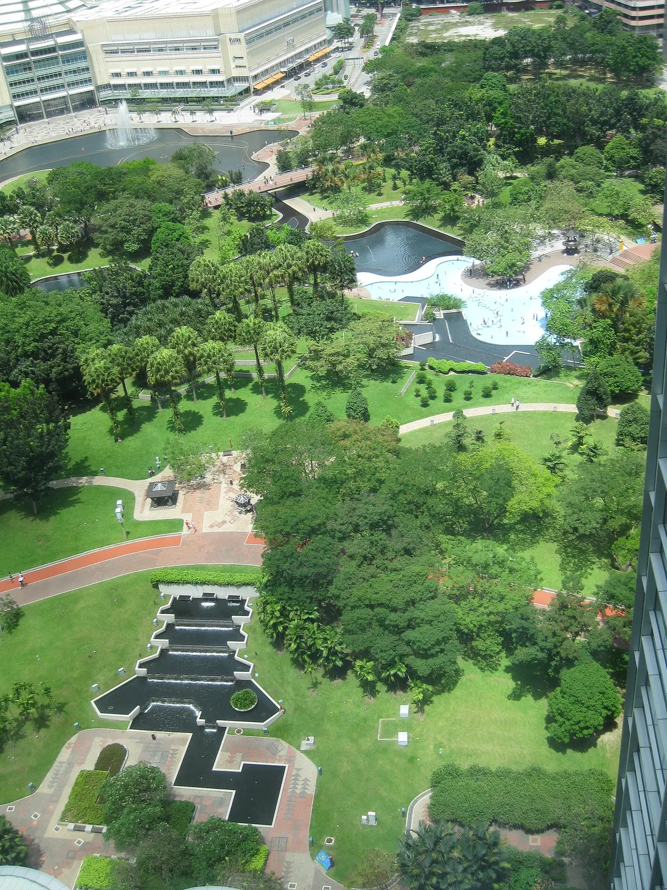
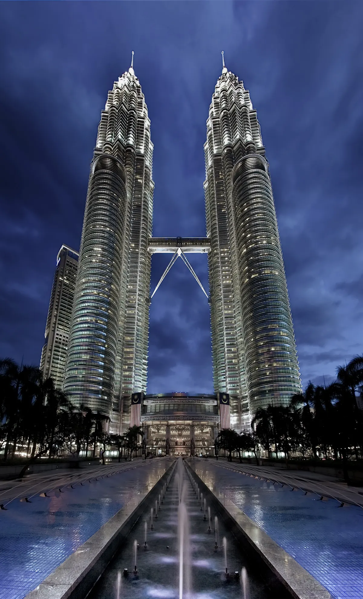

import { tpkDeep } from '../../data/affiliate.js';

## Стоит ли подниматься на Петронас

Петронас можно увидеть двумя способами, и они решают разные задачи. Из парка KLCC смотрят **на башни**: две светлые иглы, соединяющий их мост и отражения в воде. При подъёме смотрят **из башен**: на город, соседнюю башню и парк внизу. Полного силуэта обеих башен в собственном окне не будет.

Выберите бесплатную прогулку, если в Куала-Лумпуре только пересадка, облака закрывают верх зданий или вам важнее фотография снаружи. Подъём имеет смысл, когда хочется увидеть инженерное устройство комплекса и панораму с высоты. Это не замена прогулке вокруг: при свободном времени они дополняют друг друга.

| Что важно | Что выбрать | Что придётся учесть |
|---|---|---|
| Фотография обеих башен целиком | Парк KLCC и площадь у Suria | Ракурс придётся искать пешком; дождь меняет планы |
| Мост между башнями и высота | Официальный билет на подъём | Дата, слот и категория иностранца |
| Не разбираться с дорогой от отеля | Пакет с трансфером | Минимум участников, зона подачи и обратная дорога |
| Только короткий вечер в городе | Внешний осмотр | Не покупать подъём с неопределённым временем перед вылетом |

## Билет самостоятельно или с трансфером

На [сайте Петронас](https://www.petronastwintowers.com.my/plan-your-visit/admission-ticketing/) нужен **General Admission для иностранцев**, если у вас нет малайзийского права на местную категорию. Привлекательный тариф MyKad к обычному туристу не относится.

| Категория General Admission | Будний день | Выходной |
|---|---|---|
| Иностранный взрослый 13–60 лет | RM127 — около 2530 ₽ | RM137 — около 2730 ₽ |
| Ребёнок старше 2 до 12 лет | RM65 — около 1300 ₽ | RM69 — около 1370 ₽ |

Для ребёнка ровно двух лет заранее уточните возрастную категорию: формулировка оператора «above 2» не объясняет пограничный случай. Для старших посетителей и вечерней категории действуют отдельные тарифы. Вечерний взрослый билет иностранца указан как RM157 в будний день и RM167 в выходной — примерно 3130 и 3330 ₽. Выбирайте категорию в календаре, а не переносите дневную цену на любое время.

Если нужен забор из отеля, есть <a href={tpkDeep('tiqets', 'https://www.tiqets.com/en/kuala-lumpur-attractions-c74416/tickets-for-petronas-twin-towers-hotel-pick-up-skip-the-line-p991271/', 'petronas_transfer')} target="_blank" rel="sponsored noopener">билет Tiqets со Skybridge, 86-м этажом и трансфером</a>. Для 31 октября форма показывала 38,64 € за взрослого — около 3520 ₽, **минимум два участника**. Условия этого пакета не равны правилам официального билета.

Перед оплатой проверьте четыре вещи:

- **Время.** Продавец предупреждает, что фактическое посещение может оказаться в пределах двух часов от выбранного слота. Для дня с жёстким расписанием это существенная разница.
- **Отель.** Трансфер привязан к зоне обслуживания в центре, а не к любому адресу агломерации.
- **Возвращение.** Включён односторонний трансфер; в другом блоке продавца есть оговорка об обратной поездке для части заказов. Пока её не подтвердили именно для вашего отеля, планируйте обратный путь самостоятельно.
- **Отмена.** В прочитанной форме пакет невозвратный и без переноса. Российская карта и успешная оплата нами не проверялись.

Самостоятельный официальный билет удобнее для одного человека и точного времени. Пакет покупают ради организации, а не потому, что любой посредник автоматически дешевле кассы.

## Когда открыто: почему понедельник нужно проверять отдельно

По расписанию оператора со вторника по воскресенье и в государственные праздники башни работают **09:00–22:30**, последний вход — **21:30**. Обычный совет «в понедельник закрыто» устарел: второй, четвёртый и пятый понедельники месяца имеют часы **09:00–20:00**, последний вход **19:00**. Первый и третий понедельники закрыты, кроме предусмотренных оператором праздничных исключений.

На сайте есть календарь конкретных дат: он полезнее устаревшей строки в экскурсии. Например, закрытыми отмечены 2 и 16 ноября. Перед покупкой сверяйте именно свою дату. Историческое пятничное окно молитвы из старых описаний тоже не следует превращать в нынешний запрет: актуальная страница оператора сообщает о работе в пятницу.

На визит с получением билета и ориентацией внутри оставьте примерно полтора часа свободного времени. Это наш запас для планирования, а не обещание длительности экскурсии или отсутствия очереди. На прогулку по парку добавьте отдельные 40–60 минут.

## Как добраться и найти вход

Для поездки на общественном транспорте ориентир — **станция KLCC линии LRT Kelana Jaya**. На [странице оператора о дороге](https://www.petronastwintowers.com.my/plan-your-visit/getting-here/) перечислены варианты пересадки через KL Sentral. Выбирайте маршрут от своего отеля: KL Sentral нужен не каждому пассажиру.

Важно различать площадь для фотографий и вход на подъём. Стойка посещения находится на уровне **Concourse / Lower Ground** комплекса. Приехать к красивой стороне парка в последнюю минуту — ещё не значит оказаться у нужной стойки. В навигаторе ищите Petronas Twin Towers, затем внутри следуйте указателям посещения, а не витринам магазинов Suria KLCC.

На такси заранее уточните точку высадки и заложите время пройти внутрь. Заказывать обратную машину удобнее после прогулки, когда понятно, с какой стороны комплекса вы выходите. Стоимость городского такси здесь не фиксируем: она зависит от адреса, пробок и времени.

## Что смотреть наверху и вокруг

**Skybridge** — мост на уровне 41-го этажа, примерно в 170 метрах над землёй. Здесь интересны не только дальние виды: посмотрите, как пространство соединяет две отдельные башни и как меняется масштаб парка внизу. **Смотровая на 86-м этаже** — следующий уровень посещения; билет не означает свободную прогулку по всем этажам до самого шпиля.

Высота комплекса **452 метра** получилась не сразу: официальный рассказ о проекте описывает увеличение первоначального замысла с 427 метров за счёт верхней части и шпилей с повторной проверкой ветровых нагрузок. На фотографии верх выглядит как украшение, но это часть инженерной задачи. Такой взгляд делает остановку интереснее простого соревнования высот.

Не рассчитывайте на идеальные фотографии через стекло при любой погоде. Облака могут закрыть дальний горизонт, а отражения помещения попасть в кадр. Перед невозвратной покупкой посмотрите прогноз и решите, готовы ли вы платить за сам подъём, даже если панорама окажется частично закрытой.

Внизу пройдите в парк, посмотрите на комплекс с разных расстояний и оставьте время отдохнуть. Для внешнего осмотра нет необходимости покупать пакет с башнями, автобусом и несколькими достопримечательностями сразу. Расписание фонтанного шоу лучше уточнять на месте: вечерняя подсветка здания сама по себе не гарантирует конкретное представление в назначенную минуту.

## Как встроить башни в день

При самостоятельном билете выберите слот, затем стройте вокруг него прогулку. Если подъём утром, парк можно оставить на вторую половину дня и вернуться ради другого света. Если слот вечером, осмотрите парк до входа, чтобы не искать впервые нужную сторону комплекса после темноты.

С пакетом, где возможен сдвиг времени, оставьте свободным весь соответствующий отрезок дня. Не ставьте сразу после него междугородний автобус, аэропорт или другой невозвратный билет. Для короткой пересадки безопаснее по расписанию ограничиться внешним видом и самостоятельно следить за дорогой обратно.

Для дальнейшей поездки сравните [сезоны и направления Малайзии](/malaysia/). Петронас — удобная городская остановка, но выбор месяца для островов требует отдельного решения: погода у башен не описывает всё побережье страны.
