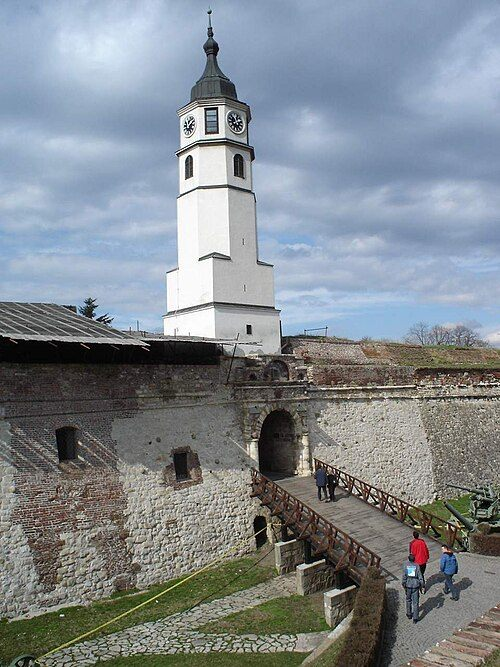
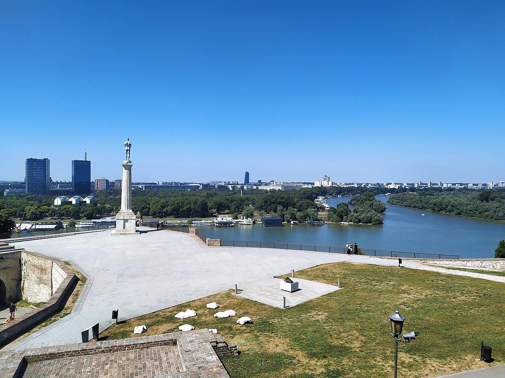
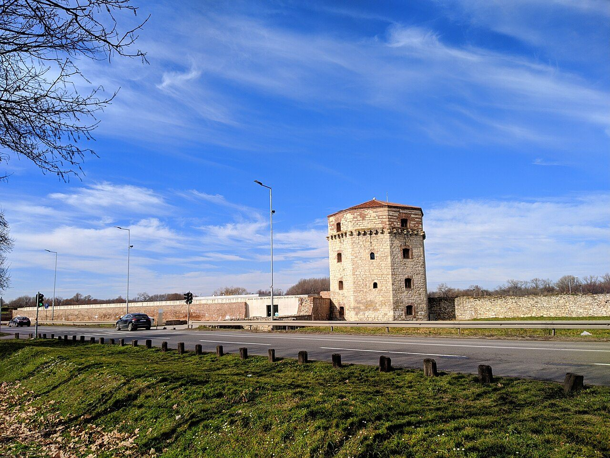

import { tpkDeep } from '../../data/affiliate.js';
export const guidedTour = tpkDeep('sputnik8', 'https://www.sputnik8.com/ru/belgrad/activities/48196-belgrad-s-aromatom-istorii', 'tt_belgradskaya_krepost');

Если в Белграде есть час, пройдите от улицы Кнез-Михайлова через парк Калемегдан в Верхний город и к памятнику «Победник». Оттуда видно, как Сава впадает в Дунай. За прогулку по парку и открытой части крепости платить не нужно. Нижний город имеет смысл добавить, когда есть время на спуск к реке и отдельный выход к набережной.

Начать прогулку можно на площади Республики. Тот же путь через старый центр к крепости входит в <a href={guidedTour} target="_blank" rel="sponsored noopener">двухчасовую экскурсию по Белграду</a>. Гид входит в цену, входы в музеи и подземелья в программе не заявлены.

## С чего начать у крепости

Калемегданом называют парк перед укреплениями, а сама крепость занимает верхнее плато и склон до Дуная. Эта разница помогает ориентироваться на месте. Если идти от площади Республики по пешеходной Кнез-Михайловой, сначала окажетесь среди аллей и скамеек. Каменные ворота в глубине парка ведут внутрь укреплений. В навигаторе для первого отрезка ищите **Knez Mihailova**, для смотровой — **Pobednik**. Не выбирайте башню Небойша первой точкой: она стоит внизу, и маршрут к ней ведёт к реке.

Парк хорош и сам по себе. Тем, кто пришёл на короткую прогулку с ребёнком или хочет увидеть город без подъёмов между двумя уровнями, можно начать с Савского променада в парке (Savsko šetalište). Крепость при этом останется рядом. Если интересуют стены, ров и ворота, переходите через Стамбольские ворота к Сахат-капии. У белой башни над аркой видно, как дорога проходит через несколько рубежей укреплений. Рядом с Военным музеем во дворе и рву стоят крупные экспонаты. Для постоянной экспозиции внутри нужен отдельный билет.

## Маршрут на час и продолжение к Дунаю

Начните у входа с Кнез-Михайловой. От аллей парка идите к Стамбольским воротам, затем через ворота Сахат на открытое плато Верхнего города. Конечная точка короткой прогулки — памятник Победнику у края возвышенности. Вдоль стены посмотрите в сторону острова Велико-Ратно. Выше по Саве стоят мосты, а широкое русло за островом — Дунай. По этой панораме понятнее, почему укрепления появились именно на этом выступе.

Время в таблице — ориентир по карте крепости с остановками на смотровых.

| Если у вас есть | Куда идти | Где закончить |
|---|---|---|
| Около часа | Парк, Стамбольские ворота, Сахат, вид от Победника | Вернуться к Кнез-Михайловой. Внутренние экспозиции пропустить |
| Два часа | Верхний город и спуск через Деспотовы и Зинданские ворота к Ружице | Выйти через Нижний город в сторону бульвара Воеводы Бойовича |
| Полдня | Верхний город, Военный музей **или** церковь Ружица и башня Небойша | Оставить запас на экспозицию и подъём обратно, если захотите вернуться в центр |

Спуск добавляет ступени, неровный камень и обратный набор высоты, если возвращаться тем же путём. После дождя или в гололёд можно оставить Нижний город на другой день. С коляской и при ограниченной подвижности для начала выбирайте аллеи парка со стороны центра. У ворот и на внутренних дорожках встречаются пороги и брусчатка. Сквозной маршрут к башне без ступеней здесь не обещаем. Перед посещением можно открыть [карту комплекса](https://www.beogradskatvrdjava.co.rs/инфо/интерактивна-мапа/?lang=la) и посмотреть, где хотите закончить прогулку.

По дороге вниз у Ружицы и часовни Святой Петки меняется характер места. С открытого плато попадаете в тесный проход под стенами. Если церковь открыта и нет службы, загляните внутрь. Люстры в сводчатом зале собраны из деталей военного происхождения. Если вход закрыт, по внешнему виду церкви и соседних стен всё равно понятно, как постройки втиснуты в склон крепости. Башня Небойша стоит дальше, на нижнем уровне у бульвара. До неё не нужно спускаться ради того же вида, который открывается сверху. Сюда стоит идти, если хочется увидеть укрепление с уровня реки или попасть внутрь башни.

## Какие часы и билеты проверить зимой

У парка, ворот и экспозиций разные правила. С 3 июня 2026 года четыре входа в Верхний город — Сахат, Королевские, Дефтердаровы и Деспотовы ворота — закрываются с **00:30 до 04:30**. Калемегдан и Нижний город в это время остаются открытыми. Если собираетесь только к закату, закрытие этих ворот вам не помешает. Если нужна экспозиция, порядок лучше поменять. Сначала сходите в музей или башню, потом выходите к реке и на смотровую.

- **Башня Небойша.** С октября по март — со среды по воскресенье, 10:00–17:00. Взрослый билет — 270 динаров, около 210 ₽. Льготный тариф для учащихся, студентов и пенсионеров — 150 динаров, около 115 ₽. Уточните документ для льготы.
- **Галерея у Сахат-капии.** В холодный период открыта со вторника по воскресенье с 10:00 до 17:00. Вход бесплатный. Вход в галерею не означает доступ на саму башню.
- **Римский колодец и казематы.** С 1 ноября по 31 марта администрация указывает предварительное согласование организованных посещений. Не рассчитывайте на обычную кассу во время вечерней прогулки. Военный бункер и Большой пороховой склад принимают организованные посещения по записи круглый год.
- **Военный музей.** У него своя касса. Постоянная экспозиция принимает со вторника по воскресенье с 10:00 до 17:00, последние билеты продают в 16:00. Взрослый билет стоит 350 динаров, около 270 ₽. 1, 2 и 7 января музей закрыт. Если вы пришли после 16:00, оставьте музей на другой день и идите к Победнику.

Два примера бюджета. Если гуляете по открытому парку и Верхнему городу, входы обойдутся в **0 динаров**. Если вдвоём спустились и оба берёте обычный билет в башню Небойша, заплатите **540 динаров**, около 410 ₽. Часы и порядок записи лучше открывать в [сербской версии сайта крепости](https://www.beogradskatvrdjava.co.rs/инфо/). Отдельно проверьте [расписание Военного музея](https://www.muzej.mod.gov.rs/eng/269/informacije-za-posetioce-269).

## Когда идти с гидом

Для вида на реки и прогулки по стенам удобно прийти самостоятельно. Можно менять маршрут на месте, задержаться в парке и уйти в центр тем же путём. Если хотите связать историю крепости со старым Белградом, выберите прогулку от площади Республики. На ней гид ведёт через центральные улицы к крепости и Калемегдану. На двоих по показанному тарифу получится **130 € за группу**, около 11 700 ₽. За эту сумму проводят двухчасовую прогулку с гидом. Вариант для группы большего размера и язык уточняйте при выборе даты. Если для вас важен конкретный зал или подземелье, сначала проверьте, можно ли его посетить отдельно. <a href={guidedTour} target="_blank" rel="sponsored noopener">Посмотреть программу и даты экскурсии</a>

Если после крепости остаётся время на город, вернитесь через парк на пешеходную улицу. Если хочется продолжить путь вдоль воды и не подниматься снова, планируйте выход с нижнего уровня. Для поездки по стране есть [путеводитель по Сербии](/serbia/) и [советы для зимней поездки в Сербию](/trips/december/serbia/).
