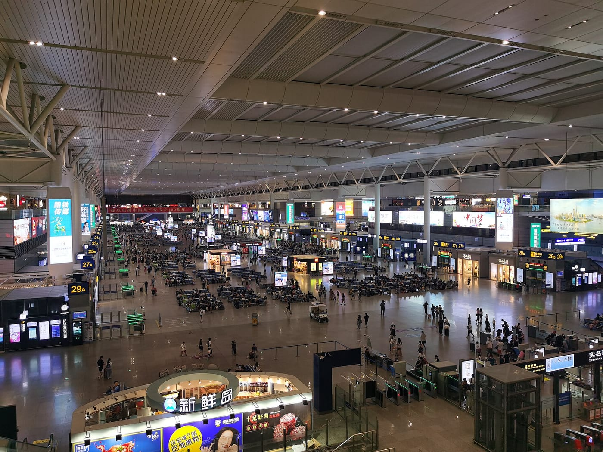
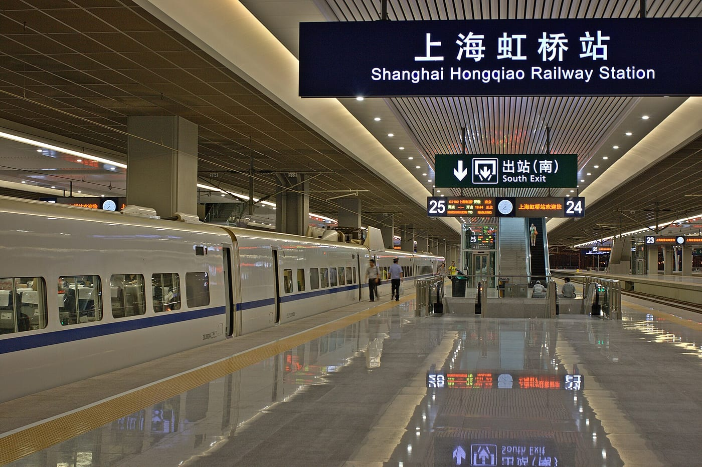
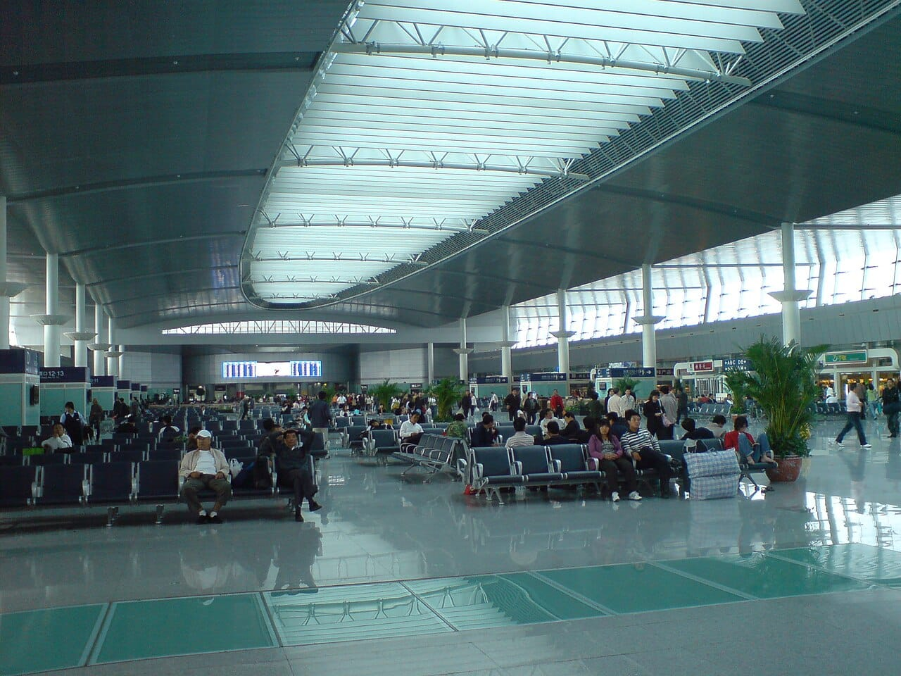
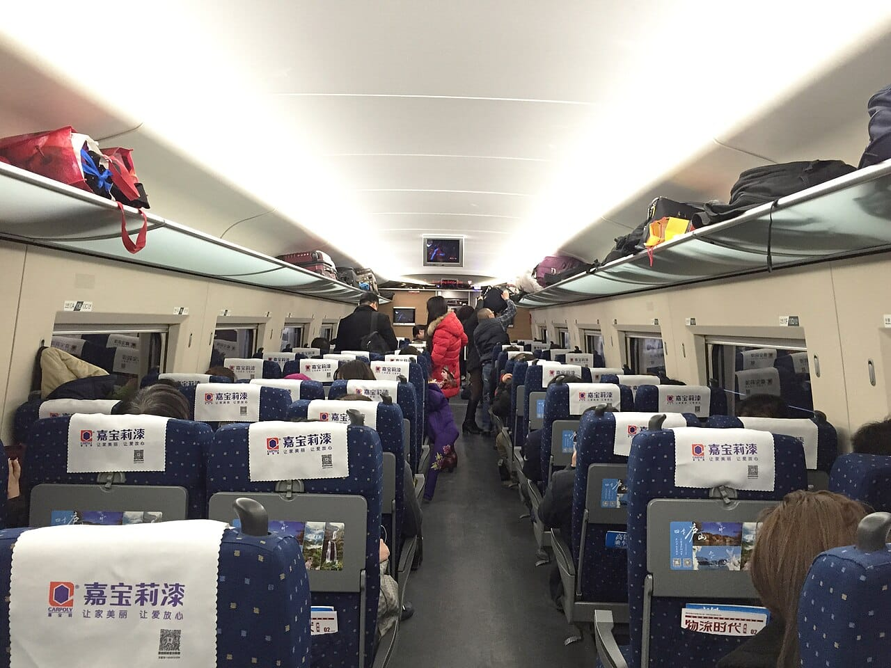
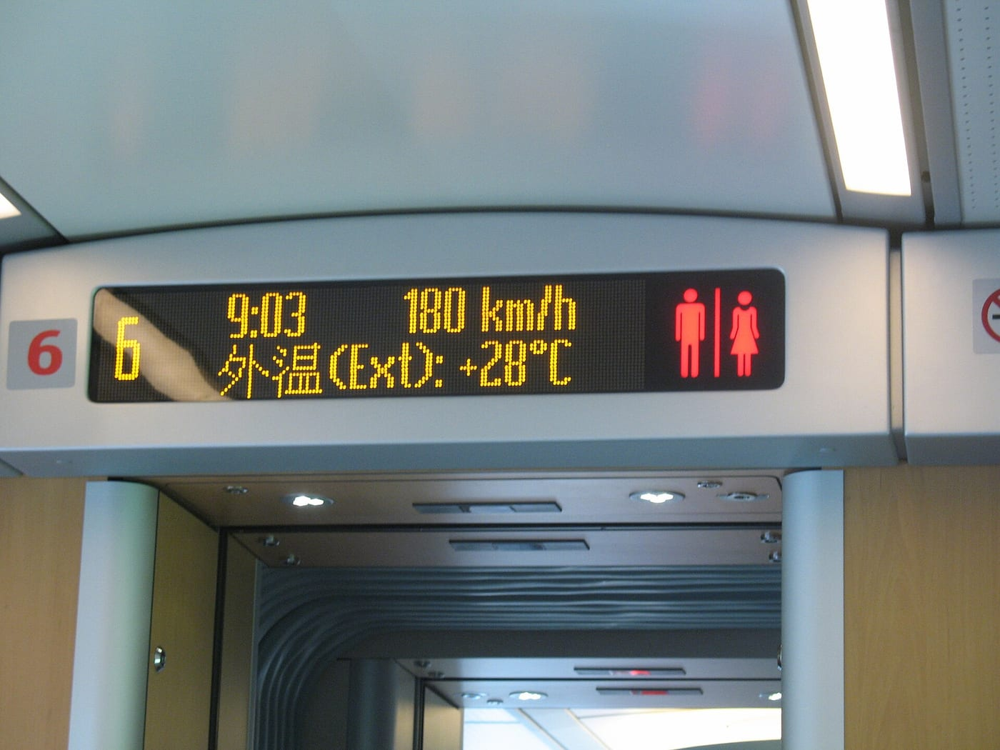

**Билет на поезд в Китае можно купить через официальный сайт или приложение 12306, в железнодорожной кассе либо у посредника.** Иностранному пассажиру нужен действующий загранпаспорт. Для электронного билета сохраните сведения о поездке, а на вокзал возьмите тот же оригинал документа, по которому оформлена покупка.

Главная ошибка — считать оплату последним шагом. Деньги могут списаться, пока заказ ещё не завершён. Нужен подтверждённый билет на правильные дату, поезд и станции. Ни банковское уведомление, ни заявка на будущую покупку сами по себе права на посадку не дают.

Ниже — инструкция для поездов **внутри Китая**. Она не описывает поезд из России, пересечение границы или разрешение на въезд. Гонконг и международные маршруты могут иметь дополнительные условия: переносить на них все советы автоматически не стоит.

## Где покупать: 12306, касса или посредник?

Выбирайте способ по тому, что сможете довести до конца: проверка пассажира, доступная оплата, получение билета и помощь при изменении планов. Удобный русский интерфейс решает только одну из этих задач.

| Способ | Когда подходит | Что проверить до покупки |
|---|---|---|
| Сайт или приложение 12306 | Хотите оформить билет напрямую у железной дороги и готовы разобраться с аккаунтом | Статус проверки паспорта и доступный вашему платёжному средству способ оплаты |
| Касса на вокзале | Находитесь в Китае; онлайн-проверка или оплата не получается | Наличие мест, часы нужной кассы, оригинал паспорта и возможность оплатить на месте |
| Посредник | Нужны другой интерфейс или поддержка продавца | Полную стоимость, момент выпуска билета, сборы, порядок изменения и возврата |

Если у вас только российская карта, сначала выясните платёжный путь у выбранного продавца. Логотип Visa, Mastercard или UnionPay на странице не доказывает приём карты конкретного банка. В этой инструкции оплата российской картой не проверялась; обещания, что любой способ обязательно сработает, здесь нет.

Для первой поездки полезно заранее разделить транспортные задачи. Поезд между городами, метро до вокзала и трансфер из аэропорта — отдельные участки. Если прилетаете со стыковкой, сначала проверьте [пересадку в Шанхае](/blog/peresadka-v-shankhae/) или [пересадку в Пекине](/blog/peresadka-v-pekine/), затем выбирайте железнодорожное отправление.

Для отдельного дня в Пекине есть [обзор Мутяньюй: дорога из города и выбор подъёмника](/blog/mutyanyuy/). Поездку к стене планируйте отдельно от железнодорожного переезда.

## Что подготовить: паспорт и точные станции

Укажите имя и данные документа так, как требует форма продавца и ваш паспорт. Не подставляйте кириллицу в поле для латинского имени и не используйте случайное сокращение, чтобы пройти ограничение длины: при проблеме лучше получить инструкцию поддержки до оплаты. Проверьте также тип документа, его номер и пассажира, к которому относится билет.

[Английская версия 12306](https://www.12306.cn/en/index.html) принимает действующие иностранные паспорта. Проверка личности в аккаунте — самостоятельная процедура. Не откладывайте её до последних минут перед отправлением и не рассчитывайте, что подтверждение придёт за заранее обещанное число часов: универсальный срок здесь не установлен.

Затем проверьте вокзал. **Shanghai Hongqiao и Shanghai Railway Station — разные места**, хотя оба находятся в Шанхае. В официальной [инструкции города](https://russian.shanghai.gov.cn/ru-Transportation/20250318/cd17109254c94d9d86a46c99cdf639a3.html) перечислены также Shanghai South и Shanghai West. Название города в поиске билетов ещё не определяет, куда ехать на посадку.

Сохраните полное название станции латиницей и иероглифами из подтверждённого заказа. Сверяйте с ним адрес в карте, табло и нужную линию метро. Не просите таксиста отвезти вас на «главный вокзал»: такое описание не определяет станцию отправления.

## Как купить билет через 12306

Официальный адрес — **12306.cn**, приложение называется **Railway 12306**. Ссылки на нужный сайт есть в инструкции China Railway; случайная страница с похожим названием может оказаться другим продавцом. Английский интерфейс помогает с покупкой, но не отменяет проверки паспорта и условий билета.

1. Зарегистрируйтесь или войдите в аккаунт и проверьте данные пассажира. Если покупаете другому человеку, добавьте именно его действующий документ.
2. Введите станцию отправления, станцию назначения и дату. В результате снова проверьте станции: выбор города может показывать несколько вокзалов.
3. Сопоставьте поезда по времени, длительности и классу. Не выбирайте только по первой цене, если она относится к другому времени или варианту размещения.
4. Перед подтверждением перечитайте пассажира, маршрут и дату. Данные ошибки дешевле исправлять до покупки.
5. Оплатите заказ способом, который доступен в вашей форме, в отведённое ею время.
6. Вернитесь в список заказов и убедитесь, что покупка успешна. Сохраните номер поезда, сведения о месте и статус билета.

Если нужная дата не показывается, это ещё не доказательство, что все места проданы. В [официальной инструкции на 2026 год](https://english.shanghai.gov.cn/en-LatestNews/20260119/50214166c9ec4d9492a780526c3a0268.html) указан горизонт продажи до 15 дней до отправления; доступный календарь конкретного рейса проверяйте в 12306. Поезд может быть вне доступного периода продажи или его расписание может корректироваться. Проверяйте объявление и доступные даты в самой системе. Заявку посреднику на покупку после открытия продаж не принимайте за выпущенный билет.

При выборе места смотрите именно доступную категорию своего поезда. Не переносите фотографии одного состава на другой: расположение кресел и набор классов различаются. Отдельно проверьте, что приобретается место, а не иной вариант проезда, который вы не собирались выбирать.

## Деньги списались: как понять, что билет куплен?

У 12306 есть прямое правило: результат покупки, изменения и возврата определяется **состоянием заказа**. Письмо или уведомление помогает его найти, но при расхождении надо открыть заказ и уточнить результат у сервиса.

Неоплаченный заказ нужно оплатить в срок, который показан на экране. По [инструкции онлайн-оплаты](https://kyfw.12306.cn/otn/gonggao/onlinePay.html), нельзя оставить место в интернет-заказе и затем прийти заплатить за него в кассу. Если срок закончился, место освобождается для других пассажиров. Кассовая покупка будет отдельным оформлением с проверкой наличия мест.

Если платёж прервался, сначала проверьте два места: банковскую операцию и статус заказа. Повторное нажатие без этой проверки может создать ещё одно списание. При успешном списании без билета обращайтесь в поддержку 12306; официальный FAQ отдельно описывает такую ситуацию. Не рассчитывайте на посадку по банковскому чеку и не закладывайте непроверенный срок возврата денег.

У посредника принцип тот же, но обращаться нужно по его заказу. Заранее найдите, где написано «билет оформлен» и где видны данные поездки. Статусы «получили заявку», «ждём открытия продаж» и «ищем место» означают незавершённую покупку, в том числе после списания денег. Названия статусов у продавцов различаются — важен их смысл.

Полезно сохранить подтверждение офлайн. На вокзале связь может оказаться неудобной именно тогда, когда нужно показать номер заказа или найти вход. Сохранённые сведения облегчают разговор с сотрудником, но не заменяют оригинал паспорта.

## Что проверить у посредника и в кассе

При покупке через сервис вроде Trip.com сравнивайте **один и тот же поезд и класс**, а не только города. К железнодорожной цене могут добавляться сбор продавца и выбранные дополнительные услуги. Окончательная сумма перед оплатой важнее цены в поисковой карточке. Общие принципы сервиса разобраны в [обзоре Trip.com](/blog/trip-com-2026/); это не подтверждение оплаты конкретного железнодорожного заказа.

До покупки ответьте на четыре вопроса: кто выпускает билет, кто помогает при ошибке в паспорте, где подаётся возврат и какие сборы сохраняются при отмене. Если ответ скрыт за общим обещанием «поддержка 24/7», попросите условия именно выбранной услуги. Не предполагайте, что касса железной дороги исправит финансовый спор со сторонним продавцом: [China Railway](https://www.12306.cn/en/faq.html) разделяет официальную продажу и проблемы других сайтов.

Если вы находитесь в Китае и купить билет онлайн не получается, обращайтесь в билетную кассу с паспортом. Подготовьте дату, обе станции, номер желаемого поезда и класс. Можно показать сотруднику запись из поиска; это удобнее устного произношения незнакомых названий. Пока билет не оформлен, наличие места не гарантировано.

Для оплаты на месте подготовьте подходящий способ, в том числе наличные юани, и уточните его в кассе. Поездка к кассе не должна строиться на предположении, что любая иностранная карта пройдёт. Автомат тоже не гарантирует решение: набор принимаемых документов и способов оплаты проверяйте на самом устройстве, а при отказе обращайтесь к сотруднику.

## Посадка: паспорт, вокзал и запас времени

Электронный билет не требует обязательного получения бумажного аналога. По официальным правилам на входе и при посадке используют действующий документ, по которому куплен билет. Сохраните его до конца поездки: проверка бывает и при выходе со станции.

Если автоматический турникет не читает иностранный паспорт, найдите проход с сотрудником. Не идите следом за другим пассажиром и не считайте отсутствие срабатывания доказательством, что билет недействителен. Нужна проверка документа и заказа установленным способом.

Вокзал включает несколько этапов: вход, досмотр, проверку личности и проход к платформе. Время отправления на билете — время поезда, а не рекомендуемый момент прибытия к дверям здания. China Railway предупреждает, что контроль и продажа прекращаются заранее; точное время смотрите в объявлении своей станции. Единого гарантированного запаса на все вокзалы нет.

Для первой поездки оставьте дополнительное время на незнакомую станцию и ручную проверку паспорта. Если едете с детьми или большим багажом, учитывайте и этот путь. Для стыковки после самолёта считайте весь маршрут от прилёта до вокзала, включая пограничные процедуры и возможную задержку, а не только минуты в метро.

## Ошибка, смена планов и возврат

Ошибка в имени после покупки не исправляется как обычное редактирование профиля. [Правила 12306](https://kyfw.12306.cn/otn/gonggao/buyTicket.html) говорят, что имя в купленном билете изменить нельзя. При неверных данных пассажира может потребоваться возврат и новая покупка с предусмотренным сбором; новое место при этом не гарантировано. Сначала уточните порядок у продавца, особенно если до отправления мало времени.

Изменение даты или поезда — другая операция. Она зависит от наличия мест и условий обмена. Не отменяйте первый билет вслепую, если рассчитываете сразу получить другой на популярное отправление: сначала проверьте доступный вариант и правила операции.

Возврат также зависит от времени до отправления, истории изменений и способа покупки. В [английском FAQ](https://www.12306.cn/en/faq.html?item=1) есть отдельные правила для электронных билетов, оплаты наличными и ранее напечатанных документов. Сбор посредника нужно проверять дополнительно: железнодорожный тариф возврата не описывает автоматически все его услуги.

Подавайте запрос через правильный заказ и сохраняйте подтверждение результата. Для оплаты, возврата и поступления денег есть разные состояния; слово «отменён» не подтверждает зачисления возврата на счёт. Если план меняется в последний момент, обращайтесь в поддержку или нужную кассу сразу, не дожидаясь отправления поезда.

## Перед выездом на вокзал

Проверьте в одном месте пассажира и номер паспорта, дату, точные станции, поезд, класс и состояние билета. Убедитесь, что знаете свой вокзал и способ доехать до него, а подтверждение и контакт продавца доступны без поиска по всей почте. Возьмите оригинал того же паспорта.

Для более длинной поездки сначала выберите [месяц и регионы Китая](/blog/china-guide-2026/), затем соединяйте города конкретными поездами. На [странице Китая](/china/) собраны связанные материалы. Хороший маршрут не требует покупать все билеты одним махом: он требует понимать, какой участок подтверждён и что вы будете делать, если следующий ещё не оформлен.
