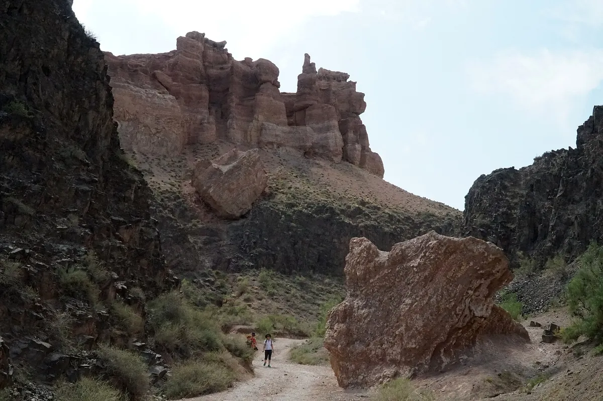
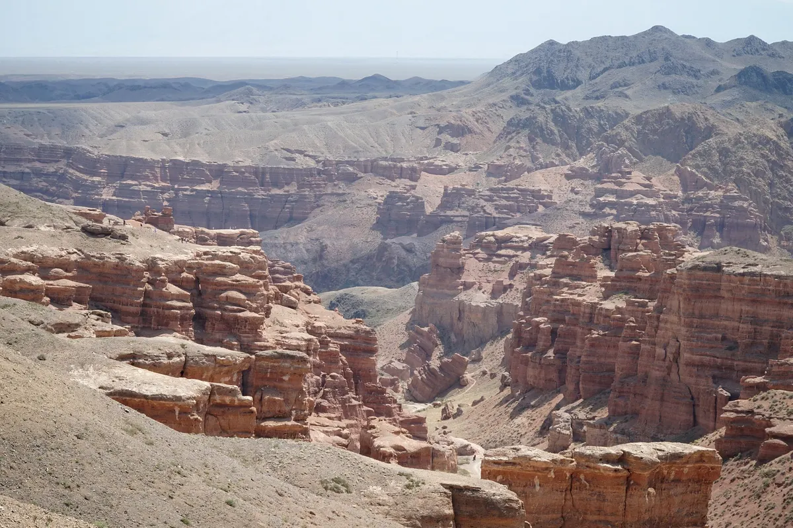
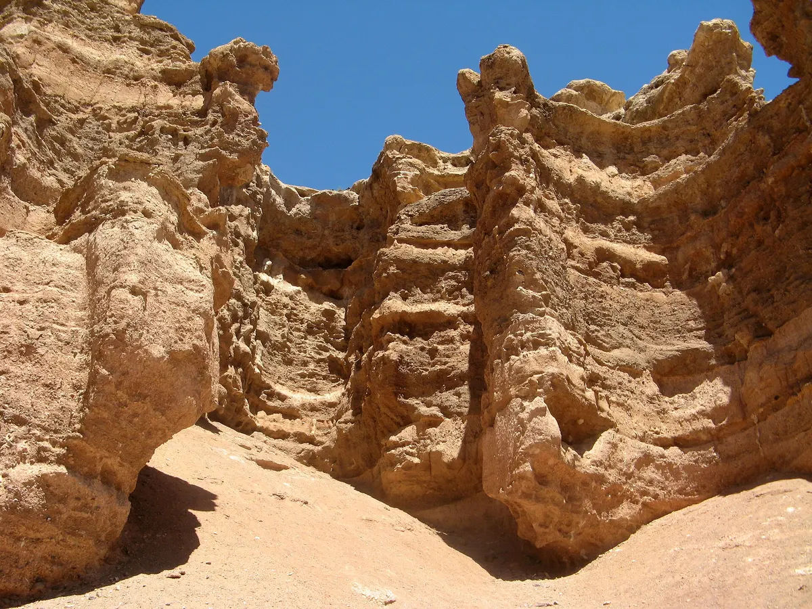
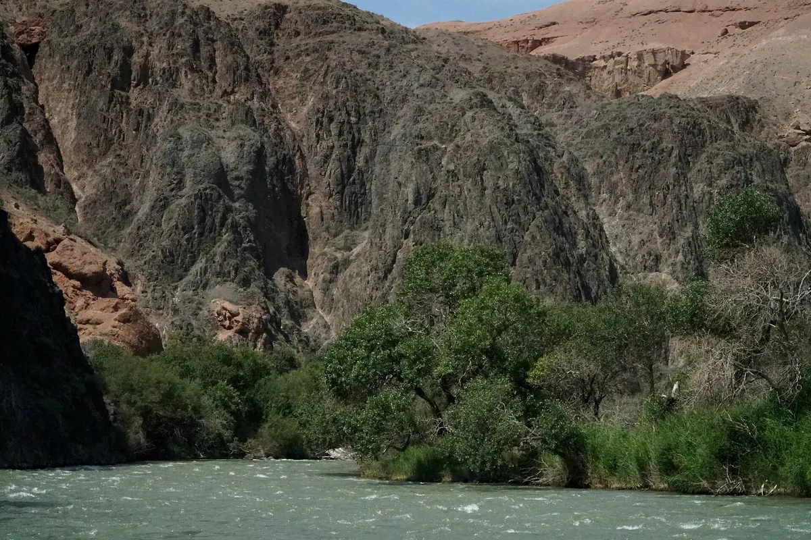

import { tpkDeep } from '../../data/affiliate.js';

## Какую часть каньона выбрать впервые

Для первого дня из Алматы удобная цель — **Долина замков**: здесь можно посмотреть на скальные стены сверху и, если позволяет состояние и погода, спуститься между ними к реке. Национальный парк Чарын гораздо больше этой прогулки. Ясеневая роща и Темирлик — другие маршруты, а не соседние остановки, которые обязательно удастся добавить после обеда.

Красные и охристые стены работают на двух масштабах. Сверху видна форма долины, изгибы и слои породы. Внизу отдельные выступы превращаются в башни и тесные проходы. Поэтому полезнее выбрать время для обоих ракурсов, чем объехать несколько смотровых ради похожих общих фотографий.

| Вариант | Кому подходит | Что запланировать |
|---|---|---|
| Верхние виды без длинного спуска | Небольшой запас сил, короткая прогулка | Безопасная площадка, ветер и защита от солнца |
| Долина с выходом к реке | Готовы идти и подниматься обратно | Несколько часов на месте, вода и запас до отъезда |
| Чарын и озёра | Есть отдельные дни | Самостоятельный многодневный маршрут, а не обязательная добавка к прогулке |

Планируйте по самому медленному участнику. Вид сверху — осмысленный вариант посещения, если долгий обратный подъём вам не подходит. Спускать человека вниз с обещанием «обратно наверняка подвезут» не стоит.

## Самостоятельная дорога или экскурсия

На машине ищите **въезд к Долине замков**, а не любой адрес, подписанный названием национального парка. На [сайте парка](https://charyn-park.kz/ru/o-parke/) указан административный адрес в Чундже, улица Кыдырбаева, 4. Приехать в офис — не то же самое, что оказаться у начала прогулки. Проверьте конечную точку маршрута до выезда из Алматы и сохраните её офлайн.

Обычную легковую машину оставляют у разрешённого места наверху. Парк сообщает, что **проезд частных автомобилей вниз запрещён с 2019 года**. Наличие внедорожника не отменяет это правило. На месте бывают дополнительные перевозки, но их сегодняшнюю работу и тариф нужно выяснять отдельно: свою способность вернуться пешком лучше оценить заранее.

Если машины нет, можно выбрать <a href={tpkDeep('sputnik8', 'https://www.sputnik8.com/ru/almaty/activities/67521-charynskiy-kanon-v-kazahstane-iz-almaty', 'charyn_day_almaty')} target="_blank" rel="sponsored noopener">индивидуальный выезд в Чарын из Алматы на Sputnik8</a>. Программа рассчитана на **12 часов**, в форме были старты в 07:00 на 24–26 октября. В неё входят городской трансфер от отеля и водитель-гид; подробная лекционная экскурсия этим составом не обещается.

Цена зависит от числа гостей: **115 000 тенге для одного человека** — около **20 800 ₽**; **120 000 тенге за группу из 2–4 человек** — примерно **21 700 ₽**. Первый тариф нельзя делить на четверых: у группы другая цена.

Обед и экологический сбор оплачиваются отдельно. **3000 тенге с человека** — около **540 ₽** — это дополнительный расход, указанный данным продавцом, а не подтверждённый нами единый тариф кассы парка. Для четырёх взрослых расчёт по этому предложению: 120 000 + 4 × 3000 = **132 000 тенге**, примерно **23 870 ₽**, без еды и личных расходов.

В описании и плашке бронирования расходятся условия предоплаты. До оплаты уточните у продавца окончательную сумму, порядок внесения денег, точку подачи и что будет при закрытии маршрута. Факт наличия формы не доказывает возможность оплатить её российской картой.

## Сколько оставить времени

Это загородный день с существенной дорогой в обе стороны. В выбранной программе выезд в 07:00, прибытие к каньону около 10:00 и возвращение в Алматы около 18:00–18:30. **Три часа на одну дорогу — ориентир этого расписания**, а не наша измеренная скорость на вашей машине. Погода, место отеля и остановки меняют время.

Для самостоятельного дня используйте ту же логику: ранний выезд, несколько часов в каньоне и заранее выбранное время начала обратной дороги. Внизу не стоит проводить весь запас так, будто подъём состоялся. Отдельно оставьте время на отдых, туалет, воду и обед.

В маршрутных описаниях встречается ориентир **около трёх километров в одну сторону** по Долине замков. Это вторичный планировочный ориентир, не наш трек и не подтверждённая длина официального паспорта маршрута. Для решения о нагрузке важнее учесть ходьбу в обе стороны, рельеф, остановки и температуру, чем обещать себе ровно час по любой дорожке.

## Входной сбор: что известно и что уточнить

Точный действующий тариф для самостоятельного визита подтвердить не удалось. На официальной странице есть старое описание компонентов оплаты, а доступный через неё документ с тарифами не открылся. Переносить число из старого отзыва в сегодняшний бюджет было бы ненадёжно.

Практическое решение — **попросить парк рассчитать платёж для вашего состава до поездки**: число взрослых и детей, машина, конкретный маршрут и дополнительные перевозки. На сайте парка описана оплата через Kaspi и Halyk с расчётом сотрудником. Это не подтверждение, что иностранная банковская карта сработает на месте: способ оплаты заранее согласуйте с парком или организатором.

Возьмите удостоверяющий документ: парк указывает это в правилах посещения. Не переводите сумму по реквизитам из случайного комментария. Если едете с организатором, получите объяснение дополнительного сбора в переписке и отличайте его от цены самой поездки.

## Прогулка сверху и спуск к реке

Сначала осмотритесь наверху, определите начало разрешённого спуска и оцените погоду. Рядом с краем не нужно искать «ещё чуть лучше» ракурс: рыхлая кромка и порыв ветра важнее расстояния до красивой башни в кадре. С детьми заранее договоритесь, где можно останавливаться и фотографировать.

Внизу идите не только к конечной точке. Ищите различия в стенах: полосы осадочных пород, узкие ответвления, отдельно стоящие останцы. Название «замки» понятно именно отсюда, когда человеческий масштаб рядом со скалой делает её похожей на стену или башню. Это удобная прогулка для внимательного разглядывания, если не пытаться пройти её на скорость.

Выход к реке — место передохнуть, затем повернуть обратно. Не делайте купание обязательной частью программы: подход к воде не означает оборудованного пляжа или безопасного течения. Для ребёнка берег требует отдельного внимания, даже если сама тропа до него не показалась сложной.

Назначьте время разворота до спуска. Если на середине пути стало тяжело, разворачивайтесь раньше: у прогулки нет обязанности закончиться у определённого камня. Обещание последней машины не заменяет запас сил, особенно если её места, расписание и работа в этот день не подтверждены.

## Что взять и когда сократить план

Нужны обувь с хорошим сцеплением, закрывающая голову защита от солнца, вода, небольшой перекус и слой от ветра. Не стройте расчёт воды вокруг одного стакана в кафе у конечной точки: место может не работать, а ваша прогулка — занять дольше. Количество выбирайте по температуре и собственной нагрузке, с запасом на задержку.

Парк описывает маршруты как круглогодичные, но это не обещание одинаковой проходимости зимой, летом и после осадков. При жаре длинный нижний маршрут разумно сократить; при скользком покрытии отказаться от спуска; при ограничениях парка принять их, а не искать объезд. Людям, которым трудно подниматься по неровной поверхности, стоит выбрать верхние виды и заранее проверить подход к конкретной площадке.

До выезда сохраните маршрут, контакт водителя или организатора, проверьте запас топлива и прогноз. Прогулку лучше отменить или уменьшить до короткой при неблагоприятных условиях, чем пытаться оправдать длинную дорогу обязательным спуском.

Если планируете более длинное путешествие, начните со [страницы Казахстана](/kazakhstan/). Чарын легко становится сильным отдельным днём — ему не требуется список дальних озёр в довесок, чтобы поездка была содержательной.
