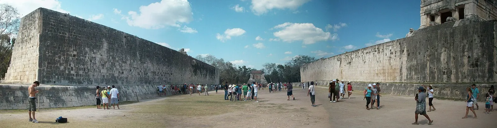
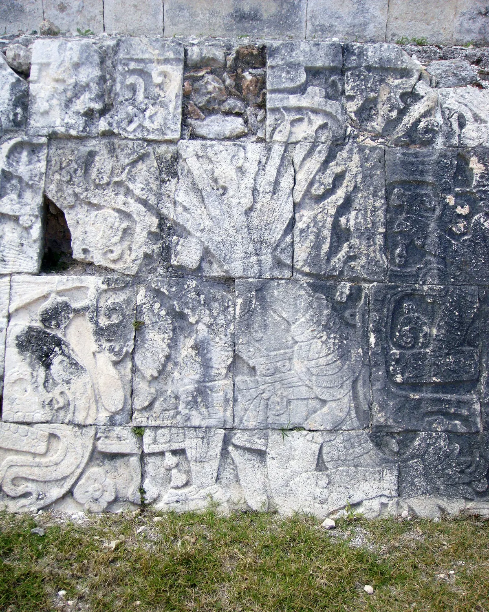
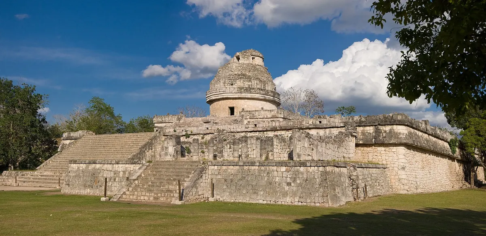
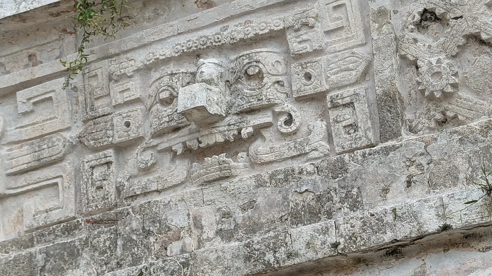

import { tpkDeep } from '../../data/affiliate.js';

## Как провести утро в Чичен-Ице

Главная ошибка короткого визита — увидеть пирамиду Кукулькана и сразу возвращаться к автобусу. Она действительно собирает вокруг себя пространство, но площадка для игры в мяч, рельефы и Караколь объясняют, что перед вами был город с разными общественными и ритуальными местами.

На первое посещение оставьте **около трёх часов**, не считая дороги и кассы. Это планировочный ориентир для спокойного наружного осмотра, а не опубликованная длительность обязательного маршрута. С гидом часть времени уйдёт на объяснения; после экскурсии полезно оставить собственный запас на выбранные детали.

| Порядок | Что смотреть | На чём остановиться |
|---|---|---|
| После входа | Пирамида Кукулькана | Общая форма, лестницы, связь с площадью |
| Следующий блок | Большая площадка для игры в мяч | Высота стен, каменные кольца и рельефы |
| Вторая половина обхода | Караколь и южная часть | Другая архитектура и меньше внимания одной пирамиде |
| Альтернативное продолжение | Священный сенот | История ритуального места, не купание |

Не пытайтесь обязательно пройти обе ветки в жару и к назначенному выезду. Лучше заранее выбрать, что вам интереснее: архитектура южной части или путь к Священному сеноту. После первых двух остановок решение можно пересмотреть по силам.

## Что входит в билет и нужен ли гид

Для иностранного взрослого официальный тариф складывается из **105 MXN федерального сбора INAH** — около **455 ₽** — и **592 MXN сбора штата**, примерно **2570 ₽**. Итого **697 MXN**, около **3020 ₽**. Одинаковый итог указан на [странице INAH](https://www.inah.gob.mx/zonas/146-zona-arqueologica-de-chichen-itza) и у [оператора CULTUR](https://culturyucatan.com/destinos/chichen-itza).

В интернете ещё встречаются другие суммы и старые разбивки. Перед оплатой посреднику смотрите не только слово Entry, но и включение обоих сборов. Экскурсия по комплексу, вход и трансфер из курортного отеля — три разных услуги; одна фотография пирамиды в карточке не доказывает наличие всех трёх.

Можно купить вход самостоятельно и осмотреть комплекс по своему плану. Гид полезен, если хочется связать архитектуру с историей и понимать сюжеты каменной резьбы, а не только назвать здания. Для такого варианта есть <a href={tpkDeep('tiqets', 'https://www.tiqets.com/en/chichen-itza-attractions-c74049/tickets-for-chichen-itza-guided-tours-p1111466/', 'chichen_small_group')} target="_blank" rel="sponsored noopener">билеты с полуторачасовой экскурсией на Tiqets</a>.

На 24 октября в английской форме был вариант **Skip The Line Ticket + Small Group Guided Tour** от **72,22 €**, примерно **6580 ₽**: группа до 15 человек, вход, живой гид и сбор CULTUR перечислены во включённом. На той же странице продаются другие варианты, включая частную прогулку и большую группу; у них свой состав и цена. Выбирайте именно нужную карточку опыта, а не ориентируйтесь на общий заголовок страницы.

Русского языка в прочитанном списке не было. Дорога от вашего отеля этим вариантом не обещана; способ оплаты российской картой не проверен. Перед покупкой проверьте язык, точку встречи, окончательный итог, оба сбора и условия отмены. Если вы ждёте автобус из Канкуна, нужен отдельный продукт с явным трансфером.

## Часы: почему лучше приехать утром

Официальные страницы расходятся. Страница зоны INAH указывает **08:00–17:00**, последний вход **16:00**, начало освобождения территории **16:30**. Портал Lugares INAH показывает **08:00–16:00** и последний вход **15:00**. CULTUR также публикует более раннее время окончания.

Поэтому рабочий план — приехать к **08:00**, а не выяснять допустимую минуту на поздней кассе. Если можете приехать только после 15:00, подтвердите доступ у администрации: на странице INAH указан телефон **+52 985 851 0137**. Не покупайте невозвратную экскурсию на последний час, исходя лишь из самого позднего расписания в поиске.

Утренний визит даёт запас на выбор ветки и отдых. Но он не гарантирует пустого комплекса: школьные группы, экскурсии и сезонная посещаемость меняют картину. На дни около равноденствия нельзя автоматически переносить обычный темп прогулки.

## Пирамида Кукулькана: куда смотреть

Обойдите пирамиду так, чтобы увидеть её на фоне открытого пространства. Ступени и площадка наверху воспринимаются иначе с разных сторон; не ограничивайтесь самой популярной точкой перед фасадом. **Подниматься по пирамиде нельзя.** В [сообщении INAH о защите памятника](https://inah.gob.mx/images/comunicados/2025/20250320/COMUNICADO_CHICHEN.pdf) прямо говорится о запрете подъёма на древние сооружения. Обычное посещение не включает вход во внутренние помещения Кукулькана: планируйте наружный осмотр, оставаясь за ограждением.

Комплекс сочетает разные архитектурные традиции майя и центральной Мексики. У пирамиды часто обсуждают светотеневой эффект «спускающегося змея» около равноденствия. Но это зависимое от солнца наблюдение, а не представление по гарантированному расписанию. Не стройте всю поездку вокруг обязательной красивой тени при любой облачности.

## Площадка для мяча: посмотрите выше и ниже

Здесь легко пройти по центру и пропустить самое интересное у стен. Сначала найдите каменные кольца и оцените их высоту, затем посмотрите рельефы ниже. Важен переход от размера сооружения к подробностям изображения: он делает площадку чем-то большим, чем длинным пустым прямоугольником.

Гид может объяснить сцены и ритуальный контекст, но популярные истории о том, кого именно после каждой игры приносили в жертву, не стоит пересказывать как универсальное доказанное правило. У сложного памятника нет обязанности помещаться в одну эффектную легенду.

Если вы с детьми, предложите сначала найти кольцо, затем повторяющиеся элементы резьбы. Это конкретная задача наблюдения вместо длинного списка дат. При этом не нужно трогать поверхность или заходить за ограждения, чтобы показать рисунок ближе.

## Караколь, маски Чаака и сенот

**Караколь** узнаваем по круглой башне. Его обычно называют обсерваторией; на месте полезно сравнить форму этого здания с геометрией Кукулькана. Даже без специальной подготовки видно, насколько разными могли быть здания одного комплекса.

На зданиях южной группы ищите **маски Чаака**, божества дождя. Повторяющиеся выступающие детали собирают фасад в ритм, который на общем снимке легко принять за орнамент. Для более внимательного обхода выберите одно здание и рассмотрите его стену, вместо того чтобы фотографировать всё издалека.

**Священный сенот** внутри археологического маршрута — историческое и ритуальное место. Не путайте его с купальными остановками, которые экскурсии добавляют за пределами зоны, например Ик-Килем. Обещание «Чичен-Ица и сенот» нужно читать по конкретной программе: оно может означать другое место, отдельный переезд и дополнительную плату.

## Дорога и подготовка

По описанию INAH, комплекс находится примерно в **115 км от Мериды**, дорога идёт по направлению к Писте; от Писте до зоны около **двух километров**. Это расстояния, а не обещанное время поездки. Из более далёкого курортного отеля сравнивайте не только цену экскурсии, но и длительность в автобусе, число заездов и реальное время на руинах.

Для самостоятельного автомобиля CULTUR указывает парковку **124 MXN** — около **540 ₽** — для машины или фургона до девяти мест. Она не входит автоматически в приведённый входной тариф. Водительский день дополнительно включает топливо и возможные дорожные расходы; без точного маршрута общего «бюджета из Канкуна» здесь нет.

Возьмите воду, головной убор, защиту от солнца и удобную обувь. У комплекса есть открытые пространства: если утомились, сократите вторую ветку вместо того, чтобы ускорять весь обход. Сохраните точку встречи и её время, особенно если путешествуете с группой.

Дальнейший маршрут и сезон сравните на [странице Мексики](/mexico/). После Чичен-Ицы оставьте свободный остаток дня под дорогу и отдых: новая длинная программа не обязана начинаться сразу после выхода с археологической территории.
