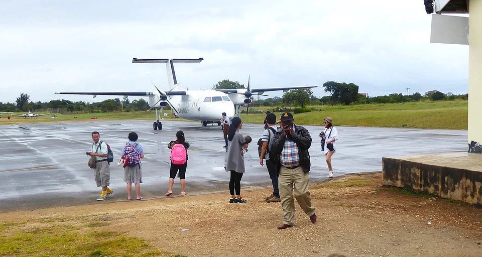
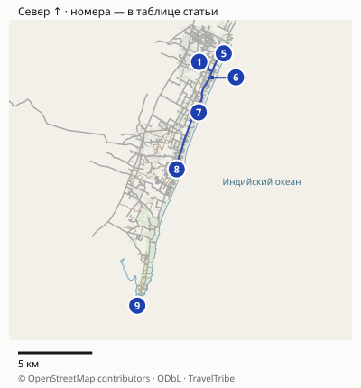
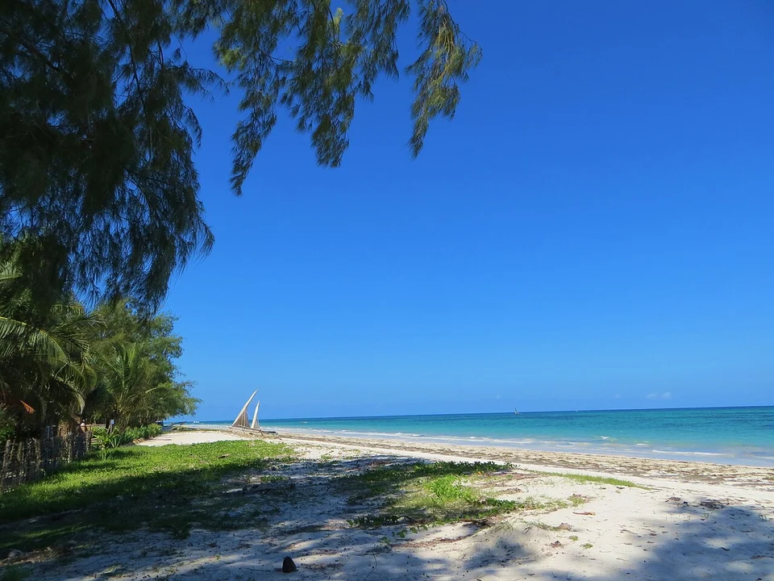
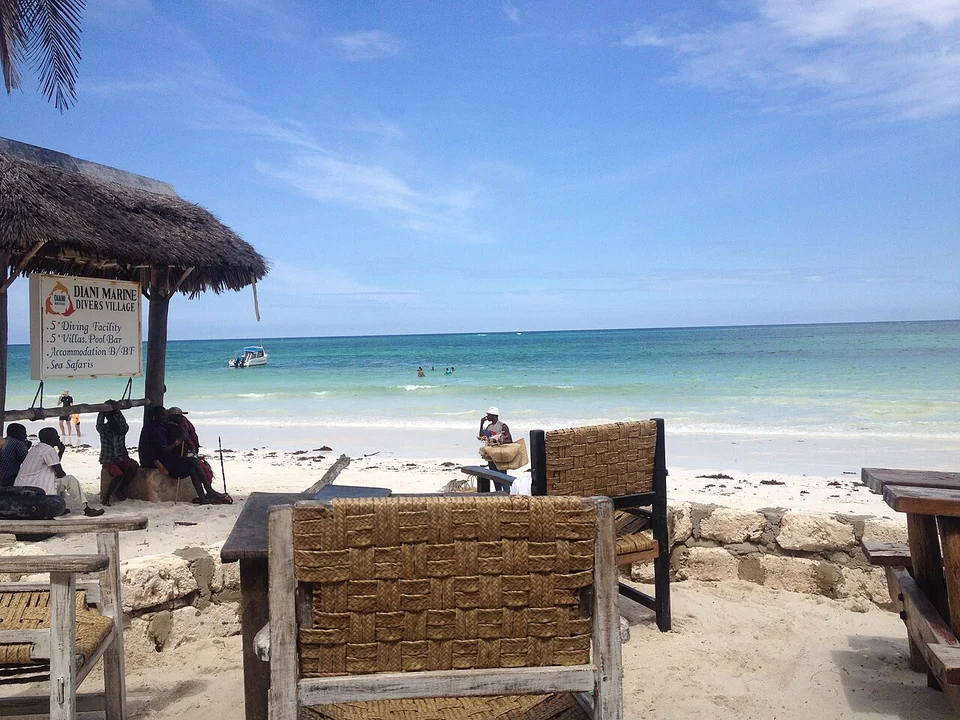

## Сначала выберите дорогу, потом первую ночь

Главная развилка — где заканчивается сафари и откуда вы продолжаете путь. Прямой на вид перелёт из парка может включать промежуточные посадки или пересадку. Уточните весь маршрут у оператора до покупки отеля с невозвратным тарифом.

| Вариант | Когда рассматривать | Что проверить до оплаты |
|---|---|---|
| Перелёт в Ukunda / Diani | Хотите закончить переезды ближе к пляжу | Конечный аэропорт, промежуточные посадки, багаж и встречу у терминала |
| Перелёт в Mombasa | На ваши даты лучше расписание или цена | Полный трансфер на южное побережье, а не только выход из аэропорта |
| Через Nairobi Wilson | Сафари заканчивается рейсом в Wilson | Остаётся ли пересадка в том же аэропорту и защищена ли она перевозчиком |
| Через Nairobi Jomo Kenyatta | Внутренний или международный рейс вылетает из NBO | Межаэропортовый переезд, если предыдущий сегмент прибывает в Wilson |
| Наземный маршрут к побережью | Сафари заканчивается ближе к востоку страны | Общую длительность от лоджа до отеля, остановки и время приезда |

В Найроби **Wilson (WIL) и Jomo Kenyatta (NBO) — разные аэропорты**. Слово Nairobi в обоих билетах не подтверждает пересадку без дороги через город. Для двух отдельных билетов заложите запас, который согласован с перевозчиком и трансфером, а не универсальные «два часа».

## Укунда и Момбаса: в чём практическая разница

Укунда обслуживает район Диани. После прибытия остаётся местный трансфер до конкретного отеля; точная дорога зависит от его расположения. Укажите полное название гостиницы водителю заранее: похожие названия вилл и апартаментов могут привести к другому въезду.

Момбаса находится отдельно от курортной полосы Диани. У [Nomad](https://www.nomad-beach-resort.com/faq/) подтверждена платная встреча и трансфер из аэропортов Момбасы и Укунды: это конкретный вариант заказать всю дорогу через принимающий отель, а не искать машину на месте. В запросе укажите номер рейса, число людей, багаж и конечный адрес; получите общую цену до подтверждения. Заказывайте переезд **до двери гостиницы** и спрашивайте, каким путём он выполняется, какие дорожные платежи включены и где встречает водитель. Старые отчёты с обязательным паромом Ликони не стоит превращать в вечное правило маршрута: инфраструктура меняется, а конкретный путь выбирается по текущей ситуации.

Поезд до Момбасы тоже не доставляет на пляж Диани. После железнодорожной станции остаётся автомобильный участок. Сравнивая поезд с самолётом, добавьте дорогу на вокзал, ожидание, поездку от станции и отдых после раннего подъёма. Самая низкая цена одного билета не обязательно даёт самый удобный день после сафари.

Не назначайте дайвинг или другую оплаченную активность сразу после предполагаемого прибытия. Первый вечер разумнее оставить для заселения и спокойного знакомства со своим участком берега.

Укунда: от самолёта до отеля ещё нужен местный трансфер. Архивный кадр аэропорта.

## Карта и точная логистика

[Открыть подробную карту: масштаб, все точки и навигация](/maps/diani-kenya/). Север вверху; нумерация указана ниже. На обзорной картинке дальние пересадки могут не помещаться — они доступны в подробной карте через «Все точки».

| № | Точка | Ориентир и ограничение |
|---|---|---|
| 1 | [Укунда: терминал](https://www.google.com/maps/search/?api=1&query=-4.297434900000001,39.5718717) | Местный аэропорт Диани. Водитель встречает у согласованного выхода, а не у самолёта. |
| 2 | [Момбаса:MBA](https://www.google.com/maps/search/?api=1&query=-4.0316453,39.6030012) | Пассажирские терминалы1/2; номер рейса и место встречи передайте отелю. |
| 3 | [Wilson: Safarilink](https://www.google.com/maps/search/?api=1&query=-1.3185902,36.8127724) | Точка перевозчика в Wilson, отдельном аэропорту Найроби. |
| 4 | [Найроби:NBO](https://www.google.com/maps/search/?api=1&query=-1.3169486,36.9288569) | Комплекс международного аэропорта; конкретный терминал берите из билета. |
| 5 | [Swahili Beach](https://www.google.com/maps/search/?api=1&query=-4.2923255,39.5867509) | Проверяйте свой тариф и конкретный подъезд к отелю. |
| 6 | [Diani Sea Resort](https://www.google.com/maps/search/?api=1&query=-4.3067796,39.5798913) | Не Diani Sea Lodge: названия похожи, точки разные. |
| 7 | [Nomad Beach Resort](https://www.google.com/maps/search/?api=1&query=-4.3279941,39.5715812) | Отдельный адрес и трансфер; в картографических данных ещё встречается название The Sands at Nomad. |
| 8 | [Neptune Palm Beach](https://www.google.com/maps/search/?api=1&query=-4.3624351,39.5582321) | Южнее основной полосыДиани, районГалу. |
| 9 | [Остров Чале](https://www.google.com/maps/search/?api=1&query=-4.4449519,39.5343056) | Финальный участок организует отель; островная точка не является точкой автомобильной высадки. |

### От терминала до конкретного отеля

На карте аэропорт **UKA / Ukunda** отмечен пассажирским терминалом, MBA — зданием Terminal 1 & 2, а Wilson — точкой Safarilink. Это разные аэропорты. Для NBO показан только аэропортовый комплекс: после получения билета уточните терминал и место встречи; точку комплекса нельзя использовать как точный адрес посадки в машину.

По выбранному автомобильному маршруту от UKA до Swahili Beach получается около **3,4 км**. Дальше вдоль побережья: Swahili Beach → Diani Sea Resort около **2,3 км**, до Nomad ещё **3,2 км**, затем до Neptune Palm около **4,3 км**. Это ориентиры между территориями отелей, не последовательность обязательных заездов трансфера. Для прямой поездки UKA → свой отель водитель выбирает нужный въезд и путь; номер отеля важнее общего названия «Диани».

От пассажирского терминала **MBA до Nomad** дорожный расчёт дал около **54 км**. Расчётный маршрут проходит по обходу Dongo Kundu, а не через обязательную переправу Likoni: способ проезда подтвердите у своего трансфера. Оставьте для планирования **1,5–2 часа после выхода из терминала**, с дополнительным запасом при пробках; это резерв, а не обещание водителя или время от посадки самолёта. Километраж до другого отеля будет иным. Остров Чале не является автомобильной точкой высадки: финальный участок и время встречи нужно включить в подтверждение трансфера отеля.

В [FAQ Safarilink](https://www.flysafarilink.com/travel-information/faqs) для Диани ещё встречается 45 минут до рейса, но в [условиях перевозки](https://www.flysafarilink.com/travel-information/terms) для Диани, Wilson и Момбасы указаны **60 минут**. Планируйте не менее 60 минут и выполняйте более строгое требование своего билета. Трансфер от отеля прибавляется к этому часу. При смене NBO → Wilson дополнительно нужны получение багажа, возможный пограничный контроль, автомобильный переезд и новая регистрация; короткую пересадку по одному километражу не подтверждаем. Полезный минимум от оператора для самой дороги в часы пик — не менее часа; весь стык должен согласовываться с билетами. Связь разных авиакомпаний автоматически не защищена.

Расстояния округлены, время в пути зависит от пробок, погоды и открытых проходов. Метка территории может отличаться от входа: последние метры сверяйте с указателями. [Картографические данные © OpenStreetMap contributors](https://www.openstreetmap.org/copyright), ODbL.

## Багаж: норма пляжного рейса не отменяет норму сафари

У [Safarilink](https://www.flysafarilink.com/travel-information/baggageallowance) базовая норма на сафари-направлениях — **15 кг**, а для перечисленных перевозчиком пляжных направлений, включая Диани и Момбасу, — **20 кг**. В обоих случаях в общий вес входят ручная кладь и вещи, которые вы несёте с собой; рекомендованы мягкие сумки. В [условиях](https://www.flysafarilink.com/travel-information/terms) также указаны габариты 60 × 45 × 30 см.

Если в одной поездке есть сегмент с лимитом 15 кг и другой с 20 кг, ориентируйтесь на более строгий участок, пока перевозчик не подтвердит иное. Доплата не гарантирует перевозку любого чемодана: место и допустимая загрузка самолёта ограничены. Фототехника тоже весит, даже если вы держите её в руках.

Safarilink сообщает о бесплатном хранении лишнего багажа в своём офисе в Wilson. Это полезно, **только если маршрут возвращается туда и вы успеваете забрать вещи**. Для перелёта из парка сразу на побережье оставленная в Найроби сумка сама не прибудет в отель Диани.

В условиях перевозчика для Wilson, Диани и Момбасы указана регистрация за 60 минут; для ряда сафари-аэродромов действует другое окно. Следуйте своему подтверждению рейса и правилам конкретного перевозчика. Гарантия связи двух собственных рейсов Safarilink не распространяется автоматически на чужую авиакомпанию и международный билет.

## Где остановиться: три сценария

**Впервые в Диани, без машины.** Ищите отель в основной курортной полосе с удобным подъездом и понятной возможностью поесть вне территории. Сравните конкретный адрес с нужными кафе и магазинами: километры вдоль пляжа не равны короткой прогулке после темноты. Уточните у отеля надёжный местный транспорт на вечер.

**Несколько спокойных дней вдвоём.** Подойдут небольшой пляжный отель, коттедж или вилла. Проверьте, что означает sea view: вид с балкона, удалённость здания от воды и прямой выход на берег — разные свойства. Если питание не включено, добавьте ужины и трансферы к ресторану в общий бюджет.

**С детьми или без желания ездить на ужин.** Рассмотрите курорт с бассейном и подходящим питанием. Уточните возрастные условия, размещение всей семьи в одном номере, детское меню и глубину бассейна. Наличие слова family в категории не гарантирует отдельную спальню или бесплатное размещение ребёнка любого возраста.

Galu — южное продолжение пляжного направления, которое можно рассматривать ради более удалённой базы. Не выбирайте его только по слову «тише»: проверьте рестораны, подъезд, конкретный соседний объект и условия нужного вам участка пляжа. Для двух ночей после насыщенного сафари простая логистика может оказаться важнее уединённого адреса.

## Основная полоса Диани, Галу или отдельный остров

Ниже — ориентиры для выбора базы, не административные границы районов. Центральную курортную полосу сравнивайте по отдельным адресам вдоль Diani Beach Road; Галу — как более южный вариант. Укунда прежде всего помогает понять логистику аэропорта, а не выбрать пляж по его названию.

| База | Для какого отдыха | Компромисс |
|---|---|---|
| Основная полоса Диани | Первый короткий визит, выбор гостиниц и еды | Смотрите, что реально доступно пешком от конкретного входа |
| Галу, южнее основной полосы | Дольше жить на территории выбранного курорта | Поездки к северным кафе и магазинам добавляют дорогу |
| Тиви, отдельный пляж севернее Диани | Целенаправленно хотите именно этот берег | Не бронируйте его как соседний корпус гостиницы в Диани; проверьте подъезд отдельно |
| Чале, отдельный островной вариант | Хотите островной курорт вместо обычной пляжной базы | Нужен согласованный трансфер и условия последнего участка к острову |

Три гостиницы в сравнении ниже относятся к направлению Диани. Для Галу можно отдельно проверить [Neptune Palm Beach](https://www.neptunehotels.com/neptune-palm-beach-diani/contacts/getting-here/): оператор указывает примерно 8 км от аэродрома Укунда, а не обещает, что все курорты стоят в пяти минутах от него. [Chale Island Resort](https://chaleislandresort.com/contact-us/) публикует собственные варианты доставки из Укунды и Момбасы. Само наличие отеля на острове не означает, что вы сможете приехать к номеру обычным такси без последнего согласованного участка.

## Три отеля для начального сравнения

Это примеры разных форматов, а не рейтинг лично проверенных гостиниц. Наличие номеров и итоговая цена требуют поиска на ваши даты.

| Объект | С чего начать сравнение | Какой вопрос задать |
|---|---|---|
| [Swahili Beach](https://swahilibeach.com/features/) | Курорт с несколькими ресторанами и спа | Какие заведения, зоны и услуги входят именно в выбранный тариф |
| [Nomad Beach Resort](https://www.nomad-beach-resort.com/accommodation/) | Garden Rooms, Beach Cottages и семейные категории | Где расположен конкретный номер и что означает его вид/выход к пляжу |
| [Diani Sea Resort](https://app.dianisearesort.de/) | Формат all inclusive, информация о питании и активностях | Какие напитки и часы питания включены; как организован ранний выезд |

У Swahili Beach проверяйте включения выбранного тарифа, а не общий перечень услуг курорта. У Nomad сравнивайте категории, а не общую фотографию коттеджа с ценой Garden Room. В его FAQ прямо указано отсутствие Kids Club: семейная категория номера не означает детский клуб и анимацию. У Diani Sea Resort официальный гостевой справочник помогает проверить содержание all inclusive; это не означает, что любая продажа номера у любого посредника включает весь набор.

Цена без дат и состава гостей мало помогает выбору. Сравнивайте одинаковое число ночей, питание, налоги, отмену и трансфер. После дорогого сафари возможность отмены пляжной части полезна, если внутренняя логистика ещё не подтверждена.

Попросите у гостиницы описание именно своего входа в воду. Общая фотография курорта не показывает камни, водоросли и глубину на каждый час прилива.

## Приливы и пляж: что выяснить у отеля

Для Диани важен не только сезон, но и уровень воды в часы, когда вы хотите купаться. Узнайте, есть ли напротив отеля каменистые участки, как далеко уходит вода и где сотрудники рекомендуют заходить. Не идите по рифу ради короткой дороги к морю и не наступайте на морских животных.

Бассейн полезен как отдельная возможность плавать, когда купание в океане не подходит. Он не делает море безопасным в любую погоду. Для прогулки учитывайте солнце, возвращение и местные рекомендации; для лодки или водных занятий выбирайте организатора с понятными условиями и инструктажем.

Иллюстрация прибрежного отдыха, не фотография одного из рекомендованных номеров и не обещание включённого сервиса.

## Что подтвердить до бронирования

Сначала получите письменное подтверждение окончания сафари: аэродром, время доставки и допустимый багаж. Затем проверьте перелёт и весь путь до гостиницы. После этого выбирайте тариф отеля и время обратного международного вылета.

Для самостоятельных билетов не ставьте возвращение с пляжа встык к дальнему рейсу. Смена аэропорта, задержка небольшого самолёта и дорога по городу способны разрушить красивую формальную пересадку. При необходимости добавьте ночь у аэропорта; стоимость этой ночи сравнивайте с риском потерять отдельный дальний билет.

В [гиде по Кении](/kenya/) сопоставьте пляжную часть с остальным маршрутом. Здесь главный результат планирования — подтверждённая цепочка «сафари → нужный аэропорт → отель», а не обещание обязательного прямого рейса из любого национального парка.
