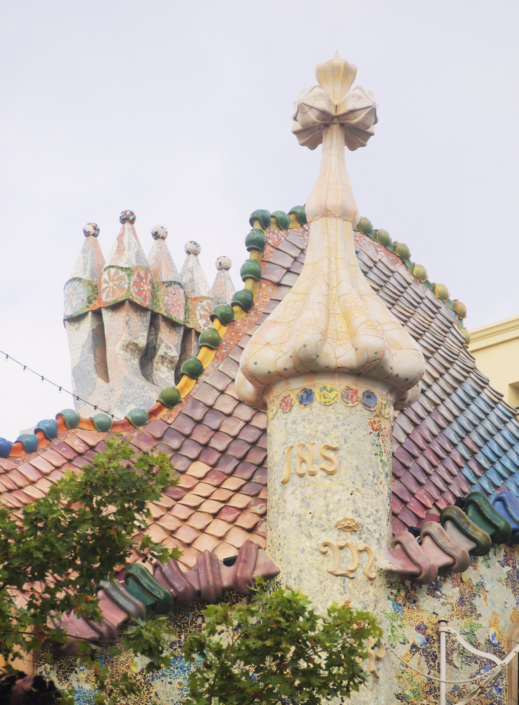
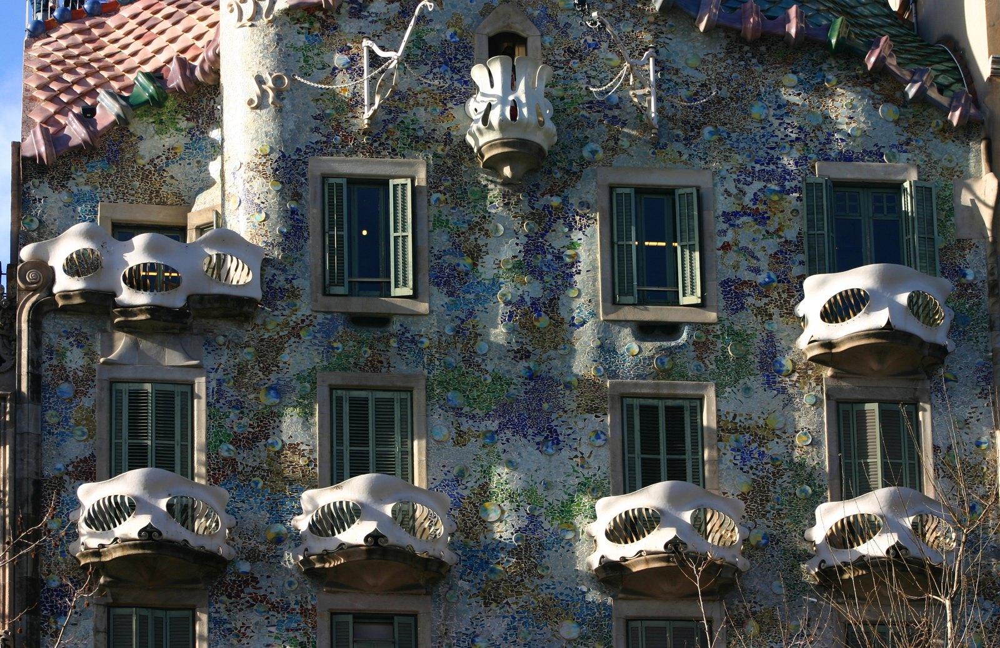
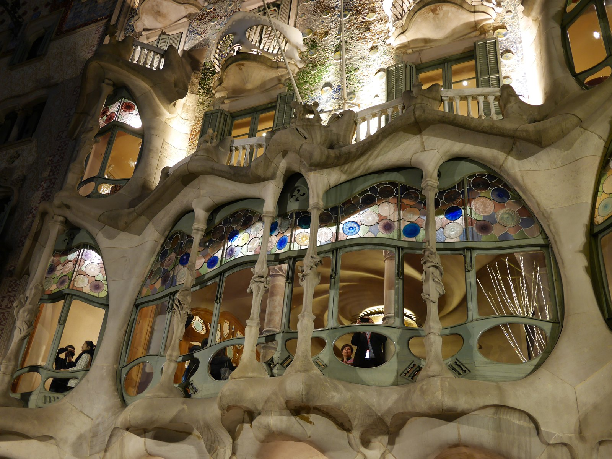
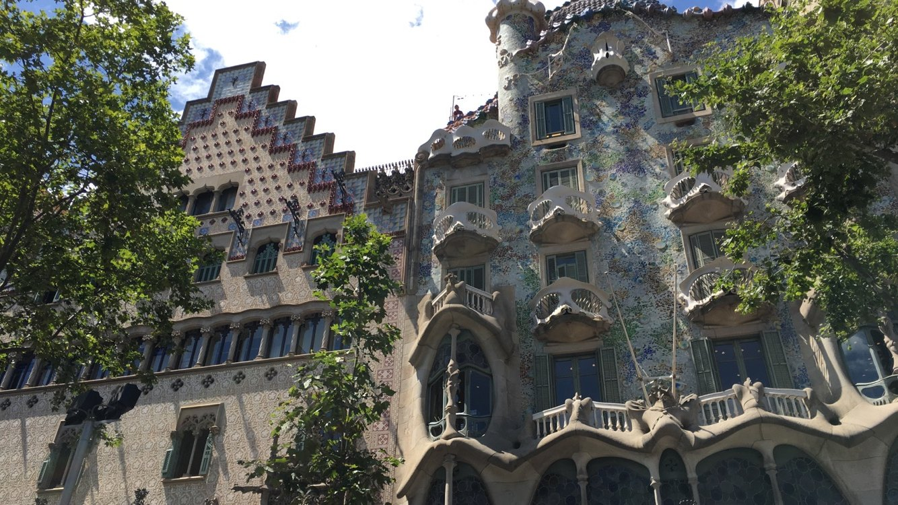

import { tpkDeep } from '../../data/affiliate.js';
export const dayTicket = tpkDeep('tiqets', 'https://www.tiqets.com/en/barcelona-attractions-c66342/tickets-for-casa-batllo-entry-ticket-p1111363/', 'tt_dom_balo_barselona');

Для первого визита в Дом Бальо берите **Blue**, если хотите увидеть парадный этаж, световой двор и чердак. Если хотите подняться на крышу, выбирайте **Silver**. Это самый доступный дневной билет с выходом на террасу. **Gold** пригодится, если хотите зайти в отдельные комнаты семьи Бальо. **Platinum** имеет смысл покупать у Дома Бальо, если планы могут поменяться и вам важна возможность переноса.

На [странице дневного визита](https://www.casabatllo.es/en/experience/) есть состав тарифов, а в <a href={dayTicket} target="_blank" rel="sponsored noopener">карточке Tiqets на вход в Дом Бальо</a> можно сравнить даты и варианты. До оплаты откройте описание выбранного тарифа. Название дома у всех четырёх вариантов одинаковое, а доступ на крышу зависит от билета.

## Что дают Blue, Silver, Gold и Platinum

Во все четыре тарифа входят парадный этаж, внутренний двор с задним фасадом, чердак, аудиогид на русском и Gaudí Cube. Это отдельная цифровая работа в подвале, вход в которую есть даже в Blue. Крыша становится доступна с Silver, а планшет с дополненной реальностью и частные комнаты открываются с Gold.

| Билет | Что добавляется | Цена на странице музея 26 ноября |
|---|---|---|
| Blue | Основной маршрут по дому и Gaudí Cube | 35 € (около 3 160 ₽) |
| Silver | Терраса на крыше | 40 € (около 3 610 ₽) |
| Gold | Планшет, Gaudí Dôme, комната консьержа, резиденция семьи Бальо и временная выставка | 45 € (около 4 060 ₽) |
| Platinum | Состав Gold. При покупке у музея дату можно перенести по ссылке из письма | 55 € (около 4 960 ₽) |

Цены сняты с [официальной страницы продажи](https://www.casabatllo.es/en/online-tickets/visit-casa-batllo/) 26 ноября. Сверьте итог после выбора даты, сеанса и числа гостей. Суммы в рублях ориентировочные, по курсу Банка России на 26 ноября. При оплате итог зависит от курса и комиссий вашей карты.

Практический расчёт для двух взрослых и ребёнка 10 лет. По этим ценам Blue стоит **70 €**, Silver — **80 €**, Gold — **90 €**. Ребёнок до 12 лет включительно в сопровождении взрослого проходит бесплатно. Планшет с дополненной реальностью детям этого возраста выдают с любым тарифом. Выход на крышу добавляет **10 € на семью**. Для подростков 13–17 лет музей указывает скидку 6 €. До 15 лет включительно нужен сопровождающий взрослый.

*Чешуйчатый изгиб и башенку видно с улицы. С террасы можно рассмотреть рисунок покрытия и трубы с другого ракурса.*

## Как пройти Дом Бальо за один визит

Парадный этаж даёт представление о доме как о жилье, а не только как о фасаде с балконами. Посмотрите на большие окна, выходящие к проспекту. Снаружи видно, как каменные стойки обрамляют стекло. Внутри становится понятно, сколько места в комнате отдали свету. У внутреннего двора сравните оттенки плитки: верх темнее, а ближе к нижним этажам поверхность светлеет.

На чердаке обратите внимание на ряд светлых арок. Здесь хорошо виден переход от жилых комнат к верхним помещениям дома. Если в билете есть крыша, выйдите на террасу и посмотрите на трубы и плитку вблизи. Если у вас Blue, продолжайте предложенный музеем маршрут к Gaudí Cube. Экран в подвале стоит воспринимать как отдельную работу о Гауди. На самой крыше вас ждут архитектура дома и вид на город.

Для Blue музей указывает около **часа**, для остальных дневных тарифов — **1 час 15 минут**. В действующие Gold и Platinum входит [выставка «Гауди, Миро, Гомис»](https://www.casabatllo.es/en/experience/expo/) до 10 января 2027 года. Если собираетесь и в дом, и на выставку, закладывайте около 1 часа 45 минут и сверьте состав билета на свою дату. Если заходите с коляской, её предложат оставить перед осмотром. Для детей до двух лет у музея есть переноски. Общей камеры хранения нет. На террасу ведёт лифт. Уточните помощь на входе, если без лифта пройти маршрут не получится.

## Где покупать, если важны перенос и возврат

На официальном сайте Дом Бальо указывает, что Platinum дневного визита можно перенести по ссылке из письма. Для бесплатной отмены нужно написать в музей до визита. Если берёте Blue, Silver или Gold и опаздываете из-за отмены транспорта или другой уважительной причины, музей просит связаться с ним и приложить подтверждение. Возможность переноса стоит согласовать заранее. [Правила Дома Бальо](https://www.casabatllo.es/en/visit/faqs/)

В <a href={dayTicket} target="_blank" rel="sponsored noopener">карточке билета Tiqets</a> есть все четыре варианта, а в общих условиях карточки указано, что билет нельзя вернуть или перенести. Если у продавца и музея совпадает название Platinum, проверьте правила на последнем шаге бронирования. При риске изменить планы берите тариф с явно указанным переносом у того продавца, где платите. На входе билет можно показать на телефоне.

## Как увидеть фасад бесплатно и добраться до входа

Адрес — **Passeig de Gràcia, 43**. Ближайшая станция метро **Passeig de Gràcia**, линии L3 и L4. От **Plaça de Catalunya** музей оценивает дорогу пешком примерно в 10 минут. На билете проверьте именно время входа. Если вы приехали раньше, начните с противоположного тротуара. Оттуда помещаются в один взгляд крыша, балконы и соседний Дом Амалье с треугольным ступенчатым верхом.

Затем перейдите проспект и посмотрите на нижние окна вблизи. Мозаика, каменные стойки и балконы читаются совсем иначе с уровня входа. На этот отрезок отведите 10–15 минут. Если нужен только внешний осмотр, билет не потребуется. При полном визите оставьте короткую прогулку по проспекту после сеанса и не ставьте следующую бронь вплотную.

Для продолжения поездки пригодится [гид по Испании](/spain/). Если хотите увидеть в тот же день другой угол Барселоны, пройдитесь до Готического квартала и [мозаики на площади Исидре Нонель](/blog/pochemu-v-ispanii-tseluyutsya/#где-в-барселоне-увидеть-знаменитый-поцелуй).
