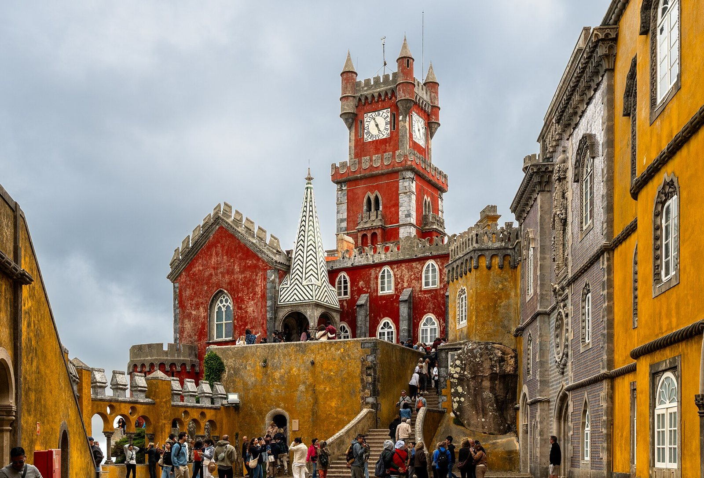
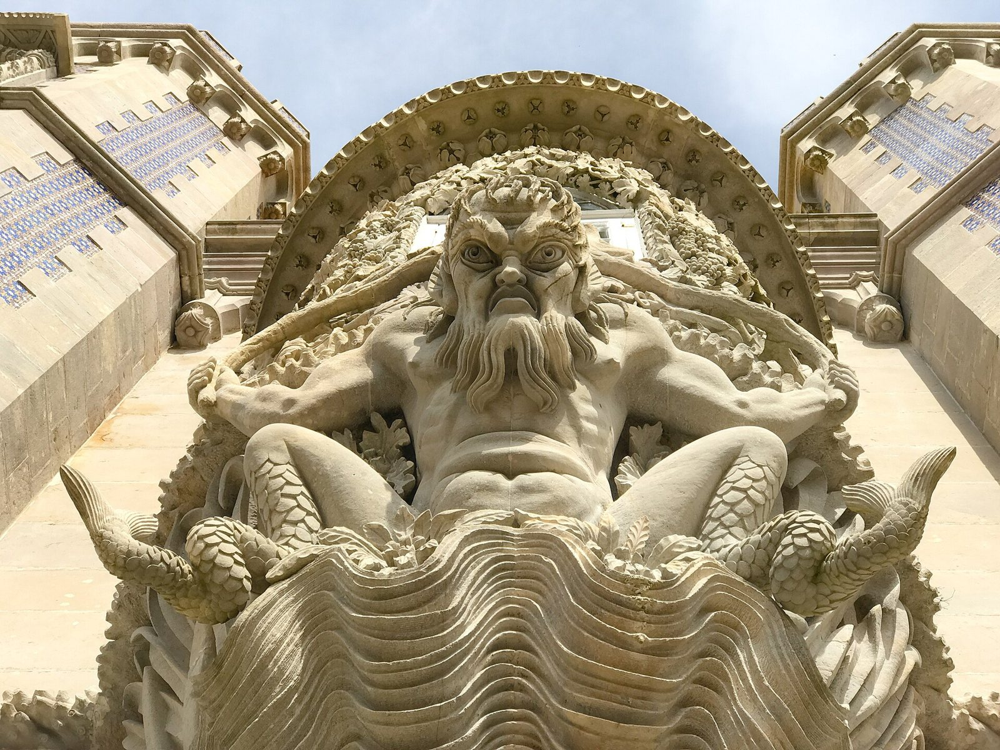
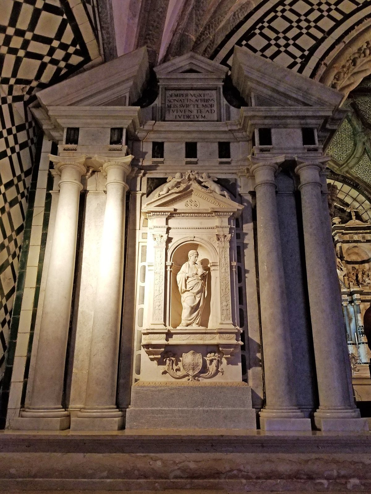
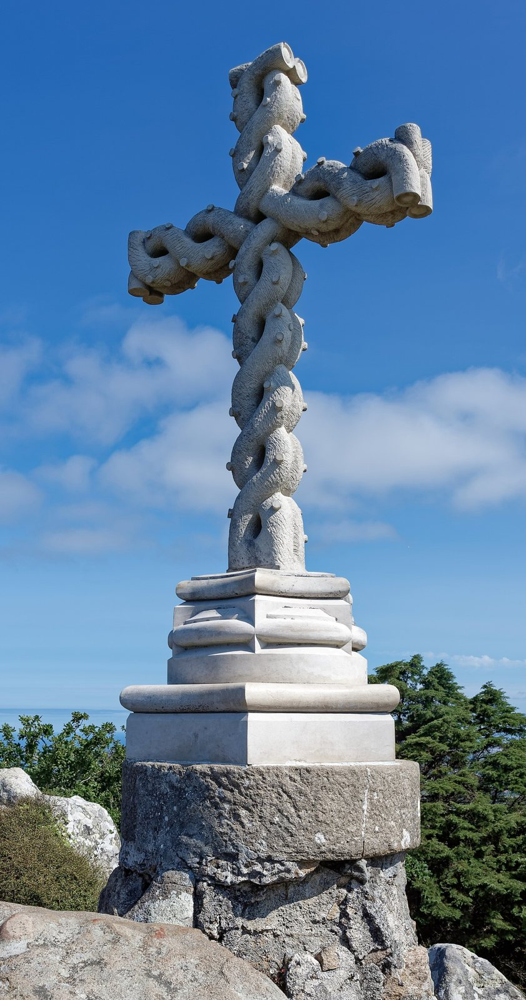

import { tpkDeep } from '../../data/affiliate.js';
export const penaPriority = tpkDeep('tiqets', 'https://www.tiqets.com/en/sintra-attractions-c76496/tickets-for-park-and-pena-palace-in-sintra-priority-ticket-p1088286/', 'tt_pena_sintra_priority');

На дворец Пена лучше выделить полдня. **Время в билете — вход во дворец на вершине холма.** От ворот парка оператор просит заложить около 30 минут до двери залов. Если к 11:30 вы добрались только до ворот парка, время подъёма уже не помещается в план. Оператор предупреждает, что опоздавших в залы не пускают.

Для первого визита я бы выбрал [билет за 20 € на парк и основной маршрут по дворцу](https://www.parquesdesintra.pt/en/plan-your-visit/tickets-palace-of-pena). Билет за **12 €** даёт доступ к парку и террасам дворца. Его достаточно для прогулки и фотографий снаружи. Есть и <a href={penaPriority} target="_blank" rel="sponsored noopener">билет с приоритетным входом у Tiqets</a>. У него жёстче условия переноса, а время входа в залы всё равно нужно выбрать.

## Какой билет купить

В таблице официальные тарифы указаны для взрослого от 18 до 64 лет. Для ориентира, **20 € — около 1800 ₽**, а **42 € — около 3770 ₽** по курсу [Банка России](https://www.cbr.ru/scripts/XML_daily.asp?date_req=20/11/2026) на 20 ноября. При оплате возможен другой курс. На свою дату проверьте [тарифы и часы работы](https://www.parquesdesintra.pt/en/plan-your-visit/opening-times-and-prices/). Дорога из Лиссабона, автобус и шаттл внутри парка оплачиваются отдельно.

| Билет | Ориентир | Что входит | Когда брать |
| --- | ---: | --- | --- |
| Парк | 12 € | Парк, террасы и шале графини Эдла. Для залов нужен дворцовый билет | Главное для вас — прогулка и виды |
| Essential Visit | 20 € | Парк и основной маршрут по залам по выбранному времени | Первый визит во дворец |
| Complete Visit | 45 € | Расширенный маршрут с монастырским двориком и частными покоями королевской семьи | Интересуют дополнительные пространства дворца |
| Priority Entry, Tiqets | 42 € в карточке 20 ноября | Приоритет у ворот парка и у входа во дворец, залы по времени | Дата поездки уже определена |

Двое взрослых заплатят **24 € за парк** или **40 € за парк с основным маршрутом по дворцу**. Для двух взрослых и двух детей от 6 до 17 лет оператор указывает семейные билеты **40 € за парк** и **65 € за Essential Visit**. Дети младше 6 лет проходят бесплатно по тарифу оператора. Добавьте их при оформлении, чтобы проверить условия семьи целиком.

По [правилам приоритетного входа](https://www.parquesdesintra.pt/en/plan-your-visit/skip-the-line-entrance-to-palace-of-pena/) сначала проходите через главные ворота парка. Затем к времени в билете подойдите к магазину дворца, где вас встретит сотрудник.

У <a href={penaPriority} target="_blank" rel="sponsored noopener">билета Tiqets Priority Entry</a> приоритет действует на двух входах. Трансфер можно выбрать дополнительно. По условиям карточки билет нельзя вернуть или перенести. При проверке 20 ноября у продавца был сеанс **23 ноября в 11:30 за 42 €** для взрослого. На свою дату заново сверьте цену и наличие мест. Официальная касса Parques de Sintra разрешает изменить время онлайн-билета до **18:00 накануне** по [правилам переноса](https://www.parquesdesintra.pt/en/plan-your-visit/faqs).

## Как доехать из Лиссабона и не опоздать

Из центра Лиссабона садитесь на поезд CP со станции **Rossio** до конечной **Sintra**. В расписании есть также поезда из Oriente и Entrecampos. От Rossio поезд обычно идёт около **40 минут**. Сверьте остановки и время на свою дату у [Comboios de Portugal](https://www.cp.pt/info/w/discover-sintra).

От станции Синтра поднимается автобус **434** до Пены. Он довозит к воротам парка. Внутри есть крутой подъём к дворцу. От главных ворот курсирует малый шаттл за **4,50 € туда и обратно**. Его можно добавить при покупке входного билета. Он полезен, если тяжело идти в гору, но к времени поездки добавится ожидание посадки. Оператор просит закладывать около получаса между воротами и дворцом даже с трансфером. Из исторического центра подъём к Пене на частном автомобиле закрыт.

**Пример для обычного билета Essential на 11:30.** К воротам парка я бы подошёл к **10:45**. Из 45 минут около 30 уйдёт на путь к дворцу, ещё 15 останутся на поиск входа и задержки. Приехать на вокзал Синтры стоит примерно к **10:00**. На нужную дату выбирайте рейс из Rossio с прибытием в Синтру **не позже 10:00**. Это запас редакции для планирования, рейсы проверьте перед поездкой, а маршрут 434 — на [сайте автобуса](https://www.sintra434.com/pt/help-center).

Если время поджимает, от ворот сразу идите к точке входа по своему билету. Для обычного сеанса это вход в залы, для приоритета — встреча у магазина дворца. После пропущенного сеанса оператор не пускает в залы и не возвращает деньги. При срыве сеанса узнайте у сотрудников, какие зоны остаются доступны по вашему билету. В отдельный билет на парк имеет смысл вкладываться после уточнения у кассира, чтобы второй раз не заплатить за уже включённую прогулку.

## Что смотреть во дворце

Пена стоит на месте монастыря. В XIX веке король Фернанду II превратил его в летнюю резиденцию. Во дворе рядом стоят жёлтые фасады, красная часовая башня и церковь. По [описанию комплекса](https://www.parquesdesintra.pt/en/parks-monuments/park-and-national-palace-of-pena/) восстановленный монастырь вошёл в новый дворец. Проследите, где кончается старый объём и начинаются пристройки с башнями и террасами.

У входа задержитесь у **арки Тритона**. Морская фигура сидит на раковине, а выше каменные ветви обрамляют окно. Если хотите увидеть азулежу и арки бывшего монастырского дворика, сверяйтесь с программой [Complete Visit](https://www.parquesdesintra.pt/en/parks-monuments/park-and-national-palace-of-pena/complete-visit/). В расширенный маршрут входят и частные покои. Для этой программы оператор указывает отдельное время и сопровождение от главных ворот парка. Если открыта часовня, посмотрите на алтарь. Парадный двор даёт общее представление о дворце, а на этих трёх остановках видны детали, за которыми стоит подняться сюда.

## Как выбрать прогулку по парку

**Если у вас полдня из Лиссабона и билет в залы**, начните с точки входа по своему билету. Затем оставьте около часа на террасы и ближайшие дорожки парка. Обратный автобус ищите по указателям на остановке у выхода. Заходить к другому дворцу по билету впритык опасно: между объектами нужно спуститься и снова подняться по дороге.

**Если у вас больше времени**, спуститесь к Долине озёр и шале графини Эдла. Шале выглядит как альпийский дом, а декоративные детали отделаны пробкой. Прогулку к **Круш-Алта (Cruz Alta)** оставьте на ясную погоду. При облаках на уровне холма лучше выбрать нижние дорожки, где маршрут интересен и без дальней панорамы.

С маленьким ребёнком или при ограниченной подвижности проверьте [доступность маршрута у оператора](https://www.parquesdesintra.pt/en/plan-your-visit/accessibility/park-and-palace-of-pena/). Шаттл довозит до подножия дворца. Дальше остаётся пандус длиной около 90 метров с уклоном до 18% на отдельных участках. В самих залах лестницы, поэтому посетителям, которым трудно по ним подниматься, оператор предлагает виртуальную экскурсию.

По обычному графику парк открыт **09:00–19:00**, дворец **09:30–18:30**. Последний вход указан на **18:00**, последнее время продажи билета во дворец — **17:30**. Перед поездкой в праздник или после непогоды проверьте [уведомления об ограничениях](https://www.parquesdesintra.pt/en/notices/). Особенно внимательно к этому стоит отнестись, если на Синтру оставили только один день.

Если собираете поездку с нуля, заранее разберите [как оформить шенгенскую визу](/blog/schengen-visa-2026/) и [чем платить в европейской поездке](/blog/pay-abroad-2026/). Перед покупкой самого билета решите, нужны ли интерьеры, выберите время и отсчитайте от него дорогу до двери дворца.
