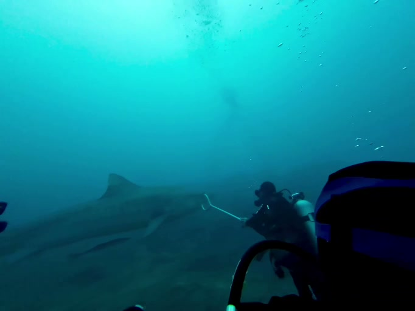
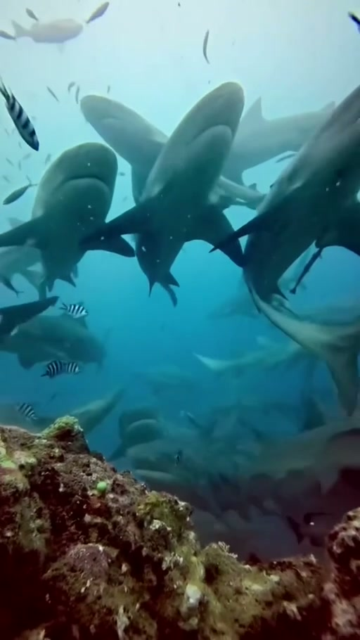
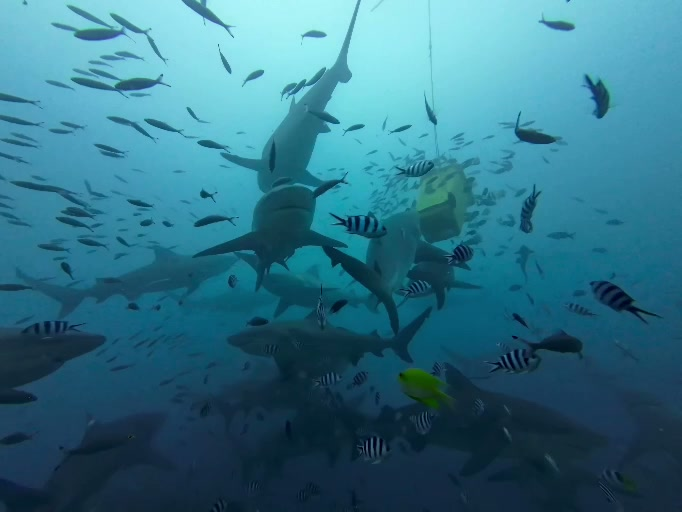
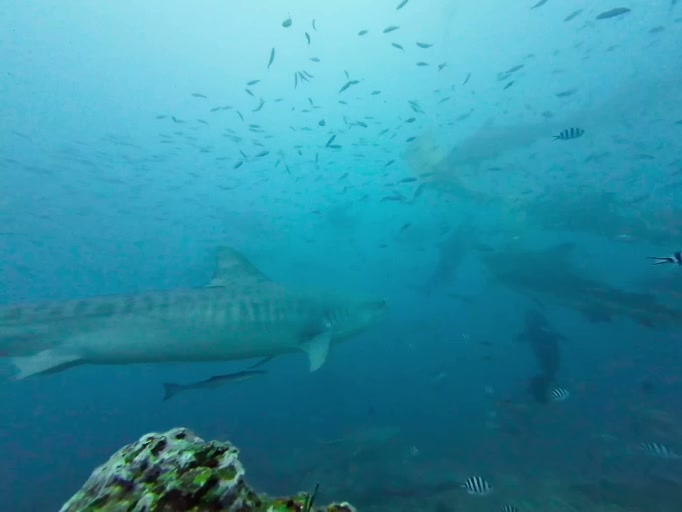

import tigerVideo from './_images/fiji-shark-diving/tiger-video.mp4?url';
import tigerPoster from './_images/fiji-shark-diving/tiger-poster.webp?url';
import sharksVideo from './_images/fiji-shark-diving/sharks-video.mp4?url';
import sharksPoster from './_images/fiji-shark-diving/sharks-poster.webp?url';

**26 сентября я нырял с акулами на Фиджи, в лагуне Бека.** Глубина — около 20 метров, под водой — примерно полчаса. В нашей встрече были бычьи акулы и тигровая. Погружение организовал Aqua-Trek, клетки между нами и животными не было.

Ниже — видео этой встречи и кадры из них. В одном плане видны дайверы у рифа, в другом акула занимает почти весь экран. Широкий кадр помогает понять обстановку; крупный показывает, ради чего мы спустились под воду.

## Акулы проходят мимо группы

Дайверы держатся у рифа. Над ними поднимаются пузырьки, между людьми и акулами ходят стаи рыб. В какой-то момент тигровая проходит сбоку от группы: видны полосы на теле, плавники, хвост. Она движется дальше, камера поворачивается вслед за ней.

На этом видео можно увидеть весь проход, а не только его самый эффектный момент. На стоп-кадре акула может занять весь экран. Точную дистанцию по одному кадру определить нельзя.

<figure>
  <video src={tigerVideo} poster={tigerPoster} controls preload="none" playsInline width="682" height="512" style="display:block;width:100%;height:auto" aria-label="Тигровая акула проходит рядом с группой дайверов у рифа на Фиджи">
    Ваш браузер не поддерживает видео. <a href={tigerVideo}>Открыть видео погружения на Фиджи</a>.
  </video>
  <figcaption>Лагуна Бека: тигровая акула проходит мимо дайверов. Видео длится около 26 секунд.</figcaption>
</figure>

*Фиджи, лагуна Бека: группа у рифа. Кадр из видео погружения.*

## Бычьи акулы крупным планом

Вертикальное видео показывает другую сторону встречи. В нём больше крупных планов: одна акула выходит из кадра, следом появляется следующая, а между ними мелькают рыбы. Свет и цвет воды меняются от плана к плану.

Бычьих акул в таком кадре видно подробнее, но положение группы почти исчезает из поля зрения. Поэтому оба видео оставил в статье: в одном есть пространство вокруг людей, в другом — движения и детали животных.

<figure>
  <video src={sharksVideo} poster={sharksPoster} controls preload="none" playsInline width="512" height="910" style="display:block;width:100%;max-width:480px;height:auto;margin-inline:auto" aria-label="Крупные планы акул во время погружения в лагуне Бека на Фиджи">
    Ваш браузер не поддерживает видео. <a href={sharksVideo}>Открыть вертикальное видео с акулами</a>.
  </video>
  <figcaption>Акулы в лагуне Бека. Вертикальное видео — 30 секунд.</figcaption>
</figure>

*Крупный план акул у Фиджи. Стоп-кадр из вертикального видео.*

## За такой встречей едут в Pacific Harbour

Pacific Harbour — база на Вити-Леву, откуда ездят нырять в лагуну Бека. У Aqua-Trek программа проходит на участке рифа **The Bistro**. С берега к месту выходят на лодке.

Это погружение с кормлением: группа наблюдает у рифа, команда оператора работает с кормом. Мы приехали на специально организованную встречу с акулами. Случайная встреча во время обычной прогулки над кораллами — другая история.

В описании программы фигурирует до восьми видов акул. Это возможные встречи, а не восемь обязательных пунктов за один выход. Тигровую тоже никто не обязан привести к следующей группе: животные дикие, состав встречи меняется.

*Лагуна Бека: акулы среди рыб у места погружения. Кадр из видео.*

## Сколько стоит повторить такой выезд

За выезд Aqua-Trek с двумя погружениями закладывайте **190 долларов США — около 16 100 ₽ с человека**. В этот тариф входят баллоны и грузовые пояса. Сбор морского заповедника оплачивается отдельно: **$15, около 1 300 ₽**. Аренда снаряжения — **$25, около 2 100 ₽ за день**.

| Вариант | Сумма на человека | Что учитывать |
|---|---:|---|
| Со своим снаряжением | $205 — около 17 400 ₽ | Два погружения и сбор |
| С арендой снаряжения | $230 — около 19 500 ₽ | Два погружения, сбор и дневная аренда |

Это бюджет по тарифу оператора для новой поездки; мой личный чек здесь не подсчитан. Международный перелёт, проживание и дорога к дайв-центру в сумму не входят. До бронирования [проверьте программу Aqua-Trek](https://www.aquatrek.com/sharkdive), уточните комплектацию аренды и полную стоимость под свои даты.

Мои примерно полчаса под водой описывают отдельное погружение. Они не равны длительности всего выезда. В программе два погружения с поверхностным интервалом; оставьте запас до второй половины дня и согласуйте возвращение, прежде чем ставить следующее мероприятие вплотную.

Фиджи — островное направление, и соседние острова не становятся одной точкой на карте. Если планируете жить на другом острове, сначала проверьте дорогу до Pacific Harbour. Отель в подборке [необычных отелей мира](/blog/luchshie-oteli-mira-2026/) находится на Вануа-Леву; выезд Aqua-Trek организуют с Вити-Леву.

## Как подготовиться к такому погружению

Для shark dive Aqua-Trek нужен сертификат **Open Water**, возраст — **от 15 лет**. Junior-сертификаты для этой программы не принимаются. Несовершеннолетний участвует с родителем или опекуном, у которого тоже есть дайверский сертификат.

До оплаты сообщите дайв-центру уровень подготовки и дату последнего погружения, уточните допуск и ограничения по глубине. Мои около 20 метров описывают мой опыт; по ним нельзя выбирать допустимую глубину для другого человека. Первое знакомство с аквалангом и этот shark dive стоит планировать как разные программы.

Нужен полный гидрокостюм. Дайв-компьютеры Aqua-Trek в аренду не предоставляет, поэтому вопрос оборудования решите до поездки. При выборе [страховки для путешествия](/blog/strahovka-dlya-puteshestviy-2026/) проверьте условия именно для дайвинга с аквалангом и вашей глубины: общий медицинский полис не обещает покрытия такого занятия.

Планы сопровождающего тоже обсудите заранее. На этот выезд оператор не берёт пассажиров, которые не ныряют; участок не предназначен для снорклинга. Бронь для дайвера не включает день наблюдения за акулами с поверхности для его партнёра.

*Тигровая акула у рифа в лагуне Бека. Кадр из другого фрагмента погружения.*

## Если хочется другой встречи с океаном

У меня есть и [история о китах в Тонга](/blog/tonga-whales/) — с фотографиями и видео. Там другой формат: наблюдение и плавание с китами. Сертификат, правила группы и программа Фиджи не переносятся на эту поездку.

