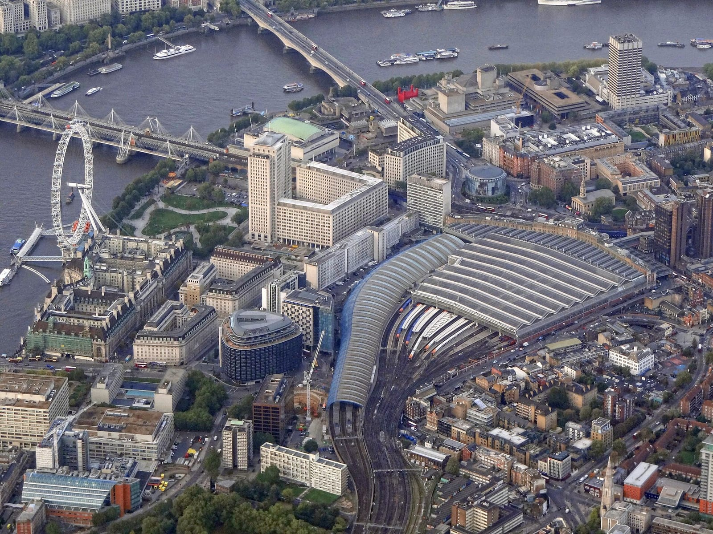
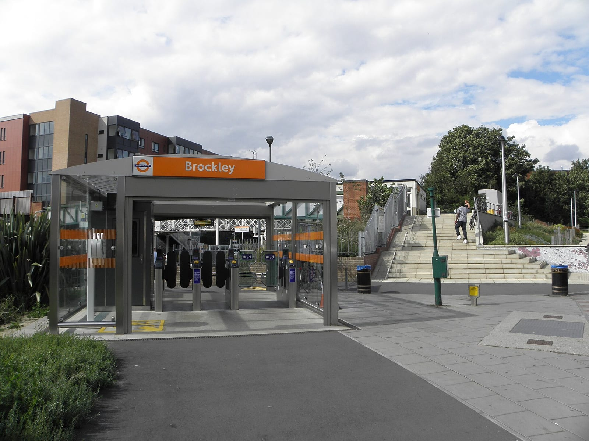
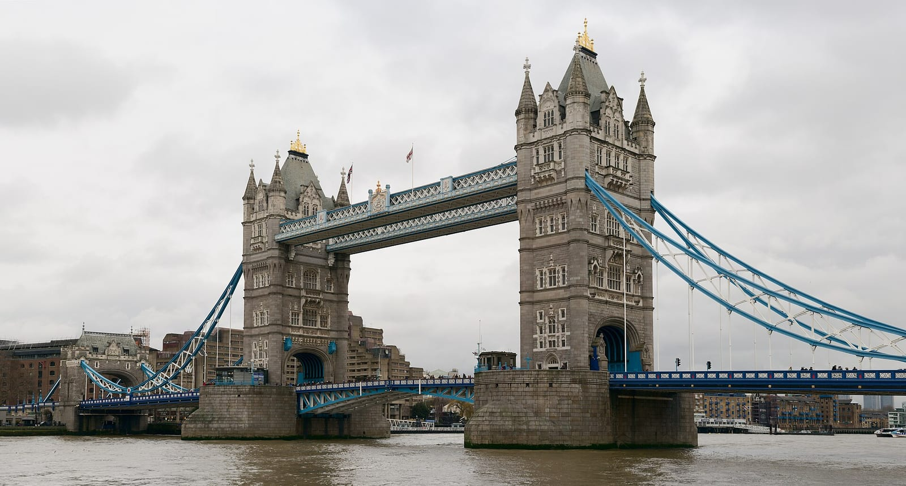

## Выберите обед по своему маршруту

Chippy — традиционная закусочная с рыбой в кляре и толстой жареной картошкой. За этим простым описанием скрываются разные места: от небольшого прилавка навынос до ресторана с посадкой, гарнирами и садом.

Стивен Пил, создатель The Chippy Tour, выбрал для BBC Travel пять лондонских заведений. Материал написала Ева Сандоваль. Ниже сохранены его рекомендации, а практический выбор начинается с географии. Не стоит пересекать город ради каждого обеда из списка: большая часть поездки уйдёт на дорогу, а еда не станет вкуснее от количества отметок.

| Заведение | Адрес | Ради чего выбрал Пил | Какому дню подходит | Что учесть |
|---|---|---|---|---|
| Brockley’s Rock | 317 Brockley Road,SE4 2QZ | Разная рыба и лёгкий кляр | Прогулке по Брокли и юго-востоку | Спецменю не гарантирует отсутствие следов аллергенов |
| Marlow Fish Bar | 57 Marlow Road,SE20 7YG | Жарка на говяжьем жире | Отдельной вылазке в Анерли/Пендж | Не подходит тем, кто исключает говяжий жир |
| Fishcotheque | 79A Waterloo Road,SE1 8UD | Традиционный chippy под мостом | Ватерлоо и южному берегу | Не рассчитывайте на тихий ресторанный вечер |
| Joseph’s Fish & Chips | 83 Tower Bridge Road,SE1 4TW | Гарниры и крупные порции | Прогулке в районе Тауэрского моста | Проверьте рабочий день; это не одноимённое место у Тауэра |
| Fishers | 19 Fulham High Street,SW6 3JH | Полноценный обед с посадкой | Фулему и западной части города | Рыба и картошка могут быть отдельными позициями |

В навигатор вводите полный адрес, особенно для Joseph’s. Увидеть слова Tower Bridge в названии недостаточно: ресторан находится на Tower Bridge Road, а не непосредственно на мосту.

*Вокзал Ватерлоо и южный берег. Архивная панорама района; самого Fishcotheque на снимке не показываем.*

## Пять разных причин заказать fish & chips

### Brockley’s Rock: выбор рыбы и специальные меню

Пил выделяет семейное заведение в Брокли за разнообразие рыбы и кляр, который остаётся лёгким и хрустящим. Это вариант для компании, где желания расходятся: один человек хочет классику, другой ищет рыбу на гриле, третий — растительное блюдо.

В меню есть безглютеновые и веганские разделы. Для человека с аллергией этого недостаточно: до заказа спросите о составе кляра, отдельной фритюрнице и контакте с другими продуктами. Наличие пометки GF говорит о позиции меню, а не об условиях всей кухни.

Из рекомендаций Пила можно начать с кальмаров с чили-имбирным соусом, если хочется отойти от трески. Наличие конкретной рыбы и блюда уточняйте на месте. Для еды в соседнем Hilly Fields нужна подходящая погода; дождливый день лучше не строить вокруг пикника.

*Станция Брокли, архивный снимок. Это транспортный ориентир района, а не фасад Brockley’s Rock.*

### Marlow Fish Bar: традиция говяжьего жира

Здесь причина поездки вполне конкретная — **beef dripping**, говяжий жир для жарки. Его отмечают и Пил, и ресторанный критик Дейзи Мигер в обзоре The Infatuation. Для любителя классического вкуса это интересная деталь; для человека с пищевыми или религиозными ограничениями — повод выбрать другое место либо заранее обсудить заказ.

Пил рекомендует Marlow как старое семейное chippy. Отдельная поездка оправдана, если вам интересен сам такой формат. Если времени в Лондоне мало, а день целиком проходит у Вестминстера и Ватерлоо, Fishcotheque проще встроить в прогулку.

Не выводите из слов «говяжий жир» никаких обещаний о сертификации, составе всех блюд или подходящем питании. Для заказа нужны ответы самого заведения.

### Fishcotheque: обед под железнодорожным мостом

Fishcotheque находится у Ватерлоо. Пилу нравится его старомодная атмосфера: мост и традиционный формат здесь часть впечатления, а не недостаток, который нужно скрывать.

Начать можно с привычной трески или пикши. Если встречаете слово **saveloy**, это не вид рыбы, а колбаска; **scampi** — тоже отдельная позиция, а не название картофельного гарнира. Не заказывайте незнакомое блюдо по звучанию, если принципиален состав.

Пил советует сначала попробовать рыбу без лишних добавок, а уксус и соль оставить картошке. Это его вкусовой подход. Есть руками или приборами, добавлять уксус или нет — ваше решение, а не экзамен на знание британской кухни.

### Joseph’s: гарниры и обед на двоих

Joseph’s на Tower Bridge Road Пил выбирает за большие порции и домашние гарниры. Он отмечает гороховое пюре, тартар и маринованные овощи. Если аппетит небольшой, спросите о размере порции и возможности разделить её, прежде чем заказывать две одинаковые.

Важна свежая деталь: сейчас заведение рассказывает о **норвежской фермерской треске Ode**. Поэтому рассчитывать на происхождение рыбы из Питерхеда, упомянутое в пересказе материала BBC, не стоит. Поставки и меню меняются.

Проверьте день посещения: сайт Joseph’s указывает воскресенье и понедельник выходными. Для остальных дней расписание тоже лучше уточнить перед дорогой.

*Тауэрский мост — ориентир прогулки по району. Joseph’s находится отдельно, на Tower Bridge Road.*

### Fishers: поесть сидя и выбрать гарниры

Fishers в Фулеме подойдёт тем, кому нужен спокойный обед с посадкой, а не свёрток еды на бегу. Пил особенно отмечает треску, толстую картошку и густое гороховое пюре. Его оценка порции и кляра — рекомендация конкретного человека, а не гарантия любого будущего заказа.

У Fishers есть разные варианты приготовления рыбы и растительные позиции. Но большая карточка меню не означает, что все блюда готовятся одинаково или подходят при аллергии. До оплаты уточните нужный способ приготовления, состав соуса и размер картошки.

В холодное время года уточните наличие посадки внутри. Сад из описания Пила — приятная сезонная возможность, а не обязательная часть зимнего визита.

## Сколько стоит полная порция

Легко ошибиться и принять цену **cod**, трески, за стоимость fish & chips целиком. У Fishers в меню доставки рыба и картошка прямо разделены.

Для ориентира: треска стоит **£12,85**, маленькая картошка — **£4,75**, большая — **£5,89**. Получается **£17,60–18,74**, ориентировочно **1 950–2 070 ₽** за рыбу с картошкой. Если добавить гороховое пюре за £3,95 и тартар за £1,49, сумма вырастет до **£23,04–24,18**, около **2 550–2 670 ₽**.

Это пример расчёта по меню доставки Fishers. Доставка, сервисные сборы и напиток сюда не входят; цена обслуживания в зале может отличаться. Не переносите эту сумму на остальные четыре заведения. Перед заказом попросите назвать итог именно вашей порции.

| Что уточнить | Почему это меняет счёт |
|---|---|
| Fish only или fish & chips | Картошка может оплачиваться отдельно |
| Small,regular или large | Размер рыбы и размер картошки могут выбираться независимо |
| Takeaway или eat in | Условия и меню навынос и в зале могут различаться |
| Соусы и горошек | Это нередко отдельные платные позиции |
| Итог до оплаты | Напиток, доставка и сборы не видны в цене одной рыбы |

## Как выбрать блюдо и не промахнуться с составом

**Cod** — треска, **haddock** — пикша, **plaice** — камбала. Слова **battered**, **grilled** и **steamed** обозначают разные способы приготовления: в кляре, на гриле и на пару. Для первого знакомства с chippy логично заказать рыбу в кляре и толстую картошку, а соусы взять отдельно, чтобы сначала попробовать само блюдо.

Горошек тоже бывает разным. **Mushy peas** — гороховое пюре; **garden peas** — целый зелёный горошек. На обложке этой статьи виден именно целый горошек. Он не показывает, какой гарнир вам подадут в выбранном заведении.

Если важны аллергены, веганское питание или религиозные ограничения, уточняйте не только рыбу. Спросите о жире для жарки, общем оборудовании, кляре и соусах. Отдельная пометка halal у колбасы не подтверждает статус всего ресторана; слово vegan в разделе не отвечает на вопрос о перекрёстном контакте.

## Кому лучше выбрать другой обед

- **Не едите говяжий жир:** Marlow нельзя выбирать вслепую ради одной только рыбы.
- **Нужна подтверждённая безопасность при аллергии:** сначала получите конкретный ответ кухни; рейтинг и статья его не заменяют.
- **Остался один день в центре:** не планируйте все пять точек. Выберите ближайшую к прогулке.
- **Хотите тихий праздничный ужин:** традиционный chippy под мостом может не совпасть с ожиданием ресторанного вечера.
- **Считаете каждую трату:** сравнивайте полный заказ, а не минимальную цену в разделе fish.

## Перед выходом из отеля

Сохраните точный адрес, проверьте часы на нужный день и выберите запасной вариант поблизости. В компании заранее решите, нужны ли отдельные порции и гарниры. Заказывая навынос, сначала найдите место, где сможете поесть: длинная дорога со свёртком плохо сочетается с хрустящим кляром.

Если поездка приходится на конец декабря, [в новогоднем гиде есть отдельный разбор Лондона](/blog/novyy-god-2027-kuda-poehat/): билет на фейерверк и доступ к набережной нельзя заменить бронированием обеда.

Пять мест Пила — хороший повод познакомиться с разными chippy, но для первого раза можно выбрать одно. Выберите его по району и своим ограничениям, попросите полный счёт и ешьте рыбу, пока она горячая.
