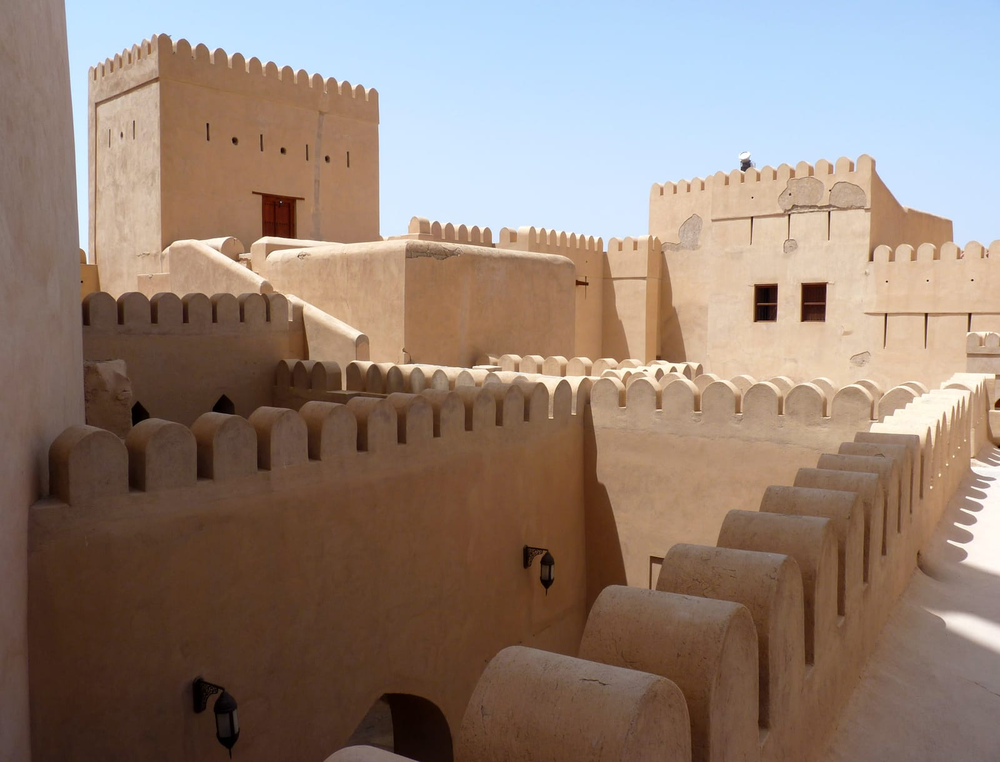
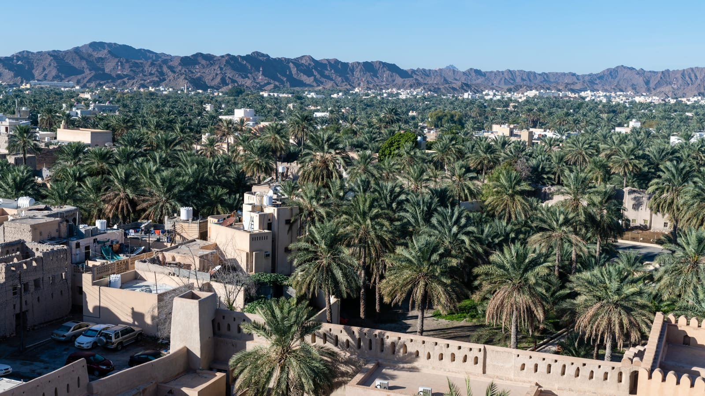
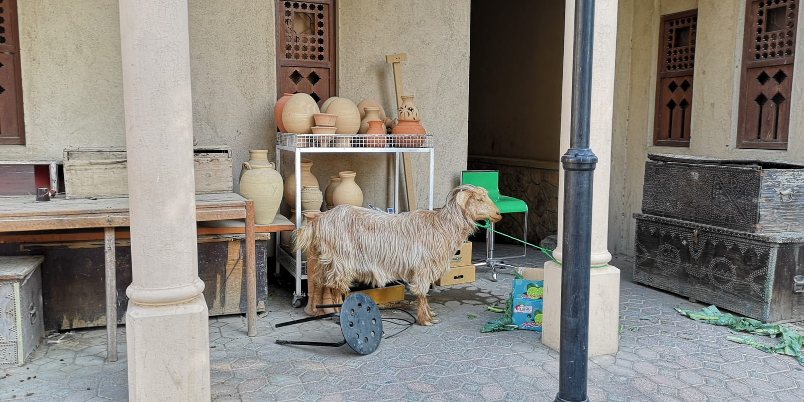

import { tpkDeep } from '../../data/affiliate.js';

Низва подходит, если хочется увидеть оборонительную архитектуру и старый город за одну остановку. Главная цель внутри — круглая башня, но ограничиваться ею жалко: в комплексе есть переходы, комнаты и открытые площадки. Вид на пальмовые сады помогает понять, почему укрепление стоит именно здесь.

## Как спланировать визит в форт Низва?

Сначала определите, сколько времени остаётся **на само место**, без дороги из Маската. Поездка из столицы с несколькими остановками займёт день; прогулка по форту — только его часть.

| Сколько времени у вас есть | Что выбрать | Что учесть |
|---|---|---|
| Около часа | Башня и доступные переходы без долгого осмотра комнат | Это сокращённый вариант: не пытайтесь заодно подробно пройти рынок |
| Полтора–два часа | Башня, помещения комплекса, виды со стен | На лестницы и остановки оставляйте запас |
| Утро без спешки | Форт, затем соседний рынок и перерыв на еду | Покупки и кафе увеличат время и расходы |

Это варианты для планирования, а не измеренный нами хронометраж. Если любите читать музейные пояснения и фотографировать детали, закладывайте больше времени.

Без машины из Маската можно поехать с гидом. <a href={tpkDeep('sputnik8', 'https://www.sputnik8.com/ru/muscat/activities/95373-nizva-i-dzhebel-ahdar-istoriya-gory-i-starinnye-derevni', 'tt_nizwa_guide_early')} target="_blank" rel="sponsored noopener">Посмотреть программу и даты поездки в Низву с русским гидом</a>. В этой программе есть также Биркат-аль-Муз и Джебель-Ахдар. Это дневная экскурсия, а не отдельный входной билет в форт.

## Что посмотреть: башня, лестницы и комнаты

Круглую башню построили в XVII веке при имаме Султане бин Саифе аль-Яруби. По описанию [оператора форта](https://nizwafort.om/en/about-fort/), строительство заняло 12 лет. Высота башни — 34 метра, диаметр — 45 метров. Эти размеры легче оценить изнутри: площадка за зубчатыми стенами гораздо шире обычной смотровой башенки.

Вход устроен через узкую лестницу с поворотами и семью дверями. Здесь интересны сами переходы: как меняется направление движения, где размещены оборонительные отверстия, что видно из-за стены. Подъём подходит для внимательного осмотра, а не для спешки вслед за группой.

*Переходы комплекса на архивном снимке апреля 2015 года.*

Рядом с фортом находится замок — жилая и административная часть комплекса. Оператор описывает библиотеку имама, комнаты приёма гостей, помещения для приготовления кофе и хранения фиников. Так визит получает второй смысл: после оборонительной башни можно посмотреть, как были устроены повседневная жизнь и управление.

Не обещайте себе увидеть всё за полчаса. Если времени мало, выберите башню и несколько помещений; если задержались у экспозиции, сократите последующую прогулку по рынку.

## Когда форт открыт и сколько стоит билет?

На 3 ноября 2026 года [туристический портал Омана](https://experienceoman.om/ru/marshruty/al-dakhiliya/fort-nizva) указывает такой график по местному времени:

- **С субботы по четверг — 08:00–20:00.**
- **В пятницу — 08:00–11:30 и 13:30–20:00.**

Для пятницы лучше выбрать один из двух отдельных промежутков. Приход к полудню не оставляет нормального времени на осмотр до перерыва. Перед особой датой или праздником проверьте режим ещё раз.

В [карточке билета от Nizwa Fort](https://myticket.om/en/products/nizwa-fort-entry-ticket), проверенной 3 ноября, взрослый туристический билет стоит **5 OMR**, детский для иностранцев 6–12 лет — **3 OMR**. Тариф для граждан Омана другой: его нельзя использовать как ориентир расходов туриста. Условия для детей младше шести и другие льготы уточняйте у форта.

| Кто идёт | Стоимость билетов | Примерно в рублях |
|---|---|---|
| Один взрослый турист | 5 OMR | 1050 ₽ |
| Один ребёнок 6–12 лет | 3 OMR | 630 ₽ |
| Двое взрослых | 10 OMR | 2110 ₽ |
| Двое взрослых и ребёнок восьми лет | 13 OMR | 2740 ₽ |

Это расходы **только на вход**, без дороги, еды и покупок на рынке. Рубли рассчитаны по [курсу Банка России на 3 ноября 2026 года](https://www.cbr.ru/scripts/XML_daily.asp?date_req=03/11/2026): 1 OMR = 210,594 ₽. Округление даёт ориентир бюджета; курс банка или обменника будет отличаться.

Туристический портал направляет за билетами в кассу на месте. В myticket.om сначала выбирают дату и время: проверенный онлайн-билет невозвратный. Не считайте покупку у посредника обязательным условием самостоятельного визита.

## Самостоятельно из Маската или с экскурсией?

На машине вы сами выбираете время в форте и на рынке. Для поездки из Маската оставляйте около двух часов в одну сторону как планировочный ориентир: точное время зависит от места старта и дороги. Если в тот же день нужно вернуться на рейс, учтите обе стороны пути и отдельный запас.

Экскурсия удобнее, когда не хочется организовывать транспорт или нужен рассказ на русском. Проверенная 3 ноября поездка Sputnik8 заявлена на 10 часов и стоит **550 $ за экскурсию**, около **44 500 ₽** по курсу ЦБ на ту же дату. В неё входят транспорт и обед; вход в форт и личные расходы оплачиваются отдельно.

Есть важная разница цен: организатор поездки указывает вход в форт отдельной доплатой **15 $ с человека**, около **1210 ₽**. Это условие конкретной программы, тогда как самостоятельный туристический билет в проверенной карточке стоит 5 OMR. До оплаты согласуйте, что покупает гид и какие доплаты будут у вашей группы. Стоимость экскурсии нельзя сравнивать с ценой одного входного билета.

<a href={tpkDeep('sputnik8', 'https://www.sputnik8.com/ru/muscat/activities/95373-nizva-i-dzhebel-ahdar-istoriya-gory-i-starinnye-derevni', 'tt_nizwa_guide_details')} target="_blank" rel="sponsored noopener">Проверить состав поездки, цену и доступность на свои даты</a>. Вместимость машины, место встречи и сопровождение внутри форта уточните у организатора. Наличие даты в календаре не означает подтверждённую бронь.

## Как подготовиться к лестницам и открытым площадкам?

Часть осмотра проходит под открытым небом. Воду и головной убор лучше взять с собой, а для лестниц выбрать удобную обувь. С детьми оставляйте больше времени на переходы и подъём; коляска не заменит переноску там, где идут ступени.

Если нужен маршрут без ступеней, заранее уточните доступные зоны у оператора. Подъём на круглую башню включает лестницы.

*Низва со стороны форта. Архивная панорама декабря 2019 года.*

Для спокойной прогулки выбирайте утро, учитывая дневную жару и время в дороге. Сезон северного Омана и отличие от Салалы разобраны в [гайде о времени поездки в Оман](/blog/oman-guide-2026/). Форт и прохладный горный маршрут — разные условия, поэтому одежду для следующей остановки планируйте отдельно.

## Что посмотреть рядом с фортом?

Соседний рынок удобно оставить на вторую часть утра. После стен и лестниц здесь можно посмотреть керамику, финики и ремесленные товары. Если времени мало, выберите одну цель: короткую прогулку или покупки, вместо попытки обойти каждую лавку.

*Лавка на рынке Низвы, архивный кадр января 2019 года.*

На рынок и кафе закладывайте отдельную сумму: в билет форта эти расходы не входят. 

Если это первый день в стране, сравните Низву с [прогулкой по Маскату](/blog/maskat-za-odin-den/). Маскат удобнее для дня в столице, Низва — для отдельного выезда к форту и старому городу. Общие сезоны и подготовка к поездке собраны на [странице Омана](/oman/).

## Что пишут те, кто был?

Для этого обзора разобраны **два отчёта**: [рассказ на форуме Винского](https://forum.awd.ru/viewtopic.php?t=437506) о поездке в сентябре 2025 года и [обзор Oman Wanderlust](https://omanwanderlust.com/nizwa-fort-the-largest-on-the-arabian-peninsular/), обновлённый 9 октября 2026 года. Во втором точные даты визитов не названы. Это небольшая выборка, представительной считать нельзя.

В обзоре форта советуют оставлять не меньше двух часов и отдельно отмечают множество ступеней. Для семьи с ребёнком, который ещё не ходит сам, там рекомендуют переноску вместо коляски. Полезный вывод для нашего плана — не считать подъём и переходы быстрым дополнением к рынку.

Форумный путешественник пишет о трудностях с большой машиной на узких улицах центра и советует заранее продумать парковку. Рынок он описывает сдержанно: приятная прогулка за фруктами и сладостями, без особого восторга. Поэтому покупки разумнее оставить необязательной частью дня, если главная цель — форт.

Эти тексты дают детали и ожидания, но не устанавливают сегодняшние очереди, наличие парковочных мест или правила входа. Текущие цены и часы выше взяты из проверенных карточек, а не из старого чека посетителя.

## Ещё два вопроса перед поездкой

### Обязательно ли брать гида для входа в форт?

Туристический портал описывает покупку билета в кассе и услуги гида по запросу. Дневная экскурсия из Маската нужна для транспорта и сопровождения; самостоятельный вход в форт остаётся отдельным вариантом. Наличие гида на месте и стоимость его услуг уточните при покупке билета.

### Можно ли выйти на обед и вернуться по тому же билету?

В прочитанных официальных описаниях правило повторного входа не установлено. Если хотите разделить посещение перерывом, уточните это в кассе **до выхода**. Дневные часы работы сами по себе не подтверждают возможность вернуться по использованному билету.
