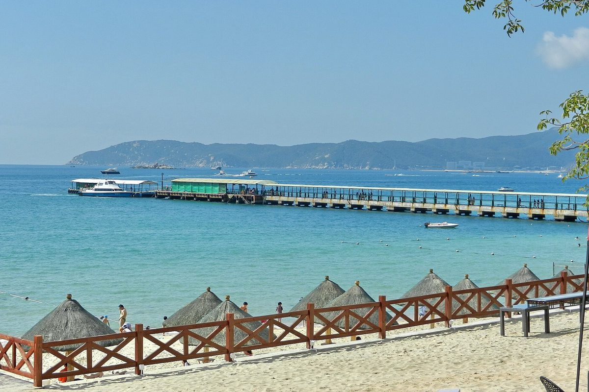
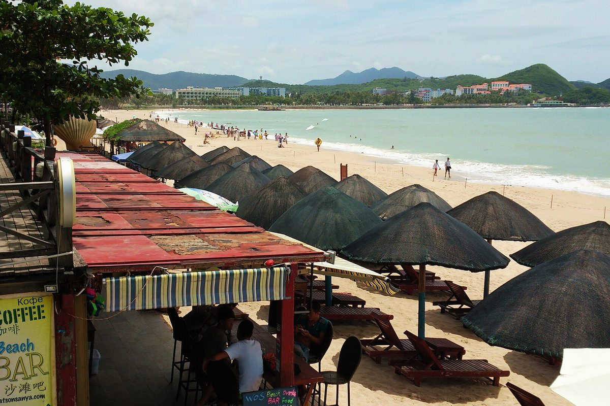
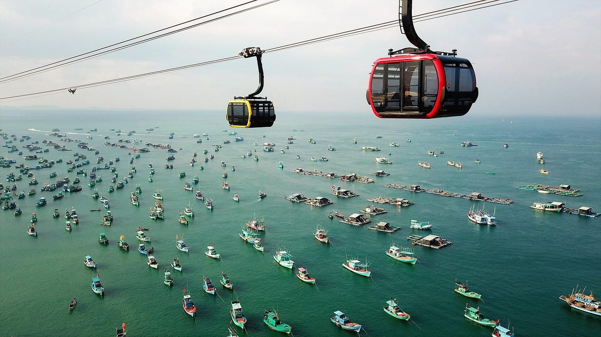
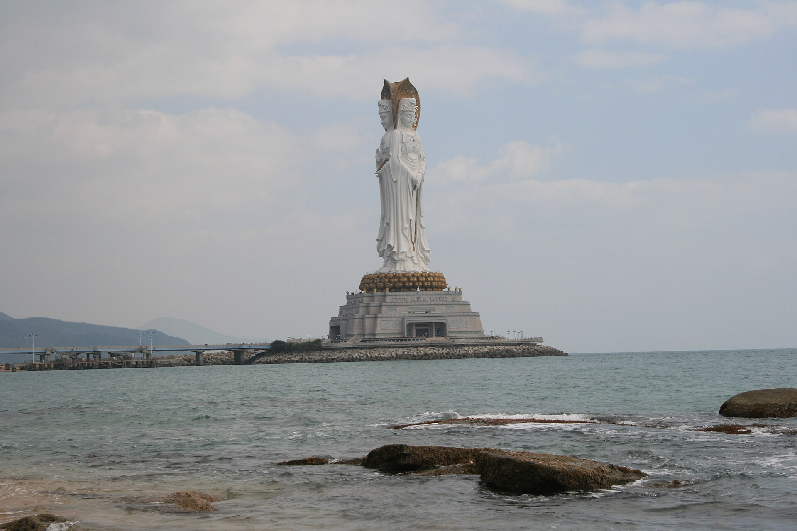
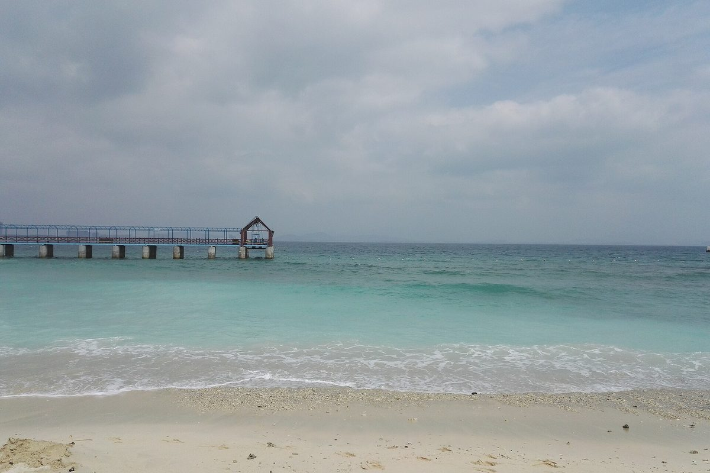

import { aviasalesRoute, ostrovokCity } from '../../data/affiliate.js';

export const flightsFukuok = aviasalesRoute('MOW', 'PQC', 'fukuok_hainan_flight_pqc');
export const flightsSanya = aviasalesRoute('MOW', 'SYX', 'fukuok_hainan_flight_syx');
export const hotelsFukuok = ostrovokCity('vietnam', 'phu_quoc', 'fukuok_hainan_stay_pqc');
export const hotelsSanya = ostrovokCity('china', 'sanya', 'fukuok_hainan_stay_syx');

**Выбирайте Фукуок, если хотите совместить островной пляж, вечерний рынок Дуонг-Донга и поездку на Хонтхом. Выбирайте Хайнань, если вам подходит одна из бухт Саньи: городской Дадунхай или отдых в курортном отеле Хайтанвана.** Для семьи и пары решающими будут пляж у конкретного отеля, дорога до него и итоговая цена на ваши даты.

Зимой оба направления стоит включить в сравнение. У Фукуока официальный туристический портал рекомендует ноябрь–апрель; у Саньи комфортный период зависит от бухты. Назначать победителя по фразе «на острове всегда тепло» нельзя: купание определяют ещё ветер, волна и разрешение спасателей на конкретном берегу.

| Ваш приоритет | Что сравнивать на Фукуоке | Что сравнивать на Хайнане |
|---|---|---|
| Вечером выходить из отеля пешком | Размещение возле Дуонг-Донга и путь к рынку | Дадунхай, расположение относительно пляжа и торговых улиц |
| Большую часть дня проводить в отеле | Собственный пляж, бассейн и питание выбранного комплекса | Курортные комплексы Хайтанвана; доступ к морю проверять отдельно |
| Добавить одну заметную поездку | Хонтхом или север острова | Другую бухту Саньи или Наньшань |
| Поехать с маленьким ребёнком | Дорогу, тень, номер и заход в воду | Те же условия; слово «семейный» в рекламе их не подтверждает |
| Выбрать дешевле | Полную смету на одинаковые даты | Полную смету с тем же багажом, питанием и числом ночей |

## Начните с перелёта, затем выбирайте отель

Сравните <a href={flightsFukuok} rel="sponsored noopener">перелёты Москва — Фукуок</a> и <a href={flightsSanya} rel="sponsored noopener">Москва — Санья</a> на одинаковые даты. Поиск открывается на следующий месяц; задайте свой день, состав семьи и обратный рейс. Наличие прямого перелёта и его расписание проверяйте в результатах: они здесь не обещаны.

На Фукуоке нужен аэропорт **PQC**, для пляжного отдыха в Санье — **SYX**. В предложении с Хайнанем проверьте город прилёта: Хайкоу расположен на том же острове, но это другой аэропорт и другая дорога к курортам Саньи. Сверяйте маршрутную квитанцию, а не только заголовок тура.

При самостоятельной стыковке посмотрите, один ли билет вы покупаете, до какого пункта оформят багаж и понадобится ли проходить границу в промежуточном аэропорту. Заложите в смету дополнительную ночёвку, если она есть в маршруте. Дешёвый билет с двумя отдельными перелётами и короткой пересадкой может оказаться неудобным для семьи, даже когда цена ниже.

В пакетном предложении уточните, включены ли трансфер и багаж каждого пассажира. При самостоятельной поездке получите от отеля условия встречи: аэропорт, время прилёта, цена всей машины и доплата за поздний приезд. Число ночей тоже сверяйте отдельно: поздний прилёт и ранний вылет уменьшают фактическое время на пляже.

Ялунван — одна из бухт Саньи. Вид с отеля не отвечает на вопрос о доступном входе в воду у другого комплекса.

## Ноябрь, зима или лето: как учитывать сезон

[Vietnam Tourism](https://vietnam.travel/places-to-go/mekong-delta/phu-quoc) относит **ноябрь–апрель** к лучшему периоду для Фукуока: это сухой сезон. **Май–октябрь** портал описывает как дождливый период с более неспокойным морем. Это климатическая рекомендация, а не обещание солнечной недели после первого ноября.

По Хайнаню полезнее смотреть конкретную бухту. Официальный портал Саньи называет **ноябрь–апрель** комфортным периодом для Дадунхая, а **октябрь–март** — для Хайтанвана. Эти интервалы перекрываются с сезоном Фукуока. Одного месяца недостаточно, чтобы доказать, где будет лучше купаться именно во время вашего отпуска.

Если главный запрос — «Фукуок или Хайнань в ноябре», сначала отберите два отеля с подходящим пляжем. Затем проверьте прогноз ближе к вылету и уточните у каждого условия купания: бывают ли запреты, работает ли спасательный пост, есть ли бассейн для дней с волной. Задавайте вопрос про берег выбранного отеля, а не про море на всём острове.

Для летней поездки дождливый сезон Фукуока — существенный фактор выбора. Особенно если отпуск короткий и вы рассчитываете ежедневно плавать. Для Хайнаня также проверьте прогноз и сообщения о тропических циклонах перед вылетом. При предупреждении следуйте указаниям местных служб; привлекательная фотография пляжа не отменяет ограничение.

Не сравнивайте Фукуок с погодой «во Вьетнаме вообще». Нячанг, Дананг и Ханой находятся в других районах. Если выбираете между двумя вьетнамскими курортами, нужен отдельный [разбор Нячанга и Фукуока](/blog/nyachang-fukuok-2026/), а не перенос сезона одного места на всю страну.

## Где жить: прогулки пешком или отдельный курорт

На Фукуоке ночной рынок находится возле **Дуонг-Донга**. Если хотите каждый вечер выбирать еду вне отеля, проверьте дорогу от номера до этой части острова: расстояние по карте, освещение и необходимость такси. Название «Фукуок» в карточке размещения само по себе не означает близость к рынку.

Можно <a href={hotelsFukuok} rel="sponsored noopener">посмотреть отели Фукуока</a> и сопоставить их положение с планом поездки. Для отдыха внутри комплекса сначала изучайте пляж, бассейны и питание. Для вечерних прогулок — выход к улицам с ресторанами. Один и тот же отель может отлично подходить первому сценарию и требовать ежедневных поездок во втором.

В Санье **Дадунхай** сочетает пляж с городской средой: официальный туристический портал перечисляет прибрежные кафе, рестораны и торговые улицы. **Хайтанван** описан как район крупных курортных отелей. У этих мест разные сценарии отдыха; заголовок «отель на Хайнане» скрывает полезное различие.

В <a href={hotelsSanya} rel="sponsored noopener">поиске отелей Саньи</a> задайте бухту или проверьте каждый адрес на карте. Уточните, сколько реально идти до моря и разрешено ли там купание. Пляжная территория и пригодный для вас заход в воду — два отдельных вопроса. Для человека с ограниченной подвижностью добавьте проверку лестниц, пандусов и пути от номера.

Дадунхай удобен для сочетания пляжа с городской прогулкой. Конкретный пеший путь лучше проверить по адресу отеля.

## Что делать, когда хочется уйти с пляжа

На Фукуоке можно выделить день на **Хонтхом**: остров связан с основной частью Фукуока канатной дорогой над морем. Отдельный вариант — пляж **Сао**, который туристический портал перечисляет среди мест для посещения. Ещё один — перцовые хозяйства, производство рыбного соуса или лесные маршруты на севере. Доступ, часы и цену выбранной программы проверяйте перед поездкой.

Не пытайтесь уместить север, юг и вечерний рынок в каждый свободный день. Сначала отметьте места на карте относительно отеля. Если вы живёте далеко от Дуонг-Донга, поездка на рынок становится отдельным выездом. Это влияет и на бюджет такси, и на количество времени, которое остаётся у моря.

На Хайнане пляжный отдых можно дополнить поездкой в другую бухту или к комплексу **Наньшань**. Для более подробного маршрута пригодится [гайд по Хайнаню](/blog/hainan-guide-2026/). Он помогает выбрать занятия на самом острове; переносить их все в одну неделю не обязательно.

Для короткого отпуска заранее выберите одну поездку, ради которой готовы отдать пляжный день. Остальные оставьте запасными. При плохой погоде проверьте, безопасна ли дорога и работает ли место назначения: «поедем на экскурсию вместо моря» не является универсальным планом во время сильного шторма.

Хонтхом относится к южной части поездки по Фукуоку. При выборе отеля учитывайте отдельный переезд к канатной дороге.

## Как сравнить цену без лишних обещаний

Здесь нет универсального вывода «Фукуок дешевле Хайнаня». Чтобы он был полезен для вашей поездки, нужны два доступных предложения на одни даты и одинаковый состав путешественников. Сравнение стоимости номера с ценой пакетного тура не отвечает на вопрос о полном бюджете.

Запишите для каждого варианта **перелёт туда и обратно, багаж, размещение, питание, трансфер, местные поездки и страховку**. Отдельно отметьте оплаченные заранее экскурсии. Если в одном варианте завтрак включён, а в другом нет, добавьте питание ко второму. Скидку считайте по итоговой сумме после обязательных сборов.

| Строка сметы | Условие одинакового сравнения |
|---|---|
| Билет | Те же даты, пассажиры, багаж и условия пересадки |
| Отель | То же число ночей, нужные кровати и сопоставимое питание |
| Трансфер | Из фактического аэропорта к выбранному отелю, в обе стороны |
| Передвижение | Реальные выезды из отеля к вашим местам |
| Отмена | Одинаково приемлемые условия возврата и изменения |

Для семьи добавьте детское место в трансфере, нужную кровать и условия питания ребёнка. Узнайте, включены ли они в указанную цену: возрастная отметка в поиске не всегда объясняет каждую услугу. При позднем прилёте проверьте возможность заселения и кормления, чтобы не искать решение ночью на месте.

Сохраняйте оба предложения с датой проверки. Если цена изменилась, сравнение нужно обновить. Окончательный выбор делайте по смете и удобству поездки: несколько дополнительных переездов способны перевесить небольшую разницу в стоимости номера.

Наньшань — самостоятельная поездка. Время дороги от вашего отеля добавляется к времени посещения.

## Въезд с российским паспортом и оплата

В Китай с российским общегражданским паспортом можно въехать без визы на срок **до 30 дней**. [Безвизовый режим](https://www.kdmid.ru/docs/china/information-about-the-country/) действует **15 сентября 2025 — 31 декабря 2027**; туризм входит в разрешённые цели. Перед вылетом сверяйте условия с официальным источником и перевозчиком.

Для Вьетнама действует освобождение россиян от визы на срок **до 45 дней**: [правительственное сообщение](https://en.baochinhphu.vn/viet-nam-waives-visas-for-citizens-from-12-countries-until-march-2028-111250308085955058.htm) указывает период **15 марта 2025 — 14 марта 2028** при соблюдении условий въезда. Специальный режим Фукуока на 30 дней не нужно подставлять вместо общего 45-дневного освобождения для граждан РФ. Подробности документов и формы прибытия собраны в [разборе въезда во Вьетнам](/blog/vietnam-visa-2026/).

Для Хайнаня подготовьте способ оплаты до вылета. [Официальное китайское руководство](https://english.www.gov.cn/news/202404/11/content_WS6617c858c6d0868f4e8e5f4d.html) перечисляет наличные, банковские карты и мобильные платежи, включая привязку поддерживаемых международных карт к Alipay и WeChat Pay. Оно не подтверждает работоспособность любой российской карты. Проверяйте конкретный банк и сервис; держите запасной разрешённый способ оплаты.

Для Фукуока также уточните у отеля способы оплаты номера и депозита. Ответ «карты принимаем» недостаточен, если у вас карта другого выпуска или деньги на конкретном счёте. Проверьте условия бронирования, валюту списания и возврат до оплаты. Связь и доступ к нужным приложениям подготовьте заранее, сохранив адрес отеля и билет так, чтобы открыть их без интернета.

Хайтанван — отдельный район Саньи. Название бухты полезнее для выбора размещения, чем общее обещание «отдых на Хайнане».

## Выбор для пары и семьи

**Для пары, которая хочет выходить вечером пешком**, сравните размещение возле Дуонг-Донга на Фукуоке и в Дадунхае на Хайнане. Проверьте оба маршрута от отеля: пляж днём, еда вечером. При сопоставимой цене выбирайте место, где ваши обычные занятия доступны без постоянных поездок.

**Для семьи, которая проводит почти весь отпуск в комплексе**, сначала выберите два конкретных отеля. Спросите про питание ребёнка, тень, бассейн, разрешённое купание и время трансфера. После этого сравните полный бюджет. Дорогой курорт с подходящими условиями может быть полезнее дешёвого номера далеко от нужного берега; рекламная категория отеля этого не решает.

**Для тех, кто хочет много ездить**, выпишите две-три цели на острове и расстояния между ними. У Фукуока это может быть Хонтхом, Дуонг-Донг и север. У Хайнаня — выбранная бухта Саньи и поездка по острову. Привязывайте размещение к этому плану, чтобы отпуск не превратился в ежедневный длинный трансфер.

Перед оплатой у вас должны остаться два понятных варианта: точные рейсы, адрес и бухта отеля, условия купания, перечень включённых услуг и итоговая сумма. Если один из них выигрывает по важным для вас условиям, вопрос «какой остров лучше вообще» теряет смысл.
