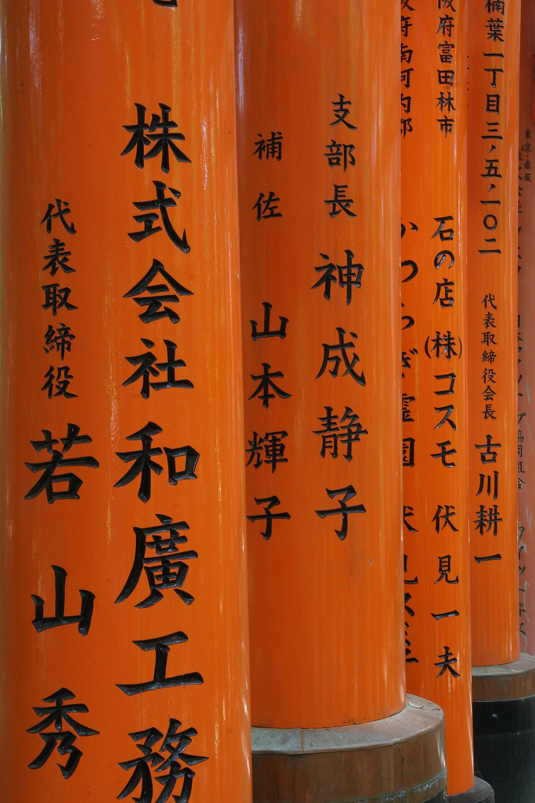
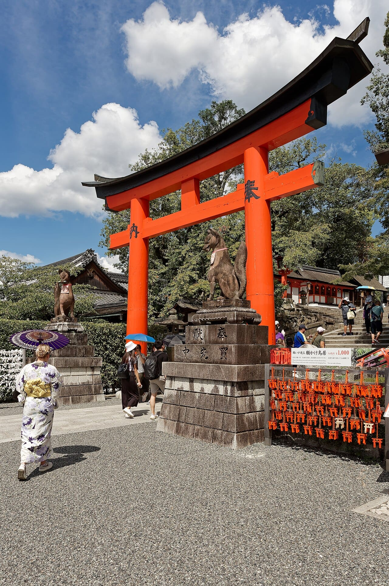
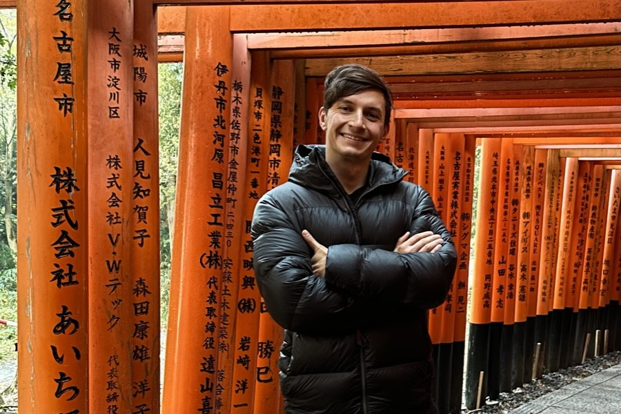
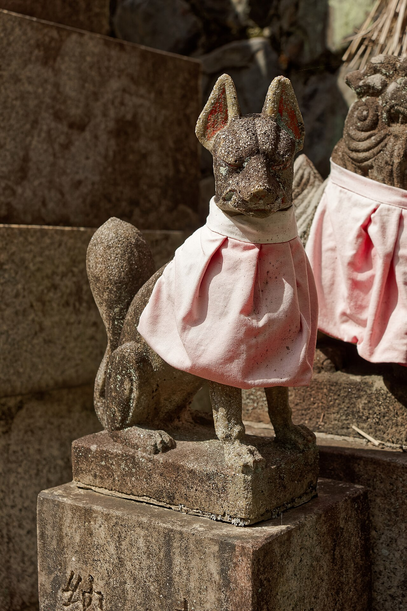

В Фусими Инари легко совершить две противоположные ошибки: уйти после первого коридора красных ворот или подняться на вершину только потому, что «раз приехали, надо дойти». Самое известное место Киото устроено интереснее. Здесь есть короткая прогулка, подъём к панораме города и полноценный маршрут по священной горе. Выбирать стоит по времени и силам.

Вход в святилище бесплатный. Для первого посещения мы предлагаем идти до развилки Ёцуцудзи и там решать, продолжать ли подъём. На полную прогулку до вершины и обратно закладывайте около двух–трёх часов, на остановки и фотографии — дополнительное время. Если вы путешествуете с маленькими детьми или тяжело переносите лестницы, нижняя часть комплекса тоже даёт содержательное знакомство с местом.

Если хотите слушать рассказ на русском в своём темпе, можно выбрать <a href="https://tripster.tpk.mx/cicJCuPT?erid=2VtzqxMZpjc&amp;sub_id=tt_fushimi_inari_audio&amp;u=https%3A%2F%2Fexperience.tripster.ru%2Fexperience%2F112508%2F" target="_blank" rel="sponsored noopener">аудиогид по Фусими Инари</a>. Это отдельная услуга: сам вход остаётся бесплатным.

## Зачем сюда идти, кроме фотографии

Фусими Инари-тайся — синтоистское святилище, история которого отсчитывается с 711 года. Оно возглавляет сеть примерно из 30 тысяч святилищ Инари по Японии. Сюда приходят молиться об урожае, благополучии и успехе в делах; туристическая популярность не отменила религиозной жизни.

Знаменитые тории — подношения людей и организаций. На воротах можно увидеть имена жертвователей и даты. Это помогает по-другому прочитать прогулку: перед вами не единая декорация, построенная для посетителей, а множество отдельных посвящений. На всей горе насчитывается около десяти тысяч тории разных размеров. Самый плотный двойной коридор у подножия, Сэнбон-тории, — лишь один участок маршрута.

Обратите внимание на лисиц. Они считаются посланниками Инари, а не самим божеством. Каменные фигуры, маленькие подношения и святилища между деревьями делают верхнюю часть прогулки содержательнее, чем соревнование за пустой кадр. Лучше оставить время, чтобы рассмотреть несколько деталей, чем пройти все лестницы, не поднимая глаз от карты.

## Как добраться: две станции, которые легко перепутать

Из Kyoto Station удобен поезд JR Nara Line до станции **Inari**: две остановки, около пяти минут в поезде. Перед посадкой проверьте остановки выбранного состава — направление на Нару само по себе не гарантирует остановку у святилища. Главный подход находится у выхода со станции.

Если живёте ближе к линии Keihan, смотрите станцию **Fushimi-Inari**. От неё до комплекса несколько минут пешком. Это другая станция: не закладывайте время, исходя из того, что JR и Keihan высадят вас у одной двери.

Полезный приём для маршрута по Киото — сначала поставить на карту свой отель, затем обе станции. Иногда прямой поезд от жилья экономит больше времени, чем поездка через Kyoto Station ради короткого пяти­минутного участка. Учитывайте весь путь от двери до двери, включая выход из гостиницы и ожидание состава.

Такси имеет смысл сравнивать для компании или при сложном подходе от жилья. Само святилище рекомендует общественный транспорт: парковка бывает перегружена. Если продолжаете поездку по стране, транспорт между городами разобран в [путеводителе по Японии](/blog/japan-guide-2026/).

## Какой маршрут выбрать

Время ниже — ориентир для планирования, а не обещание скорости. Толпа, жара, дождь и остановки меняют продолжительность прогулки.

| Вариант | Что увидите | Сколько заложить | Кому подойдёт |
|---|---|---|---|
| Нижний комплекс | Главные здания, лисицы, Сэнбон-тории | Около часа | Для короткого знакомства и поездки с детьми |
| До Ёцуцудзи и обратно | Ворота на склоне и панораму Киото | Примерно полтора–два часа | Для первого посещения без обязательства идти на вершину |
| Полный круг по горе | Верхние святилища и лесные участки | Около двух–трёх часов, с запасом на отдых | Тем, кто готов к продолжительным лестницам |

**Начните с главных зданий.** Не проходите их насквозь ради ворот. Здесь легче понять, что Фусими Инари остаётся местом молитвы. Пропускайте людей, которые пришли к святыням, и не направляйте камеру в лицо молящимся.

**Пройдите Сэнбон-тории.** На узком участке поток может двигаться медленно. Для фотографии дождитесь просвета, не перекрывая проход. Не стоит останавливаться всей компанией поперёк дорожки: за вами продолжают идти люди.

**Продолжайте по основному обозначенному пути.** Выше начинаются лестницы, появляются небольшие святилища и места для передышки. Проверяйте указатели на развилках: движение вниз не всегда возвращает к тому входу, через который вы пришли.

**На Ёцуцудзи сделайте паузу.** Эта развилка примерно на середине подъёма известна видом на Киото. До неё часто доходят за 30–45 минут подъёма, но с остановками потребуется дольше. Здесь удобно оценить оставшийся световой день, погоду и усталость.

**Вершина — по желанию.** Высота горы Инари — 233 метра, но небольшая цифра не отменяет ступеней. Продолжайте ради самого пути и верхних святилищ. Если главным желанием была панорама города, разворот у Ёцуцудзи — полноценный вариант, а не неудавшееся восхождение.

## Когда приходить и как не превратить прогулку в гонку

В опубликованных заметках о Киото Никита вспоминает ноябрь 2023 года: осенние цвета привлекали толпы, а Фусими советовал оставить на утро. Это архивный опыт, который хорошо объясняет принцип планирования; расписанием загруженности на вашу дату он не является.

Раннее утро даёт больше шансов пройти нижние коридоры спокойнее. Но универсального часа, после которого здесь «никого нет», не существует. На посещаемость влияют сезон, день недели и группы, приехавшие одновременно с вами. Не покупайте дорогой трансфер только ради обещания пустых ворот.

Территория доступна круглосуточно, однако это не означает круглосуточную работу киосков, заведений и всех услуг. Поздний вечер меняет впечатление: часть деталей сложнее рассмотреть, лес темнеет, а усталость после дня в Киото никуда не исчезает. Для первого полного подъёма выбирайте дневной свет.

Летом учитывайте влажную жару и возьмите воду до начала подъёма. После дождя ступени и лесные участки могут быть скользкими. Зимой проверяйте состояние дорожек; поздней осенью оставляйте запас до темноты. Если прогноз плохой, сократите маршрут до нижнего комплекса вместо попытки выполнить план любой ценой.

Удобно поставить Фусими Инари первым большим пунктом дня, а после прогулки оставить обед и одну соседнюю остановку. Попытка добавить сюда ещё три удалённых района Киото обычно сокращает именно то время, ради которого вы приехали: возможность спокойно смотреть по сторонам.

## Сколько стоит посещение и нужен ли гид

Вход на территорию и проход по основному маршруту бесплатные. Бюджет самостоятельной прогулки складывается из дороги, еды и необязательных покупок. Пожертвования, амулеты и экскурсионные услуги — отдельные расходы, а не обязательная плата за доступ к воротам.

Если хочется объяснений на русском, один из вариантов — <a href="https://tripster.tpk.mx/cicJCuPT?erid=2VtzqxMZpjc&amp;sub_id=tt_fushimi_inari_audio&amp;u=https%3A%2F%2Fexperience.tripster.ru%2Fexperience%2F112508%2F" target="_blank" rel="sponsored noopener">аудиогид по Фусими Инари</a>. В карточке указаны продолжительность полтора часа и цена 14 долларов за человека, ориентировочно 1160 ₽. Для двоих это около 2310 ₽. Пересчёт нужен для сравнения бюджета: сумма списания зависит от способа оплаты и курса продавца.

Для прогулки нужно приложение для iOS или Android; инструкции по активации продавец отправляет после оплаты. По условиям карточки, пользоваться аудиогидом можно в любой день без ограничения срока, а дата при заказе может быть приблизительной. Возможность заранее скачать запись и карту уточните до покупки. Аудиогид не заменяет сопровождающего и не охватывает все достопримечательности комплекса. Заявленные полтора часа — длительность программы, а не обещание пройти весь круг по горе за это время.

Живую экскурсию выбирайте, если важны диалог и объяснение религиозных деталей. Смотрите, сколько времени программа проводит именно здесь: обзор Киото с остановкой у ворот и отдельная прогулка по горе решают разные задачи. Для самостоятельного посещения покупать услугу необязательно.

## Четыре детали, которые стоит заметить

**Лисицы не одинаковые.** Рассмотрите позы и предметы у фигур, но не трогайте подношения. Один из узнаваемых мотивов — ключ от рисового хранилища. Это связь места с урожаем и достатком, которую легко пропустить за поиском красивого ракурса.

**У ворот есть обратная сторона.** Надписи превращают одинаковые на первый взгляд конструкции в отдельные истории посвящений. Для крупного плана лучше найти участок, где вы не мешаете потоку, чем фотографировать буквы в самом тесном коридоре.

**Маленькие тории тоже имеют значение.** Среди крупных ворот встречаются небольшие подношения. Не переставляйте их ради композиции и не используйте как реквизит.

**Вершина не обязана быть кульминацией.** В этом маршруте интересны повторение ворот, лес, лестницы и маленькие святилища. Если воспринимать прогулку только как путь к финальной смотровой, можно обесценить большую часть впечатления ещё до начала.

## Как совместить с Тофуку-дзи

После Фусими Инари можно выбрать Тофуку-дзи — другой тип храмового пространства и удобное продолжение знакомства с юго-восточным Киото. Разделите посещения обедом и проверьте часы работы конкретных платных зон храма. Круглосуточная доступность Фусими Инари на соседние достопримечательности не распространяется.

Существует и более длинный лесной переход к Тофуку-дзи через участки Kyoto Trail. Официальный туристический сайт Киото публикует [подробный маршрут](https://kyoto.travel/en/itineraries/fushimi-inari-tofukuji-hike/). Это вариант для подготовленной прогулки с картой, подходящей обувью и дневным светом. Не стоит добавлять его после полного круга по горе автоматически: получится другой объём нагрузки.

В дождь, с коляской или при ограниченном времени удобнее обычное перемещение между точками. «Секретная тропа без людей» не должна становиться обязательным пунктом поездки. А на отдельный день из Киото можно оставить [Нару](/blog/nara-za-odin-den/) — совмещать оба больших маршрута в один день мы не предлагаем.

## Что взять и кому лучше сократить прогулку

Нужны обувь с цепкой подошвой, вода, заряженный телефон и офлайн-карта. Небольшой рюкзак удобнее тяжёлой сумки в руке. После дождя возьмите защиту от осадков, с которой легко пользоваться лестницами, не задевая окружающих.

С коляской рассчитывайте прежде всего на нижнюю часть комплекса: горный круг включает множество ступеней. При ограничениях подвижности заранее уточните доступный подход у святилища. Семье с ребёнком полезнее выбрать короткий маршрут с остановками, чем обещать вершину и потом торопить уставшего спутника.

Правила самого святилища запрещают дроны, кормление животных и создание помех на дорожках ради съёмки. Есть и ограничения на коммерческую фотографию. Ешьте в отведённых местах; лесные святилища не подходят для пикника. Встретив дикое животное, не приближайтесь к нему ради фотографии.

До поездки отдельно проверьте [условия японской визы](/blog/japan-visa-2026/). Бесплатный вход в достопримечательность ничего не меняет в правилах въезда в страну.

## Что пишут те, кто был

В одной дискуссии r/JapanTravelTips, доступной в ноябре 2026 года, сравнили четыре сообщения о личных посещениях. Это небольшая выборка, представительной считать её нельзя. Авторы описывали разные сезоны и время суток, поэтому их опыт полезен как предупреждение, а не расписание загруженности.

Один посетитель застал плотный поток около пяти вечера и людей выше по маршруту позднее. Другой вспоминал спокойное февральское утро около семи. Ещё один описывал переход от толпы к почти пустой дорожке после наступления темноты. В четвёртом сообщении нижняя часть заметно заполнилась к половине десятого после тихого раннего старта.

Практический вывод: приходите раньше, если это удобно, но стройте хороший маршрут и на случай людей. Подъём и паузы важнее обещания фотографии без единого прохожего.

## Частые вопросы

**Нужен ли билет в Фусими Инари?** Нет, посещение бесплатное. Платить можно за отдельные услуги, покупки и экскурсии.

**Можно ли увидеть ворота без подъёма на вершину?** Да. Сэнбон-тории находится в нижней части маршрута; полный горный круг необязателен.

**Сколько времени нужно в первый раз?** Около часа на короткое знакомство; два–три часа на горный маршрут, больше при частых остановках. Подбирайте вариант по силам.

**Стоит ли приходить ночью?** Ради вечерней атмосферы — возможно, но первую прогулку по незнакомому лесному маршруту лучше планировать при свете. Открытая территория не гарантирует работающих кафе и услуг.

**Что выбрать, если есть только полдня?** Доехать поездом, посмотреть главный комплекс и ворота, подняться к Ёцуцудзи при хорошей погоде и вернуться без спешки. Начните с этого плана, а вершину оставьте решением на месте.
