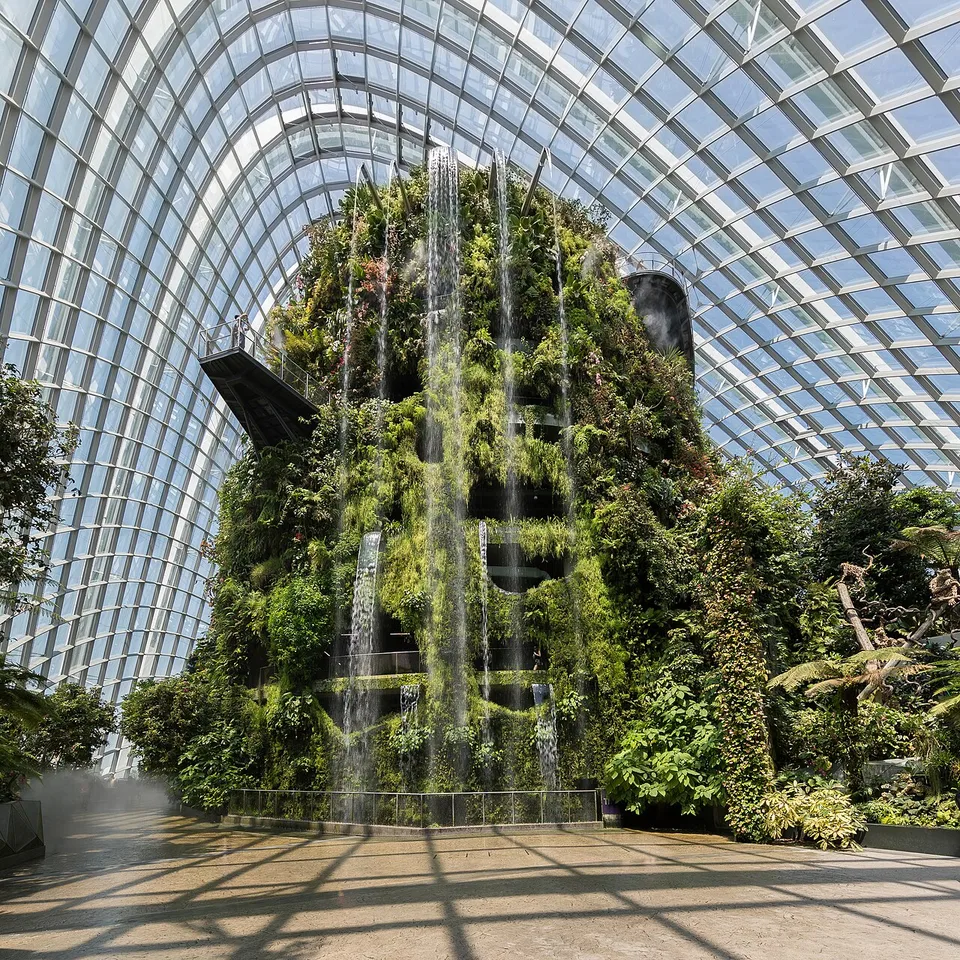
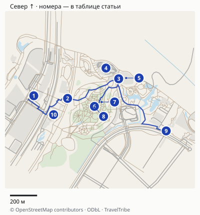
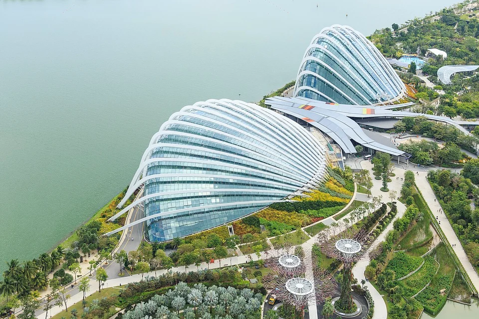
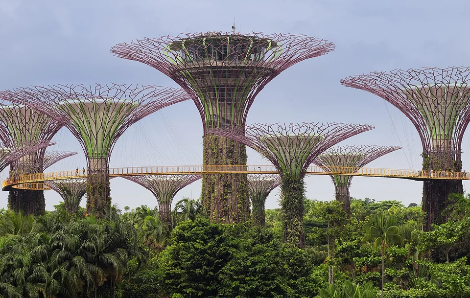

## Что здесь бесплатно

Открытые сады — самостоятельная достопримечательность. Можно пройти через тематические Heritage Gardens, погулять у Dragonfly Lake, рассмотреть супердеревья снизу и остаться на Garden Rhapsody. Покупать билет «на вход в парк», если нужны только эти места, не требуется.

Открытая часть Bay South обычно работает с 05:00 до 02:00. Шоу у супердеревьев начинается в 19:45 и 20:45. Но у бесплатного вечера есть исключение: во время отдельных платных мероприятий, например Christmas Wonderland, доступ к Supertree Grove может потребовать билет. Сверьте [страницу Garden Rhapsody](https://www.gardensbythebay.com.sg/en/things-to-do/calendar-of-events/garden-rhapsody.html) на выбранный день — обычный режим не отменяет условия фестиваля.

С ребёнком можно добавить Far East Organization Children’s Garden с водными играми. У него собственные дни работы, отличный от остального парка последний вход и отдельное время отключения воды. Не обещайте ребёнку площадку в любой будний день только потому, что сады открыты ежедневно: [расписание зон и закрытий](https://www.gardensbythebay.com.sg/en/plan-your-visit/opening-hours.html) нужно проверить заранее.

## За что стоит платить именно вам

| Вариант | Зачем выбирать | Ограничение |
|---|---|---|
| Бесплатные сады и шоу | Супердеревья, прогулка вечером, ограниченный бюджет | Не увидите оранжереи и высокие площадки |
| Flower Dome + Cloud Forest | Первый визит, растения и архитектура под стеклом | Оставьте около двух часов внутри и время на переходы |
| Добавить Floral Fantasy | Нравятся оформленные цветочные композиции и тематические персонажи | Это отдельное здание; пакет не превращает день в короткую прогулку |
| OCBC Skyway | Хотите пройти между супердеревьями по подвесному мосту | Открытая высота, зависимость от погоды |
| Supertree Observatory | Нужна смотровая точка на самом супердереве | Это другой объект, не второе название Skyway |

**Наш выбор для первого платного визита — две оранжереи.** Cloud Forest интересен водопадом, вертикально устроенным зелёным пространством и воздушными дорожками. Flower Dome — коллекциями растений и меняющейся цветочной экспозицией. Одна высокая площадка имеет смысл, если после них остаются время и желание; обе не нужны для понимания сада.

Проверить предложение на две оранжереи можно в [подборке Gardens by the Bay у Tiqets](https://www.tiqets.com/en/gardens-by-the-bay-tickets-l146661/). Выбирайте конкретный состав, а не только название парка: Skyway, Observatory и Floral Fantasy не становятся включёнными от того, что на обложке билета изображены супердеревья. Сравните условия с официальным тарифом ниже; оплату российской картой и свободный проход без очередей этот гайд не гарантирует.

Cloud Forest устроен по вертикали: многоуровневые дорожки и водопад отличают его от ровной цветочной теплицы. Фотография показывает пространство оранжереи, а не обещает неизменную временную выставку.

## Билеты для туристов: не перепутайте валюту и категорию

[Официальный FAQ](https://www.gardensbythebay.com.sg/en/frequently-asked-questions/general.html) показывает следующие цены **для нерезидентов**, в сингапурских долларах, с GST:

| Включено | Взрослый | Ребёнок 3–12 лет |
|---|---:|---:|
| Flower Dome + Cloud Forest с Jurassic World: The Experience | S$46 (≈2979 ₽) | S$32 (≈2072 ₽) |
| Те же оранжереи + Disney Garden of Wonder в Floral Fantasy + шаттл | S$58 (≈3756 ₽) | S$41 (≈2655 ₽) |
| OCBC Skyway отдельно | S$14 (≈907 ₽) | S$10 (≈648 ₽) |
| Supertree Observatory отдельно | S$14 (≈907 ₽) | S$10 (≈648 ₽) |
| Floral Fantasy отдельно | S$24 (≈1554 ₽) | S$16 (≈1036 ₽) |

Это не доллары США. Для обычной туристической поездки выбирайте **Non-Resident**. Resident — льготная категория с подтверждением права, а не любой человек, который сейчас находится в Сингапуре. В таблице оператора отдельные билеты только в Flower Dome или только в Cloud Forest для нерезидентов не указаны: не стройте бюджет на резидентской цене одного павильона.

**Пример для двух взрослых и ребёнка 3–12 лет:** две оранжереи стоят S$124 (около 8030 ₽), пакет с Floral Fantasy и шаттлом — S$157 (около 10 167 ₽). Доплата — S$33, около 2137 ₽. Это расчёт только входных билетов по опубликованным категориям, без питания и дороги. Если семье не нужен Floral Fantasy, выбирать пакет ради скидки к сумме отдельных входов бессмысленно.

Большой пакет выгоден по сравнению с покупкой его компонентов, только если дополнительные объекты вам действительно нужны. Если Floral Fantasy не интересен, более низкая цена пакета относительно суммы отдельных билетов не делает его лучшим выбором для вашей поездки. Сначала определите остановки, потом сравнивайте корзины с одинаковыми включениями.

## Карта и точная логистика

[Открыть подробную карту: масштаб, все точки и навигация](/maps/gardens-by-the-bay/). Север вверху; нумерация указана ниже. На обзорной картинке дальние пересадки могут не помещаться — они доступны в подробной карте через «Все точки».

| № | Точка | Ориентир и ограничение |
|---|---|---|
| 1 | [Bayfront: выход B](https://www.google.com/maps/search/?api=1&query=1.2827024,103.8599199) | Выход B и подземный проход; затем Dragonfly Bridge или Meadow Bridge. |
| 2 | [Dragonfly Bridge](https://www.google.com/maps/search/?api=1&query=1.2825265,103.86215715) | Пешеходный мост в Bay South Garden. |
| 3 | [Canopy/служба посетителей](https://www.google.com/maps/search/?api=1&query=1.283827,103.8655449) | Ориентир у входов оранжерей; сверяйте билет и нужную кассу. |
| 4 | [Flower Dome](https://www.google.com/maps/search/?api=1&query=1.2845359,103.8647016) | Платная оранжерея; это отдельный объект от Cloud Forest. |
| 5 | [Cloud Forest](https://www.google.com/maps/search/?api=1&query=1.2838777,103.8660342) | Платная оранжерея с отдельным календарём закрытий. |
| 6 | [Supertree Grove](https://www.google.com/maps/search/?api=1&query=1.2819993,103.8639356) | Прогулка внизу и место вечернего шоу. |
| 7 | [Касса Skyway](https://www.google.com/maps/search/?api=1&query=1.2822892,103.8644104) | Вход на подвесную дорожку, а не на Observatory. |
| 8 | [Observatory](https://www.google.com/maps/search/?api=1&query=1.2819416,103.8639337) | Платная площадка на супердереве. |
| 9 | [TE22: выход 1](https://www.google.com/maps/search/?api=1&query=1.2803733,103.868691) | Другой край сада, ближе к Satay by the Bay. |
| 10 | [Floral Fantasy](https://www.google.com/maps/search/?api=1&query=1.2814523,103.86123275) | Дополнительный павильон у Bayfront Plaza. |

### Два выхода метро и подходы к павильонам

Для Bayfront **CE1/DT16 нужен выход B**. По [инструкции сада](https://www.gardensbythebay.com.sg/en/plan-your-visit/getting-here.html) дальше идут подземный переход и Dragonfly Bridge либо Meadow Bridge. На нашей карте выбран вариант через Dragonfly Bridge: до Canopy и входной зоны оранжерей около **900 м**, ориентир 15–20 минут без остановок. Точка Bayfront — выход метро, а не стоянка такси у Marina Bay.

Альтернатива — **Gardens by the Bay TE22, выход 1** со стороны Satay by the Bay. До Canopy получается около **700 м**, оставьте 10–15 минут. Между Canopy и Supertree Grove около **300 м**, ещё 5–10 минут с учётом переходов. Flower Dome и Cloud Forest — соседние, но отдельные здания: не тратьте билет одного объекта в очереди другого. Маркеры зданий обозначают место павильона, вход уточняют указатели на площади Canopy.

Не путайте шаттл и аудиоэкскурсию. На [странице часов работы](https://www.gardensbythebay.com.sg/en/plan-your-visit/opening-hours.html) шаттл по петле Bayfront Plaza → Active Garden → Flower Dome указан с 09:00 до 21:00, последнее отправление 20:45, интервал около 10 минут. Оплата и условия шаттла проверяются отдельно от входа в павильоны. Для вечернего шоу выбирайте обратный выход заранее: после него к метро одновременно идёт много людей.

Расстояния округлены, время в пути зависит от пробок, погоды и открытых проходов. Метка территории может отличаться от входа: последние метры сверяйте с указателями. [Картографические данные © OpenStreetMap contributors](https://www.openstreetmap.org/copyright), ODbL.

## От какой станции начинать

Для маршрута через Dragonfly Lake к супердеревьям и оранжереям удобна **Bayfront MRT (CE1/DT16), выход B**: далее подземный проход и Dragonfly Bridge либо Meadow Bridge. Станция **Gardens by the Bay (TE22), выход 1** тоже ведёт в сады, но к другой стороне территории. Выбирайте подход по своей первой остановке. [Официальная дорога к садам](https://www.gardensbythebay.com.sg/en/plan-your-visit/getting-here.html).

При выезде на такси сохраните выбранную точку посадки: «Gardens by the Bay» — большая территория с несколькими подъездами. Если весь день ходили, завершите прогулку ближе к удобному выходу, не назначая встречу на противоположной стороне сада. Маршрут к шоу не требует перехода в Bay East Garden; не добавляйте его по похожему названию.

## Один согласованный план: оранжереи и вечернее шоу

Оставьте на такой визит вторую половину дня и вечер. Ниже — планировочные окна, а не расписание экскурсии или обещание отсутствия очередей.

1. **Около 15:00 — приехать и дойти до оранжерей.** От Bayfront используйте выход B и проход к садам; станция Gardens by the Bay находится у другой части территории. Проверьте пешеходный путь, а не выбирайте метро только по названию станции.
2. **Примерно 15:30–17:30 — Flower Dome и Cloud Forest.** Начните с Flower Dome, пока снаружи светло, затем переходите в Cloud Forest. На каждый оператор рекомендует примерно час. Если хочется задержаться, уберите платную площадку, а не сокращайте весь осмотр до фотографирования у входа.
3. **После оранжерей — перерыв на еду и прогулка к Supertree Grove.** Не покупайте слот на ещё один объект вплотную к шоу. На фотографии, туалет, еду и ориентирование тоже уходит время.
4. **К 19:15 — оказаться у супердеревьев.** Такой запас позволяет найти место до показа в 19:45. Если первый показ пропустили, есть второй в 20:45, при обычном расписании и доступе к роще.

В Cloud Forest туман включают в 10:00, 12:00, 14:00, 16:00, 18:00 и 20:00. Если хотите совместить его с прогулкой, подстройте порядок двух оранжерей. Специально ждать до 20:00 ради тумана, если вы устали и хотите на первое шоу, необязательно. [Информация Cloud Forest](https://www.gardensbythebay.com.sg/en/things-to-do/attractions/cloud-forest.html).

**Без платных объектов:** приезжайте ближе к вечеру, пройдите к Dragonfly Lake и Heritage Gardens, затем к супердеревьям и шоу. На первый бесплатный визит оставьте примерно два часа с ожиданием показа. Не пытайтесь за это время обойти всю территорию трёх садов.

Оранжереи — крупные самостоятельные пространства. Даже когда объекты кажутся соседними, проверяйте путь между нужными входами.

## Последний вход, техобслуживание и дождь

Обычные часы Flower Dome и Cloud Forest — 09:00–21:00. Но последний вход в Cloud Forest — **20:00**, во Flower Dome — **20:30**. Приходить за несколько минут до последнего входа ради двух оранжерей неудобно: право войти не равно времени на спокойный осмотр.

Платные объекты закрывают на обслуживание. Ближайшее указанное закрытие Cloud Forest — **26 октября 2026 года**; для другой даты сверяйтесь с живым календарём. Купленный пакет не отменяет закрытие павильона. Если именно Cloud Forest — главная цель, переносите визит, а не покупайте пакет в надежде, что всё откроют.

При грозе или сильном дожде не рассчитывайте на Skyway. В FAQ оператор отдельно связывает его работу с погодой и описывает перевод затронутых посетителей в Supertree Observatory. У посредника порядок изменений может отличаться: заранее прочитайте условия своего билета и обращайтесь туда, где его купили. Закрытые оранжереи и погода — повод упростить план до доступных объектов, а не добавлять ещё несколько покупок.

Jurassic World внутри Cloud Forest использует громкие звуки и вспышки. Это прямо отмечено оператором: если такие эффекты не подходят вам или ребёнку, учитывайте их до покупки. Не выбирайте оранжерею только по старому фото тихого водопада.

Подвесная дорожка OCBC Skyway между супердеревьями. Её выбирают ради прогулки на высоте; нижние сады остаются отдельной бесплатной программой.

## Что подготовить до поездки

Сохраните билет и карту сада офлайн, проверьте календарь закрытий и время шоу на свою дату. Для оранжерей пригодится лёгкий дополнительный слой одежды, для улицы — вода и удобная обувь. Еду планируйте вне павильонов; поздний ужин не должен заставлять вас бежать от одного конца территории к другому.

Если это короткая остановка в Сингапуре, отдельно проверьте визовые и транзитные условия и оставшееся время до аэропорта. Сады удобно включить в [поездку по Сингапуру](/singapore/), но даже самый большой пакет билетов не заменяет проверку, сколько часов у вас есть после дороги и формальностей.

Главное решение: бесплатный вечер ради супердеревьев или несколько часов в двух оранжереях с продолжением на шоу. Дополнения выбирайте под свой интерес, а не ради полного перечня платных объектов.

