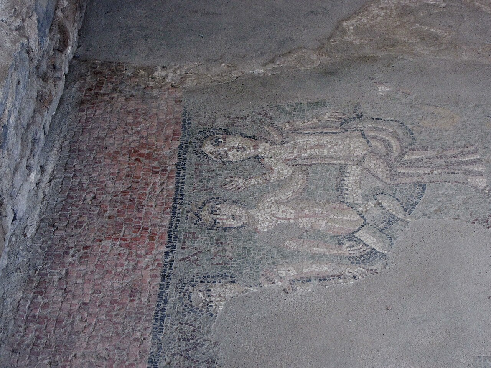
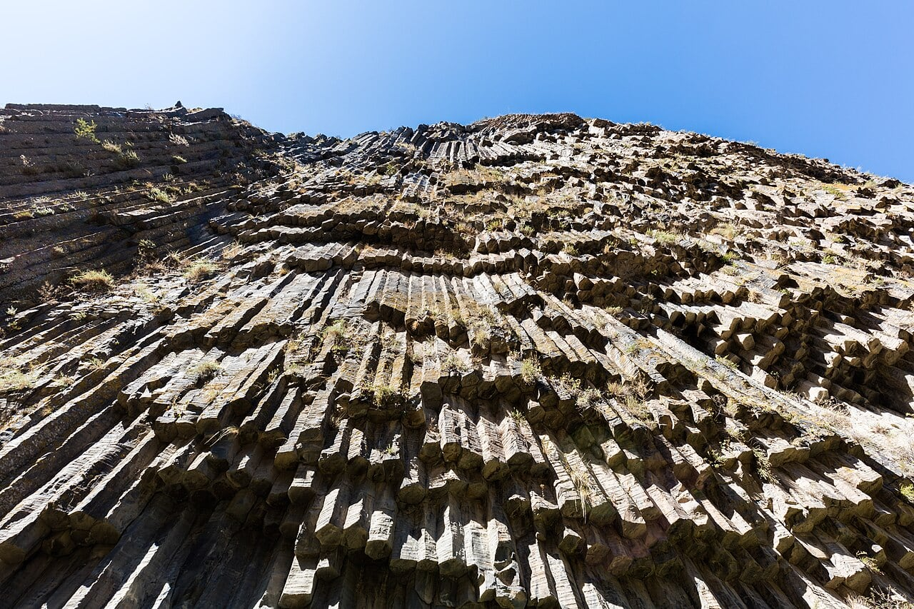
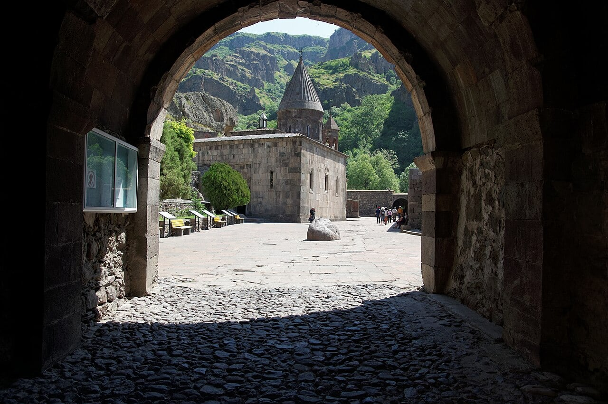

import { tpkDeep } from '../../data/affiliate.js';
export const guidedTour = tpkDeep('tripster', 'https://experience.tripster.ru/experience/78037/', 'tt_garni_iz_erevana');

У Гарни две точки на карте. На плато стоит храм, а внизу под селом, у реки Азат, находятся базальтовые колонны «Симфонии камней». Смотровая у храма даёт панораму ущелья. Для прогулки под базальтовой стеной понадобится отдельный спуск и вход. Третья остановка, Гегард, находится дальше по долине. Если у вас полдня и общественный транспорт, разумно оставить храм и одну дополнительную точку. На все три удобнее ехать на машине с заранее понятным возвращением в Ереван. [Туристическое управление Армении о долине Азата](https://armenia.travel/de/places-to-go/kotayk/)

Если хотите за день увидеть все три места с гидом, есть <a href={guidedTour} target="_blank" rel="sponsored noopener">экскурсия из Еревана в Гарни, ущелье и Гегард</a>. Вход в храм и ущелье оплачивается отдельно.

## Что посмотреть в самом Гарни

Первым виден храм на высоком основании. Обойдите его снаружи, затем подойдите к краю музейной площадки и посмотрите на долину. Так становится понятно, почему крепость расположили именно здесь. Уделите время остаткам римской бани. Пол с мозаикой даёт представление о том, что на плато когда-то был целый комплекс, где жили, мылись и принимали гостей.

Храм обрушился при землетрясении, его восстановили в советское время. При восстановлении использовали сохранившиеся древние камни и восполнили недостающие части. Гарни с базальтовым ущельем находится в предварительном списке ЮНЕСКО. Гегард и верховья Азата включены в Список всемирного наследия. [Музей-заповедник Гарни](https://garni.mus.am/ru/) · [Заявка Гарни и ущелья](https://whc.unesco.org/en/tentativelists/6808/) · [Гегард в списке ЮНЕСКО](https://whc.unesco.org/en/list/960/)

## Два билета для двух уровней долины

| Место | Что оплачивать | Сколько времени оставить |
|---|---|---|
| **Храм и музей-заповедник Гарни** | Взрослый вход 1 500 драмов, примерно 340 ₽ | 45–60 минут на храм, баню и площадку над ущельем |
| **Симфония камней** | Отдельный вход в участок ущелья, точный тариф уточните на месте | Около часа на спуск, прогулку и возвращение к машине. Время зависит от места высадки |
| **Монастырь Гегард** | Вход в монастырь обычно свободный | Около часа на двор и открытые скальные залы |

Музей Гарни публикует график 10:00–21:30 ежедневно. При зимней поездке планируйте храм на светлое время и уточните часы на свою дату, если хотите выехать под вечер. Рублёвая сумма для билета рассчитана по курсу Банка России на 24 ноября. [Билеты и часы музея](https://garni.mus.am/ru/) · [Вход в ущелье и дорога к нему](https://armenia.travel/de/places-to-go/kotayk/) · [Курсы Банка России](https://www.cbr.ru/currency_base/daily/?UniDbQuery.Posted=True&UniDbQuery.To=24.11.2026)

## Как выбрать остановки по времени

**Только полдня.** Оставьте Гарни и Гегард. На плато посмотрите на ущелье сверху, а у монастыря зайдите в скальные помещения, если они открыты. Если едете за геологией, замените Гегард спуском к базальтовой стене. В нижней части долины из лавы при остывании образовались каменные столбы, в сечении похожие на многоугольники. Именно снизу видны и форма колонн, и их масштаб. [Геология ущелья в досье ЮНЕСКО](https://whc.unesco.org/en/tentativelists/6808/)

**Есть день и машина.** Начните с Гарни, спуститесь к Азату и затем поезжайте в Гегард. Если дорога к ущелью скользкая или спуск закрыт, оставьте время на баню и музейную площадку, а затем поезжайте к монастырю. В Гегарде часть залов сделана внутри скалы. При осмотре ищите переход из пристроенного зала в помещения, вырезанные в камне. Так легче понять, что именно отличает Гегард от других монастырей вокруг Еревана. [Описание комплекса Гегарда](https://armenia.travel/destination/the-monastery-of-geghard-and-the-upper-azat-valley/)

## Самостоятельно или с водителем

Для самого села Гарни есть маршрутка **№ 266** от автостанции у проспекта Гая в районе Нор-Норк. В расписании конечная указана как Гохт. Для ущелья и Гегарда спланируйте местную машину отдельно. Перед выездом узнайте, откуда идёт последний подходящий рейс, а если берёте такси — согласуйте, где оно ждёт после спуска и где подбирает в Гегарде. Поездка с ожиданием и возвращением в Ереван удобна, когда три остановки важнее экономии на транспорте. [Расписание рейса № 266, страницы 33–34](https://api.mtad.am/storage/pages/files/2026/01/pdf/22_16-35-sc789-697219afde322.pdf#page=33) · [Остановка у проспекта Гая](https://yandex.com/maps/10262/yerevan/stops/4819581886/)

Если нужен рассказ о памятниках, посмотрите программу, где перечислены храм, спуск и монастырь. У русскоязычной экскурсии Tripster заявлены все три локации. Входы в Гарни и ущелье в этой программе оплачиваются отдельно. Перед оплатой уточните, доезжает ли машина до входа в ущелье и что меняется, если спуск закрыт. Один и тот же заголовок «Гарни и Гегард» у разных организаторов может означать разный день. <a href={guidedTour} target="_blank" rel="sponsored noopener">Программа экскурсии</a> · [Путеводитель по Армении](/blog/armenia-guide-2026/)
