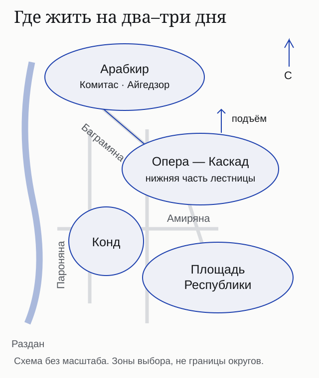
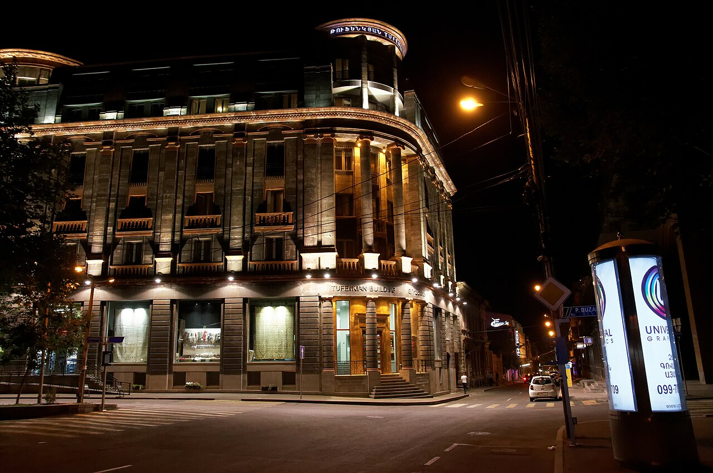
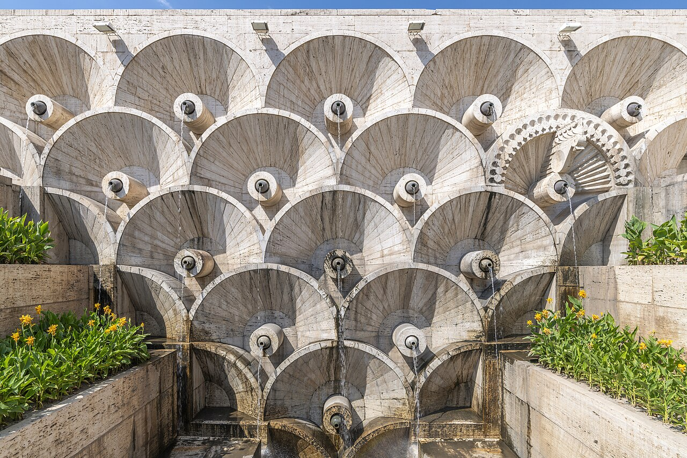
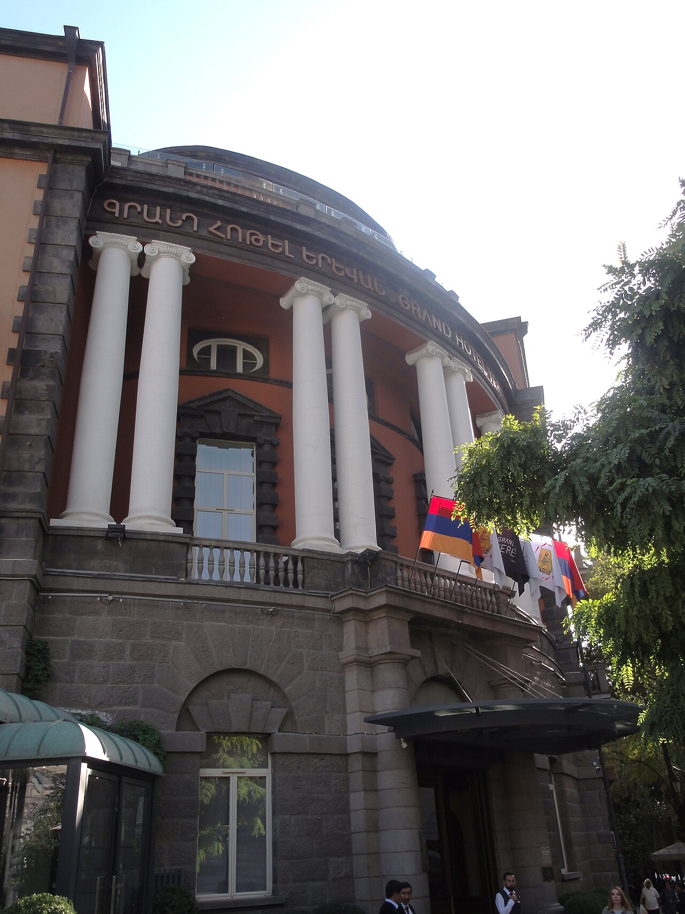

import { tpkDeep } from '../../data/affiliate.js';

На первую поездку в Ереван на два–три дня я бы выбирал **площадь Республики или нижнюю часть зоны Опера–Каскад**: больше времени останется на прогулки, меньше — на дорогу из гостиницы. Конд подойдёт ради старого города, если не мешают подъёмы и неровные улицы. Арабкир стоит рассматривать под конкретный адрес и маршрут: близость к центру на карте ещё не означает удобную прогулку с чемоданом.

Ниже — восемь конкретных гостиниц, а не список «лучших» по чужому рейтингу. Я не жил в каждом из этих отелей. Выбор основан на расположении, карточках бронирования и ограничениях, которые видны до оплаты.

## Четыре зоны: выбираем под свои два–три дня

Площадь Республики, Опера–Каскад и Конд — зоны внутри центральной части города. **Арабкир — большой административный район**, поэтому сравнивать его целиком с одной площадью неправильно: ниже речь об адресах на Комитасе и Айгедзоре.

| Зона | Когда выбирать | Что может помешать |
|---|---|---|
| Площадь Республики | Первая поездка, музеи, Вернисаж, прогулки по центру | Транспорт, мероприятия и окна на оживлённую улицу |
| Опера–Каскад | Кафе, вечерние прогулки, нижний Каскад | Шум заведений; адрес выше лестницы означает другой рельеф |
| Конд и улица Пароняна | Старые кварталы, музей Параджанова, гостиница у западного края центра | Подъёмы, лестницы и сложный подъезд внутри квартала |
| Арабкир | Нужен конкретный адрес в районе или устраивает поездка в центр | Расстояние и пробки; экономию на номере может съесть такси |

Это схема взаимного расположения, без масштаба и административных границ. Перед бронированием откройте пешеходный маршрут от **входа гостиницы**, а не только метку района. В [общем путеводителе по Армении](/blog/armenia-guide-2026/) можно собрать продолжение поездки за пределами Еревана.

## Площадь Республики: удобная база для первого приезда

Здесь удобно начать прогулку и в сторону Абовяна и Оперы, и к Вернисажу. Для короткой поездки важнее не вид на площадь, а сторона окон и путь от входа до ваших мест. Уличный концерт, стройка или автобус под окнами могут оказаться существеннее звёзд отеля.

### Holiday Inn Yerevan Republic Square — Амиряна, 2

Удобен, если хочется выходить сразу в центральную часть: карточка указывает около 170 м до площади Республики. Это расстояние из сервиса, а не обещание маршрута без ступеней. Проверьте вход с багажом; шум оценивайте по стороне выбранного номера.

Парковка заявлена, в описании также есть платная парковочная зона: бесплатное место на весь срок не обещано. В проверенном примере **Standard без питания — около 42 400 ₽ ($525) за три ночи для двоих**, оплата сейчас, при отмене деньги не возвращаются. Другой тариф того же номера — около 44 100 ₽ ($547) с бесплатной отменой до 3 ноября. Точное время окончания отмены нужно открыть в условиях.

<a href={tpkDeep('ostrovok', 'https://ostrovok.ru/hotel/armenia/yerevan/mid9309597/holiday_inn_yerevan_republic_square/', 'yerevan_stay_holiday')} target="_blank" rel="sponsored noopener">Проверить номера Holiday Inn и условия отмены</a>

### Tufenkian Historic Yerevan — Анрапетутян, 48

Вариант на стороне Вернисажа: карточка показывает около 340 м до площади и 200 м до рынка. Подойдёт тем, кто хочет начинать день в этой части центра. Улица и конкретное расположение комнаты требуют отдельной проверки шума; «исторический» в названии не обещает тишину.

В карточке указана бесплатная парковка, но наличие места к приезду стоит подтвердить. В примере номер с двуспальной кроватью и завтраком — **около 43 900 ₽ ($544) за три ночи**, оплата сейчас, бесплатная отмена до 9 ноября. Для другого предложения за около 51 200 ₽ ($635) показаны оплата на месте и необходимость карты зарубежного банка для бронирования; бесплатной отмены нет. **Оплата в отеле сама по себе не делает тариф возвратным.**

<a href={tpkDeep('ostrovok', 'https://ostrovok.ru/hotel/armenia/yerevan/mid7709080/tufenkian_historic_yerevan_hotel/', 'yerevan_stay_tufenkian')} target="_blank" rel="sponsored noopener">Сравнить тарифы Tufenkian</a>

## Опера–Каскад: жить у прогулок, а не над лестницей

Главное различие здесь — нижняя или верхняя часть Каскада. Слово «рядом» может скрывать подъём обратно в гостиницу. На карте проверьте маршрут после ужина, после целого дня прогулок, и возможность подъезда машины к самому входу.

### Grand Hotel Yerevan — Абовяна, 14

Компромисс между площадью и Оперой: в карточке до каждого из этих ориентиров около полукилометра. Это вариант для прогулок по центральным улицам, а не гостиница у самой лестницы Каскада. Для сна просите подтвердить сторону окон: название категории «вид во двор» полезнее общего обещания тихого центра.

Парковка в карточке указана бесплатная. В проверенном примере номер с двуспальной кроватью без питания — **около 40 500 ₽ ($502) за три ночи**, оплата сейчас, без возврата при отмене. Соседнее предложение за около 43 600 ₽ ($540) позволяет бесплатную отмену до 9 ноября и оплату на месте картой зарубежного банка. Свою карту и валюту расчёта проверьте до выбора.

<a href={tpkDeep('ostrovok', 'https://ostrovok.ru/hotel/armenia/yerevan/mid11333106/grand_hotel_yerevan/', 'yerevan_stay_grand')} target="_blank" rel="sponsored noopener">Посмотреть категории Grand Hotel</a>

### Cascade Yerevan — Заробяна, 10/10

Карточка ставит гостиницу примерно в 140 м от Каскада. Её стоит рассмотреть, если именно эта часть города — центр вашей программы. При этом расстояние до достопримечательности не заменяет проверки уклона последнего отрезка и входных ступеней.

Парковка заявлена рядом с гостиницей; бесплатность и закреплённое место не подтверждены. В примере без питания — **около 25 500 ₽ ($316) за три ночи**, бесплатная отмена до 9 ноября, оплата на месте; для бронирования нужна карта зарубежного банка. Цена со скидкой за вход в аккаунт показана отдельно: в сравнение взята обычная доступная цена, без обещания персональной скидки.

<a href={tpkDeep('ostrovok', 'https://ostrovok.ru/hotel/armenia/yerevan/mid7663215/cascade_hotel/', 'yerevan_stay_cascade')} target="_blank" rel="sponsored noopener">Проверить Cascade на свои даты</a>

## Конд: старый квартал и гостиницы по его краю

Для поездки с чемоданом проще рассматривать конкретный подъезд с улицы Пароняна, чем выбирать жильё внутри переплетения старых улочек только по фотографии. На прогулку в Конд можно зайти без необходимости каждый вечер подниматься туда с багажом. Эти два отеля стоят у его края; это не обещание проживания среди старых дворов.

### Apricot Hotel Yerevan — Пароняна, 15/3

Подойдёт для прогулок в сторону музея Параджанова и старых кварталов. Карточка указывает около 1,1 км до площади Республики. Улица оживлённая: в видимых отзывах есть жалобы на шум со стороны дороги; тихий номер нельзя обещать по названию района.

Парковка и парковка рядом заявлены, но цену и место нужно подтвердить. **На проверенные 10–13 ноября доступных вариантов не было.** Поэтому у Apricot здесь нет выдуманной цены или срока бесплатной отмены. Общая карточка предусматривает оплату наличными в AMD или картой в гостинице, а онлайн-оплату — для отдельных тарифов. Нужен новый поиск на ваши даты.

<a href={tpkDeep('ostrovok', 'https://ostrovok.ru/hotel/armenia/yerevan/mid8873996/otel_apricot_yerevan/', 'yerevan_stay_apricot')} target="_blank" rel="sponsored noopener">Проверить, появились ли номера Apricot</a>

### Seven Visions Resort and Places, the Dvin — Пароняна, 40

Вариант для тех, кто хочет проводить время и в самом отеле, а не только ночевать после прогулок. Это отдельный гостиничный комплекс у западной части центра. Не переносите фотографии люкса на все категории: планировка и набор услуг различаются.

Парковка заявлена; её стоимость и условия въезда проверьте отдельно. В примере двухместного размещения без питания — **около 85 400 ₽ ($1 059) за три ночи**, оплата сейчас, бесплатная отмена до 9 ноября. Это обычная цена показанного предложения, а не персональная скидка за авторизацию. При мероприятиях уточните сторону номера и близость к площадкам отеля.

<a href={tpkDeep('ostrovok', 'https://ostrovok.ru/hotel/armenia/yerevan/mid10292262/seven_visions_hotel_the_dvin_hotel/', 'yerevan_stay_dvin')} target="_blank" rel="sponsored noopener">Проверить номер и включённые услуги Seven Visions</a>

## Арабкир: считать дорогу вместе с ценой номера

Арабкир выбирают по адресу. Комитас и Айгедзор дают разные маршруты в центр, а обещание «тихий жилой район» не исключает трафик на проспекте или соседнюю стройку. Для двух дней сравните стоимость всего проживания с поездками и время, которое они займут.

### Deluxe Yerevan — Комитас, 32/1

Гостиница на проспекте, примерно в 3 км от центра по карточке. Выбор имеет смысл, если нужны дела в этой части Арабкира или вас устраивает транспорт. До Каскада сервис показывает около 1,9 км; это не означает ровную короткую прогулку.

Парковка указана без подтверждённой цены. **На 10–13 ноября доступного тарифа не было**: отмена и предоплата для этих дат не установлены. В общей карточке есть наличные AMD и оплата картой в отеле; возможность онлайн-оплаты зависит от тарифа. Не выбирайте этот вариант только ради старой цены «от» из каталога.

<a href={tpkDeep('ostrovok', 'https://ostrovok.ru/hotel/armenia/yerevan/mid11332202/deluxe_hotel_yerevan/', 'yerevan_stay_deluxe')} target="_blank" rel="sponsored noopener">Проверить доступность Deluxe</a>

### Capital Hotel — Айгедзора, 53Б; вход указан со стороны 53А

Карточка относит гостиницу к Арабкиру и отдельно уточняет адрес входа — полезная деталь для такси и позднего приезда. До Оперы в сервисе около 1,6 км; с багажом ориентируйтесь на реальный подъезд и рельеф, а не этот радиус.

Указаны бесплатная парковка на территории и рядом, но место не резервируется самим наличием такой строки. **На проверенные три ночи доступных вариантов не было.** Поэтому срок отмены и необходимость предоплаты неизвестны до нового поиска. Общая карточка перечисляет наличные AMD и карты в отеле; принятие конкретной карты подтвердите заранее.

<a href={tpkDeep('ostrovok', 'https://ostrovok.ru/hotel/armenia/yerevan/mid7690831/capital_hotel_5/', 'yerevan_stay_capital')} target="_blank" rel="sponsored noopener">Проверить Capital и адрес подъезда</a>

## Как сравнивались тарифы и что проверить перед оплатой

Примеры сняты **30 октября 2026 года на 10–13 ноября: один номер, двое взрослых, три ночи**, валюта интерфейса — USD. Это полная показанная цена проживания с указанными сервисом налогами, а не цена за ночь. Рублёвые суммы — ориентиры, округлённые до сотен; курс оплаты банка или сервиса может отличаться. Наличие и цена меняются, бронирование не создавалось.

У бесплатной отмены есть **точные дата, время и часовой пояс**. Откройте пояснение у выбранного тарифа: слова «до 9 ноября» в примере не дают универсального права отменить в любую минуту этого дня. Проверьте отдельно питание, тип кровати, дополнительные сборы, депозит и необходимость зарубежной карты. Российская карта на сайте и российская карта в гостинице — разные сценарии; второе здесь не подтверждено.

Если цена не решает выбор, сравните [другие отели Армении](/hotels/armenia/). Документы для поездки разобраны в [материале о въезде в Армению](/blog/armenia-zagranpasport-2026/).

## Что пишут гости: как читать отзывы о шуме и подъёмах

Для этого блока прочитаны **пять видимых отзывов Apricot 30 октября**; даты пребывания в этих блоках не показаны. Это **не случайная и не представительная выборка**: встречаются и похвала расположению, и противоположные сообщения о ночном шуме. Такие наблюдения — повод проверить сторону окон, а не основание объявить весь отель шумным или тихим. Положительная оценка центрального адреса тоже не доказывает тишину конкретного номера.

Вопрос отелю лучше формулировать предметно: «Выходит ли этот номер на дорогу? Есть ли ступени от машины до лифта? Можно ли поставить автомобиль на три ночи и сколько это стоит?» Ответ по выбранной категории полезнее среднего балла из сотен разных поездок.

## Частые вопросы

### Какой район выбрать для первого приезда на два дня?

Площадь Республики или нижнюю часть зоны Опера–Каскад, если основная программа в центре. Затем сравните конкретные входы, стороны окон и условия номера.

### Конд подходит для поездки с ребёнком и коляской?

Зависит от адреса и подъезда. Внутри старого квартала есть узкие и неровные улицы; отель у края на Пароняна и жильё в глубине Конда дают разные условия. Маршрут с коляской нужно проверить отдельно.

### В Арабкире всегда дешевле и тише?

Нет. Сравнивайте тариф на одинаковые даты, поездки в центр и конкретную улицу. Название района не гарантирует ни скидку, ни отсутствие шума.

### Можно ли забронировать без зарубежной карты?

Это определяется тарифом. В проверенных предложениях встречались оплата сейчас и оплата на месте, но у части последних требовалась зарубежная карта для гарантии или расчёта. Выбирайте предложение с подходящими вам условиями до перехода к оплате.
