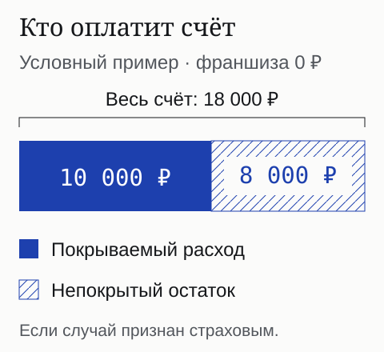
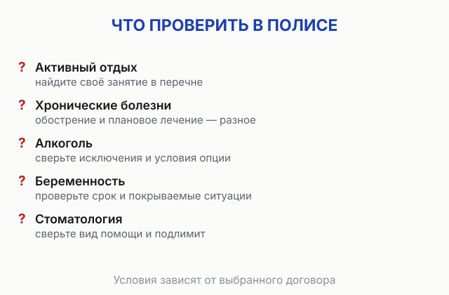
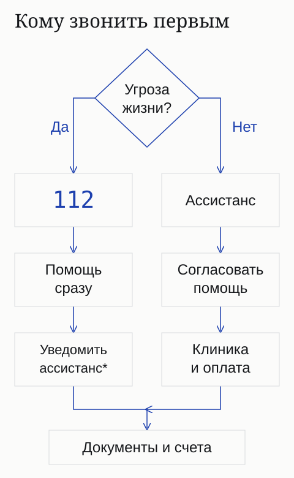
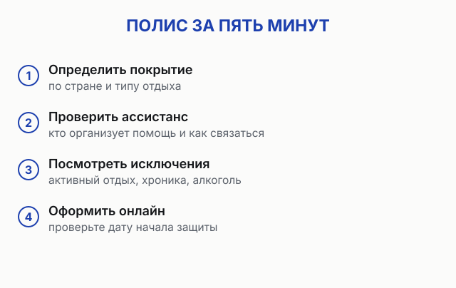

import { cherehapaCountry } from '../../data/affiliate.js';

export const chGeorgia = cherehapaCountry('georgia', 'georgia_insurance_2026');

**Для туристической поездки в Грузию страховка нужна с 1 января 2026 года.** Минимум — здоровье и несчастный случай, сумма не ниже **30 000 лари (около 930 000 ₽)**, весь срок пребывания и документ на грузинском или английском. Полис может выдать грузинский или иностранный страховщик.

**Без франшизы — полезное условие договора, но не отдельное требование постановления №602.** Нулевая франшиза снимает заранее установленную доплату по страховому случаю; она не отменяет исключения, подлимиты и необходимость согласовать помощь. Ни высокая сумма на обложке, ни отметка «для въезда» сами по себе не отвечают на вопрос, кто оплатит лечение.

<a href={chGeorgia} class="aff-cta" rel="sponsored noopener">Подобрать полис в Грузию под свои даты</a>

## Нужна ли страховка для въезда в Грузию в 2026 году?

**Да, если вы въезжаете как иностранный турист; безвизовый въезд россиян этого не отменяет.** Требования распространяются на туриста, а не только на пассажира самолёта: полис нужен и при пересечении сухопутной границы. Постановление даёт патрульной полиции право проверить его в пункте пропуска. Проверят ли именно ваш документ, заранее неизвестно.

Перечень исключений отдельный: дипломатические и специальные визы; дипломатические, официальные, служебные и специальные паспорта; аккредитованные сотрудники представительств и аккредитованные члены их семей; въезд на основании соответствующих международных соглашений; водители международных автомобильных грузовых и пассажирских перевозок. **Поездка на собственной машине в отпуск не делает туриста таким водителем.**

Для ребёнка также проверьте страховую защиту и документ с его данными. Исключения «детям не нужен полис» в постановлении нет. Не подменяйте медицинскую страховку страховкой багажа или отмены поездки: они решают другие задачи.

### Если есть ВНЖ или вы едете надолго

В перечне исключений нет отдельной строки «любое лицо с ВНЖ». При этом постановление адресовано туристам: из одного наличия карточки ВНЖ нельзя сделать вывод о применимости ко всем вариантам въезда. До вылета уточните свой статус через консульскую службу Грузии и требования перевозчика. Не рассчитывайте, что местная медицинская программа автоматически заменит нужный документ: сравните территорию, риски, сроки и реквизиты.

Маршрут, документы и подготовка поездки разобраны в [гайде по Грузии](/blog/georgia-guide-2026/). Эта статья помогает проверить полис, с которым вы собираетесь пересекать границу и получать помощь.

## Что проверить в полисе: требования въезда и условия лечения

У документа есть две независимые проверки. Первая — соответствует ли он требованиям Грузии. Вторая — подходит ли страховая защита вашей поездке. Одна не заменяет другую.

| Для въезда | Для медицинской помощи |
|---|---|
| Здоровье и несчастный случай | Какие заболевания и травмы признаются страховыми |
| Страховая сумма не ниже 30 000 лари | Общая сумма, отдельные подлимиты и собственная доплата |
| Срок от въезда до выезда, не более года | Ограничение одной поездки, ожидание начала защиты, продление |
| Грузинский или английский язык; бумага или электронный документ | Язык общения, доступные контакты, согласование лечения |
| Грузинский или иностранный страховщик с правом такого страхования | Применимость к возрасту, проживанию, спорту и маршруту |

В полном полисе должны быть стороны договора, территория, предмет страхования, начало и окончание, риски, страховые суммы и лимиты, размер взноса, место и срок его уплаты. Короткое письмо «покупка успешна» может этих сведений не содержать. До дороги откройте полный документ: квитанция об оплате его не заменяет.

**Лари — валюта минимального требования, а не цена полиса.** Если сумма вашего договора выражена в другой валюте, сравнивайте её с грузинским минимумом; одинаковая запись «30 000» в разных валютах означает разные суммы. Попросите страховщика подтвердить соответствие выбранного документа требованиям Грузии, особенно если территория названа расплывчато — например, только «Европа».

Под покрытием травмы может пониматься оплата медицинских расходов, а под отдельным страхованием несчастного случая — денежная выплата при последствиях травмы. Не считайте эти строки взаимозаменяемыми: в сертификате для въезда должны быть понятны оба требуемых риска. Если формулировка продукта неясна, запросите письменное пояснение и подходящую версию документа до оплаты.

## Требует ли закон Грузии полис без франшизы?

**Постановление №602 не устанавливает нулевую франшизу.** Не устанавливает оно и отдельную обязательную разбивку «5 000 лари на амбулаторную помощь и 30 000 на стационар». Это не значит, что подлимиты вашего страховщика можно игнорировать: договор вправе ограничивать конкретные расходы внутри общей суммы.

Например, в описании Visitor у IRAO общий лимит — 30 000 лари, но на медицинскую эвакуацию указан отдельный предел **1 000 лари (около 31 000 ₽)**, на репатриацию — **5 000 лари (около 155 000 ₽)**. Для людей от **65 лет** опубликовано возмещение **50% расходов** в пределах лимитов. Значит, соответствующий минимуму въезда документ может оставлять заметную часть счёта самому путешественнику.

У Aldagi для въезжающих предлагаются варианты с франшизой и без неё. Поэтому утверждение «у всех полисов для Грузии франшизы нет» не подходит для выбора. В карточке конкретного предложения найдите размер франшизы, к каким рискам она применяется и как считается: на человека, случай или иначе.

Для короткого отпуска я бы сначала сравнил подходящие договоры без франшизы. Если вариант с доплатой даёт нужное покрытие, которого нет у остальных, сравните весь договор: сама франшиза не делает его плохим. Подробный порядок — в [сравнении страховок для путешествий](/blog/strahovka-dlya-puteshestviy-2026/).

## Сколько стоит страховка в Грузию?

**Для одного взрослого на неделю в нашем расчёте получились 244–644 ₽ у трёх выбранных страховщиков.** Это примеры для конкретных дат и условных возрастов. Они помогают сравнить предложения, но не закрепляют цену для вашей поездки. Тариф может измениться до оплаты.

Во всех трёх сценариях — Грузия, граждане России, которые ещё не выехали за границу, обычная поездка без добавленных спортивных занятий. В поиске выбрано медицинское покрытие $50 000 (около 4 млн ₽): у Зетты и Согласия карточки показывают эту сумму, у Сбера — $60 000 (около 4,8 млн ₽). Поэтому сравнение отражает доступные предложения с разными фактическими лимитами. Возрасты ниже придуманы для расчёта; это не данные семьи автора.

| Сценарий и даты | Зетта, $50 000 | Согласие, $50 000 | Сбер, $60 000 |
|---|---|---|---|
| Один взрослый 35 лет, 7 дней: 10–16 ноября | 244 ₽ | 389 ₽ | 644 ₽ |
| Семья: взрослые 35 и 33 лет, ребёнок 8 лет; 14 дней: 10–23 ноября | 1 967 ₽ за всех | 2 334 ₽ за всех | 3 863 ₽ за всех |
| Один взрослый 35 лет, 30 дней: 10 ноября — 9 декабря | 1 314 ₽ | 1 667 ₽ | 2 760 ₽ |

Для семейной строки сравнивайте общую цену за троих. Не умножайте цену одного взрослого на число участников: детский возраст и тариф могут менять расчёт. Поездка на месяц здесь непрерывная; это не годовой договор с ограниченным числом застрахованных дней.

### Что получаете за эту цену

В показанных предложениях франшиза обозначена как отсутствующая. Но набор рисков и отдельные лимиты различаются:

| Предложение | Медицинский лимит в карточке | Важное ограничение | Кто организует помощь |
|---|---|---|---|
| Зетта | $50 000 | На хронические заболевания в карточке — $1 000 (около 81 000 ₽); обычный треккинг ограничен 3 500 м, выше нужна другая категория | AP Companies |
| Согласие | $50 000 | На хронические заболевания — $5 000 (около 403 000 ₽). Лечение COVID-19 — $5 000, не более одного раза за срок полиса; выше 1 500 м нужна категория горного треккинга | Global Voyager Assistance |
| Сбер | $60 000 | Возвращение детей и перелёт после лечения — по $4 000 (около 323 000 ₽); поисково-спасательные мероприятия — $6 000 (около 484 000 ₽). Горные занятия требуют отдельной проверки категории | Eurasia Assistance |

Подлимит не означает, что оплатят любое лечение на эту сумму. Например, пункт 5.1.7 правил Согласия связывает помощь при обострении хронического заболевания с **угрозой жизни** и экстренной стационарной помощью; общий предел там — 10% страховой суммы, если договор не устанавливает иное. При $50 000 это $5 000. Плановое лечение в эту строку не превращается.

У Зетты отдельно ограничены некоторые обследования и вмешательства. В частности, правила содержат исключения для КТ и МРТ с узкими оговорками для экстренной диагностики черепно-мозговой травмы, а также для ряда операций на сердце и сосудах. Если вам важно конкретное обследование, одного медицинского лимита $50 000 для выбора недостаточно: проверьте пункт 4.1.2 и условия вашего предложения.

**Как выбирать между ними.** Для обычной короткой поездки сравните цену Зетты с её исключениями; для поездки с известным хроническим заболеванием сначала выясните применимость покрытия к своему состоянию. Увеличенный общий лимит Сбера полезно сопоставить с подлимитами возвращения и спасработ. Ни один из этих расчётов не подтверждает страхование лыж, Казбека или любого другого горного маршрута: спортивных опций в них нет.

Для своего расчёта задайте одинаковые даты, состав и занятия во всех предложениях, затем проверьте фактическую сумму в каждой карточке. Отдельно укажите, если уже находитесь за границей: доступность продукта и начало защиты могут измениться. Выбранные условия сверьте с готовым полисом до оплаты.

Затем сравните не только итоговую стоимость, но и три возможных расхода после покупки: франшизу, непокрытый остаток из-за подлимита и самостоятельную оплату с последующим возмещением. Дешевизна полиса не означает, что эти расходы меньше. Высокая цена тоже не доказывает быструю организацию помощи.

<a href={chGeorgia} class="aff-cta" rel="sponsored noopener">Сравнить условия и стоимость страховки в Грузию</a>

## Горы, хронические болезни и обращение к врачу

**Название курорта не определяет покрытие.** Для Гудаури важны лыжи или сноуборд, трасса или выезд за её пределы. Для Казбеги и Сванетии — вид маршрута, высота, необходимость снаряжения и условия поиска и спасения. У разных продуктов прогулка и альпинизм относятся к разным категориям. Не переносите обещание «горы покрываются» на любую активность. Для зимней поездки проверьте [условия горнолыжной страховки](/blog/gornolyzhnaya-strahovka/), для пешего маршрута — [высоту и покрытие треккинга](/blog/strahovka-dlya-aktivnogo-otdyha/).

Отдельно проверьте экстренное обострение хронического заболевания, беременность и стоматологию. Плановый приём и срочная помощь — разные расходы. Если условие сформулировано как помощь при угрозе жизни, оно не обещает оплатить весь дальнейший курс лечения. Сообщайте медицинские сведения честно: скрытие диагноза не расширяет договор.

### Куда обращаться, если помощь понадобилась

При непосредственной угрозе жизни вызывайте экстренную помощь **112**. Связь со страховщиком не должна задерживать её получение. Когда это возможно, передайте полис врачам и свяжитесь с указанной в нём сервисной службой.

*После экстренной помощи уведомите ассистанс при первой возможности.*

Если ситуация позволяет согласовать визит, сначала сообщите службе номер полиса, местонахождение и симптомы. Получите адрес клиники, порядок оплаты и номер обращения. Спросите, отправлена ли гарантия оплаты, и сохраните переписку. Телефон продавца полиса и телефон медицинской помощи могут различаться.

Если оплатили сами, сохраните медицинский отчёт, диагноз, назначения, подробные счета и подтверждение платежа. Срок подачи документов и необходимость перевода смотрите в своём договоре. Нулевая франшиза не гарантирует, что в любой клинике вы обойдётесь без временной самостоятельной оплаты.

## Нужна ли страховка на машину, если еду своим ходом?

**Да, для машины на иностранных номерах действует отдельное обязательное страхование ответственности.** Медицинский полис защищает путешественника; автогражданка касается ущерба другим людям и имуществу при использовании машины. Один документ второй не заменяет и ремонт собственной машины автоматически не обещает.

Полис можно получить в бумажном или электронном виде через [Центр обязательного страхования Грузии](https://www.tpl.ge/ru/faq), его агентов и брокеров. Цена зависит от категории транспорта и срока. До оплаты сверьте категорию, номер, VIN и период: ошибка в реквизитах может повлиять на действительность документа.

При ДТП Центр предписывает немедленно сообщить по **112** и на свою горячую линию **+995 32 230 11 11**, остаться на месте и дождаться уполномоченного лица, если не требуется доставка пострадавшего в медучреждение. Порядок пересечения границы и комплект документов — в [разборе поездки через Верхний Ларс](/blog/v-gruziyu-na-mashine-2026/).

## Как оформить страховку онлайн за несколько минут

1. **Укажите маршрут и срок.** Включите день въезда, день выезда и всех людей, которым нужна защита. Проверьте промежуток между окончанием старого и началом нового договора.
2. **Проверьте применимость.** Возраст, место проживания, ВНЖ и покупка в поездке могут менять условия. Для долгого пребывания уточните предел одной поездки.
3. **Сравните документ с требованиями въезда.** Территория Грузии, риски, сумма, язык, даты и обязательные реквизиты должны быть понятны без устных обещаний продавца.
4. **Прочитайте ограничения.** Франшиза, подлимиты, конкретные занятия и эвакуация важнее общей надписи «расширенный».
5. **Проверьте начало действия до оплаты.** Полученный PDF и начавшееся покрытие — разные события. Оформляйте заранее, до въезда; не рассчитывайте на покупку у стойки или доступ к интернету на границе.
6. **Сохраните полный комплект офлайн.** Полис, правила, контакты помощи и подтверждение оплаты. Бумажная копия — удобный резерв, а не обязательная форма по постановлению.

<a href={chGeorgia} class="aff-cta" rel="sponsored noopener">Оформить полис в Грузию под свой маршрут</a>

### Можно ли купить после прилёта и есть ли штраф?

Онлайн-покупка физически возможна у некоторых продуктов, но она не исправляет отсутствие действующего полиса в момент въезда. Может быть период ожидания; начавшееся заболевание новый договор не покроет. Поэтому не оставляйте оформление на прилёт.

Само постановление №602 не содержит размера штрафа. Из этого нельзя заключить, что никаких последствий по другим нормам нет. Не планируйте поездку по неподтверждённой сумме штрафа: заранее выполните требования и проверьте документы у перевозчика. А для возможной самостоятельной оплаты пригодится разбор [денег и карт в Грузии](/blog/pay-georgia-2026/).
