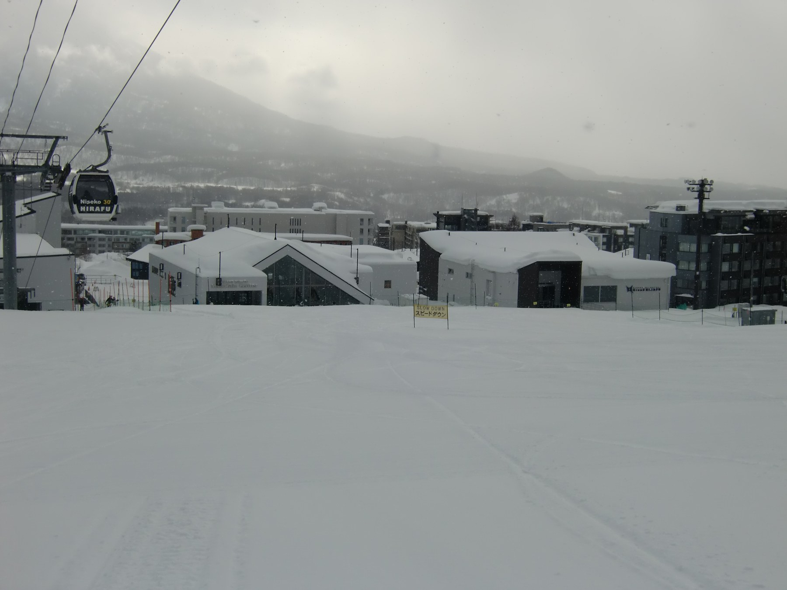
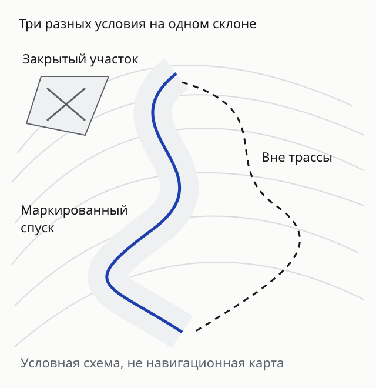
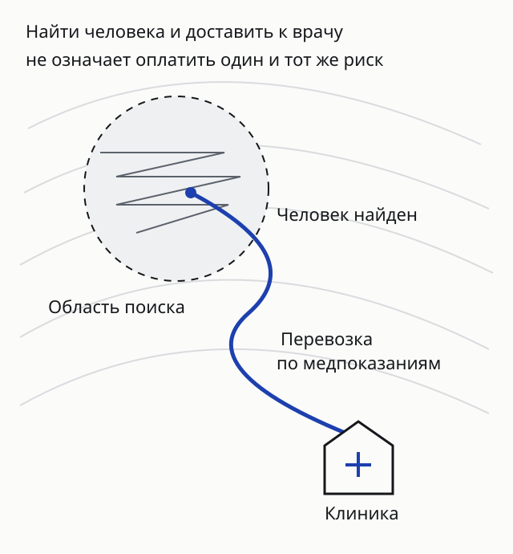
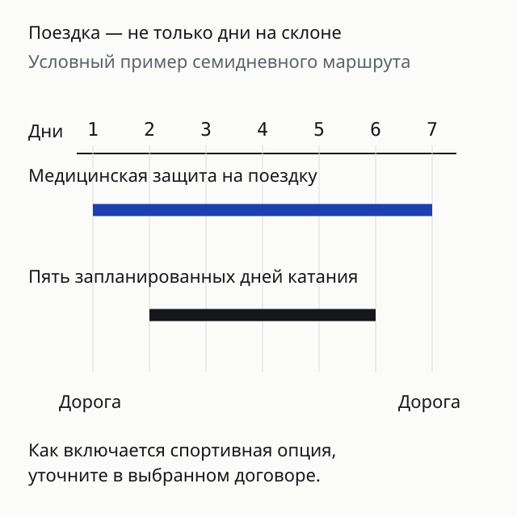

import { cherehapaTravel } from '../../data/affiliate.js';

export const skiCompare = cherehapaTravel('ski_insurance_compare');
export const freerideCompare = cherehapaTravel('ski_insurance_freeride');
export const skiPrice = cherehapaTravel('ski_insurance_price');

**Для горных лыж и сноуборда нужен полис с вашим видом спорта и подходящей территорией катания.** Открытая маркированная трасса, фрирайд и соревнования могут иметь разные условия. Отдельно проверяют лечение, поиск человека, спасение со склона и медицинскую эвакуацию: слово «горнолыжная» не объединяет эти услуги автоматически.

> **До покупки:** назовите страну, курорт, даты и формат катания. Затем сравните спортивные условия, услуги и исключения. <a href={skiCompare} rel="sponsored noopener">Подобрать полис для лыж или сноуборда</a> стоит с этим списком перед глазами; предложение подходит только после проверки индивидуального договора.

## Медицинская страховка и несчастный случай решают разные задачи

В поездке прежде всего нужно понять, кто организует медицинскую помощь и на каких условиях оплачиваются расходы. Полис путешественника может включать обращение к врачу, лечение и медицинскую транспортировку. Наличие этих рисков ещё не подтверждает покрытие травмы во время катания: спорт должен быть включён отдельно или прямо допущен базовыми условиями.

Страхование от несчастного случая, или НС, устроено иначе. Оно предусматривает денежную выплату при указанных последствиях травмы. Размер зависит от договора, выбранных рисков и таблицы выплат. Такая сумма не означает, что страховая прямо оплатит любой счёт клиники, найдёт пропавшего лыжника или пришлёт вертолёт.

Поэтому две похожие кнопки «Страховка для горных лыж» могут вести к разным продуктам. В одном нужно проверить медицинские расходы и спортивную опцию, в другом — таблицу выплат НС. Они могут дополнять друг друга, но один нельзя выдавать за другой. Общая механика франшизы и начала защиты разобрана в [гайде по туристической страховке](/blog/strahovka-dlya-puteshestviy-2026/).

## Открытая маркированная трасса: базовый сценарий тоже нужно назвать

Для спокойного катания по подготовленным спускам проверьте, что в договоре указаны горные лыжи или сноуборд, а определения допускают выбранное занятие. Проверьте, как договор расшифровывает категорию «спорт». Обучение с инструктором, тренировка, соревнование и катание в парке с фигурами могут потребовать отдельных условий. Отдельно прочитайте требования к защитному снаряжению и условия, связанные с алкоголем: не заменяйте конкретный пункт правил общим обещанием продавца.

У Tripinsurance FAQ относит лыжи и сноуборд на организованных трассах к занятиям с опцией «Активный отдых». В условиях, на которые ведёт горнолыжная страница, речь идёт о маркированных трассах. У ЕВРОИНС маркированные спуски отнесены к опасному спорту; программа «Спорт» включает эту категорию. Одно название опции не переносится между компаниями.

Перед первым подъёмом сохраните контакты спасателей именно своего курорта и выясните, как сообщить место происшествия: номер трассы, ближайшая опора подъёмника, отметка на карте. Проверьте, какие услуги входят в ски-пасс, а какие оплачиваются отдельно. Ски-пасс не стоит считать медицинским полисом без его собственных условий.

## Фрирайд: выезд за границу трассы меняет проверку

**Фраза «рядом с трассой» не означает «на трассе».** Если предполагается выезд за маркировку, назовите это страховщику прямо. Наличие гида или инструктора само по себе не превращает внетрассовый маршрут в разрешённый по договору спуск.

Например, FAQ Tripinsurance исключает фрирайд. В связанных условиях внетрассовое катание исключено с инструктором и без него, если договор не предусматривает иное. У ЕВРОИНС немаркированные склоны относятся к экстремальному спорту, для которого предусмотрено отдельное расширение. При этом запрещённые трассы и нарушения ограничений остаются отдельным исключением: доплата за категорию не открывает закрытый склон.

Для <a href={freerideCompare} rel="sponsored noopener">сравнения условий страховки под фрирайд</a> подготовьте название района, описание маршрута и сопровождения. Запросите письменный ответ о допустимой зоне катания и конкретных исключениях. Если выбранное предложение такой ответ не даёт, не подменяйте его широким рекламным словом «экстрим».

На схеме показана граница понятий, а не безопасный маршрут. Страховка не заменяет оценку лавинной обстановки, подготовку группы, необходимое снаряжение и ограничения курорта.

## Поиск, спасение и медицинская эвакуация — разные расходы

Человек может потеряться без травмы. Его сначала нужно найти, затем вывести или вывезти. В другом случае место известно, но пострадавшего требуется доставить к врачу. Третья задача возникает в клинике: перевезти пациента по медицинским показаниям. Договор может описывать эти ситуации разными пунктами и лимитами.

Уточните, **при каком событии возможен вызов вертолёта, кто принимает решение и какие расходы оплачиваются**. Наличие медицинской транспортировки не доказывает оплату поиска здорового человека. Упоминание воздушного транспорта не обещает его при любой травме: способ помощи зависит также от медицинских показаний, организации спасения и доступных условий.

В Правилах №5 ЕВРОИНС поиск и спасение при несчастном случае или бедствии в удалённых местах, включая воздушный поиск, предусмотрены в пределах договорного лимита. Это не обещание оплатить любую операцию по поиску человека. Медицинская эвакуация требует подтверждённых медицинских оснований и согласования. В таблице программы «Спорт» поиск и спасение входят в общую страховую сумму, а не образуют неограниченный дополнительный бюджет.

Уточните, кто связывается со спасательной службой, можно ли согласовать помощь через сопровождающего и что делать при отсутствии связи. Сохраните эти инструкции офлайн вместе с номером полиса. Общего ответа «сначала всегда плати сам» или «никогда не обращайся без звонка» для всех договоров нет.

## Сравнение программ: что именно проверять в документах

Ниже — различия назначения и спортивных условий, а не рейтинг скорости помощи. Известное имя компании не заменяет подходящую программу, а таблица не подтверждает покрытие конкретной поездки без индивидуального договора.

| Вопрос | Tripinsurance с опцией «Активный отдых» | ЕВРОИНС «Спорт» | Росгосстрах «Спортзащита» |
|---|---|---|---|
| Основная задача | Медицинская помощь путешественнику и предусмотренные транспортные расходы | Медицинские, медико-транспортные и предусмотренные дополнительные риски | Денежная выплата по выбранным рискам НС |
| Маркированные трассы | Нужна соответствующая опция | Категория опасного спорта включена в программу | Вид спорта должен входить в договор; это не обещание прямой оплаты клиники |
| Фрирайд | FAQ исключает; иное требует прямого условия договора | Отдельная категория экстремального спорта; запреты на закрытые трассы сохраняются | По прочитанному КИД явное покрытие не установлено |
| Поиск человека | Отдельное покрытие поиска без травмы не подтверждено | Предусмотрен в договорных пределах; входит в общую сумму | Не следует из выплаты за травму |
| Медицинская эвакуация | Проверить организацию через сервис и пределы тарифа | Медицинские основания и согласование по правилам | НС не заменяет договор на организацию перевозки |
| Ответственность перед другим лыжником | Проверить включение отдельного риска | В таблице именно «Спорт» стоит прочерк | Проверять отдельный продукт и договор |

Последняя строка важна при столкновении на склоне. Страховка вашего здоровья не означает, что покрывается вред другому человеку. Ответственность, повреждение арендованных лыж, кража снаряжения и пропущенные дни ски-пасса — разные вопросы. Не считайте их включёнными по одному названию «спортивная».

## Как сравнить цену без ложной экономии

Для осмысленного сравнения оставьте одинаковыми страну, даты, возраст участников, страховую сумму, франшизу и формат катания. Отдельно отметьте поиск и спасение, медицинскую эвакуацию, ответственность и нужные дополнительные риски. Сравнение обычного полиса с фрирайдом не покажет, какая компания дешевле при одинаковом покрытии.

Уточните, франшиза применяется к одному страховому случаю или к каждому обращению, что считается продолжением случая и нужно ли доплачивать за последующий визит. Также проверьте подлимиты: высокая общая сумма не отменяет меньший предел конкретной услуги. Если поиск расходует общий бюджет, после него на лечение остаётся меньше доступного покрытия.

<a href={skiPrice} rel="sponsored noopener">Сравнить стоимость полисов под одинаковые условия катания</a> можно после этой проверки. Сохраните цену, файл предложения, выбранные опции и условия. Если дешёвый вариант не покрывает запланированный склон, он не решает задачу поездки. Текущую цену без ваших дат и состава участников назвать нельзя.

## Даты поездки и катание рядом с домом

Проверяйте защиту на весь маршрут, включая дорогу к курорту и обратно. У годового полиса могут быть ограничения длительности одной поездки. При покупке после выезда возможны особые условия и отсрочка начала защиты: травма, которая произошла до покупки, не становится новым страховым событием после оплаты.

На схеме медицинская защита охватывает весь маршрут; порядок добавления спорта уточняют по конкретному предложению. Не покупайте пять дней катания вместо семи дней поездки автоматически: сначала проверьте, как страховщик разделяет эти периоды.

Для склона рядом с домом отдельно посмотрите определение поездки, места постоянного проживания и территориальные ограничения. Наличие страны «Россия» в названии не подтверждает покрытие любого местного катания. Полис НС и медицинский полис путешественника здесь тоже не становятся взаимозаменяемыми.

## Что делать при происшествии на склоне

При угрозе жизни сначала вызывают экстренную помощь и спасателей курорта; согласование расходов не должно задерживать спасение. Используйте заранее сохранённый местный номер. Как только позволяет ситуация, свяжитесь с сервисом по контакту в полисе или попросите сопровождающего сделать это.

Сообщите номер полиса, имя пострадавшего, точное место, вид катания и что произошло. Для дальнейших расходов уточните, кто организует доставку, какая клиника принимает пациента и какие документы нужны. Если связи не было, сохраните подтверждения обстоятельств и объяснение, почему согласовать помощь вовремя не удалось: правила разных программ предусматривают разные процедуры.

Собирайте медицинские документы с диагнозом и назначениями, счета, подтверждения оплаты и документы спасательной службы. При происшествии на курорте попросите доступный отчёт патруля. Срок уведомления и перечень документов берите из своего договора: рекламная памятка может отличаться от него. Не обещайте себе возмещение только потому, что чек сохранён.

## Что написать страховщику до оплаты

Можно отправить такой запрос, заменив скобки своими данными:

> Планирую поездку в [страна, курорт] с [дата] по [дата]. Занятие — [лыжи или сноуборд], формат — [открытые маркированные трассы / конкретный внетрассовый маршрут / парк / соревнования], сопровождение — [кто]. Подтвердите включение занятия и территории. Оплачиваются ли поиск без травмы, спасение и доставка со склона, медицинская эвакуация? Каковы отдельные и общие лимиты, франшиза и порядок обращения при отсутствии связи? Нужны ли дополнительные опции ответственности или снаряжения?

Попросите указать программу, применимые пункты и необходимые отметки в полисе. Сохраните ответ вместе с договором. Общий ответ поддержки «спорт включён» не проясняет фрирайд, поиск или соревнования.

Если зимняя поездка сочетается с другими занятиями, каждое проверяют отдельно. Для воды и горных пеших маршрутов есть [разбор страховки для снорклинга, дайвинга и треккинга](/blog/strahovka-dlya-aktivnogo-otdyha/). Одна галочка не обязана покрывать весь отпуск.

## Частые вопросы

### Подойдёт ли обычная туристическая страховка?

Только если её условия действительно покрывают ваши лыжи или сноуборд в выбранном формате. Проверьте определение спорта, место катания и исключения; при необходимости добавьте опцию до начала занятия.

### С инструктором можно выехать за трассу по обычному полису?

Нет оснований так считать. Внетрассовое катание может быть исключено и с инструктором. Нужны прямое покрытие маршрута и соблюдение остальных ограничений, включая запрет закрытых склонов.

### Вертолёт включён — значит, больше ничего проверять не нужно?

Нужно узнать основание вызова, организацию помощи и лимит расходов. Поиск, спасение и перевозка по медицинским показаниям могут оплачиваться по разным правилам. Само упоминание вертолёта не гарантирует любой вылет.

### Нужен ли отдельный полис ребёнку?

Проверьте, что ребёнок указан среди застрахованных, а его занятия и возраст допускаются программой. Спортивная опция взрослого не распространяется на другого участника автоматически; обучение и соревнования также нужно назвать.
