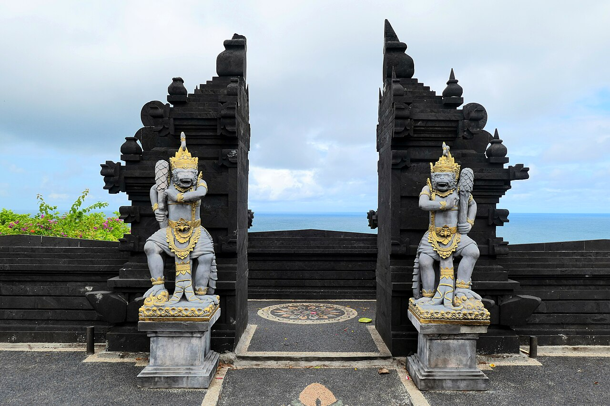

import PhotoGallery from '../../components/post/PhotoGallery.astro';
import temple from './_images/hram-uluvatu-bali/temple.jpg';
import fire from './_images/hram-uluvatu-bali/fire.jpg';
import monkeys from './_images/hram-uluvatu-bali/monkeys.jpg';
import { tpkDeep } from '../../data/affiliate.js';

export const uluwatuTour = tpkDeep('sputnik8', 'https://www.sputnik8.com/ru/bali/activities/82113-severnye-vodopady-bali-sekumpul-banyumala-hram-ulun-danu-na-ozere', 'hram_uluvatu_bali');

## Что выбрать: прогулку, кечак или экскурсию

**Если нужен вид на океан и сам храм**, выбирайте входной билет: можно пройти по разрешённой части территории и дорожкам вдоль скалы. Внутренние святыни предназначены для богослужений, а не для свободной прогулки туристов.

**Если хотите увидеть кечак**, добавьте отдельный билет в амфитеатр. Мужской хор задаёт ритм голосами, а исполнители разыгрывают эпизоды «Рамаяны». Представление и храм — два разных расхода. Первое вечернее шоу начинается в 18:00; время и наличие мест на свою дату проверяйте при покупке.

**Если не хочется решать вопрос обратной дороги**, можно выбрать <a href={uluwatuTour} target="_blank" rel="sponsored noopener">экскурсию с водителем и гидом</a>. В карточке цена — $80 (около 6 571 ₽) за группу до пяти человек; билеты и ужин оплачиваются отдельно. Сравнивайте полную сумму с самостоятельной поездкой.

## Сколько стоят билеты в 2026 году

Для иностранных посетителей вход стоит **60 000 IDR за взрослого** и **40 000 IDR за ребёнка** (около 272 ₽ и 182 ₽ соответственно). Парковка и кечак в стоимость не входят. На [странице представления](https://uluwatutemple.id/uluwatu-kecak-dance) взрослый билет на кечак стоит **150 000 IDR** (около 681 ₽), для ребёнка 2–9 лет — **75 000 IDR** (около 340 ₽). Цены и доступные сеансы проверьте при покупке.

| Расход | Один взрослый | Двое взрослых |
|---|---:|---:|
| Вход в храм | 60 000 IDR, около 272 ₽ | 120 000 IDR, около 545 ₽ |
| Билет на кечак | 150 000 IDR, около 681 ₽ | 300 000 IDR, около 1 362 ₽ |
| Вместе, без дороги и парковки | 210 000 IDR, около 953 ₽ | 420 000 IDR, около 1 907 ₽ |

Рублёвые суммы ориентировочные: курс обмена зависит от банка и даты. Цена такси зависит от точки отправления и времени; сравните варианты для своего адреса, а парковку и питание оставьте отдельными строками бюджета.

Билет на представление не заменяет вход в храм. Если покупаете кечак онлайн, заранее посмотрите, где обменять подтверждение на билет и как рано нужно прийти. В [отчёте о поездке 2025 года](https://forum.awd.ru/viewtopic.php?t=437524) путешественница описывала обмен электронного билета на бумажный на территории; это её опыт, порядок на вашу дату может измениться.

## Как добраться и вернуться после шоу

Введите в навигатор **Pura Luhur Uluwatu**, деревня Печату, район Южная Кута. Не путайте храм с районом Улувату и его пляжами: они находятся на одном полуострове, но не в одной точке.

*Ворота храма с видом на океан. Архивный снимок.*

Дорога занимает ориентировочно **45–60 минут от аэропорта**, около **45 минут от Куты или Семиньяка** и **полтора–два часа от Убуда**. Это не гарантия на конкретный вечер: перед выездом проверьте маршрут с учётом движения и оставьте запас.

- **Такси или приложение.** Уточните место посадки и цену до поездки; после представления несколько зрителей выходят одновременно. В [обсуждении путешественников](https://www.reddit.com/r/bali/comments/1ldp9as/jimbaran_to_uluwatu/) мнения о скорости обратного такси расходятся, поэтому лучше иметь запас времени или заранее договориться с водителем.
- **Машина с водителем.** Договоритесь, включено ли ожидание у храма и где состоится встреча после кечака. На большой группе стоимость машины делится между пассажирами.
- **Скутер или арендованная машина.** Проверьте условия аренды и парковку, а поездку обратно планируйте с учётом темноты и дождя. Выбирайте этот вариант, только если уверенно водите и имеете подходящие документы.

## Экскурсия: что входит в цену

В карточке <a href={uluwatuTour} target="_blank" rel="sponsored noopener">экскурсии Sputnik8 к храму и на Джимбаран</a> указана цена **$80 за экскурсию** для группы до пяти человек — около **6 571 ₽**. Заявлены русскоговорящий гид, трансфер от отеля и обратно, продолжительность восемь часов и старт в 15:00. Наличие места зависит от даты.

**Важное исключение:** вход в храм, билет на кечак и ужин в эту цену не входят, хотя ужин упомянут в названии. Для двух взрослых ориентир — $80 за экскурсию плюс 420 000 IDR за два входа и два билета на кечак, всего около **8 478 ₽**, без ужина и личных расходов. Перед бронированием проверьте цену, дату, район трансфера и состав программы. Если хотите посмотреть кечак именно при храме, согласуйте с организатором наличие билета и место показа.

## Пример вечера у храма

Храм открыт ежедневно с 07:00 до 19:00. Для самостоятельной поездки на представление в 18:00 удобно приехать около 16:00 и подойти к амфитеатру примерно за час. Это план, а не расписание экскурсии: время своего сеанса проверьте в билете.

1. **Около 16:00 — вход.** Купите билет в храм и наденьте саронг и пояс: их обычно выдают у входа.
2. **До 17:00 — прогулка.** Пройдите по доступным дорожкам, посмотрите на храм и океан с разрешённых площадок. На ограждения у края утёса не садитесь и не перелезайте.
3. **Затем — амфитеатр.** Найдите вход на кечак и ориентируйтесь на время, указанное организатором. Места и вид на закат зависят от рассадки и погоды.
4. **После представления — встреча с водителем.** Договоритесь о точке заранее: тем, кто продолжает вечер в Джимбаране, нужно отдельно учесть дорогу и стоимость ужина.

<PhotoGallery id="uluwatu-temple-photos" label="Храм Улувату, кечак и обезьяны" images={[
  { src: temple, alt: "Храм Улувату на высоком утёсе над океаном", caption: "Храм на краю известняковой скалы. Архивный снимок." },
  { src: fire, alt: "Исполнитель кечака у огня на представлении в Улувату", caption: "Представление кечак в Улувату. Архивный снимок; состав программы может отличаться." },
  { src: monkeys, alt: "Макака на территории храма Улувату", caption: "Обезьяна в храмовом комплексе. Держите вещи в закрытой сумке." }
]} />

## Одежда, обезьяны и правила храма

Улувату — действующее место поклонения. Одевайтесь скромно, используйте саронг и пояс, не мешайте церемониям и следуйте указателям. По местным правилам женщинам во время менструации нельзя входить в храм. Доступ в зоны для молящихся может быть закрыт туристам.

Очки, головные уборы и украшения лучше убрать в закрытую сумку: обезьяны могут их схватить. Не кормите и не трогайте животных. Если обезьяна укусила или поцарапала, [британская служба рекомендаций путешественникам](https://www.gov.uk/foreign-travel-advice/indonesia/health) советует немедленно обратиться за медицинской помощью: в Индонезии встречается бешенство.

С детьми держитесь дальше от края утёса и учитывайте, что кечак проходит вечером при большом числе зрителей. Если человеку трудно долго стоять или идти по неровной поверхности, уточните доступность нужного маршрута и места в амфитеатре до покупки билетов.

## Что говорят путешественники

Два описания поездок летом 2025 года — небольшая непредставительная выборка, а не рейтинг всех посетителей.

**Понравилось.** В [семейном отчёте на форуме Винского](https://forum.awd.ru/viewtopic.php?t=437524) кечак назвали ярким; путешественники также описали отдельную покупку билета в храм и обмен электронного билета на бумажный.

**Что не понравилось.** Один посетитель в [обсуждении на Reddit](https://www.reddit.com/r/bali/comments/1ldp9as/jimbaran_to_uluwatu/) пожаловался на тесные места в амфитеатре, очереди и пробку при выезде; само представление ему тоже не понравилось. Это личное впечатление, а не оценка всех зрителей.

**Обратная дорога.** В том же обсуждении один участник считал вызов машины несложным, другой предупреждал о возможном ожидании после шоу. Проверьте варианты для своего времени и адреса.

## Частые вопросы

### Можно ли посетить храм без кечака?

Да. Билет на храм и билет на представление продаются отдельно. Для прогулки по доступной территории покупать кечак не обязательно.

### Входит ли саронг в билет?

Саронг и пояс обычно предоставляют на входе. Их нужно носить на территории храма; конкретный порядок выдачи проверьте у входа.

### Обязательно ли брать экскурсию?

Нет, к храму можно добраться самостоятельно. Экскурсия удобна, если нужен гид и согласованный обратный трансфер; сравнивайте её цену с билетами и дорогой отдельно.

Общее планирование поездки, районы и сезон собраны в [путеводителе по Бали](/blog/bali-guide-2026/).
