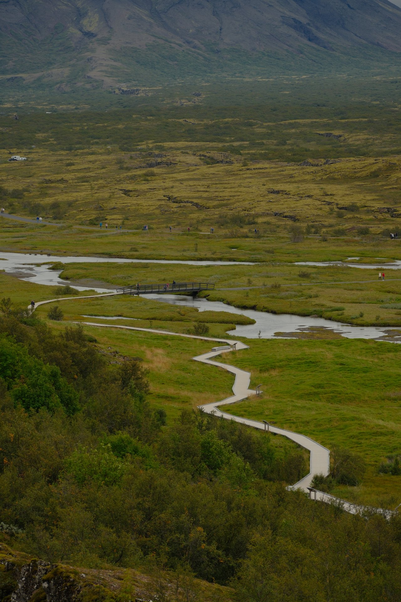
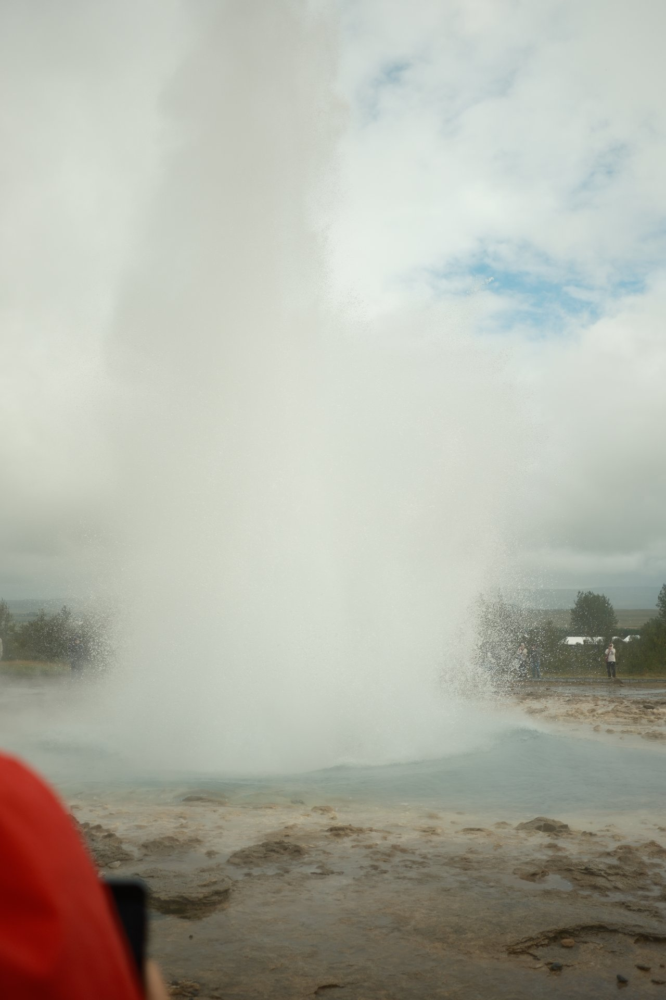
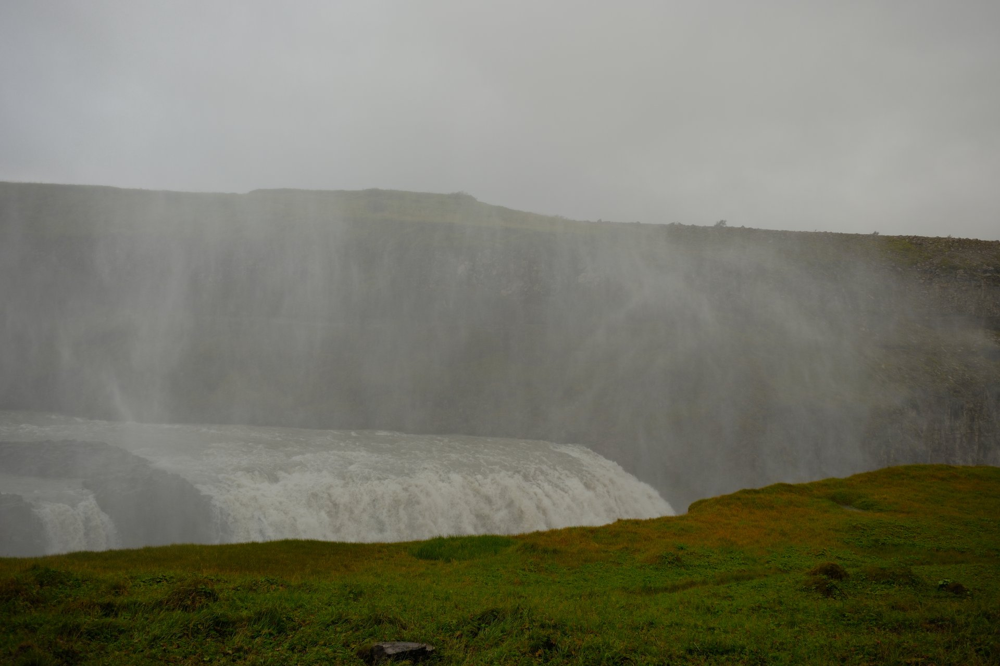
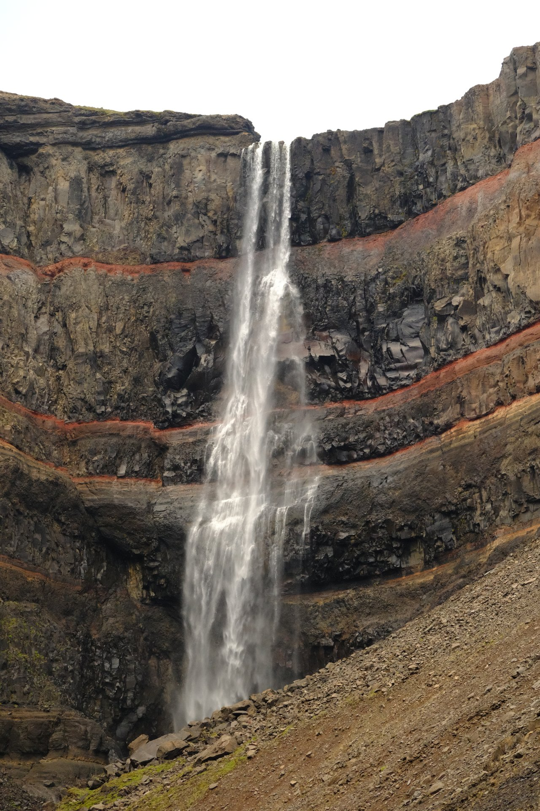
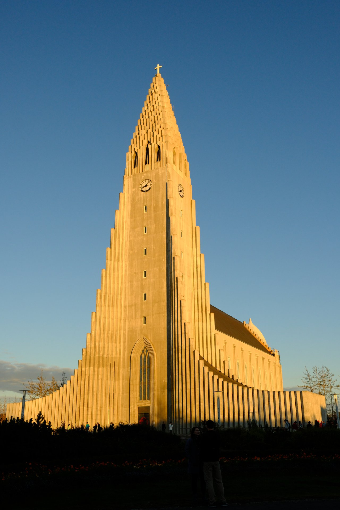

В августе 2025 года я фотографировал в Исландии разломы Тингведлира, гейзер Строккюр, водопады и Рейкьявик. Для первой поездки из этих мест складываются два разных плана. **Если времени немного, выбирайте столицу и Золотое кольцо. Если едете дальше вокруг острова, добавляйте восточный Хенгифосс отдельным днём.**

Главная ошибка при выборе достопримечательностей — считать все узнаваемые фотографии соседними остановками. Тингведлир, Строккюр и Гюдльфосс действительно связаны одним популярным маршрутом. Хенгифосс находится в другой части страны. Смешав их в один список без географии, легко получить отпуск, в котором основное занятие — возвращение к машине.

Для короткого путешествия главный вопрос — сколько времени оставить на прогулки между переездами. Если хочется ходить, а не только выходить к смотровым площадкам, разделите Золотое кольцо на два дня. Вокруг этих остановок уже можно выбирать ночёвки и дополнительные занятия.

## Короткая поездка или дорога вокруг острова

На три–четыре дня я бы оставил Рейкьявик и Золотое кольцо, добавив запас на перелёт и погоду. На сам маршрут кольца можно выделить полный день, а при интересе к прогулкам разделить его на два. Тогда не придётся сокращать Тингведлир до фотографии с первой площадки, чтобы успеть к гейзеру.

Для путешествия вокруг острова я бы рассматривал около десяти–четырнадцати дней как спокойный рабочий ориентир. Это не минимально возможный срок и не обещание увидеть всё. Длинные прогулки, дополнительные полуострова и плохая погода потребуют выбирать, что оставить. Восточный Хенгифосс уместен именно в таком большом маршруте или в отдельном путешествии по востоку.

| Место | С какой частью поездки связать | Что оставить в запасе |
|---|---|---|
| Тингведлир | Золотое кольцо из Рейкьявика | Время на пешую прогулку, а не только смотровую |
| Строккюр | Геотермальная зона Хёйкадалюр | Несколько циклов ожидания и переходы по дорожкам |
| Гюдльфосс | Тот же день или второй день Золотого кольца | Разные площадки, если они открыты |
| Хенгифосс | Восток, район Эгильсстадира | Отдельное время на подъём и возвращение |
| Рейкьявик | Начало или конец маршрута | Спокойный городской день без дальнего выезда |

Если ехать без машины, сравнивайте не только цену экскурсии, но и продолжительность остановок. Автобусное Золотое кольцо и самостоятельный день с прогулками решают разные задачи. На востоке транспорт надо подбирать под конкретную базу и начало тропы, а не рассчитывать на случайную возможность доехать.

### Порядок остановок на машине

Рабочая последовательность такая: **Рейкьявик → Тингведлир → Хёйкадалюр со Строккюром → Гюдльфосс → Рейкьявик**. Visit Iceland описывает Золотое кольцо примерно как 250 километров с возвращением в столицу; точная длина зависит от выбранных дорог и дополнительных остановок. Это ориентир масштаба, а не время, которое придётся провести за рулём при любой погоде.

В однодневном варианте выезжайте утром и оставляйте основную пешую прогулку для Тингведлира. Затем — наблюдение за гейзером и площадки Гюдльфосса. Обед удобнее привязать к зоне Хёйкадалюр, где есть туристическая инфраструктура, чем искать его между незнакомыми съездами. Не добавляйте к этому дню Хенгифосс: он относится к восточному маршруту острова.

Если разбить поездку на два дня, после Тингведлира можно заночевать ближе к следующим остановкам Золотого кольца, а Строккюр и Гюдльфосс оставить на утро. При бронировании сравните положение жилья относительно дороги, возможность позднего заселения и место ужина. Зимнюю короткую световую часть дня лучше потратить на прогулку, а не на поиск открытого кафе.

## Тингведлир: смотреть на разломы и ходить по долине

В Тингведлире широкая долина сочетается с трещинами и каменными стенами. На моих фотографиях дорожки изгибаются среди зелени и воды; пейзаж воспринимается иначе сверху и после спуска. Я бы начинал здесь с обзорной точки, а затем выбирал пешую часть по погоде и доступному времени.

*Тингведлир: от обзорного вида стоит перейти к прогулке по обозначенным дорожкам.*

Это место интересно и историей, и геологией: здесь собирался древний парламент, а рельеф связан с рифтовой зоной. Но для посетителя важнее выбрать, какую часть территории успеть пройти. Не нужно превращать день в попытку найти каждую трещину с карты. Одна вдумчивая прогулка даст больше, чем бег между несколькими парковками.

Для первого посещения удобно начать у **визит-центра рядом с P1 и площадкой Хакид (Hakið)**, спуститься по **Альманнагья** к **Лёгбергу**, затем вернуться к исходной парковке. Так в одной прогулке соединяются панорама, каменные стены разлома и место парламентской истории. Спуск не отменяет обратного подъёма: если кому-то трудно ходить по уклону, начните со смотровой и выберите длину пути уже на месте.

Тингведлир подходит тем, кто хочет начать знакомство с природой без обязательного большого похода. Удобство конкретного пути проверяйте отдельно, особенно если нужны ровное покрытие и небольшой набор высоты. «Национальный парк рядом со столицей» не означает, что все его участки одинаково доступны при снеге, льду или сильном ветре.

Вход на территорию и оплата парковки — разные вещи. Перед выездом проверьте порядок оплаты для выбранного места стоянки, а не делайте вывод о бесплатности всего посещения. Дополнительные занятия вроде погружения в Сильфре бронируются отдельно и требуют своих условий; обычная прогулка их не включает.

## Строккюр: гейзер, который не надо путать с Гейсиром

В геотермальной зоне Хёйкадалюр находятся и знаменитый Гейсир, и Строккюр. **Регулярно выбрасываемый фонтан, который обычно снимают туристы, — Строккюр.** Гейсир дал имя явлению, но не является обещанием частого извержения. Это различие полезно знать ещё до поиска точки на карте.

*Строккюр в момент выброса. Наблюдать его нужно с разрешённой стороны ограждения.*

На моём кадре фонтан закрывает большую часть неба, а вокруг стоит пар. Для съёмки стоит оставить время на несколько ожиданий, а не оценивать посещение по одному неудачному нажатию. Номинальный интервал из описания места не превращает гейзер в расписание транспорта: высота и характер выброса меняются.

Держитесь обозначенных дорожек и границ. Вода и грунт в геотермальной зоне опасны высокой температурой; это не место, где следует проверять рукой, насколько горячий небольшой источник. Положение относительно ветра важно для комфорта, но не отменяет ограждений и указаний на месте.

Хёйкадалюр удобно сочетать с Гюдльфоссом в один день. Если компания быстро устаёт от ветра и сырости, оставьте между остановками возможность зайти в тепло и поесть. Не привязывайте весь день к фотографии с конкретным направлением пара: гораздо полезнее сохранить силы для следующей прогулки.

## Гюдльфосс: два каскада и разные точки обзора

У Гюдльфосса вода последовательно уходит в каскады и узкий каньон. На моих фотографиях водяная пыль частично скрывает противоположный склон. Поэтому впечатление зависит не только от расхода воды, но и от ветра: один и тот же вид может открываться и снова исчезать за брызгами.

*Гюдльфосс: брызги меняют видимость и быстро делают одежду влажной.*

Начните с доступных верхних площадок, затем решите, нужен ли подход ближе. Нижние дорожки могут закрываться из-за обледенения и состояния покрытия. Если проход закрыт, обзор сверху остаётся самостоятельным вариантом посещения; обход ограждения ради близкого кадра не делает маршрут частью нормальной программы.

Ветровка с защитой от воды полезнее зонта, который трудно удерживать на открытом месте. Телефон и камеру убирайте от постоянных брызг между кадрами. Для тех, кто путешествует с маленькими детьми, важно заранее определить короткий путь возвращения к машине, если все промокли и замёрзли.

Охраняемая территория имеет свои ограничения: нельзя съезжать с обозначенных дорог и повреждать грунт или растительность. Для дрона требуется разрешение. Отсутствие толпы в определённом ракурсе не означает, что к нему разрешено пройти по любому склону.

В короткой поездке Гюдльфосс хорошо завершает природную часть дня, после которой не запланирован ещё один дальний выезд. Если хочется увидеть его в другом свете, проще заночевать с учётом географии маршрута, чем дважды пересекать весь столичный участок. Выбирайте жильё по следующему утру, а не только по названию популярного района.

## Хенгифосс: отдельная прогулка на востоке

Хенгифосс узнаётся по красноватым полосам в тёмной скальной стене. На моих снимках водопад занимает узкую вертикальную часть большого амфитеатра. Это другая перспектива по сравнению с широким Гюдльфоссом: здесь важен путь вверх и постепенное приближение к стене.

*Хенгифосс: красные полосы в скальной стене делают водопад узнаваемым издалека.*

**Планируйте Хенгифосс из района Эгильсстадира, а не как короткий выезд из Рейкьявика.** В кольцевом маршруте острова он становится одним из восточных дней. Попытка добавить его в сжатую программу Золотого кольца меняет весь масштаб поездки и требует других ночёвок.

Местная туристическая служба описывает прогулку ориентировочно в два часа и отмечает крутизну подъёма. Воспринимайте это как предварительный ориентир, а не гарантированный срок возвращения к машине. На тропе есть и другой интересный водопад — Литланесфосс с базальтовыми колоннами. Если путь выше закрыт или сил мало, незавершённое восхождение не обесценивает прогулку.

До выхода проверьте текущую схему прохода и состояние верхнего участка. Старое сообщение о весеннем ограничении нельзя автоматически переносить на другую дату. Не рассчитывайте на возможность идти за водопад или переходить реку только потому, что такой вариант описан в чужом отчёте: разрешённый путь и условия определяются на месте.

Жильё для этого дня выбирайте так, чтобы не начинать долгий перегон после утомительного подъёма. Вода, еда, одежда от ветра и рабочая обувь нужны даже при хорошем прогнозе у машины. Если время сжимается, лучше сократить число остановок в этот день, чем ускорять ход на мокром грунте.

## Рейкьявик: оставить время для города

Хадльгримскиркья на моём снимке освещена низким солнцем. Церковь видна из разных частей центра, и вокруг неё удобно строить пешую прогулку. Для первого посещения города я бы не превращал каждый час в переход к следующему обязательному объекту: после дороги по острову полезно провести день без длинного переезда.

*Хадльгримскиркья: городской день даёт другую скорость после природных маршрутов.*

Осмотр церкви и подъём на башню — разные части посещения. Для башни действуют отдельные билеты и часы; службы и мероприятия влияют на доступ. Не ориентируйтесь на старую цену из путеводителя и не ставьте подъём в последние минуты перед закрытием.

Рейкьявик удобно оставить на начало поездки, если нужно прийти в себя после перелёта, или на конец — чтобы иметь запас перед вылетом. Во втором случае не отдавайте резерв целиком дальнему природному объекту. Перекрытая дорога или задержавшаяся прогулка в последний день создаст проблему уже с возвращением домой.

## Что проверить перед поездкой по Исландии

Погоду смотрите по каждому участку маршрута, а не только по столице. Перед длинным выездом открывайте [предупреждения Safetravel](https://safetravel.is/) и [официальную карту дорожных условий](https://umferdin.is/en). Автомобиль выбирайте под разрешённые дороги, условия аренды и сезон; наличие полного привода не отменяет закрытия дорог.

Загрузите карты и подтверждения бронирований офлайн. Оставляйте время на парковку и пеший подход, которые навигатор не включает в чистую дорогу. Список из пяти мест должен оставаться списком решений: где провести больше времени, что перенести и от чего отказаться при ухудшении условий.

Для первого короткого знакомства я бы выбрал Рейкьявик, Тингведлир, Строккюр и Гюдльфосс. Хенгифосс добавил бы в путешествие по востоку или вокруг острова. Перед покупкой билетов сравните месяцы и климат в [гайде по сезонам Исландии](/iceland/): августовские фотографии показывают один сезон, а зимняя поездка потребует другого запаса времени.
