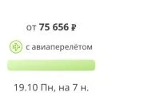
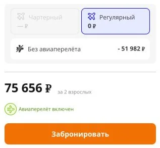
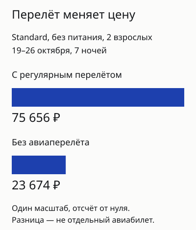
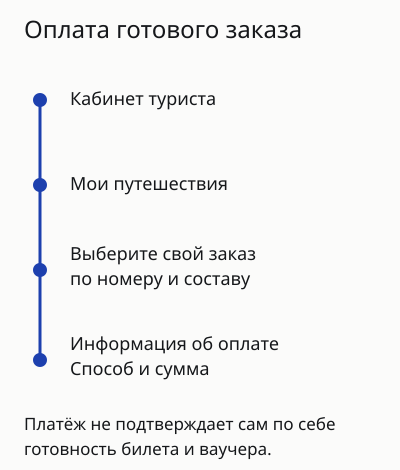

import AffiliateNote from '../../components/post/AffiliateNote.astro';
import { tpkDeep } from '../../data/affiliate.js';

Тур Интуриста в Hotel The Rose Bouquetes на **19–26 октября, семь ночей для двух взрослых**, показывал **75 656 ₽ с регулярным перелётом из Москвы**. После переключения на вариант без авиаперелёта цена того же Standard без питания стала **23 674 ₽**: сравнивать эти две суммы как одинаковые туры нельзя.

До оплаты проверьте состав заявки, продавца в договоре и срок платежа. На сайте есть отдельные режимы «Туры с перелётом» и «Только проживание в отеле», а цена на главной может быть указана за человека. Сумма крупным шрифтом полезна только вместе с этими условиями.

<AffiliateNote />

## Сколько стоит тур Интуриста на семь ночей?

В поиске были выбраны Москва, Турция, вылеты **18–31 октября**, семь ночей и двое взрослых. Для Hotel The Rose Bouquetes в Султанахмете календарь показывал следующие цены с перелётом:

| Начало тура | Ночей | Взрослых | Цена пакета от |
| --- | --- | --- | --- |
| 18 октября | 7 | 2 | 77 406 ₽ |
| 19 октября | 7 | 2 | 75 656 ₽ |
| 20 октября | 7 | 2 | 77 406 ₽ |
| 21 октября | 7 | 2 | 77 406 ₽ |
| 22 октября | 7 | 2 | 91 294 ₽ |

Это календарь одного отеля, а не средняя цена Стамбула и не обещание одинакового рейса на каждую дату. У предложения на **19–26 октября** был выбран номер Standard, размещение 2ВЗР и питание Room only — без питания. Перелёт входил в цену; выдача также указывала включённый топливный сбор. Багаж, конкретный рейс и дополнительные услуги нужно сверять в составе выбранной заявки.

Для другого предложения можно <a href={tpkDeep('level', 'https://level.travel/', 'intourist_2026_compare')} rel="sponsored noopener">открыть общий поиск туров Level.Travel</a>. Задайте те же даты и состав туристов, затем сравните номер, питание, аэропорты, багаж и трансфер. Здесь нет собственного замера цены Level и утверждения, что другой продавец дешевле.

## Почему цена без перелёта заметно ниже?

В [карточке Hotel The Rose Bouquetes](https://intourist.ru/info/turkey/stambul/sultanahmet/hotel/hotel-the-rose-bouquetes) можно переключить состав предложения. У выбранного Standard на 19–26 октября вариант с регулярным рейсом стоил **75 656 ₽**, без авиаперелёта — **23 674 ₽**. Остались семь ночей, двое взрослых и отсутствие питания.

Разница **51 982 ₽** — разница двух показанных вариантов пакета. Она не является отдельной офертой авиакомпании: купить самостоятельный билет за такую сумму на основании этого переключателя нельзя. После смены режима повторно сверяйте услуги, итог и условия отмены.

Если билет у вас есть, сравнивать нужно проживание и наземные услуги. Если билета нет, к варианту без перелёта придётся добавить подходящие рейсы и проверить время заселения. Низкая цена гостиничной части не означает, что вся поездка обойдётся в эту сумму.

Для Стамбула имеет значение и аэропорт. IST и Сабиха Гёкчен находятся в разных частях агломерации; как это влияет на дорогу и стыковку, разобрано в [статье о пересадке в Стамбуле](/blog/peresadka-v-stambule/). Название города в выдаче не заменяет проверку аэропорта в билете.

## Кто принимает заказ на официальном сайте?

[Опубликованная оферта](https://intourist.ru/rev_ntk.aspx?id=6333) называет **ООО «ИНТУРИСТ»** и описывает реализацию туристского продукта туроператора. Поэтому перед оплатой полезно найти в заявке и продавца, и туроператора: бренд на странице и юридическая роль компании — разные сведения.

Оферту открывайте из текущего сайта и сохраняйте вместе с заявкой. Старый PDF из поисковой выдачи может содержать другое название юрлица и истёкший период финансового обеспечения. Такие цифры нельзя переносить в свою покупку без проверки. Само наличие старого файла в поиске не подтверждает действующие гарантии и не доказывает нарушение со стороны продавца.

Состав путешествия должен быть понятен до денег: кто едет, на какие даты, каким транспортом и в какой номер. Если менеджер описывает один пакет, а в заявке другой, сначала согласуйте расхождение. Переписку и финальные условия сохраните рядом с договором.

## Как оплатить заявку картой, СБП или другим способом?

[Инструкция для туристов](https://intourist.ru/rev_ntk.aspx?id=1672) перечисляет пять способов: **СБП, банковская карта, Сбербанк Онлайн, T-Pay и перевод по реквизитам**. При оплате должны быть указаны минимальная предоплата и условия отмены подтверждённой заявки. Перечень на странице не доказывает прохождение платежа с любой карты: смотрите варианты своего заказа.

Оплатить можно при онлайн-бронировании или после создания заявки. Во втором случае инструкция ведёт в личный кабинет: **«Мои путешествия» → нужный заказ → «Информация об оплате»**. Там выбираются доступный способ и сумма. Для СБП появляется QR-код; для карты предусмотрен переход на банковскую страницу.

Не отправляйте номер паспорта или реквизиты карты по адресу из случайного сообщения. Откройте кабинет через официальный сайт. При банковском переводе сначала уточните номер заявки и счёта у продавца; реквизиты из старой статьи могут оказаться неподходящими для вашей покупки.

Инструкция предупреждает, что перевод из другого банка может идти **3–5 дней** и банк может брать свою комиссию. Для близкого вылета это существенное ограничение: срок зачисления нужно сопоставить со сроком оплаты, а не только с днём отправки денег.

## За сколько времени нужно оплатить тур и может ли измениться сумма?

Пункт 4.2 [оферты](https://intourist.ru/rev_ntk.aspx?id=6333) задаёт базовый срок — **один рабочий день с бронирования, если в заказе не указано иное**. Это не универсальная отсрочка для каждого предложения. У близкого вылета или специального тарифа смотрите конкретное условие заказа до его принятия.

Оферта допускает стоимость в рублях или условных единицах по внутреннему курсу компании. Окончательная сумма и услуги указаны в заявке и кабинете. Если платите частями, попросите объяснить валюту расчёта, график и момент фиксации рублёвой суммы; слово «предоплата» само по себе не означает фиксацию всего остатка.

Просроченная доплата тоже не гарантирует прежнюю цену. Не перечисляйте деньги по старому счёту после истечения срока без подтверждения продавца. При изменении стоимости запросите обновлённую заявку и объяснение расчёта, чтобы решение опиралось на свой пакет, а не на общую рекламу рассрочки.

## Когда будут билет, ваучер и страховой полис?

В [кабинете туриста](https://intourist.ru/client/login) нужно различать состояние заказа и набор готовых документов. Платёжное уведомление подтверждает операцию с деньгами, но само по себе не заменяет билет, ваучер гостиницы или полис.

Пункт 2.1.2 [оферты](https://intourist.ru/rev_ntk.aspx?id=6333) описывает передачу документов через кабинет не позднее чем за 24 часа до начала путешествия, **с оговорками и отдельным порядком выдачи в порту или на станции отправления**. Поэтому не считайте эту цифру безусловным обещанием для любого заказа. Согласуйте, какие файлы и когда появятся именно у вас.

Состав комплекта зависит от купленных услуг. При проживании без перелёта не следует ждать авиабилет. Ваучер на размещение и трансфер могут быть объединены, а медицинская страховка определяется составом заявки и условиями поездки. После появления файлов сверьте имена, даты и услуги, затем сохраните копии, доступные без интернета.

У сайта есть отдельная [проверка статуса заказа](https://intourist.ru/dg_check.aspx), запрашивающая номер путёвки и паспортные данные. Вводите их только на официальной странице. Отсутствие нужного файла решайте с продавцом по номеру заявки; повторная покупка из-за непонятного статуса может создать второй заказ.

## Что показывают отзывы покупателей?

В двух прочитанных рассказах на Отзовике впечатления различаются. [PolinaTikhonova0](https://www.otzovik.com/review_18264849.html) хвалит подбор под интерес к еде, трансфер и своевременные документы. Это опыт конкретной поездки, а не проверка всех направлений и менеджеров.

В [рассказе Right953](https://www.otzovik.com/review_18330962.html) сложности возникли при подтверждении одного из нескольких платежей для возврата. Важно дочитать историю: автор сообщает о полученных деньгах, а позже уточняет отзыв и благодарит менеджеров. Представлять этот случай как продолжающийся отказ в возврате было бы неверно.

Выборка из двух текстов за апрель–май невелика и неслучайна. По ней нельзя вычислить вероятность проблем или надёжность компании. Сохраняйте подтверждения **каждого** платежа и читайте продолжение спорной истории. Собственной покупки и проверки поддержки у автора этого разбора нет.

## Как запросить отмену и возврат?

Раздел 7 [оферты](https://intourist.ru/rev_ntk.aspx?id=6333) предусматривает письменное заявление через личный кабинет. Отмена считается осуществлённой при поступлении заявления компании или туроператору. Сохраните подтверждение получения: нажатие кнопки и завершение процедуры не стоит считать одним событием.

В правилах предусмотрен учёт фактически понесённых расходов. Поэтому нельзя заранее обещать полный возврат или единый процент удержания для всех туров. Для оплаты картой описан возврат на карту, с которой поступили деньги; иные случаи рассматриваются отдельно.

До покупки прочитайте условия своего тарифа, а при отмене запросите расчёт по своей заявке. Не переносите сумму удержания из чужого отзыва на другой отель, даты или перелёт. Если покупали через агентство, сначала определите канал обращения по своему договору.

## Кому такой способ бронирования не подойдёт?

Если нужен пляжный отдых с питанием, самая низкая строка поиска «Турция» может привести к городскому отелю Стамбула без еды. Сначала сузьте регион и питание; сравнение только нижних цен не решает задачу отпуска.

Если хотите платить частями и заранее знать окончательную рублёвую сумму, выясните условия её фиксации. При ближайшем вылете перевод по реквизитам с зачислением через несколько дней может оказаться неудобным. Если важно получить весь комплект документов задолго до дороги, согласуйте срок до оплаты.

Правила других операторов разобраны в [обзоре ANEX Tour](/blog/anex-tour-2026/) и [материале о Пегас Туристик](/blog/pegas-touristik-2026/). Сравнивайте конкретные пакеты и договоры: одинаковое название отеля не означает одинаковые билеты, условия отмены или сопровождение. Приведённые цены — наблюдавшиеся предложения, а не созданная бронь или гарантия наличия мест.
