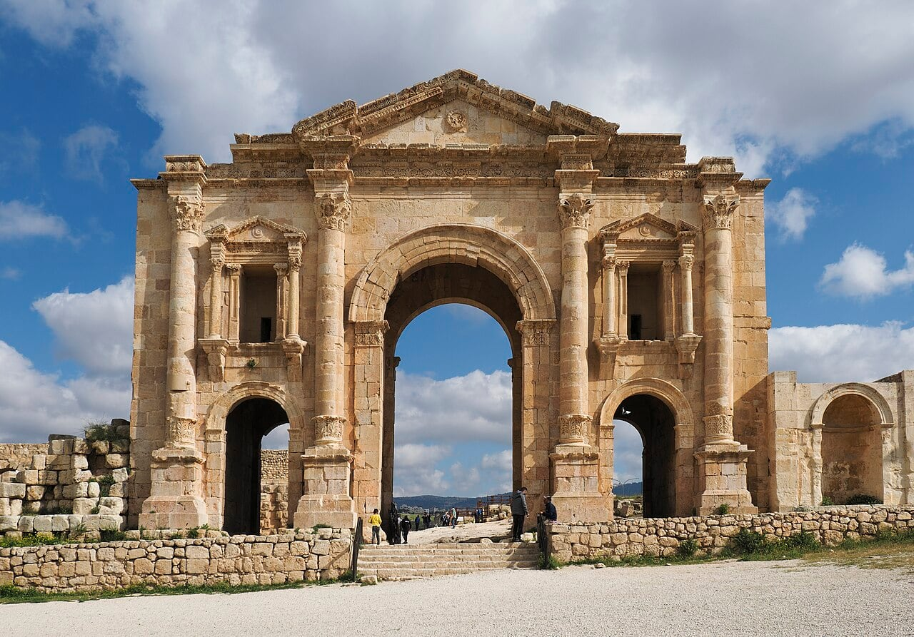
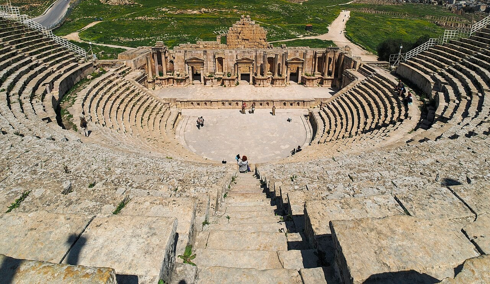
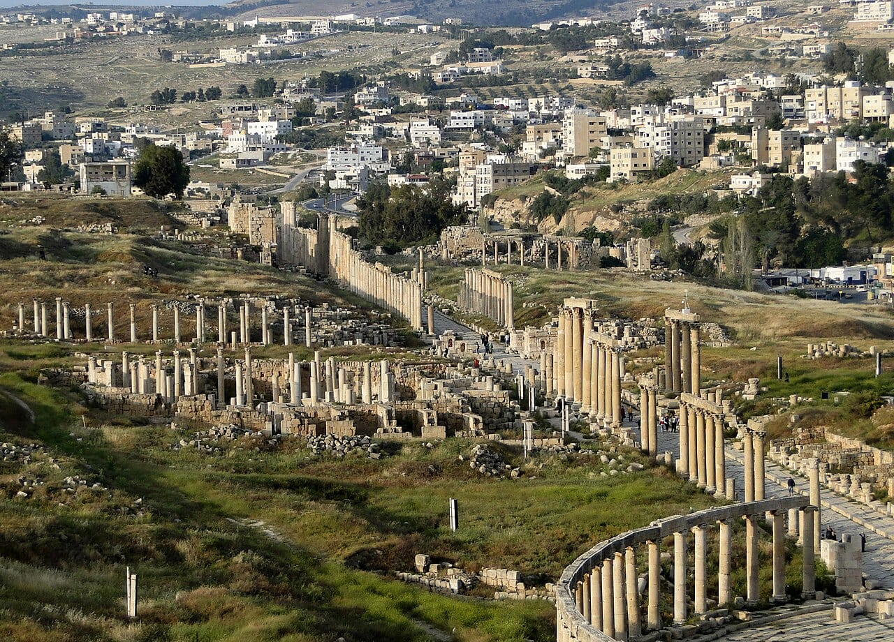
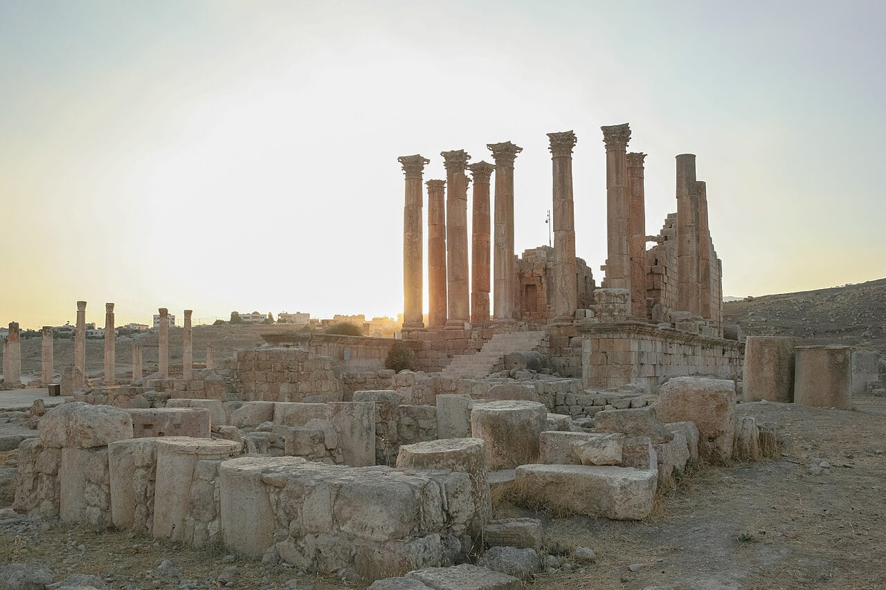

import { tpkDeep } from '../../data/affiliate.js';
export const guidedTour = tpkDeep('tripster', 'https://experience.tripster.ru/experience/7540/', 'tt_jerash_iz_ammana');

В Джераш удобно выехать утром из Аммана. Если у вас около двух часов на сами руины, идите от арки Адриана через Южные ворота к Овальной площади, загляните в Южный театр и пройдите часть улицы с колоннами. На храм Артемиды, северную часть города и музей оставьте около четырёх часов. Если едете автобусом, начните с North Bus Terminal в Аммане и уточните последний обратный рейс, пока ещё на автостанции. Часы на дорогу сюда не входят.

Если после руин хотите зайти ещё и в крепость, сравните этот маршрут с <a href={guidedTour} target="_blank" rel="sponsored noopener">поездкой с гидом в Джераш и Аджлун</a>. Билеты в оба места оплачиваются отдельно.

## Билет и часы работы

Отдельный вход в археологический город для иностранного посетителя стоит **10 иорданских динаров**, примерно 1 160 ₽ по расчётному курсу на 24 ноября. Археологический музей входит в билет на город. Если у вас есть Jordan Pass, Джераш в него включён. Покупать базовый абонемент за 70 динаров только ради Джераша смысла нет. При поездке в Петру или другие платные места считайте весь маршрут. [Государственная билетная касса](https://www.ticket.gov.jo/en/location/jerash) · [Тарифы туристического совета Иордании](https://sp.visitjordan.com/page/17/entrance-fees/) · [Цены Jordan Pass](https://www.jordanpass.jo/contents/Prices.aspx)

В ноябре ориентир по опубликованному сезонному графику — **08:00–16:00**. Летом окно длиннее. Отдельные часы предусмотрены для переходных месяцев. На Рамадан памятки расходятся. Турсовет указывает 08:30–18:00, Jordan Pass — 09:00–17:00. Если от графика зависит поездка, проверьте свою дату у визит-центра. Шестнадцать часов — время закрытия по зимней таблице. На прогулку лучше приезжать до обеда. [Часы и телефон визит-центра](https://jerash.visitjordan.com/en/page/10/Jerash-Visiting-Information) · [Сезонная таблица Jordan Pass](https://jordanpass.jo/Contents/Opening_Hours.aspx)

## Как пройти руины, если есть только два часа

1. **Арка Адриана и ипподром.** За аркой начните идти к Южным воротам. Если хочется больше времени в городе, посмотрите ипподром с края маршрута и проходите дальше.
2. **Овальная площадь.** Встаньте у выхода на длинную улицу и оглянитесь. За овалом виден поворот оси к святилищу Зевса. Площадь расширяется так, чтобы соединить главную улицу и подход к храму, которые идут под разными углами. Если смотреть с центра, это легко пропустить.
3. **Южный театр.** Он рядом с форумом. При открытых ступенях можно подняться на несколько рядов и увидеть чашу театра сверху. Затем вернитесь на площадь и идите по Кардо, главной улице. Если время заканчивается, разворачивайтесь у фонтана Нимфей, сохранив запас на обратный путь к выходу.

Такой маршрут показывает, как устроен город от парадного входа до места, где начиналась повседневная жизнь. Храм Артемиды можно оставить на следующий визит. Перечень открытых частей уточните у визит-центра, там же есть схема. [Описание объектов и карта Джераша](https://jerash.visitjordan.com/en) · [Список памятников археологического города](https://www.ticket.gov.jo/en/location/jerash)

## Что добавить за четыре часа

После Нимфея поднимитесь к храму Артемиды. Там видна другая сторона города, с лестницей и террасой над главной улицей. Если хочется продолжить, пройдите по Кардо на север, к меньшему театру и Северным воротам. Заканчивайте прогулку с учётом дороги до того входа, где вас ждёт машина. Визит в музей ближе к концу помогает связать найденные предметы с местами, по которым только что прошли.

Короткий маршрут тоже включает каменную мостовую. Если тяжело подниматься по высоким ступеням, сократите Южный театр до осмотра снизу и оставьте на Кардо время для спокойного прохода. Условия прохода в отдельные залы могут меняться, и часть пути идёт по открытым участкам. [Советы посетителям Джераша](https://jerash.visitjordan.com/en/page/10/Jerash-Visiting-Information)

## Когда совмещать Джераш и Аджлун

Из Аммана есть регулярный междугородний автобус. Министерство транспорта называет **North Bus Terminal** одной из точек посадки, а пассажирский отчёт регулятора подтверждает, что линия Амман — Джераш работала и в октябре 2026 года. На терминале попросите показать, где в Джераше садиться обратно, и уточните часы последнего рейса на день поездки. Если хотите задержаться в руинах до закрытия, заранее договоритесь о машине на обратный путь. [Сообщение Минтранса о маршруте и терминале](https://pt1.petra.gov.jo/en/news/transport-ministry-plans-second-phase-of-intercity-bus-project-with-seven-new-routes) · [Октябрьские данные транспортного регулятора](https://petra.gov.jo/phpticket/index.php/en/news/intercity-bus-ridership-surges-588-percent-in-october%C2%A0ltrc)

Если хочется добавить крепость Аджлун, удобнее выбрать машину с ожиданием или программу, где объединены обе остановки. Tripster предлагает поездку по северу Иордании с русскоязычным гидом. Маршрут включает оба места. Билеты в Джераш и Аджлун оплачиваются отдельно, место встречи согласуют заранее. Перед заказом спросите, сколько времени из программы оставят на руины. Для подробного осмотра Джераша оставляйте ему отдельную половину дня. <a href={guidedTour} target="_blank" rel="sponsored noopener">Программа поездки в Джераш и Аджлун</a> · [Другие маршруты по Иордании](/jordan/)

*Курс для оценки 10 динаров рассчитан через доллар по данным центробанков Иордании и России. Банк или обменник может использовать другой курс.* [Центральный банк Иордании](https://www.cbj.gov.jo/En/Pages/foreignexchangerates) · [Банк России](https://www.cbr.ru/currency_base/daily/?UniDbQuery.Posted=True&UniDbQuery.To=24.11.2026)
