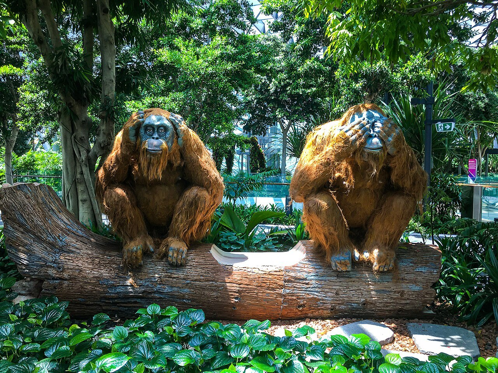
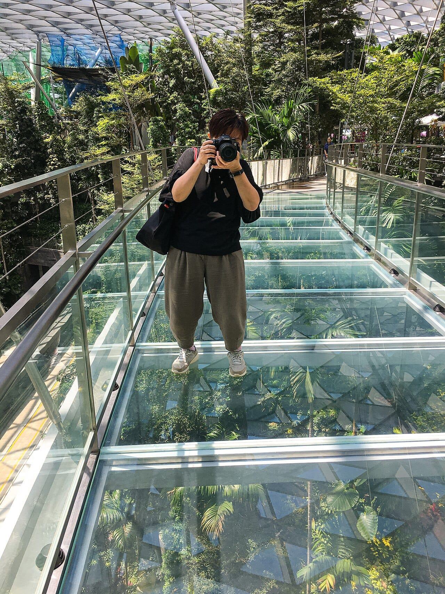
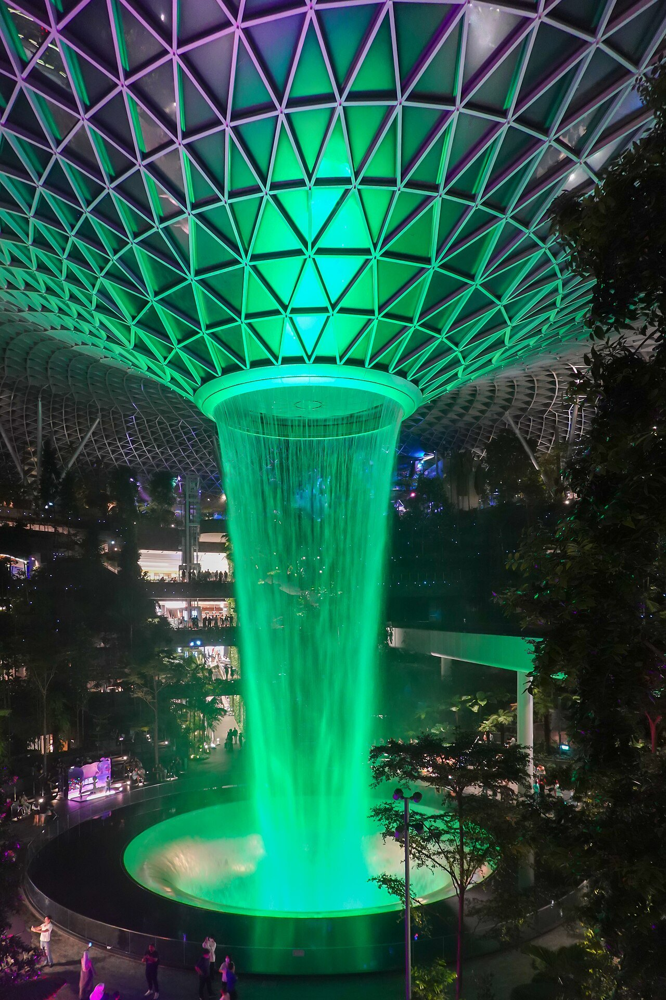
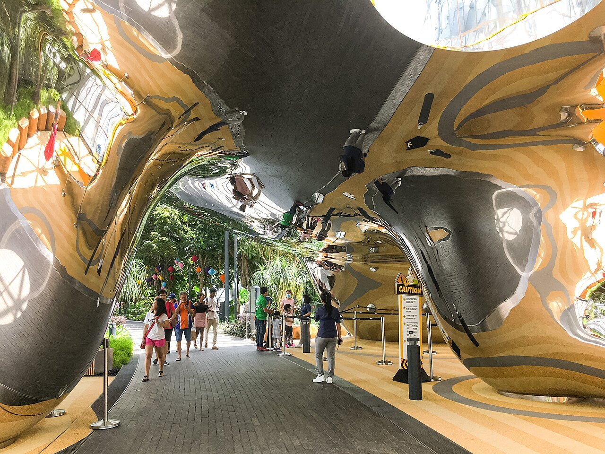

У самого известного водопада Сингапура есть неудобная для транзитного пассажира особенность: он находится **за пределами транзитной зоны**. Чтобы погулять по Jewel, нужно иметь право въехать в страну, пройти контроль и затем вернуться на свой рейс. Красивый зал на фотографии не является обычным коридором между выходами на посадку.

Хорошая новость: **Rain Vortex и прогулка по Forest Valley бесплатны**. Билет понадобится для отдельных развлечений на верхнем уровне. Сам Jewel советует транзитным пассажирам закладывать не менее пяти часов между рейсами; это нижний ориентир, а не гарантия, что любой пассажир успеет. Сначала проверьте въезд и время, затем выбирайте программу.

Если нужен мост, лабиринт или Canopy Park, можно сравнить <a href="https://tiqets.tpk.mx/QYpcZlVN?erid=2VtzqvKwa3R&amp;sub_id=tt_jewel_park&amp;u=https%3A%2F%2Fwww.tiqets.com%2Fen%2Fsingapore-attractions-c78125%2Ftickets-for-jewel-changi-airport-p984738%2F" target="_blank" rel="sponsored noopener">варианты билетов на платные развлечения Jewel</a>. Название Entry Ticket у посредника не означает, что без покупки вас не пустят к водопаду. Ниже разберём и более дешёвый базовый тариф самого парка.

## Что здесь особенного и ради чего идти

Rain Vortex падает с высоты 40 метров под огромной стеклянной крышей. Вокруг устроен многоуровневый сад: можно смотреть на воду снизу, подниматься по дорожкам среди растений и менять ракурс. Интереснее всего именно движение между уровнями. Один снимок из точки входа показывает только часть пространства.

Forest Valley насчитывает более 900 деревьев и пальм и около 60 тысяч кустарников. Дорожки поднимаются вдоль зелёных склонов; восточная проходит возле каменных каскадов, западная — через участки с искусственным туманом. Это сад внутри большого общественного комплекса, где рядом работают магазины и кафе. Ожидать тишины уединённого природного водопада не стоит.

В [поездке по Сингапуру](/singapore/) Jewel особенно удобен в двух случаях: после прилёта, когда вы въехали в Сингапур, и перед вылетом, если приехали заранее. Во время пересадки к прогулке добавляются формальности и обратная дорога. Поэтому одна и та же достопримечательность может оказаться прекрасной идеей на последнем дне отпуска и плохой — при короткой стыковке.

Если вам нужен целый день среди садов, сравните Jewel с [Gardens by the Bay](/blog/gardens-by-the-bay/). В городских садах другой масштаб прогулки и собственные платные оранжереи. Посещать оба места только ради похожих фотографий зелени необязательно; выбирайте по оставшемуся времени и маршруту.

## Можно ли выйти к водопаду при пересадке

Сначала проверьте [правила въезда в Сингапур](/blog/singapore-visa-2026/) под свой паспорт и маршрут. Право пересесть на другой самолёт без выхода через границу не равно праву посетить Jewel. Безвизовый транзит также нельзя считать автоматическим разрешением для любого билета: условия маршрута и решение пограничной службы имеют значение.

Для въезда обычно требуется SG Arrival Card. Её подают бесплатно через официальный сервис ICA в пределах трёх дней, включая день прибытия. Эта электронная декларация **не заменяет визу**. Не покупайте «доступ к водопаду» у сервиса, который продаёт заполнение анкеты: посещение сада и иммиграционные формальности — разные задачи.

Далее выясните, что происходит с багажом. Если он оформлен до конечного пункта, это одна схема. Если нужно получить чемодан и заново сдать его на следующий рейс, времени потребуется больше. Отдельные билеты, смена терминала и ограничения регистрации могут сделать прогулку неудобной даже при формально длинной стыковке.

Наконец, посчитайте доступное время **от фактического прилёта до нужного возвращения в терминал**, а не весь промежуток между рейсами. Выход из самолёта, контроль, получение багажа и путь к Jewel сокращают пересадку. На обратном пути учитываются регистрация, контроль и дорога к выходу; ориентируйтесь на требования своей авиакомпании.

## Как рассчитать время и не превратить прогулку в спринт

Пять часов из рекомендации Jewel не следует превращать в обещание пяти свободных часов у водопада. Оператор отдельно напоминает о регистрации минимум за два часа до рейса; для вашего перевозчика и ситуации может понадобиться больше. Если после всех вычетов остаётся мало времени, оставьте Jewel на следующее путешествие.

Ниже — **расчётный пример**, а не расписание прохождения аэропорта. Допустим, самолёт прилетел в 12:00, следующий вылетает в 19:00, въезд разрешён, багаж перегружает авиакомпания, а терминал и посадочный талон известны.

| Этап | Пример плана | Почему нужен запас |
|---|---|---|
| Выход, контроль и дорога | 12:00–13:30 | Полтора часа заложены как допущение; фактическое время неизвестно |
| Водопад, сад и еда | 13:30–15:30 | Два часа на спокойную короткую программу |
| Возвращение в терминал | Начать в 15:30 | Остаётся запас до контрольной точки регистрации |
| Контрольная точка | Быть в нужном терминале не позднее 17:00 | Более раннее требование перевозчика имеет приоритет |

Если прибытие задержалось, сокращайте программу, а не резерв. Первым убирается платный аттракцион, затем долгий обед. Когда времени остаётся только на быстрый взгляд и бег обратно, лучше отказаться от выхода: стоимость нового билета несопоставима с ценой развлечений.

Полезный приём — поставить напоминание на время ухода из Jewel. Не на начало посадки и не на вылет, а именно на момент, когда нужно закончить прогулку. До входа сохраните номер терминала и маршрут обратно; после часа среди магазинов легко перепутать, откуда вы пришли.

## Как попасть из T1, T2, T3 и T4

**Из T1** Jewel соединён с залом прилёта на уровне L1. После необходимых формальностей следуйте указателям Jewel. Это удобный подход, но прохождение границы и получение багажа не входят в короткое расстояние между зданиями.

**Из T2 и T3** идут крытые пешеходные мосты с уровня отправления L2. Оператор оценивает сам переход примерно в пять–десять минут. В T2 ориентир — район первого ряда регистрации, в T3 — одиннадцатого. Учитывайте путь от того места терминала, где вы оказались, а не только длину моста.

**Из T4** предусмотрен бесплатный шаттл к Jewel/T1. Проверьте место посадки, действующий интервал и обратный путь на указателях аэропорта. Ожидание автобуса — отдельная часть расчёта; переносить время пешего перехода из T2 на маршрут из T4 нельзя.

Skytrain между T2 и T3 проходит через пространство Jewel, но **станции внутри комплекса у него нет**. Из поезда можно мельком увидеть водопад, если он работает и выбран нужный участок. Выйти у сада таким способом не получится. Если вы остались в транзитной зоне, не путайте этот короткий вид с полноценным посещением.

## Бесплатный маршрут: водопад и Forest Valley

Сначала подойдите к центральному пространству и посмотрите на весь поток воды и крышу. Затем выберите одну сторону сада, поднимитесь по доступной дорожке и остановитесь на другом уровне. Для каждого маршрута Forest Valley оператор советует около получаса с фотографиями. При ограниченном времени выберите одну дорожку вместо полного круга по этажам.

В саду есть выходы на разных уровнях и места для отдыха. Пользуйтесь ими, чтобы менять нагрузку: идти всё время вверх необязательно. Для фотографии попробуйте оставить в кадре и растения, и часть крыши — так виден масштаб комплекса. Крупный план воды без окружения теряет многое из того, ради чего приезжают в Jewel.

Чемоданы и сумки на колёсах **на дорожки Forest Valley не допускаются**. Платная камера хранения находится на L1. Если планируете только кафе и краткий вид из общих пространств, решите заранее, нужна ли сдача вещей; если хотите прогулку по саду, хранение становится частью маршрута. Точную стоимость уточняйте по размеру и сроку, не переносите старую цену из чужого отчёта.

Оставьте время посидеть. Во время пересадки короткая спокойная прогулка может быть приятнее попытки пробежать водопад, два лабиринта, мост и магазины. Базовый маршрут позволяет получить главное впечатление без билета на аттракционы.

## За что платить: Canopy Park, мост и лабиринты

Canopy Park расположен на L5. Стандартный вход для взрослого и ребёнка стоит **примерно 520 ₽, или 8 сингапурских долларов**. Тариф для резидентов — отдельный: туристу нельзя автоматически рассчитывать на указанную рядом меньшую цену.

Базовый билет включает Discovery Slides, Foggy Bowls, Petal Garden и Topiary Walk. Это горки, туманные игровые участки и сады; мост, лабиринты и сетчатые аттракционы требуют подходящего отдельного билета. В обратную сторону правило работает иначе: билеты ряда аттракционов включают Canopy Park. Сначала выберите занятие, затем проверьте комплект, чтобы не оплатить парк дважды.

Для семьи из двух взрослых и ребёнка 3–12 лет базовый вход по стандартному тарифу — **24 SGD, около 1550 ₽**. Это расчёт только за парк. Еда, хранение вещей и дополнительные развлечения в сумму не входят; водопад сам по себе остаётся бесплатным.

На <a href="https://tiqets.tpk.mx/QYpcZlVN?erid=2VtzqvKwa3R&amp;sub_id=tt_jewel_park&amp;u=https%3A%2F%2Fwww.tiqets.com%2Fen%2Fsingapore-attractions-c78125%2Ftickets-for-jewel-changi-airport-p984738%2F" target="_blank" rel="sponsored noopener">странице билетов Tiqets</a> на 15 ноября 2026 года базовый Canopy Park стоит **около 710 ₽ — 7,73 евро** за взрослого 13–59 лет или ребёнка 3–12 лет. Для той же семьи получается примерно **2140 ₽**. Поэтому перед покупкой сравните с [официальным тарифом Canopy Park](https://www.jewelchangiairport.com/en/attractions/canopy-park.html): для базового парка он ниже.

У посредника также были отдельные варианты моста, лабиринтов и Walking Net с включённым парком. Сравнивайте одинаковый состав и возрастные категории, а не только самую маленькую сумму на странице. Для этого билета возврат не предусмотрен. Покупка заранее особенно требует осторожности при пересадке: задержка самолёта может оставить вас без времени на посещение.

Рублёвые суммы ориентировочные: итоговое списание зависит от курса банка и продавца. Ни наличие кнопки оплаты, ни выбранная дата не подтверждают, что ваша карта будет принята.

## Когда работает водопад и что увидите ночью

Rain Vortex работает ежедневно **с 10:00 до 22:00**. Светомузыкальное шоу проходит с понедельника по четверг в **20:00 и 21:00**; с пятницы по воскресенье, в праздничные дни и накануне праздников добавляется **22:00**. Перед поездкой проверьте объявления комплекса: отдельные зоны могут закрывать на обслуживание или частное мероприятие.

Само здание доступно круглосуточно, как и Forest Valley, но водопад, магазины и платные развлечения живут по собственным расписаниям. Ночная пересадка не гарантирует поток воды и полный набор работающих кафе. Если вы прилетаете после завершения программы, не выходите через границу только ради ожидания увидеть картинку с вечернего шоу.

Canopy Park по обычному расписанию открыт с понедельника по четверг до 21:00, в пятницу–воскресенье, праздничные дни и их кануны — до 22:00; начало работы в 10:00. Последний вход за полчаса до закрытия. Сеанс шоу внизу не означает, что после него вы ещё успеете начать прогулку по платному парку.

## С детьми, коляской и багажом: что проверить заранее

Детям 3–12 лет в Canopy Park нужен сопровождающий взрослый с билетом. У конкретных развлечений действуют дополнительные ограничения: например, для Discovery Slides минимальный рост — 110 см. Семейный билет в парк не означает, что ребёнок автоматически подходит для всех горок, мостов и сеток.

Перед покупкой измерьте рост ребёнка и проверьте правила выбранного занятия. Если главное желание — побегать среди тумана и посмотреть фигуры растений, можно ограничиться базовым парком. Если хочется именно сеток или лабиринта, ищите их название в составе билета. Показывать ребёнку фотографию аттракциона до этой проверки рискованно для семейного настроения.

На L1 у стойки обслуживания можно уточнить предоставление колясок и кресел-колясок; предусмотрен возвратный депозит. При этом не все развлечения доступны с ними. Комнаты ухода за детьми есть на уровнях от B2 до L4. Планируйте паузы на еду и переодевание раньше, чем ребёнок окончательно устанет от аэропорта.

Перед вылетом из Сингапура проверьте возможность ранней регистрации в Jewel на L1. Она зависит от авиакомпании и условий рейса; нельзя считать, что любой чемодан примут в любое время. Если услуга недоступна, остаётся платное хранение или прогулка после обычной сдачи багажа, если логистика позволяет.

## Что пишут те, кто был

В одном личном отчёте на форуме Винского о весенней поездке 2026 года описан вечерний выход в Jewel во время пересадки. Это один случай, выборка непредставительна. Автор прошёл контроль быстро и предположил, что помогло позднее время; переносить этот опыт на любую пересадку нельзя.

Главным впечатлением стали подсвеченный водопад и возможность рассматривать его с разных уровней. При этом другие аэропортовые сады в темноте воспринимались иначе. Полезный вывод — выбирать время под конкретное занятие: вечер хорош для света и воды, но не заменяет дневную прогулку среди растений.

## Частые вопросы

**Можно ли увидеть водопад бесплатно?** Да. Плата нужна для отдельных развлечений, а не за сам Rain Vortex и Forest Valley. Дополнительные расходы могут возникнуть на хранение вещей, еду и дорогу.

**Хватит ли трёх часов между рейсами?** Мы не предлагаем такой план. Официальный ориентир Jewel — не менее пяти часов, и даже его нужно проверять по своему въезду, багажу, терминалу и требованиям перевозчика.

**Нужен ли билет на самолёт, чтобы прийти в Jewel?** Нет, комплекс находится в общедоступной зоне аэропорта. Для туриста, находящегося в Сингапуре, это обычная поездка к достопримечательности; для транзитного пассажира сначала решается вопрос въезда.

**Можно ли заехать перед вылетом?** Да, и часто это проще пересадки. Заранее проверьте регистрацию и багаж, приезжайте с запасом и назначьте время окончания прогулки. Если день посвящён аэропорту, не добавляйте перед ним ещё несколько далёких городских остановок.

**Что выбрать на первый раз?** Водопад, одну дорожку Forest Valley и спокойную паузу на еду. Добавляйте платное развлечение, только когда понятны возрастные ограничения, состав билета и свободное время. Jewel хорошо работает как самостоятельная короткая прогулка; покупать всё сразу не требуется.
