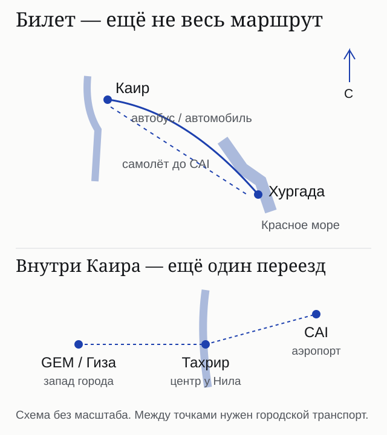
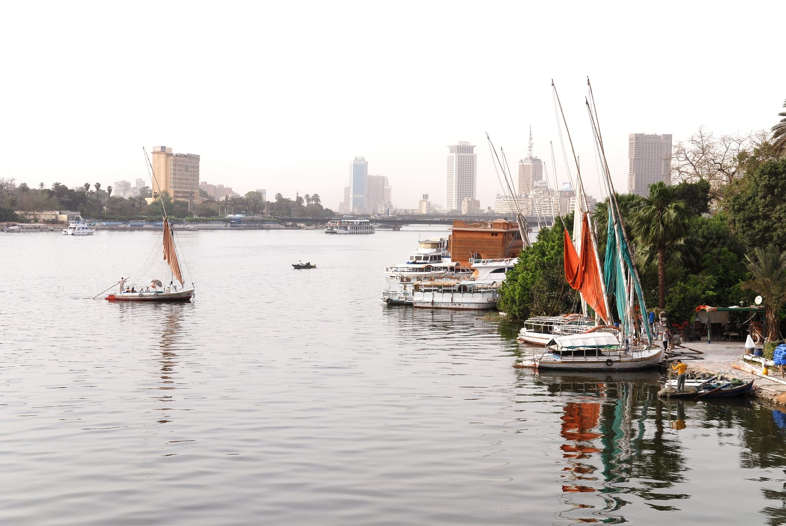
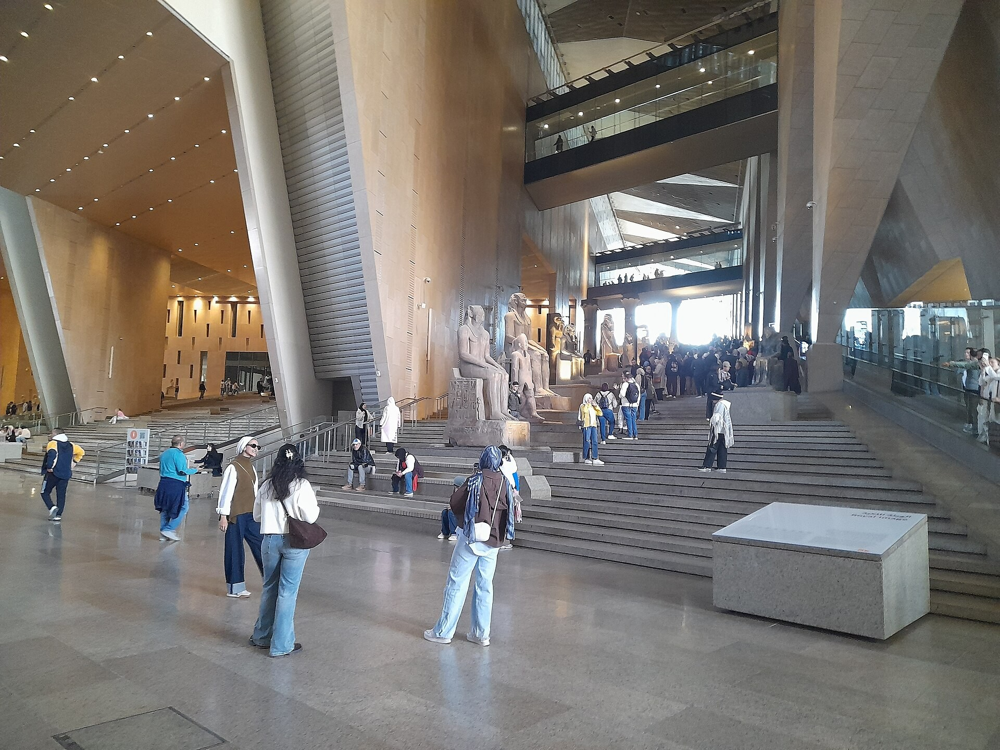
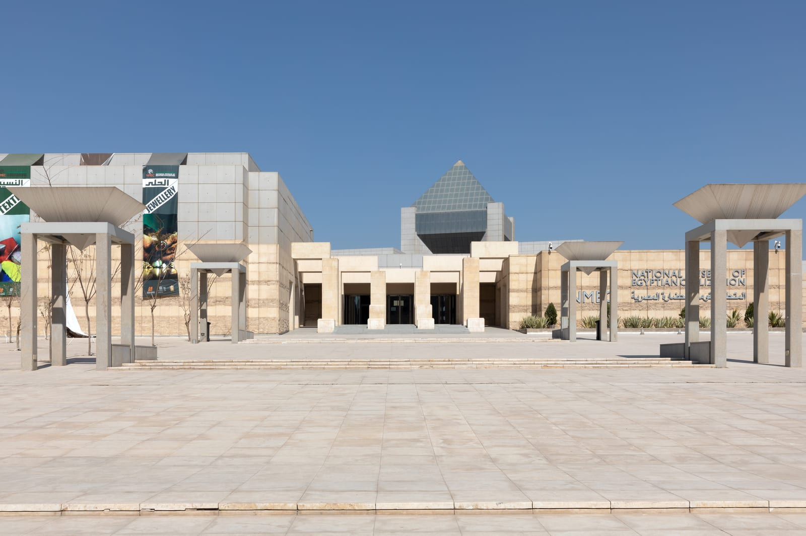

import { tpkDeep } from '../../data/affiliate.js';

**Для первой поездки на один день проще групповая экскурсия с понятным составом билетов. Самостоятельный автобус даёт свободу, но требует отдельных переездов по Каиру. Самолёт сокращает дорогу между городами, а не автоматически весь день. Ночёвка помогает разделить программу, если заранее посчитаны гостиница, питание и оба междугородних переезда.**

Начните с вопроса, какой именно музей вам нужен. Большой Египетский музей **GEM находится у Гизы**, исторический Египетский музей — **на площади Тахрир**, а царские мумии — в **NMEC**. Фраза «Египетский музей включён» не означает билет в любой из них.

## Четыре способа: сначала программа, потом цена

| Формат | Что получаете | Что ещё считать | Время от отеля до возвращения |
|---|---|---|---|
| Автобус самостоятельно | Отдельный билет между городами, собственный темп | Дорога к станции и обратно, поездки по Каиру, входы, питание | Два междугородних переезда, время в городе и все подходы; обычно захватывает ночь |
| Самолёт самостоятельно | Отдельный перелёт и возможность собрать свой день | Аэропорты, регистрация, городской транспорт, входы и еда | В примере ниже около 18 часов с заложенными запасами, хотя каждый рейс занимает около часа |
| Групповая экскурсия | Трансфер из гостиницы, общая программа, гид | Точный музей, напитки, дополнительные остановки и удалённый курорт | В проверенной карточке 18 часов; точный сбор зависит от гостиницы |
| Частная поездка с ночёвкой | Свой автомобиль и гид, разделение программы на два дня | Ночь, питание, билеты, число пассажиров и оба переезда из Хургады | Два дня и одна ночь; расписание фиксируется в вашей смете |

Эти варианты нельзя сравнить одной цифрой: экскурсия с музеем на Тахрире и самостоятельный день в GEM дают **разную программу**. Для выбора курорта перед поездкой пригодится [сравнение Хургады и Шарм-эль-Шейха](/blog/hurghada-sharm-2026/).

## Самостоятельный автобус: билет заканчивается на станции

В официальном поиске Go Bus на 10 ноября был рейс **Хургада—Тахрир 00:30–07:30, Super Go D,550EGP** — около 790₽ в одну сторону. Это время от станции до станции, а не от курортного номера до музея. Классы и рейсы различаются; не переносите одну найденную цену на весь день.

Обратный билет выбирайте **до покупки входа в музей**. В расписании должны совпасть дата, станция отправления и запас на городскую дорогу. Станции Cairo, Tahrir, Almaza и Giza не взаимозаменяемы. Если автобус приходит к Тахриру, для GEM предстоит ещё переехать на запад города.

Для расчёта времени сложите: гостиница→станция, запас до отправления, около 7 часов найденного рейса, станция→музей, посещение, дорога к обратной станции, второй междугородний переезд, станция→гостиница. **Ночная поездка туда и обратно может занять больше календарных суток**, даже если в Каире вы проведёте один день.

Самостоятельный автобус стоит выбирать ради своего темпа и маршрута. Экономию нужно проверить полной сметой: для одного человека несколько такси способны приблизить расходы к цене организованной группы.

## Самолёт: проверяем и обратный рейс

Для примера 10 ноября поиск вернул полную связку **EgyptAir MS043 05:00–06:00 и Air Cairo SM8048 19:35–20:35 за$410** на одного взрослого туда-обратно — около 33,1 тыс.₽ только за перелёт. Это найденное предложение, не покупка и не обещание наличия к вашим датам. Правила возврата и конкретный тариф проверяйте перед оплатой.

Сценарий от гостиницы: выезд около 03:00, перелёт 05:00–06:00, затем получение багажа при его наличии и переезд из CAI. Обратно нужно выехать из города с запасом на дорогу и регистрацию, прилететь в 20:35 и добраться до гостиницы. **Возвращение около 21:15 даёт примерно 18 часов 15 минут всей поездки** — это расчёт с допущениями о трансферах, а не гарантированный график.

Преимущество самолёта — меньше часов в междугороднем автобусе. Его не стоит описывать как короткую лёгкую прогулку: ранний подъём и городские пробки остаются. Поздний прилёт в Каир тоже не становится хорошим вариантом для музея только потому, что билет дешевле.

## Групповая экскурсия: сначала прочитайте включения

В проверенной программе Sputnik8№93054 указаны **18 часов, группа до 35 человек, трансфер из гостиниц Хургады, гид, обед, входные билеты, Гиза и Египетский музей**. Обычная показанная цена —$46 на взрослого, около 3700₽; в карточке есть отдельная скидочная цена. Напитки и личные расходы исключены.

Уточните **название и адрес музея**: в этой карточке не подтверждён GEM, поэтому билет в новый музей я ей не приписываю. Если хотите именно GEM, выбирайте программу, где он назван прямо, и получите подтверждение нужного билета до оплаты. Посещение плато Гизы также не означает вход внутрь пирамиды Хеопса.

Сбор заявлен примерно в 01:00; организатор уточняет его по гостинице. Группа означает общий темп и ожидание других участников. Для Сахль-Хашиша, Макади, Сомы и других удалённых зон отдельно подтвердите трансфер и доплату: слова «из Хургады» не определяют границы забора.

<a href={tpkDeep('sputnik8', 'https://www.sputnik8.com/ru/hurghada/activities/93054-istoricheskoe-puteshestvie-v-drevniy-egipet-muzey-i-piramidy', 'cairo_hurghada_group')} target="_blank" rel="sponsored noopener">Проверить программу, выбранный музей и дату групповой поездки</a>

## Частная поездка с ночёвкой: цена машины не равна всей смете

В двухдневной карточке Sputnik8№63123 есть автомобиль для 1–2 человек, водитель и гид; **гостиница, еда и входы оплачиваются отдельно**, для 3–8 человек предусмотрена доплата за микроавтобус. Показанная базовая цена —$693 за экскурсию, около 55,9 тыс.₽. Не делите её на восемь: базовое включение автомобиля рассчитано на 1–2 пассажиров.

Перед выбором нужна письменная смета, где прямо указаны **забор из вашей гостиницы в Хургаде и возвращение туда на второй день**. В карточке отдельно упоминаются аэропортовые трансферы, а место встречи сформулировано как «отель или аэропорт»; эти строки нельзя самовольно объявлять подтверждением любого междугороднего маршрута. До уточнения это пример состава расходов, а не подтверждённая итоговая цена поездки от вашей двери.

Ночь выбирайте по маршруту: отель у Гизы удобен для утреннего плато и GEM, центральный — для прогулки у Нила и Тахрира. Проверьте время заселения, завтрак, отмену и парковку для машины. В двухдневной программе не обязательно заполнять каждый час: один большой музей и Гиза с паузами могут быть полезнее списка из десятка остановок.

<a href={tpkDeep('sputnik8', 'https://www.sputnik8.com/ru/hurghada/activities/63123-dvuhdnevnaya-ekskursiya-po-kairu-i-gize-iz-hurgady', 'cairo_hurghada_private_overnight')} target="_blank" rel="sponsored noopener">Открыть состав частной программы и уточнить полную смету</a>

## Полная стоимость: что входит в расчёт

Ниже **сценарии бюджета**, а не четыре предложения с одинаковым составом. Найденные тарифы отделены от условных резервов. Примеры для самостоятельных поездок предполагают **один GEM**, без дополнительного входа на плато Гизы. Группа и частная программа имеют собственный набор мест.

| Статья расходов | Автобус самостоятельно,1 взрослый | Самолёт самостоятельно,1 взрослый | Группа,1 взрослый | Частная поездка,2 взрослых |
|---|---|---|---|---|
| Междугородняя дорога | Найденный билет 550EGP; обратный тариф проверяется отдельно | Найденный полный перелёт$410 | Входит в программу при подтверждённом заборе | В базовом предложении есть автомобиль; оба переезда из Хургады нужно явно подтвердить |
| Местный транспорт | Заложить гостиница↔станция и станция↔музей | Заложить гостиница↔HRG и CAI↔музей | Проверить доплату за удалённую гостиницу | Зафиксировать все адреса и аэропортовые доплаты |
| Входы | GEM1830EGP в расчётном примере; другие объекты отдельно | GEM1830EGP в расчётном примере | Входы по заявленной программе, без обещания GEM | Оплачиваются отдельно; выбранные объекты фиксируются в смете |
| Питание | Ваши покупки | Ваши покупки | Обед включён; напитки отдельно | Обед в карточке$15 на человека; ночь и остальное питание отдельно |
| Ночь | Не включена | Не включена | Не включена | Отдельное бронирование, стоимость за номер |
| Опции | Гид, Гиза, лодка, вход в пирамиду — только по желанию и отдельной цене | То же | Лодка, верблюд, внутренние помещения — по условиям программы | Лодка в карточке$50 с группы; остальные опции отдельно |

**Пример самостоятельного автобуса:** если обратный билет стоит столько же, два билета дают 1100EGP. Добавим условно 400EGP на дорогу в Хургаде,700EGP на городские поездки в Каире,500EGP на питание и 1830EGP за GEM (около 2630₽). Получится 4530EGP — около 6500₽. Здесь обратный тариф, такси и питание — допущения; это не готовый комплект за эту сумму.

**Пример самостоятельного самолёта:**$410 за перелёт плюс условно$30 на трансферы в Хургаде,$45 на городские переезды в Каире,$15 на питание и 1830EGP за GEM — около 43,0 тыс.₽. Эти резервы не являются найденными тарифами такси. Поездка в Гизу сверх музея меняет и расходы, и расписание.

**Пример группы:**$46 плюс условный резерв$5 на напитки — около 4100₽. Вне стандартной зоны забора, при выборе другого музея или дополнительных услуг итог изменится. Сначала подтвердите программу, затем сравнивайте её с самостоятельным маршрутом.

**Условная полная смета частной поездки для двоих:** $693 за базовую программу + $80 на номер + $60 на два обеда для двоих за два дня + $104 на перечисленные организатором основные входы + $40 на завтраки и ужин + $20 резерва на напитки и мелкие расходы = $997, около 80,4 тыс. ₽ на двоих. Билеты здесь посчитаны по опубликованным строкам организатора, не по самостоятельно проверенным ценам всех касс. Модель действует только если в базу включены оба переезда из вашей гостиницы в Хургаде и нет иной обязательной доплаты. Ночь, питание и резерв — допущения; лодка, внутренний вход в пирамиду и аэропортовые трансферы не включены и не предполагаются. Это не подтверждённое предложение за $997: до получения полной сметы для вашей даты итог неизвестен.

## GEM, Тахрир и NMEC: три разных билета

**GEM** выбирают ради Большого Египетского музея у плато Гизы и его коллекций. В отдельном [путеводителе по GEM](/blog/bolshoy-egipetskiy-muzey/) разобраны билет, вход и организация посещения. Официальный билет привязан к дате, времени и категории; условия невозврата нужно прочитать до покупки. Сумма 1830EGP в сметах относится к обычному иностранному взрослому из датированного расчёта, а не ко всем категориям посетителей.

**Египетский музей на Тахрире** — исторический музей в центре Каира. Название Cairo Museum в программе не превращает его в GEM. Если важен конкретный экспонат, проверяйте действующее место его показа, а не старое описание тура про все сокровища Тутанхамона.

**NMEC в Фустате** — Национальный музей египетской цивилизации, с залом царских мумий. Это не Тахрир и не Большой Египетский музей. Добавление NMEC означает ещё один билет и переезд.

## Перед выездом: маршрут должен выдержать обычный день

Подтвердите гостиницу отправления, точное время сбора, адрес возвращения, язык гида, названия музеев, билеты и питание. Проверьте обязательные доплаты, валюту расчёта и отмену. Наличие слова «страховка» в карточке не заменяет чтения собственного полиса.

Для ночной дороги пригодятся тёплый слой, вода, перекус, зарядка и документы. Завтрак с собой закажите заранее, если он предусмотрен вашей гостиницей. Основной список вещей сохранён в [чек-листе Египта](/packing/egypt/); сезонные особенности — в [октябре](/packing/egypt/october/) и [ноябре](/packing/egypt/november/).

Не ставьте возвращение из Каира вплотную к международному вылету из Хургады. Междугородняя дорога, контроль, остановки и трафик не дают гарантии прибытия до минуты; потеря независимого следующего билета может не входить в ответственность перевозчика или экскурсии.

## Что пишут путешественники и что нельзя из этого заключить

В трёх видимых отзывах о двухдневной программе Tripster№41490, прочитанных 31 октября по московскому времени, встречаются положительные оценки гида и рассказ об изменении порядка Каира и Александрии. В этой же малой выборке есть жалоба на русский язык гида. Это другой маршрут, с дополнительным городом; отзывы не доказывают качество всех частных поездок из Хургады или выбранной программы Sputnik8. Даты пребывания для общей оценки этой статьи не установлены, выборка не является представительной.

Полезный вывод для своего заказа — спросить, можно ли изменить порядок остановок и где проходит ночь. Чужой удачный отзыв не подтверждает включение гостиницы, конкретного музея или трансфера в ваш тариф.

## Частые вопросы

### Что дешевле: автобус самому или экскурсия?

Сравните две дороги, все городские поездки, нужный музей, питание и гида. Для одного взрослого организованная группа может оказаться дешевле полной самостоятельной сметы, но программа и музей должны совпадать.

### Самолёт гарантирует короткую поездку?

Нет. Добавьте аэропорты, регистрацию, трансферы и ожидание обратного рейса. В нашем найденном расписании перелёты короткие, а весь день с расчётными запасами занимает около 18 часов.

### Можно ли успеть GEM и пирамиды за один день?

В организованных программах такое сочетание встречается. Самостоятельно проверьте часы посещения, время между объектами и обратный рейс или автобус. Не добавляйте Тахрир иNMEC автоматически к плотному дню.

### Что обязательно включить в запрос на частную поездку?

Состав группы, вашу гостиницу в Хургаде, оба междугородних переезда, ночь с категорией номера, питание, точные музеи и билеты, доплаты, валюту и отмену. Итог подтверждается для этой программы и даты, а не общим заголовком карточки.
