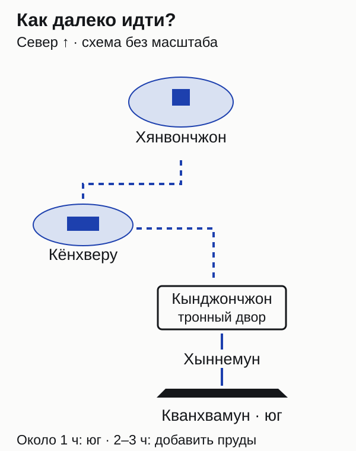
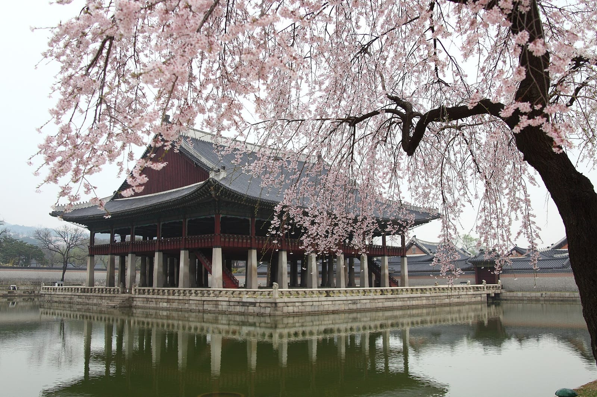
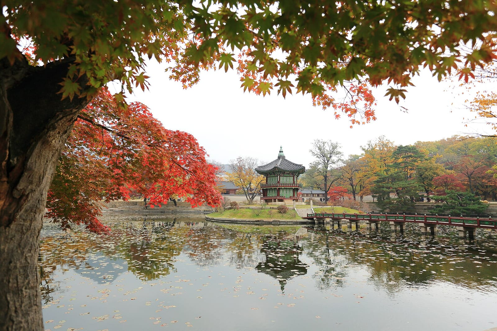
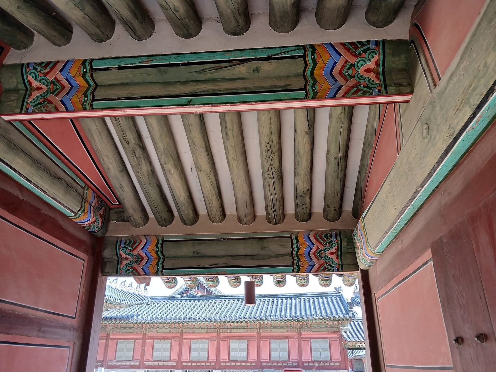

import { tpkDeep } from '../../data/affiliate.js';

Кёнбоккун — удобный первый дворец в [Южной Корее](/south-korea/), если хочется разобраться в устройстве королевской резиденции, а не только сделать снимок у ворот. Здесь есть парадная ось с тронным залом и совсем другой по настроению север с прудом и небольшим павильоном. Этим двум частям стоит дать разное время.

Если свободен всего час, ограничьтесь воротами, церемонией и главным двором. Попытка за тот же час дойти до дальнего пруда, переодеться и обойти все здания превратит посещение в спешку. На спокойную прогулку с остановками разумнее выделить половину дня без второго обязательного дворца сразу следом.

## Кому стоит идти в Кёнбоккун?

**Тем, кто хочет увидеть парадную архитектуру Чосона и готов гулять преимущественно на улице.** Это не один дворец с последовательностью музейных залов: впечатление складывается из дворов, ворот, деревянных зданий и пространства между ними. В дождь и холод наружная часть маршрута остаётся наружной.

Для первой поездки интереснее выбрать несколько точек и понять, для чего они служили. Тронный двор и павильон у воды дают больше различий, чем быстрый обход десятка похожих крыш. Любителям интерьеров стоит заранее выяснить, какие помещения открыты: обычный билет не обещает свободный проход внутрь каждого здания.

Кёнбоккун основан в 1395 году, разрушен во время вторжения 1592 года и восстановлен в XIX веке. Позднее комплекс снова терял здания, а реставрация продолжается с 1990-х. Поэтому перед вами историческая резиденция с восстановленными частями, а не полностью сохранившийся ансамбль XIV века.

## Сколько стоит вход и кому он бесплатный?

**Обычный билет для иностранца 19–64 лет стоит 3000 вон — примерно 180 ₽. С 29 октября по 15 ноября 2026 года объявлен бесплатный вход в обычные часы работы.** Выходные дни дворца сохраняются. Специальные программы, ночные события и посещение закрытых помещений нельзя считать включёнными только потому, что дневной вход бесплатный.

| Посетитель или вариант | Обычный дневной вход |
|---|---|
| Иностранный посетитель 19–64 лет | 3000 вон, около 180 ₽ |
| Иностранный посетитель до 18 лет включительно | Бесплатно; возьмите документ о возрасте |
| Посетитель от 65 лет | Бесплатно; нужен документ о возрасте |
| Посетитель в подходящем ханбоке | Бесплатно по правилам оператора |
| Последняя среда месяца — Culture Day | Бесплатно для обычного дневного посещения |
| Обычное посещение 29 октября — 15 ноября 2026 | Бесплатно, кроме дней закрытия |

Ближайший Culture Day — **28 октября 2026 года**, то есть бесплатный обычный вход доступен и за день до начала осенней акции. Для группы от десяти взрослых иностранных посетителей обычный групповой тариф — 2400 вон с человека, около 150 ₽; индивидуальный билет не становится групповым автоматически.

Рублёвые суммы помогают оценить порядок расходов; обмен наличных и конвертация карты могут дать другую сумму. Условия российских карт здесь не проверены. На случай проблемы с оплатой обычного входа разумно иметь небольшую сумму в местной валюте.

Льготы для иностранных подростков важно не путать с условиями отдельных вечерних программ. Если в описании мероприятия встретился другой детский возраст, проверьте, о каком билете идёт речь. Правило обычного дневного входа не переносится автоматически на каждое специальное событие.

## Когда открыт дворец и во сколько прийти?

**Приходите утром в день, который не является вторником, и оставляйте запас до последнего входа.** Дворец открывается в 09:00; время закрытия зависит от месяца. Ниже обычный режим, а не расписание специальных вечерних мероприятий.

| Месяцы | Часы | Последний вход |
|---|---|---|
| Январь–февраль, ноябрь–декабрь | 09:00–17:00 | 16:00 |
| Март–май, сентябрь–октябрь | 09:00–18:00 | 17:00 |
| Июнь–август | 09:00–18:30 | 17:30 |

Если вторник совпадает с официальным праздником, оператор предусматривает открытие в праздник и перенос закрытия на следующий день. Для конкретной поездки сверьте [календарь оператора](https://royal.khs.go.kr/ENG/contents/E702000000.do): бесплатная акция сама по себе не отменяет выходной.

До **31 октября 2026 года** ограничен доступ на каменную террасу Кынджончжона. Это не сообщение о закрытии всего дворца. Смотреть парадный двор и строить прогулку по доступным участкам можно, но рассчитывать на прежние точки съёмки с террасы не следует. После окончания объявленного срока сначала проверьте новое сообщение, затем планируйте подъём.

## Как добраться и где смотреть караул?

**Для метро удобны станция Gyeongbokgung на линии 3, выход 5, или Gwanghwamun на линии 5, выход 2.** Муниципальный путеводитель оценивает подход от них примерно в пять и десять минут соответственно. Добавьте время на ориентирование и выход со станции: это не замер двери вашего вагона до кассы.

Главные южные ворота называются Кванхвамун — Gwanghwamun. Не путайте название ворот с названием дворца при поиске точки встречи. Для церемонии ориентируйтесь на пространство у этих ворот; для бесплатной экскурсии — на информационный центр уже внутри ворот Хыннемун.

Смена караула заявлена на **10:00 и 14:00**, длительность около двадцати минут. Выступления караула в 11:00 и 13:00 — другая программа, примерно десять минут. Если важна именно смена, не заменяйте её автоматически соседним временем. Погода и особые мероприятия могут изменить программу; проверяйте [расписание организатора](https://www.kh.or.kr/cms/content/view/824).

Для фотографий полезнее прийти до начала и выбрать место, чем пытаться пробиться через уже стоящую публику. Точную очередь и число посетителей заранее обещать нельзя. Если церемония отменена, оставшаяся прогулка по дворцу всё равно имеет смысл: строить весь день вокруг двадцати минут рискованно.

## Что смотреть: маршрут на 2–3 часа

**Начните с парадного центра, затем выберите один или оба павильона у воды.** Время ниже — редакционная оценка самостоятельной прогулки с остановками. Она не включает длительное ожидание церемонии, аренду одежды и отдельные музейные программы.

*Схема помогает выбрать длину прогулки. Пунктир показывает последовательность, а не точные дорожки; ограждения и доступ на месте важнее схемы.*

**Кванхвамун и Хыннемун.** Пройдите от главных ворот к внутреннему входу. Здесь удобно решить, остаётесь ли вы на короткий осмотр или идёте дальше по комплексу. Если хотите экскурсию на английском, сначала выясните время встречи, чтобы не возвращаться бегом от северного пруда.

**Кынджончжон — Geunjeongjeon.** Это главный тронный зал и его парадный двор, пространство официальных церемоний. Сначала посмотрите на ансамбль с расстояния: повторение ворот и крыш по центральной оси здесь важнее попытки заглянуть в каждую дверь. В период ограничения террасы следуйте действующим ограждениям.

**Кёнхверу — Gyeonghoeru.** Павильон для торжественных приёмов стоит на воде западнее центральной части. После строгого двора это хороший поворот к более открытому виду и отражениям. Прогулка вдоль пруда и подъём внутрь павильона — разные возможности; вторую нельзя обещать по обычному входному билету.

*Архивный весенний вид Кёнхверу. Цветение на снимке не показывает состояние деревьев осенью.*

**Хянвончжон — Hyangwonjeong.** Небольшой шестигранный павильон на островке в северной части меняет масштаб прогулки: после парадных площадей здесь главное — пруд и расположение здания. Если времени мало, не ставьте себе обязательную задачу дойти сюда и одновременно подробно осмотреть юг.

*Архивная осень у Хянвончжона. Дата и яркость нынешней листвы по этому кадру не определяются.*

У Кёнхверу и Хянвончжона бывают отдельные программы с предварительной бронью. Объявленная на осень 2026 специальная программа идёт до 30 октября по средам и пятницам с ограничением мест; это не свободный проход в павильоны для каждого посетителя. Без подтверждённой брони стройте маршрут вокруг доступных наружных видов.

Если в запасе **около часа**, оставьте южные ворота и тронный двор, а караул добавляйте только при совпадении времени. Если есть **2–3 часа**, соедините центр с прудами, не пытаясь читать каждую табличку. Для экскурсии, переодевания и длинных остановок выделите больше времени и уберите из того же утра второй крупный объект.

*Детали деревянной архитектуры удобнее рассматривать на остановках, чем собирать все здания одним быстрым кругом.*

## Нужна ли экскурсия или ханбок?

**Для самостоятельной прогулки платная экскурсия необязательна; если понимаете английский, начните с бесплатного тура оператора.** Он проводится в 11:00, 13:30 и 15:30 в рабочие дни дворца и длится примерно 1–1,5 часа. Встреча — у информационного центра внутри Хыннемуна. Группам от десяти человек нужна предварительная бронь, а общая вместимость ограничена: приход без брони не означает гарантированное место.

Если важен рассказ на русском и прогулка по историческому Сеулу, есть <a href={tpkDeep('sputnik8', 'https://www.sputnik8.com/ru/seoul/activities/88525-seul-epohi-koroley-i-chosona', 'kenbokkun_history')} class="aff-cta" rel="sponsored noopener">городская экскурсия «Сеул эпохи королей и Чосона»</a>. На 24 октября, 09:00, в форме указано **$200 за группу 1–4 человек**, около **16 200 ₽**. Это двухчасовой тур с русским гидом, а не билет во дворец; входы и проезд оплачиваются отдельно.

Карточка предлагает один из пяти королевских дворцов. **Именно Кёнбоккун, место встречи и достижимость всех пунктов за два часа согласуйте до бронирования.** Цена группы не становится ценой за человека, а свободная дата в форме не закрепляет место. Возможность полной оплаты гиду на месте указана продавцом; валюту и способ расчёта уточняйте у него. Проведение платежа российской картой не проверялось.

Ханбок имеет смысл брать ради самого переодевания и фотографий. Для бесплатного входа нужен подходящий комплект: верхняя часть и юбка либо брюки по [правилам оператора](https://royal.khs.go.kr/ENG/contents/E701000000.do). Одна накидка поверх обычной одежды или половина комплекта льготу не обеспечивают. Если наряжаться не хочется, аренда ради экономии всего 3000 вон не нужна; во время бесплатной акции экономить на входе и вовсе нечего.

В холодную погоду сначала решите вопрос с тёплой одеждой. В небольшой выборке отзывов отдельно обсуждают тонкую ткань арендных костюмов; это не свойство каждого проката, но хороший повод проверить комплект до оплаты. Для поздней осени пригодится [список вещей в Корею на ноябрь](/packing/south-korea/november/). Дождь и ветер важнее красивого кадра в лёгком наряде.

## Как встроить дворец в день по Сеулу?

**Оставьте Кёнбоккун главным историческим объектом первой половины дня, а продолжение выбирайте после прогулки.** На коротком визите проще спокойно посмотреть один дворец, чем совмещать несколько резиденций и садов с разными билетами. Если силы остались, выберите городской квартал или обед, а не обязательный второй марафон по зданиям.

Утренний вариант можно строить так: прибытие около открытия, парадный центр, церемония в 10:00 при действующей программе, затем пруды или экскурсия в 11:00. Не пытайтесь совместить каждый пункт до минуты: перед церемонией придётся вернуться к южным воротам, а бесплатный тур потребует новой точки встречи. Приоритет одного события делает маршрут проще.

С детьми заранее выберите два понятных сюжета — смену караула и павильон на воде. Долгий список названий необязателен. При ограниченной подвижности обычная схема не заменяет проверку доступных проходов: террасы, закрытые участки и выбранная точка встречи могут изменить маршрут. Мы не проверяли этот путь коляской и не обещаем одинаковую доступность всех его частей.

Документы для въезда решают отдельно от посещения дворца. Календарь бесплатных дней не меняет пограничные требования; порядок подготовки собран в [материале о въезде в Южную Корею](/blog/south-korea-visa-2026/). А накануне прогулки достаточно трёх повторных проверок: работает ли дворец в этот день, состоится ли нужная программа и не изменились ли ограничения выбранных участков.
