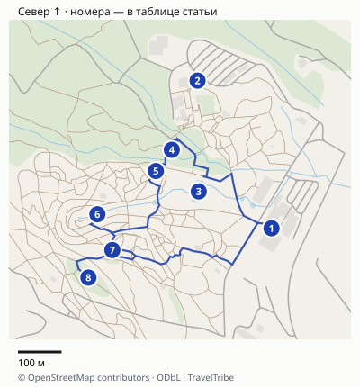
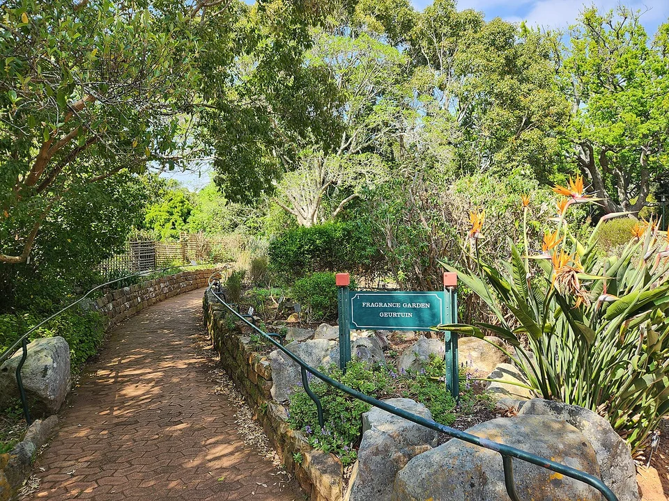
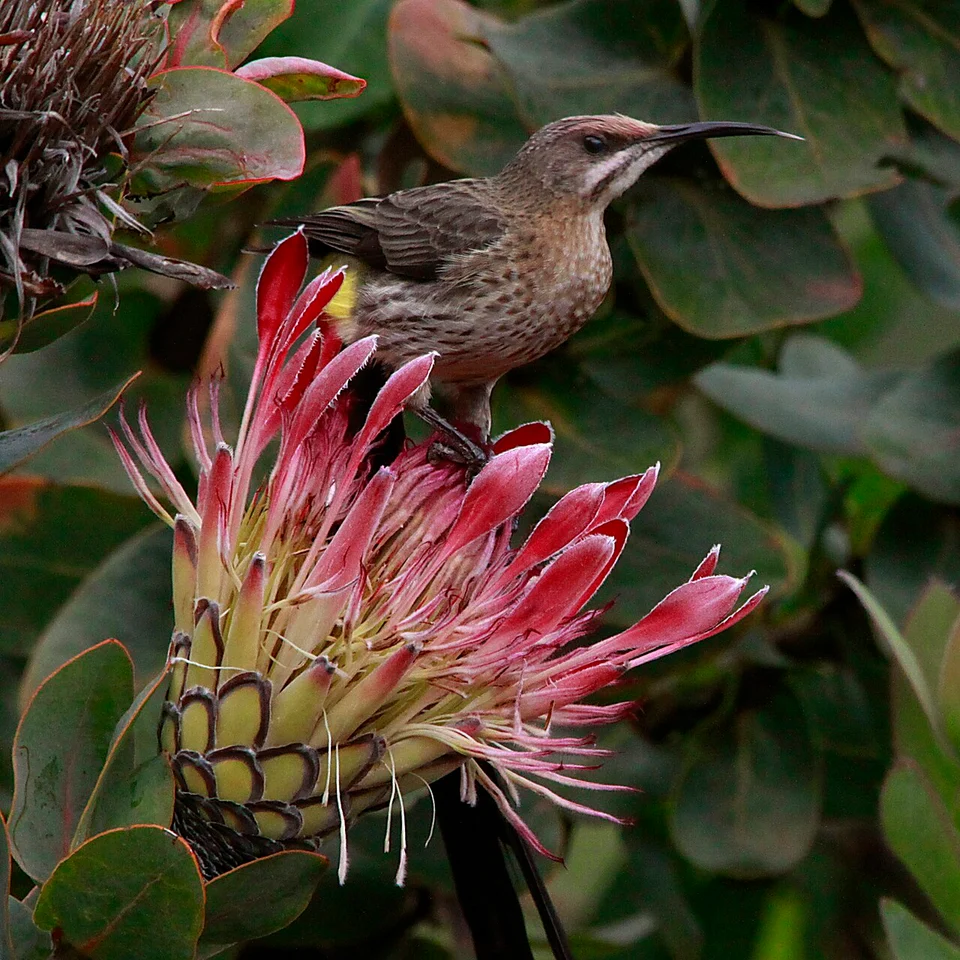
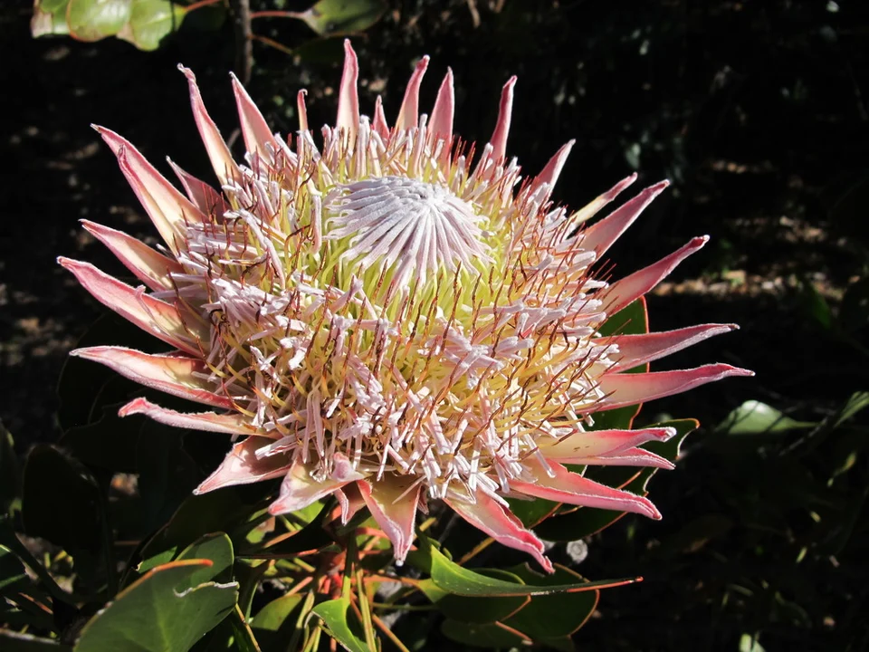
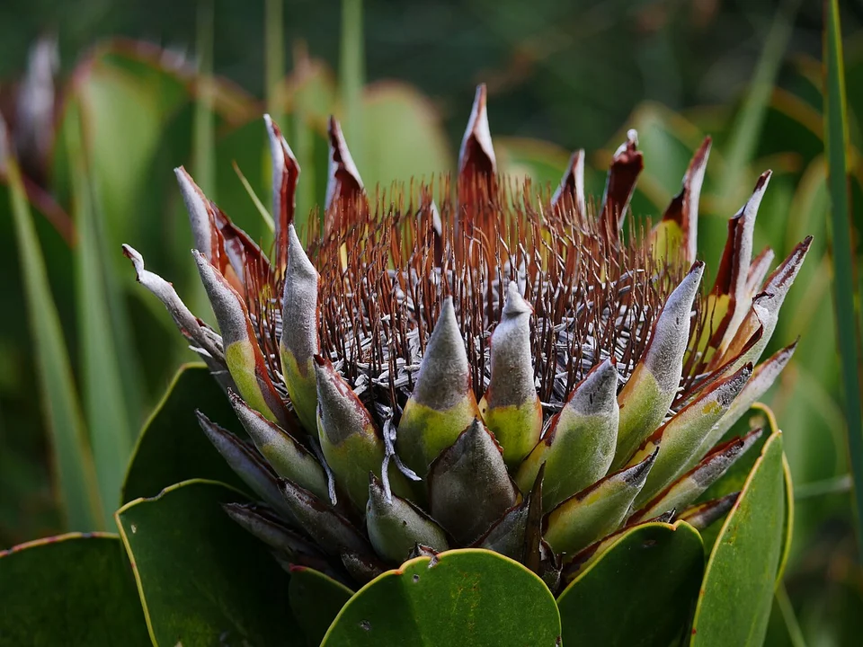

## Ради чего идти

Кирстенбош стоит включать в день, когда хочется провести время среди растений у восточных склонов Столовой горы. Кроме фотографии на мосту, здесь интересно сравнивать строение листьев, соцветия протей, плотные кустарники финбоса и более тенистые участки.

Для прогулки лучше выбрать несколько разных зон. Утомляет не размер территории сам по себе, а попытка охватить и благоустроенный сад, и лес, и подъём в горы за один короткий визит. Оставьте горные тропы отдельному плану с соответствующей подготовкой.

| Ваш интерес | Что оставить в программе | Время на визит, наш ориентир |
|---|---|---|
| Первый спокойный осмотр | Нижние сады, затем Boomslang, если подъём подходит | 2–3 часа |
| Ботаника и фотографии | Нижние коллекции, протеи и финбос, мост, остановки у этикеток | 3–4 часа |
| Ровнее и без задачи подняться к мосту | Доступные нижние дорожки и оранжерея | По силам; проверьте путь заранее |
| Пикник после прогулки | Один из маршрутов выше и отдых на разрешённой лужайке | Полдня |

Не нужно платить за гида только ради ориентирования. SANBI предлагает бесплатные прогулки с волонтёрами, а за самостоятельный вход можно заплатить через [Webtickets по ссылке оператора](https://www.webtickets.co.za/v2/Event.aspx?itemid=649795). Бесплатная экскурсия не отменяет входной билет; подробности ниже.

## У какого входа начать

Для первого визита удобен **Gate 1, Visitors’ Centre**. Здесь находится информация для посетителей и остановка City Sightseeing. Если едете на такси, договоритесь о встрече у конкретных ворот; место обратной встречи тоже сохраните заранее.

Gate 2 находится у Garden Centre, Gate 3 называется Rycroft Gate. Бесплатная парковка есть у всех трёх входов. «Бесплатная» не означает гарантированное место в загруженный день. Не выходите к другим воротам в конце прогулки, если у вас там нет машины или договорённого транспорта.

Официальная [информация для посетителей](https://www.sanbi.org/gardens/kirstenboch/visitor-information/information/) содержит карту, правила доступности и переход к билетам. Карту берите у входа или сохраните заранее. Опубликованный SANBI план помечен 2018 годом: он помогает понять расположение зон, но текущие перекрытия и обслуживание уточняют на месте.

## Карта и точная логистика

[Открыть подробную карту: масштаб, все точки и навигация](/maps/kirstenbosh/). Север вверху; нумерация указана ниже. На обзорной картинке дальние пересадки могут не помещаться — они доступны в подробной карте через «Все точки».

| № | Точка | Ориентир и ограничение |
|---|---|---|
| 1 | [Gate 1](https://www.google.com/maps/search/?api=1&query=-33.9895208,18.433837) | Основной старт этого маршрута и остановка City Sightseeing. |
| 2 | [Gate 2](https://www.google.com/maps/search/?api=1&query=-33.9864778,18.4319985) | Другой вход; заранее согласуйте здесь встречу с водителем. |
| 3 | [Main Pond](https://www.google.com/maps/search/?api=1&query=-33.988761749999995,18.432028199999998) | Нижние коллекции, удобный первый ориентир. |
| 4 | [Fragrance Garden](https://www.google.com/maps/search/?api=1&query=-33.9879048,18.4313581) | Ароматические растения; не все соседние дорожки одинаковы по уклону. |
| 5 | [Useful Plants](https://www.google.com/maps/search/?api=1&query=-33.9883411,18.4309631) | Коллекция полезных растений. |
| 6 | [The Dell](https://www.google.com/maps/search/?api=1&query=-33.989232,18.429509) | Дальнейшая часть прогулки перед решением о подъёме. |
| 7 | [Boomslang](https://www.google.com/maps/search/?api=1&query=-33.98996905,18.42988045) | К мосту нужен подъём; доступность верхних склонов ограничена. |
| 8 | [Protea Garden](https://www.google.com/maps/search/?api=1&query=-33.99053565,18.42928525) | Ботаническое продолжение по силам и сезону. |

### Откуда начать и как вернуться к машине

Основной круг начинается и заканчивается у **Gate 1 / Visitors’ Centre**: Main Pond → Fragrance Garden → Useful Plants → The Dell → Boomslang → Protea Garden → Gate 1. Расчёт соединяющих дорожек даёт около **1,8 км**, но это не полный километраж визита: к нему добавятся осмотр коллекций, обходы и подъёмы. Поэтому оставляйте 2–3 часа, а не время, которое навигатор показывает для ходьбы без остановок.

[Оператор SANBI](https://www.sanbi.org/gardens/kirstenboch/visitor-information/information/) указывает подъезд из центра Кейптауна по M3 и M63 / Rhodes Drive, около 13 км от центра, и бесплатные парковки у Gate 1, 2 и 3. Для такси задайте конкретно Gate 1, а обратную встречу назначьте у того же входа. Если приехали к Gate 2, сначала поменяйте начало круга на карте, чтобы не искать машину у другого выхода.

Автобус City Sightseeing останавливается в парковочной зоне Visitors’ Centre у Gate 1, ниже Vida e Caffè. Действующие отправления проверяйте у перевозчика: старое время первого автобуса не является гарантией на ваш день. Круг через Boomslang и Protea Garden включает верхние склоны. Для коляски или ограниченной подвижности выберите нижние коллекции и подтверждённый сотрудником путь между Gate 1 и Gate 2; короткая линия на карте не доказывает доступность подъёма.

Расстояния округлены, время в пути зависит от пробок, погоды и открытых проходов. Метка территории может отличаться от входа: последние метры сверяйте с указателями. [Картографические данные © OpenStreetMap contributors](https://www.openstreetmap.org/copyright), ODbL.

## Прогулка на два–три часа от Gate 1

Этот план соединяет нижние коллекции и один подъём. Порядок проверен по схеме сада; он не заменяет указатели и не означает, что каждая дорожка доступна в любой день.

**Начните с нижней части.** Рядом с Gate 1 находится Conservatory — оранжерея. Затем можно пройти к Main Pond и в сторону Fragrance Garden и Useful Plants. Здесь интереснее не торопиться, а читать этикетки: название, происхождение и приспособления растения объясняют больше, чем общий вид зелени. Ароматный сад не означает разрешения срывать или растирать любые листья — ориентируйтесь на правила зоны.

Дорожка у Fragrance Garden. Ароматические растения и нижние коллекции можно включить в спокойную прогулку от Gate 1.

**Через Dell двигайтесь к Tree Canopy Walkway, или Boomslang.** До моста нужно подняться; часть привлекательности как раз в смене уровня — с земли к кронам. Не считайте его лифтом на Столовую гору или коротким путём в горный поход. При дискомфорте на высоте мост можно пропустить: основная прогулка от этого не теряет смысла.

**После моста решите, продолжать ли выше.** Если хочется протей и финбоса и есть силы на уклон, оставьте на них отдельное время. Если вы устали, возвращайтесь в нижнюю часть к тому входу, от которого начали. Лучше осмотреть меньше коллекций, чем торопиться мимо растений к последнему транспорту.

На коллекции протей стоит смотреть не только как на клумбу: здесь можно наблюдать птиц. Вид животного на архивном фото не гарантирует встречу в конкретный час.

## Если хочется разобраться в растениях

Добавьте к короткой прогулке **Protea Garden и Fynbos Garden**. Финбос — характерная растительность Капской области, а не одно растение. Сравните жёсткие мелкие листья, плотность кустарников, форму соцветий. Не требуйте от каждой остановки непрерывного яркого цветения: сезонный сад интересен и устройством растений.

У протеи полезно рассмотреть крупные наружные элементы соцветия и его центр. Фото королевской протеи помогает понять, что искать, но не гарантирует раскрытое соцветие именно у вашей дорожки. В саду ориентируйтесь на этикетки и текущую сезонную прогулку, а не на календарь цветения из чужой поездки.

Если хочется узнать, что интересно сейчас, приходите на прогулку с волонтёром SANBI. Она занимает около **90 минут**, стартует от Visitors’ Centre, Gate 1, по будням в **10:00 и 11:00**, при подходящей погоде. По выходным, праздникам и в первый понедельник месяца этих обычных прогулок нет. Группа — до 15 человек по порядку прихода; место заранее не гарантируется. [Условия SANBI](https://www.sanbi.org/gardens/kirstenboch/visitor-information/guided-tours/).

Не назначайте поверх неё ещё один подробный круг на полтора часа без отдыха. Выберите: прогулка с волонтёром как основа визита либо самостоятельный маршрут со своим темпом.

Королевская протея, Protea cynaroides. Состояние цветения зависит от сезона и конкретного растения.

## Что искать в свой сезон

Для максимума цветущих растений SANBI выделяет **август–ноябрь**, конец местной зимы, весну и начало лета. Но сад интересен не только в этот период. [Календарь сезонов SANBI](https://www.sanbi.org/gardens/kirstenboch/garden-information/seasons/) помогает выбрать коллекции, а не обещает одинаковое цветение на любую дату.

| Когда вы приезжаете | На что обратить внимание | Как изменить прогулку |
|---|---|---|
| Июнь–август | Цветущий финбос, алоэ и стрелиции; дождливая часть года | Уточните состояние верхних дорожек, оставьте возможность сократить подъём |
| Август–ноябрь | Весеннее цветение и Leucospermum, «игольчатые подушки» | При интересе к ботанике добавьте Protea Garden вместо длинного пикника |
| Декабрь–февраль | Агапантусы; тенистые Dell и Camphor Avenue в жару | Верхнюю часть проходите раньше, середину дня проводите в тени |
| Март–май | Позднелетние и осенние растения, плектрантусы в тенистых участках | Уделите время нижним коллекциям и оранжерее, не ищите весеннюю картинку |

У [королевской протеи Protea cynaroides](https://www.sanbi.org/gardens/kirstenboch/seasons/spring-flowering-plants-at-kirstenbosch/kirstenbosch-protea-garden/) основной период цветения указан с июня по октябрь; у разных представителей семейства периоды отличаются. Финбос — сообщество растений, а Protea, Leucospermum и Leucadendron — разные роды. Найдите эти названия на этикетках и сравните соцветия, листья и форму куста. Так фотография превращается в наблюдение, даже если наиболее яркий экземпляр сейчас не цветёт.

## Коляска, уклоны и маршрут без верхнего сада

SANBI прямо предупреждает: Кирстенбош расположен на крутом склоне, и весь сад нельзя считать доступным для коляски. Доступные посетительские помещения не делают доступными все соединяющие их дорожки.

Для более спокойного варианта рассмотрите нижний участок между Gate 1 и Gate 2, Conservatory, зону Main Lawn, Fragrance Garden, Useful Plants и другие отмеченные оператором доступные коллекции. Точный путь выберите по схеме доступности и с помощью сотрудника. Для подходов к Boomslang, Protea Garden и Fynbos Walk оператор указывает необходимость помощи на крутых верхних склонах. Обычные экскурсии волонтёров не рассчитаны на коляски.

Если верхняя часть неудобна, не начинайте визит с обязательства «любой ценой дойти до моста». Нижние коллекции — полноценная программа. Это полезнее, чем маршрут с красивыми фотографиями, который на месте оказывается невыполнимым.

## Билет, часы и пикник

SANBI публикует [тарифы 2026–2027](https://www.sanbi.org/gardens/kirstenboch/visitor-information/information/): стандартный взрослый билет для посетителей из стран вне Африки и SADC — **R270 (около 1359 ₽)**, для детей 6–17 лет — **R40 (около 201 ₽)**, детям младше шести вход бесплатный. Льготы для жителей ЮАР, граждан стран Африки и других категорий требуют соответствующих документов. Обычному туристу из России нельзя ориентироваться на местный льготный взрослый тариф.

**Наличные не принимаются.** Подготовьте подходящий способ оплаты или купите электронный билет заранее. Возможность оплаты картой, выпущенной конкретным банком, не следует из одного наличия кнопки покупки.

Сад работает ежедневно с **08:00 до 19:00 в сентябре–марте** и до **18:00 в апреле–августе**. Conservatory — **09:00–17:00**: если оранжерея важна, не оставляйте её на самый конец вечернего визита. Билет на специальное мероприятие и его часы проверяются отдельно от обычного входа.

Пикники разрешены, но складные стулья, столы, зонты и палатки приносить нельзя; барбекю тоже запрещено. В большинстве частей сада нет урн: упаковку забирают с собой. Не кормите и не трогайте животных, не заходите на клумбы ради кадра. [Правила сада](https://www.sanbi.org/gardens/kirstenboch/visitor-information/garden-rules/).

Отцветшие соцветия показывают другую стадию развития. Отсутствие яркого цветения не делает ботаническую прогулку пустой.

## С чем совместить в Кейптауне

Кирстенбош разумнее планировать как отдельную прогулку на несколько часов. Если утром был длинный горный маршрут, не делайте верхние сады обязательными. Если погода меняется, сократите программу до доступных коллекций и помещений; оранжерея не вместит весь прежний план автоматически.

Перед поездкой сохраните Gate 1 и место обратной встречи, проверьте билет и часы нужных объектов. Для ботанического визита оставьте свободное время у этикеток и не превращайте сад в список «мост — фото — выход». Остальной маршрут по стране можно сопоставить с [гидом по ЮАР](/south-africa/): сад даёт другую часть поездки, чем сафари, океан и вершина Столовой горы.

