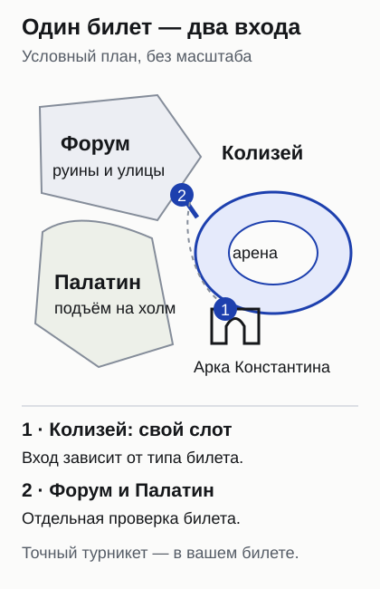
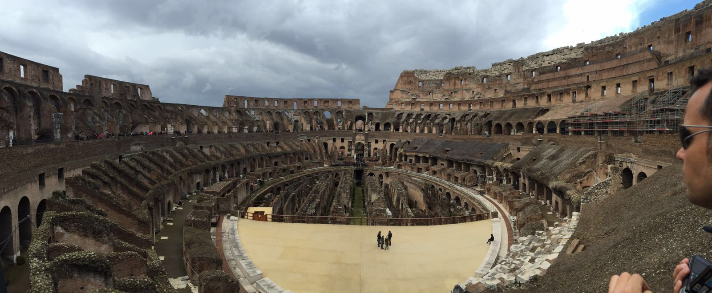
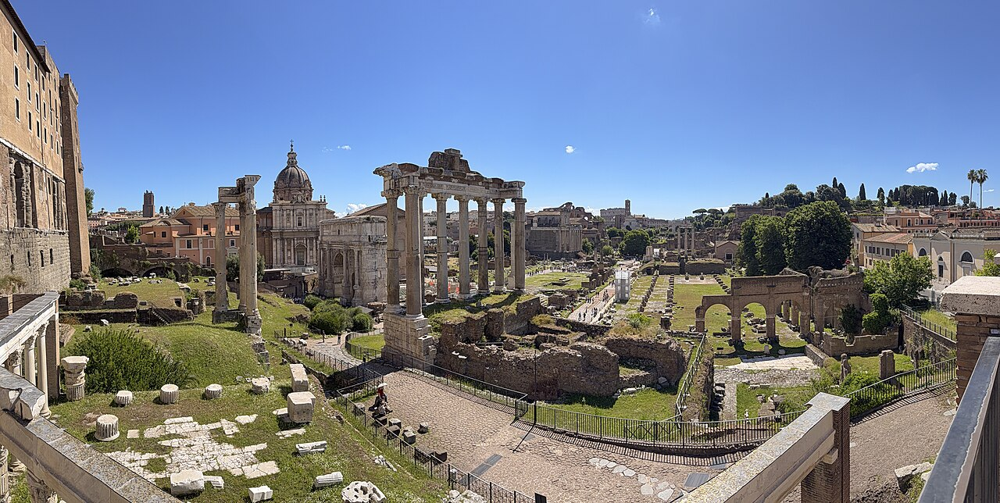
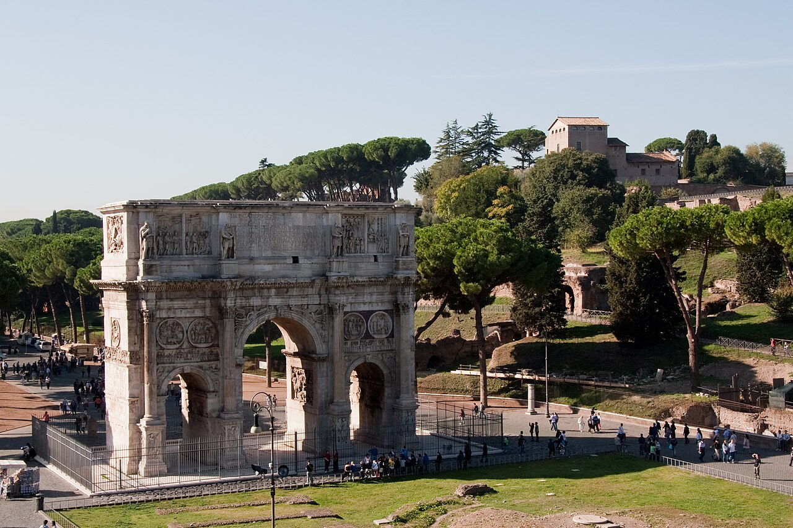

import { tpkDeep } from '../../data/affiliate.js';

## Стоит ли заходить внутрь Колизея?

**Внутрь стоит идти ради устройства амфитеатра: снаружи хорошо виден фасад, но плохо понятно, как работало всё здание.** Изнутри становятся различимы проходы, уровни зрительских мест и коридоры под бывшим настилом арены. Даже если не хочется разбирать каждую эпоху Рима, здесь есть что рассматривать. Для первого знакомства обычный маршрут по ярусам вполне содержателен.

Сильнее всего впечатление меняет точка наблюдения. С яруса вы смотрите вниз, на овал и открытые подземные конструкции. На арене, наоборот, оказываетесь внизу, внутри чаши стен. Подземелья — отдельная часть комплекса. Вид на гипогей сверху не даёт права спуститься в него. За словом «Колизей» в названии предложения могут скрываться разные сочетания этих зон.

Если интересует только узнаваемый вид здания, начните с внешней прогулки вокруг доступной части площади и арки Константина. Она не заменяет осмотр интерьера, зато помогает понять, нужен ли вам длинный археологический день. Не покупайте самый дорогой вариант из чувства, что иначе поездка в Рим «не засчитается».

В более длинный отпуск Колизей удобно вписать через [план поездки по центральной и южной Италии](/italy-south/): Рим, Флоренция и Неаполь требуют отдельного времени. Ватикан в тот же день я бы не добавлял. Две большие территории, два контроля и два набора билетов быстро превращают прогулку в гонку между слотами.

## Какой билет в Колизей выбрать?

**Для ярусов берите обычный билет; для выхода на арену проверьте, нужны ли вам также ярусы и сколько времени вы хотите провести внутри.** Слово Arena само по себе не означает расширенную экскурсию по всему амфитеатру.

| Вариант | Что даёт в Колизее | Время и соседние объекты |
|---|---|---|
| Обычный Colosseum, Roman Forum and Palatine | Первый и второй ярусы, музей; без арены | Внутри 75 минут; один вход в Форум и Палатин по условиям 24-часового билета |
| Only Arena | Только площадка арены | На арене 20 минут; один вход в Форум, Палатин и доступные SUPER-объекты |
| Full Experience Arena | Первый и второй ярусы, арена, музей | Внутри 90 минут; билет на два последовательных дня, один вход в каждую основную зону |
| Full Experience Underground and Arena | Маршрут с подземельями и ареной | Отдельный продукт; проверяйте состав и сопровождение, а не только слово Full |
| Full Experience Attic | Верхние уровни и панорамный подъём | Отдельный маршрут; обычный билет сюда не превращается после входа |

У первых трёх вариантов есть понятные [официальные карточки билетов](https://colosseo.it/en/opening-times-and-tickets/). Обычный взрослый вход стоит **18 € — около 1620 ₽**, Only Arena — тоже **18 €**, Full Experience Arena — **24 € — около 2170 ₽**. Это тарифы оператора; аудиоприложение, сопровождение продавца или полноценный гид могут образовывать другой пакет и другую цену.

Если хочется пройти три объекта с объяснениями, у Tiqets есть <a href={tpkDeep('tiqets', 'https://www.tiqets.com/en/rome-attractions-c71631/admission-for-colosseum-roman-forum-palatine-hill-guided-walking-tour-p1135615/', 'tt_blog_kolizey-rim_guide')} rel="sponsored noopener" target="_blank">трёхчасовая прогулка по Колизею, Форуму и Палатину с гидом</a>. Входы включены, группа до 16 человек, язык **английский**. Для посещения 31 октября 2026 года взрослый билет стоит **89 € — около 8030 ₽**. Первый и второй ярусы названы в описании; арену и подземелья этот вариант не обещает. Подробные ограничения — ниже, в разделе выбора гида.

Переплата здесь за организацию и рассказ, а не за обязательный допуск к самому месту. Для самостоятельного визита можно купить официальный билет и использовать бесплатное приложение **MyColosseum** с аудиорассказами на английском и итальянском. Если нужен именно русский рассказ, ни язык сайта продавца, ни перевод страницы в браузере его не обеспечивают.

## Когда появляются билеты и что проверять перед оплатой

В общем разделе оператора указано открытие продаж за 30 дней, но в [отдельной карточке Full Experience Arena](https://colosseo.it/en/tickets/full-experience-arena/) — **за 7 дней до посещения**. Поэтому отсутствие этого варианта за месяц не равно «всё раскупили». Смотрите окно именно выбранного продукта. У разных маршрутов и продавцов календари не обязаны совпадать.

Сначала выберите дату и зону, потом время, затем категории всех посетителей. Перед оплатой сверьте имена с документами: билет именной. Проверьте, что бесплатный ребёнок действительно добавлен в заказ и у него есть подтверждение входа. Скриншот свободного времени ещё не билет; завершённая оплата без полученного документа тоже повод проверить заказ у продавца и получить документ до подхода к турникету.

Полезно отдельно прочитать три строки: **куда входить, когда приходить и что делать при отмене**. В официальной карточке обычного билета рекомендуют быть у входа за 15 минут. У организованной прогулки место встречи может находиться в парке через улицу и иметь собственное время регистрации. Стоять у Колизея вместо встречи с гидом — не одно и то же действие.

Если официальный календарь не предлагает нужный день, сравните другой час, другой доступный маршрут или перенесите археологический день. Цена реселлера может быть выше из-за включённой услуги. Не сравнивайте 18 € за самостоятельный вход с 89 € за три часа с гидом так, будто это один и тот же товар. И не покупайте второй комплект, пока не понятен результат первого заказа.

Отдельный риск — исправление имени. Для посещений с 9 мая 2026 года оператор допускает однократное изменение только по перечисленным основаниям и не позже полуночи седьмого дня до визита. Это не универсальная возможность передать билет знакомому накануне. Особенно внимательно вводите данные, если покупаете за несколько дней до поездки.

## Как добраться и найти свой вход

Ближайшие станции по [инструкции археологического парка](https://colosseo.it/en/how-to-get-here/) — **Colosseo на линии B** и **Colosseo–Fori Imperiali на линии C**. У станции и у амфитеатра разные точки входа: выйти из метро недостаточно, нужно ещё найти вход своего маршрута. На поездку от жилья оставляйте запас, а не только время между станциями.

Оператор также перечисляет автобусы 51, 75, 81, 85, 87, 118 и трамвай 3. Перед дорогой проверьте движение своего маршрута: перечень транспорта возле памятника не гарантирует отсутствие временного изменения. С чемоданом сюда лучше не ехать прямо с вокзала или из аэропорта. Археологический день удобнее начинать после размещения вещей.

У обычного билета вход в Колизей указан возле арки Константина, со стороны **Valadier Spur**. У Only Arena — со стороны **Sperone Stern**. Это разные ориентиры у одного здания. На Форум и Палатин ведут отдельные входы, в том числе Largo della Salara Vecchia, Via di San Gregorio и проход у арки Тита. В письме продавца могут быть дополнительные указания: сначала сверяйте свой билет, затем общую карту.

*Схема показывает взаимное расположение зон и отдельные входы. Масштаб условный; открытый проход и точный турникет проверяйте по билету и указателям парка.*

По [официальной карточке обычного билета](https://colosseo.it/en/tickets/colosseum-roman-forum-palatine/) в Колизей входят один раз в забронированное время, а в археологическую зону Форум–Палатин — тоже один раз, в пределах указанного 24-часового окна до или после слота. Не планируйте выйти с Форума на обед и вернуться туда же, считая, что 24 часа дают неограниченные повторные входы.

## Что смотреть внутри: три разных впечатления

### Ярусы и арки

На обычном маршруте начните с общего вида внутрь. Так легче разобраться, где была арена, где зрительская часть и что относится к подземным конструкциям. Затем присмотритесь к повторяющимся аркам и проходам. Амфитеатр интересен как большое устройство для движения людей: отдельная красивая арка и множество одинаковых арок, собранных в кольцо, дают разное понимание здания.

Не пытайтесь за 75 минут обойти всё, о чём прочитали в интернете. Ваш билет задаёт конкретный маршрут. Можно провести время у одного вида, заглянуть в музейную часть и рассмотреть, как меняется пространство с высотой. Длинный список «обязательных точек» полезен меньше, чем понимание, какие из них вообще доступны по вашему входу.

Внешняя стена неодинакова по высоте: это хорошо видно и с площади, и на фотографии обложки. При осмотре сравните сохранившуюся высокую часть с открытой чашей амфитеатра. Здание дошло до нас не в виде целого стадиона; его позднейшая жизнь, разрушения и использование материалов объясняют этот разрыв лучше, чем попытка представить каждую пустую нишу ровно такой же в античности.

### Арена

Выход на площадку внизу даёт взгляд снизу вверх, на окружающие стены и ярусы. За этим и имеет смысл выбирать арену. У Only Arena 20 минут — короткое отдельное посещение, а не способ дешевле получить долгую прогулку по всем этажам. Если важны и нижняя площадка, и вид сверху, сравните её с Full Experience Arena до покупки.

Не ждите здесь действующих гладиаторских боёв или целой древней деревянной сцены. Современный участок настила помогает прочитать геометрию пространства; открытые рядом конструкции показывают другой слой здания. Фотография и название товара не сообщают автоматически, по какой стороне разрешено пройти именно в ваш день.

*Арена и открытая подземная часть, февраль 2016 года. Архивный кадр объясняет разницу уровней, но не подтверждает сегодняшнюю схему прохода.*

### Подземелья

Под бывшим настилом находится гипогей — система коридоров, связанная с подготовкой зрелищ и сценическими механизмами. Посмотреть на неё с яруса и спуститься внутрь — разные посещения. Если интересна именно эта сторона амфитеатра, ищите явное **Underground** в составе маршрута и проверяйте правила сопровождения.

Слова «арена», «приоритетный вход» и «полное впечатление» в рекламе не заменяют перечень включённых зон. Для билета с гидом отдельно смотрите язык и продолжительность: длинная прогулка по трём объектам не означает три часа под Колизеем. После покупки расширить маршрут по своему желанию у внутреннего ограждения не получится.

## Форум и Палатин: зачем оставлять силы после Колизея

Римский форум и Палатин — большая отдельная территория, а не небольшой двор при амфитеатре. Здесь впечатление строится иначе: вместо одной чаши здания перед вами улицы, остатки храмов, арки, стены и холм. Удобно сначала понять общий план, затем выбрать несколько объектов, у которых хочется задержаться.

У Форума полезно смотреть на сочетание руин разного масштаба. Высокие колонны помогают представить размеры исчезнувших построек; низкие основания без пояснения легко пройти мимо. На Палатин поднимайтесь ради другого уровня обзора и пространства холма. Если устали, сократите список залов и остановок, а не пытайтесь любой ценой повторить чужой маршрут целиком.

*Римский форум в мае 2026 года. Между отдельными памятниками здесь остаётся немало ходьбы.*

На подробный самостоятельный осмотр этой территории разумно отвести отдельную часть дня. **Два-три часа — ориентир нашего плана, а не норматив оператора.** Кому-то хватит более короткой прогулки, кому-то понадобится почти весь световой день с остановками. В отчётах путешественников встречаются оба варианта; обещание «всё за час» одинаково плохо учитывает интерес к археологии, жару и усталость.

SUPER — название доступа к определённым объектам внутри парка, а не гарантия, что каждый из них открыт в любой момент. У залов бывают собственные часы и ограничения. Если едете ради конкретного помещения, проверяйте именно его страницу. Не стройте весь день вокруг единственной двери, не сверив её доступность.

## Как спланировать полдня зимой

С 25 октября 2026 года по 28 февраля 2027 года парк закрывается в **16:30**, последний вход — в **15:30**. Колизей открывается в **08:30**, Форум–Палатин — в **09:00**. 25 декабря 2026 года и 1 января 2027 года парк закрыт. Короткий зимний день меняет порядок посещения сильнее, чем разница в цене двух похожих билетов.

Для обычного билета удобен, например, такой план: прийти заранее к слоту 09:00, провести в амфитеатре отведённые 75 минут, затем перейти к входу Форум–Палатин и оставить на эту территорию оставшуюся часть утра и начало дня. Перерыв с выходом за её пределы делайте после осмотра. Переходы, контроль и ожидание в эту прогулочную оценку входят с запасом, точного времени очереди она не обещает.

Если удалось купить только поздний слот, поменяйте порядок: сначала Форум и Палатин, затем Колизей в своё время. Иначе после выхода из амфитеатра до закрытия соседней территории может почти ничего не остаться. На обычном билете проверьте своё 24-часовое окно, а на Full Experience — два последовательных дня и ограничения каждого входа.

Два дня имеют смысл, когда хотите смотреть спокойно и выбранный билет это допускает. Например, вынести Форум с Палатином на соседний день, оставив Колизей отдельным посещением. Это не разрешение несколько раз заходить в одну зону. Для трёхчасовой экскурсии порядок ведёт гид; самостоятельный зимний план не нужно накладывать поверх её программы.

В дождь заложите более медленную ходьбу и сократите спешку на ступенях. Большая часть прогулки проходит среди открытых пространств. Плотное расписание без запаса быстро ломается, если приходится переждать ливень или осторожно идти по мокрому камню. Для выбора месяца и всей поездки пригодится [Италия в ноябре](/trips/november/italy-south/).

## Нужен ли гид и за что придётся доплатить?

**Гид полезен, если хотите понимать, что осталось от зданий и как связаны три объекта. Для самого входа в обычные зоны он не обязателен.** Самостоятельный вариант с официальным билетом заметно дешевле и позволяет задерживаться у интересной детали. Приложение лучше скачать заранее; на месте разбираться с загрузкой и одновременно слушать рассказ неудобно.

У проверенной <a href={tpkDeep('tiqets', 'https://www.tiqets.com/en/rome-attractions-c71631/admission-for-colosseum-roman-forum-palatine-hill-guided-walking-tour-p1135615/', 'tt_blog_kolizey-rim_guide_details')} rel="sponsored noopener" target="_blank">экскурсии Tiqets по Колизею, Форуму и Палатину</a> включены входы, живой гид и гарнитура. Три часа, до 16 человек, английский. На 31 октября 2026 года тариф взрослого — 89 €, ребёнок 6–17 лет — 79 € (около 7130 ₽), до 5 лет — бесплатно в сочетании со взрослым. Это предложение услуги: бесплатное право ребёнка на вход в памятник не делает бесплатной работу гида.

Встреча назначена у ограждённого входа в парк Colle Oppio и Terme di Traiano, напротив Oppio Caffè, на углу Via delle Terme di Tito и Via Nicola Salvi. В инструкции указан жёлтый знак **WalksDevour** и прибытие за 15 минут. Перед поездкой перечитайте свой ваучер: если поставщик обновит встречу, ориентир из старой статьи его не заменит.

Трансфер от отеля, обед и чаевые в пакет не включены. Бесплатная отмена и перенос заявлены до 72 часов перед визитом; за опоздание или неявку возврат не обещан. Маршрут прямо обозначен как неподходящий для посетителей с ограниченной подвижностью, пользователей кресел-колясок и детских колясок. Это ограничение конкретной экскурсии, а не вывод о недоступности всего археологического парка.

Проверенный слот на 31 октября не означает, что он останется доступен к моменту вашего чтения. Сравнивайте свою дату и полную цену. У слова «без очереди» тоже есть граница: предварительный билет помогает пропустить покупку в кассе, но не отменяет контроль безопасности и проверку документов.

## Можно ли бесплатно и как идти с детьми?

**До 18 лет вход в памятник бесплатный, но ребёнку всё равно нужен правильно оформленный билет.** Оператор даёт возможность забронировать такую категорию онлайн. Льготные 2 € для граждан ЕС 18–24 лет — другая категория; российский паспорт сам по себе права на неё не даёт.

Первое воскресенье месяца — отдельный режим. По [правилам бесплатного воскресенья](https://colosseo.it/en/2022/03/free-sundays/) билеты выдают в кассе по порядку прибытия; арена, подземелья, верхние специальные уровни и SUPER-объекты не входят в эту программу. Поэтому бесплатный день не стоит выбирать ради того же маршрута, который вы собирались купить как Full Experience.

Если семейная поездка короткая, сравните экономию с неопределённостью очереди. Двум взрослым обычные билеты обойдутся в 36 € — около 3250 ₽; это удобная величина для собственного решения, сколько стоит предсказуемый слот. Детская усталость и пропущенный обед реальнее влияют на день, чем формальное желание собрать максимум бесплатных памятников.

Для ребёнка заранее выберите одну понятную тему: зачем вокруг столько проходов, как зрители попадали на разные уровни или почему в центре видны коридоры. Не нужно за один визит пересказывать всю историю империи. Обувь с устойчивой подошвой, вода и паузы пригодятся больше длинного списка императоров. На неровных ступенях держите маленького ребёнка за руку, как рекомендует парк.

Если нужна доступная прогулка с коляской или креслом, откройте [официальный раздел доступности](https://colosseo.it/en/the-park-for-all-services/) и уточните маршрут до покупки специального продукта. Наличие лифта в здании не подтверждает, что конкретная групповая экскурсия использует подходящий путь. При сомнениях согласуйте именно набор зон, а не общее «мы хотим в Колизей».

## Что проверить утром перед выходом

Возьмите документ, билет или ваучер с читаемым кодом и сохранённую инструкцию встречи. Зарядите телефон: показать живую страницу заказа и показать полученный входной документ — разные вещи. Не рассчитывайте, что переводчик или поисковый сниппет на месте объяснит исключения вашего тарифа быстрее, чем инструкция, которую можно прочитать заранее.

Наденьте обувь для неровного камня. В [правилах парка](https://colosseo.it/en/guidelines-for-a-safe-and-enjoyable-visit/) отдельно названы крутые ступени и исторические дорожки с неодинаковой поверхностью; каблуки и шлёпанцы здесь плохой выбор. При необходимости сократите подъёмы и число объектов. Спокойная прогулка по доступной части лучше попытки догнать группу ценой болезненной ходьбы.

Оставьте крупный багаж в месте проживания или заранее выбранном хранении. Перед выездом сверьте допустимые вещи в правилах своего входа. Рядом с памятником не стоит начинать ещё одну задачу — искать, куда пристроить чемодан, пока до слота осталось десять минут.

После осмотра можно задержаться у арки Константина, не назначая себе ещё один платный вход. Её хорошо видно снаружи рядом с амфитеатром. Это удобная отдельная остановка, чтобы сравнить триумфальную арку и повторяющиеся арки Колизея: внешне знакомое слово описывает здесь совсем другую конструкцию и другую задачу.

*Арка Константина и склон Палатина. Снимок октября 2008 года; сегодняшние ограждения и проходы могут отличаться.*

Самый полезный порядок подготовки такой: сначала выбрать зоны, затем купить слот, потом поставить вокруг него остальную прогулку. Если нужен первый и второй ярусы, не берите Only Arena ради красивой обложки. Если важна арена, не ждите её от обычных 18 €. А если остаётся только час до закрытия, лучше честно сократить день, чем считать один билет обещанием успеть всё.
