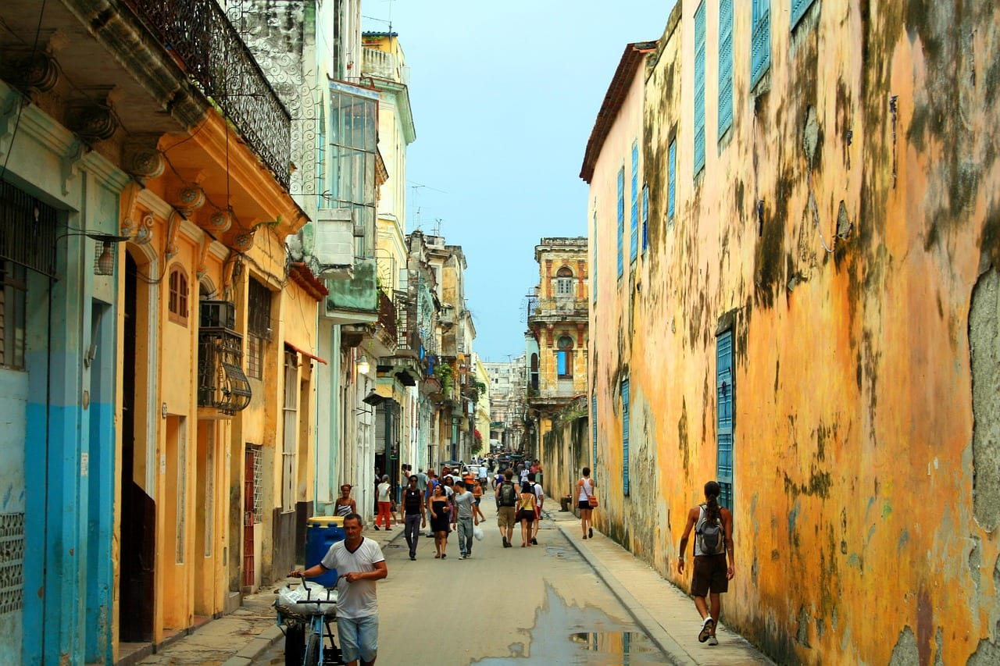
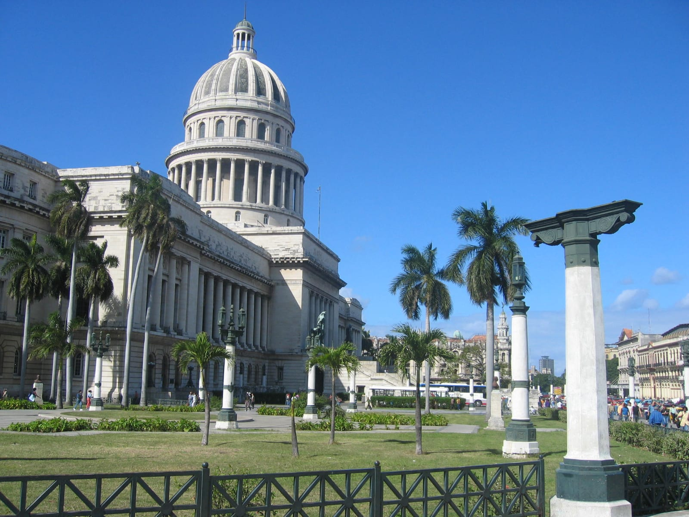
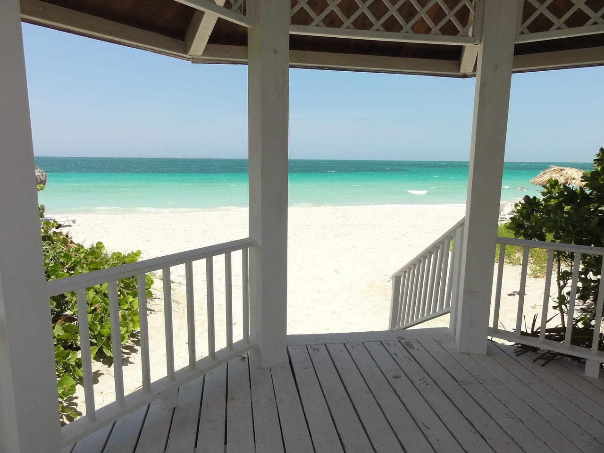
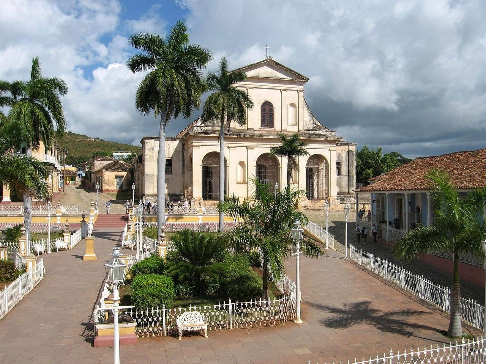

import { aviasalesRoute, cherehapaCountry } from '../../data/affiliate.js';

export const puntaCanaFlight = aviasalesRoute('MOW', 'PUJ', 'kuba_2027_punta_cana_flight', 11);
export const cancunFlight = aviasalesRoute('MOW', 'CUN', 'kuba_2027_cancun_flight', 11);
export const havanaFlight = aviasalesRoute('MOW', 'HAV', 'kuba_2027_havana_flight', 11);
export const insurance = cherehapaCountry('cuba', 'kuba_2027_insurance');

Кубу зимой 2026/27 лучше отложить, если вы выбираете пляжный отпуск с понятной дорогой и работающим «всё включено». Прямая программа из России приостановлена из-за проблем с заправкой самолётов, а подтверждённой даты возвращения нет. Для поездки именно за Гаваной и Тринидадом сначала нужен проверенный маршрут туда и обратно; покупать отель в надежде, что рейсы появятся, рискованно.

> **Туры на Кубу:** рекламная страница курорта не подтверждает вылет. У Nordwind в календаре Москва — Кайо-Коко стоит «Временно не летаем в этом направлении». Для пляжной замены сравните полную поездку в Доминикану, Мексику или Азию: одинаковые даты, число ночей, багаж, питание и трансферы. <a href={puntaCanaFlight} class="aff-cta" rel="sponsored noopener">Проверить перелёт Москва — Пунта-Кана</a> — задайте обратный билет и состав пассажиров; наличие прямого рейса не предполагается.

## Почему рейсы встали

Кубинские аэропорты столкнулись с дефицитом авиационного топлива. В феврале 2026 года «Россия» и Nordwind перешли к вывозу туристов и приостановили обычную программу. Минэкономразвития 11 февраля рекомендовало россиянам воздержаться от туристических поездок, а операторам — приостановить продвижение и продажу туров и отдельных туристических услуг на Кубу до нормализации обстановки.

Это объясняет странную картину в поиске: страна есть в каталоге, отели показаны, описание перелёта сохранилось, а вылет купить нельзя. Даже сообщение о программе до конца октября 2026 года может относиться к продажам, открытым в ноябре 2025-го, до топливного кризиса. Проверять нужно перевозку на свои даты, а не название сезона в старой публикации.

## Можно ли рассчитывать на Кубу зимой 2026/27

**Покупать поездку в расчёте на возвращение прямых рейсов не стоит.** Сообщение об интересе к возобновлению полётов не содержит ни номера рейса, ни дня вылета, ни подтверждённой продажи. Для возвращения нужны условия заправки и решение перевозчика; календарного обещания здесь нет.

Если вам предлагают тур, попросите до оплаты четыре вещи:

- Перевозчика, номера рейсов и даты обоих плеч, включая промежуточные посадки.
- Подтверждение перевозки на сайте авиакомпании либо условия чартерной перевозки в договоре оператора.
- Название работающего отеля и порядок замены, если объект закроется.
- Письменные условия изменения поездки и возврата при отмене перелёта.

Фраза «билет появится ближе к вылету» не закрывает эти вопросы. При ограниченных датах отпуска цена ошибки — потерянное время на срочную замену, а не только разница в стоимости отелей.

## Что на острове мешает обычному отпуску

Проблема шире аэропортового керосина: перебои с электричеством, топливом и водой затрагивают транспорт, связь и гостиничные услуги. Генератор у отеля полезен, но важно, какие зоны он питает и есть ли топливо на весь срок проживания. Слова «свой генератор» сами по себе не гарантируют кондиционер в номере или постоянную подачу воды.

Перед бронированием нужны ответы от конкретного объекта: работает ли он, доступны ли ресторан и бассейн, как устроены питьевая вода и резервное питание, организован ли трансфер из вашего аэропорта. Отель в Варадеро и прилёт в Гавану — разные пункты маршрута: наземную дорогу между ними тоже нужно согласовать.

**Деньги берите с запасом наличными.** Рассчитывать на международную карту и снятие в банкомате нельзя; приём МИР в конкретной точке также нельзя считать гарантированным. Евро и доллары пригодны для расчётов и обмена, но до поездки уточните валюту оплаты жилья и трансфера. Отдельный резерв нужен на задержку возвращения и медицинские расходы, а не только на сувениры.

Если поездка зависит от бесперебойного электричества, хранения лекарств в холодильнике или доступной специализированной помощи, эту неопределённость нельзя закрыть высокой категорией отеля. Для такого отпуска разумнее выбрать другое направление. Условия медицинской помощи и полиса разобраны в [гайде по страховке для Кубы](/blog/cuba-insurance-2026/).

## Как проверить перелёт через третью страну

**Стыковочный маршрут нужно подтвердить целиком.** Наличие иностранной авиакомпании в старом расписании не означает, что она продолжает летать на остров. Некоторые перевозчики остановили кубинские рейсы; оставшиеся программы могут меняться. <a href={havanaFlight} rel="sponsored noopener">Проверить варианты Москва — Гавана</a> имеет смысл до бронирования жилья, с обратной датой и запасом на пересадки.

У найденного варианта проверьте не только цену:

1. **Один билет или отдельные.** При самостоятельной стыковке пропуск следующего рейса может остаться вашей проблемой. Надпись о пересадке не обещает защиту всей цепочки.
2. **Въезд в промежуточную страну.** Получение багажа, смена аэропорта и ночёвка могут потребовать выхода из транзитной зоны. Правила зависят от паспорта и конкретного аэропорта.
3. **Багаж на каждом плече.** Одинаковый чемодан должен проходить по нормам всех перевозчиков; докупка на одном участке не добавляет его на остальных.
4. **Обратный маршрут.** Он нужен в той же проверке, что и вылет. Дешёвый путь на остров бесполезен, если возвращение не укладывается в отпуск.
5. **Резерв времени.** Отдельная гостиница на стыковке и свободный день после возвращения увеличивают расход, но короткое соединение не делает поездку удобнее.

Маршрут через США не выбирайте как обычную туристическую пересадку на Кубу без проверки американских ограничений. У остальных промежуточных стран тоже могут быть визовые требования. Если проверенного сочетания рейсов нет, безопасный результат поиска — отложить покупку.

## Как сравнить полную стоимость с заменой

Сравнивать нужно **одинаковый отпуск для одинакового числа людей**. Минимум билета в одну сторону за месяц не равен цене туда-обратно на нужные даты. Удвоение такого минимума не доказывает бюджет пары, а чартерный пакет нельзя сравнивать с одним перелётом.

Соберите для каждого направления одну смету:

| Расход | Что включить |
|---|---|
| Перелёт | Все пассажиры, туда и обратно, одинаковый багаж, необходимые места и сборы |
| Пересадки | Ночёвки, трансферы между аэропортами, питание и нужные разрешения |
| Жильё | Одинаковое число ночей, тип номера, налоги и выбранный вариант питания |
| Дорога на курорт | Из фактического аэропорта прилёта, в обе стороны |
| Отдых | Не включённые в отель еда, вода, экскурсии и местный транспорт |
| Подготовка | Страховка для маршрута и занятий, обязательные въездные платежи |
| Резерв | Отдельно от цены отпуска: задержка рейса, лишняя ночь и экстренные расходы |

Сначала сложите обязательные расходы без резерва, затем сравните итог. Если предложение в другой валюте, пересчитайте по доступному вам курсу оплаты с банковской комиссией. Возвратный тариф и невозвратный — разные покупки даже при одинаковом номере.

У Кубы есть дополнительная цена сложности: больше согласований с перевозчиками и жильём, запас наличных и готовность менять маршрут. Для поездки ради страны это может быть приемлемо. Для десяти дней у моря, когда хочется заселиться и отдыхать, та же сумма в более предсказуемом направлении может оказаться полезнее.

## Куда лететь вместо Кубы

### Доминикана — если нужны Карибы и курортный отель

Пунта-Кана подходит тем, кто искал широкие песчаные пляжи и питание «всё включено». Но перенос названия страны в поиск не решает дорогу: проверьте конкретную перевозку, длительность пересадок и условия въезда. Кубинские ограничения не делают Доминикану автоматически доступной прямым рейсом.

Сопоставляйте пакет с пакетом либо самостоятельную поездку с такой же сборкой. У дешёвого отеля могут отдельно оплачиваться питание и трансфер; у дорогого перелёта может оказаться удобнее возвращение. [Разбор Доминиканы](/blog/dominican-republic-2027/) поможет выбрать сезон и формат, а <a href={puntaCanaFlight} rel="sponsored noopener">поиск билетов в Пунта-Кану</a> — проверить дорогу на свои даты.

### Мексика — если пляж нужен вместе с историей

Канкун и Юкатан дают сочетание моря, городов и археологических мест. Такая замена ближе тем, кто хотел выезжать из отеля, а не проводить весь отпуск на одном пляже. При этом это другая страна с собственными въездными формальностями: право въезда и стыковки проверяйте до оплаты.

<a href={cancunFlight} rel="sponsored noopener">Сравнить перелёты Москва — Канкун</a> стоит вместе с размещением и дорогой до выбранного курорта. Низкая цена билета до Канкуна не означает дешёвую Ривьеру-Майю; удалённое жильё добавляет транспорт, а ежедневные выезды меняют бюджет.

### Азия — если важнее тёплое море зимой

Если Карибы были одним из вариантов, расширьте выбор до Таиланда, Шри-Ланки и Мальдив. Здесь тоже нужно выбрать побережье, питание и трансфер, а не только страну: островной отель и городской пляж решают разные задачи. Начать сравнение можно с [направлений для зимовки 2026/27](/blog/zimovka-2027/).

Не переносите старую кубинскую смету на новое направление. У Мальдив отдельным крупным расходом бывает доставка на остров; в самостоятельной поездке по Азии питание часто не входит в проживание. Выбирать стоит по итоговой стоимости и времени от двери до отеля.

## Что делать, если тур на Кубу оплачен

**Сначала получите письменный статус вашей поездки у продавца и оператора.** Нужны не общие новости, а ответ по вашему договору: состоятся ли рейсы, какое размещение подтверждено и что предлагается при отмене.

Сохраните договор, платёжные документы, подтверждение брони, уведомление об отмене и переписку. Затем письменно выберите требование: исполнение на согласованных условиях, изменение поездки или расторжение с возвратом. Попросите расписать сумму и срок возврата, а при удержаниях — основание и расчёт. Устное согласие на замену не должно опережать понимание новых условий.

При обстоятельствах, угрожающих безопасности туриста, статья 14 закона о туристской деятельности предусматривает специальный порядок: при расторжении до начала путешествия возвращается полная цена туристского продукта, после начала — часть за неоказанные услуги. Основание, даты и применимость к вашему договору нужно разбирать отдельно; обычная добровольная отмена и расторжение из-за угрозы безопасности имеют разные последствия. Не соглашайтесь считать любой возврат отменой по собственному желанию, пока не понятна причина.

**При замене направления сравните новый договор с прежним:** город вылета, число ночей, категория номера, питание, багаж, трансфер и доплата. Альтернатива с тем же названием отеля в каталоге может иметь другой состав услуг. Если вы купили только билет, обращайтесь по месту его приобретения и уточняйте вынужденный возврат; правила пакетного тура на отдельный билет не переносятся.

## Что проверить перед возвращением к планам на Кубу

Вернуться к покупке имеет смысл после появления продаваемой перевозки в обе стороны, понятных правил изменения билета и письменного подтверждения работы жилья. Затем проверяются заправка, наземные переезды, наличные и страховое покрытие для всего маршрута. <a href={insurance} rel="sponsored noopener">Сравнить полисы для Кубы</a> можно после выбора поездки: уточните у страховщика ограничения помощи, действующие рекомендации и условия эвакуации.

Появление новости о переговорах или фотографии открытого пляжа не заменяет эти проверки. Если цель — отдых без постоянных согласований, выбирать замену можно до восстановления кубинской программы.
