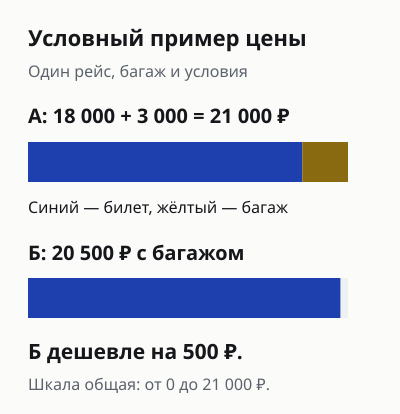
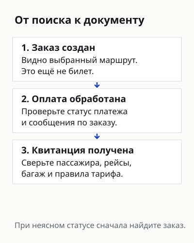
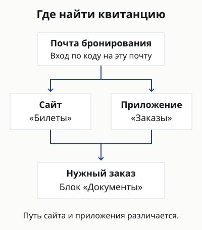

import { aviasalesUrl } from '../../data/affiliate.js';

**На Купибилете сравнивайте сумму на последнем экране, условия тарифа и путь получения билета.** Низкая цена в поиске ещё не отвечает на вопросы о багаже, дополнительных услугах и будущих изменениях. Покупать имеет смысл, когда подходящий вариант сохраняет преимущество после этих проверок.

Это разбор покупки авиабилета. Если нужно отменить купленный билет, переходите к [отдельному ответу о возврате через Купибилет](/blog/kupibilet-vozvrat-bileta-2026/): там разобраны заявка, удержания и выплата. Здесь — путь от выбора продавца до полученной маршрутной квитанции.

## Чем Купибилет отличается от Авиасейлса и авиакомпании?

**Купибилет оформляет продажу; Авиасейлс помогает найти предложения разных продавцов.** Купив билет у посредника, сохраняйте название продавца и сведения о заказе вместе с документами перевозчика. Именно эта связка понадобится, если изменится рейс или возникнет вопрос к оплате.

Начать можно с <a href={aviasalesUrl('', 'kupibilet_2026_compare')} class="aff-cta" rel="sponsored noopener">сравнения предложений на Авиасейлсе</a>, затем открыть [Купибилет напрямую](https://www.kupibilet.ru/) и сайт выбранной авиакомпании. Проверяйте одинаковый рейс, дату, число пассажиров и тариф. Общая выдача без ваших дат не подтверждает наличие билета или лучшую цену.

В [официальной справке об обращениях](https://www.kupibilet.ru/help/chasto-zadavaemye-voprosy/art/kak-i-kuda-mozhno-otpravit-pretenziyu) сервис разделяет вопросы к продавцу и к перевозчику. Выполнение рейса относится к авиакомпании; вопросы оформления и операций с купленным заказом начинаются у продавца. Поэтому отзыв о задержке самолёта и отзыв о расчёте возврата оценивают разные части поездки.

Покупка напрямую у авиакомпании сокращает число участников переписки, но сама по себе не делает тариф возвратным и не гарантирует меньшую цену. У посредника может оказаться подходящее предложение; решение зависит от условий конкретной покупки. Подробное различие поиска и продажи есть в [разборе Авиасейлса](/blog/aviasales-2026/).

## Как сравнить итоговую цену без подмены условий?

**Сравнивайте последние экраны двух продавцов, а не первую карточку одного с итогом другого.** Купибилет указывает внизу сайта, что стоимость включает сервисный сбор, а итоговая цена отображается на экране подтверждения покупки. Универсальный размер сбора для любого билета из этого заявления не следует.

Сначала выпишите четыре параметра: перелёт, багаж, условия изменений и сумму к оплате. Проверьте, включена ли ручная кладь нужного размера, сколько мест багажа разрешено и нет ли смены аэропорта. Слово «эконом» не заменяет правила выбранного тарифа: в одном классе могут продаваться разные условия.

| Что сравнивать | Как привести к общему виду |
|---|---|
| Маршрут | Один рейс, дата, аэропорты и все участки поездки |
| Пассажиры | Одинаковый состав, включая детей |
| Багаж | Одинаковое число мест и нужная норма веса |
| Изменения | Сопоставимые правила обмена и возврата |
| Оплата | Конечная сумма с нужными услугами и сборами |

Условный расчёт: вариант А стоит **18 000 ₽**, нужный багаж добавляет **3 000 ₽**; вариант Б с тем же багажом — **20 500 ₽**. При остальных равных Б дешевле на **500 ₽**. Это учебные числа, не найденные тарифы Купибилета. Если у Б хуже пересадка или отсутствует нужное условие обмена, одного вычитания недостаточно.

## Какие доплаты проверить перед подтверждением?

**Отделите перевозку и нужные услуги от того, чем пользоваться не собираетесь.** Просмотрите состав заказа целиком: багаж, место, помощь с регистрацией, страховка или дополнительная возможность отмены решают разные задачи. Наличие опции в заказе ещё не объясняет её условия и цену.

В справке об обращениях Купибилет описывает дополнительные услуги как добровольно выбранные. Проверьте собственный экран: что отмечено, сколько стоит каждая позиция и как меняется итог после её удаления. Общего заявления сервиса недостаточно, чтобы подтвердить состояние конкретной формы или приложения.

Помощь с онлайн-регистрацией не равна билету и не заменяет проверку документов для въезда. Возможность отмены за отдельную плату не делает все расходы поездки возмещаемыми. До добавления услуги прочитайте её ограничения и способ компенсации, особенно если рассчитываете получить деньги на карту.

Сохраните экран с составом покупки и правилами выбранных опций до оплаты. После неё отключение ненужной услуги может требовать обращения и зависеть от того, оказана ли она. Не переносите порядок отказа от одной услуги на другую; в обращении называйте конкретную позицию и её стоимость.

## Что проверить в маршруте и данных пассажира?

**До оплаты заново прочитайте маршрут и пассажира, даже если данные подставились автоматически.** Сверьте имя с документом для поездки, даты, города и аэропорты. Отдельно проверьте обратный перелёт: ошибка на нём может остаться незаметной, пока всё внимание занято вылетом.

Для пересадки запишите, меняется ли аэропорт, нужно ли забирать багаж и выполнять повторную регистрацию. Если ответ не виден в условиях, выясните его до покупки. Общая надпись «с пересадкой» не объясняет, оформлены ли все участки одним билетом и как будет решаться опоздание на следующий рейс.

Если покупаете билеты семье, проверьте каждого пассажира отдельно. Исправленное имя одного человека не означает, что те же данные исправились у остальных. Сопоставьте состав заказа со всеми участками: особенно когда часть семьи летит в одну сторону или возвращается в другой день. Не делайте вывод о всей группе по одной строке с общей ценой.

Почту для бронирования выбирайте доступную в дороге. Публичная инструкция получения документов связывает её со входом в кабинет, поэтому ящик попутчика, который не участвует в дальнейшей поездке, добавляет лишнюю зависимость. До оплаты договоритесь, кто сохраняет квитанции и получает сообщения по заказу. Сам билет на пассажира и доступ покупателя к переписке — разные вещи.

Не выбирайте короткий промежуток между отдельными билетами только из-за красивого времени в поиске. Учтите получение багажа, дорогу между терминалами, пограничные процедуры и крайний срок регистрации следующего перевозчика. Эти затраты времени зависят от маршрута, поэтому одного безопасного числа минут для всех поездок нет.

Если нашли ошибку после выпуска, обращайтесь через заказ и уточняйте допустимую корректировку. Справка Купибилета различает ошибки, которые можно исправить, и ситуации с переоформлением или возвратом. **Не рассчитывайте на бесплатную замену любых данных** и не создавайте второй заказ, пока не понятен статус первого.

## Как оплатить заказ и не перепутать его с билетом?

**Официальная справка называет оплату банковской картой и через СБП.** Доступный способ проверяйте в своём заказе. Перечень в справке не доказывает, что конкретный банк, карта или платёж пройдут в выбранный момент.

Перед переходом к оплате ещё раз посмотрите сумму и валюту, а затем сопоставьте их с запросом банка. Если они различаются с тем, что вы ожидали, остановитесь до подтверждения и вернитесь к составу заказа. Не отправляйте коды подтверждения платежа в чат поддержки и не публикуйте их в отзыве.

Купибилет рекомендует приступать к оплате сразу после создания заказа для сохранения найденной стоимости. Из этого не следует обещание бесконечной фиксации цены в открытой вкладке. Если вернулись к покупке позже, перечитайте сумму и доступность выбранного предложения.

При неопределённом результате платежа сначала проверьте сообщения банка, статус заказа и почту. Повторная покупка до выяснения может оставить два заказа вместо одного. Запишите время попытки и сохраните уведомление, убрав лишние банковские данные из обращения. **Заказ создан, платёж обработан и документ получен — разные этапы.**

## Где найти маршрутную квитанцию после покупки?

**Купибилет отправляет её на почту, указанную при бронировании.** Если письма нет во входящих, публичная инструкция предлагает проверить спам. Не ищите документ в другом почтовом ящике только потому, что им обычно пользуетесь для путешествий.

В [инструкции «Как найти билет»](https://www.kupibilet.ru/download-documents) указан и путь через личный кабинет. Вход выполняется по почте бронирования с одноразовым кодом. В приложении нужен раздел **«Заказы»**, на сайте — **«Билеты»**; внутри выбранного заказа документы находятся в отдельном блоке.

Если вошли с правильной почтой, но заказа нет, сервис направляет в чат поддержки со страницы этой инструкции. Подготовьте сведения о покупке и объясните, что именно отсутствует: заказ, письмо или файл. Уведомление банка о списании и маршрутная квитанция нужны для разных проверок; первое не заменяет второй документ.

В обращении полезна короткая последовательность: когда оформили заказ, что показал платёж, какое сообщение пришло и что сейчас видно в кабинете. Приложите относящийся к вопросу экран без одноразовых кодов и полного номера карты. Не отправляйте паспортные страницы в публичное обсуждение; документы для проверки передают только через официальный канал по понятному запросу.

Получив квитанцию, сверьте пассажира, рейсы, аэропорты, даты и багаж. Сохраните доступную без интернета копию. Для поездки по нескольким отдельным билетам проверьте документ каждого участка: файл первого перелёта не подтверждает оформление остальных.

## Как будут решаться обмен и возврат?

**Проверяйте их условия ещё при выборе тарифа, а процедуру — в своём заказе.** Штраф перевозчика, сбор продавца за операцию и стоимость дополнительных услуг — разные позиции. Сумма покупки и сумма, которую можно получить обратно, не обязаны совпадать.

В текущей справке Купибилета условия сбора при возврате различаются для прямой покупки и перехода со стороннего сервиса. Поэтому не переносите удержания из чужого старого отзыва на свой билет. Сохраните правила, которые видите при оформлении, и попросите расчёт по конкретному заказу до согласия на операцию.

Пошаговая отмена, действующие проценты, исключения и сроки собраны в [отдельном материале о возврате Купибилета](/blog/kupibilet-vozvrat-bileta-2026/). Он нужен, когда решение связано с купленным билетом. Для выбора нового продавца заранее оцените, готовы ли разбираться с тарифом и обращаться через посредника при изменении планов.

## Что показывают отзывы покупателей?

**Успешная покупка и сложный возврат встречаются в разных рассказах; по ним нельзя вычислить вероятность своего результата.** Для этого разбора прочитаны четыре рассказа покупателей 2026 года на двух площадках. Это целевая небольшая выборка, а не случайный опрос или проверка заказов.

Автор [отзыва от 27 августа на Отзовике](https://otzovik.com/review_18625559.html) описывает несколько покупок и помощь с возвратом. В [обсуждении Tripadvisor](https://www.tripadvisor.ru/ShowTopic-g1-i10702-k15509732-Air_Travel.html) сообщения от 8 марта, 18 июня и 3 августа содержат жалобы на понимание платной услуги, ответы поддержки и ожидание денег. Документы этих заказов, окончательный исход споров и исполнение условий независимо не проверялись.

Полезный вывод из таких рассказов — список вопросов к своей покупке: понятна ли конечная сумма, что покрывает дополнительная услуга, где обращаться и какой этап возврата сейчас происходит. Высокая оценка площадки этого списка не отменяет; резкая жалоба сама по себе не устанавливает нарушение по другому заказу.

## Когда выбрать Купибилет, а когда другого продавца?

**Выбирайте Купибилет, если подходящий маршрут и итоговые условия понятны, а разница в цене оправдывает покупку через посредника.** Если преимущество исчезло после багажа и нужных опций, вернитесь к прямому предложению авиакомпании. Для меняющегося маршрута отдельно посчитайте цену более гибкого тарифа.

Перед оплатой у вас должны остаться четыре ясных ответа: сколько спишут, что включено, где получить билет и к кому обращаться при изменении планов. При неясном ответе полезнее остановить оформление, чем рассчитывать разобраться после списания.

Если покупаете перелёт как часть большой поездки, сначала согласуйте его даты с жильём и правом въезда. Для гостиницы есть [разбор Островка](/blog/ostrovok-2026/), а для билетов другого онлайн-продавца — [материал о Trip.com](/blog/trip-com-2026/). У каждого заказа будут свои условия: переносить правила Купибилета на них нельзя.
