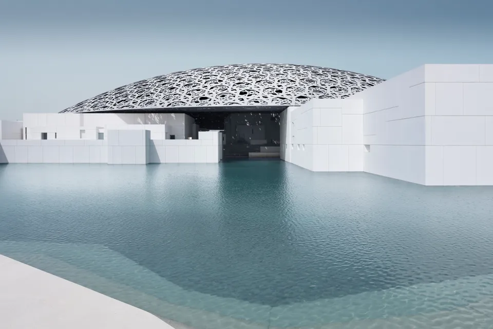
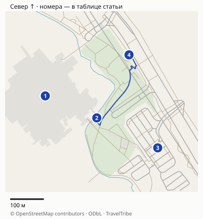
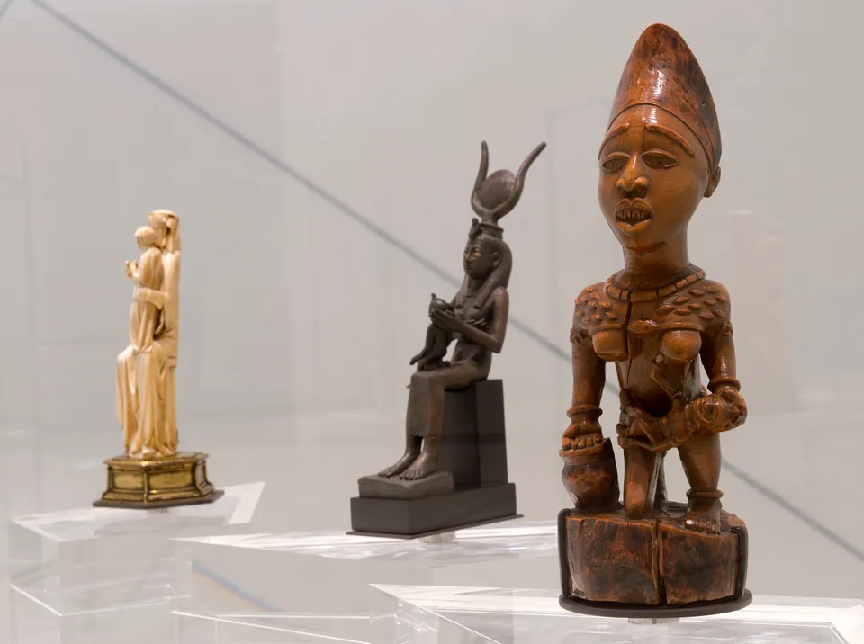
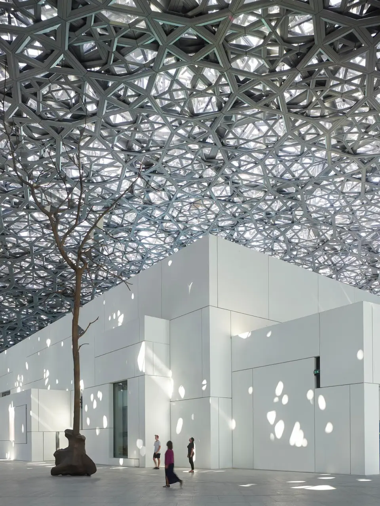
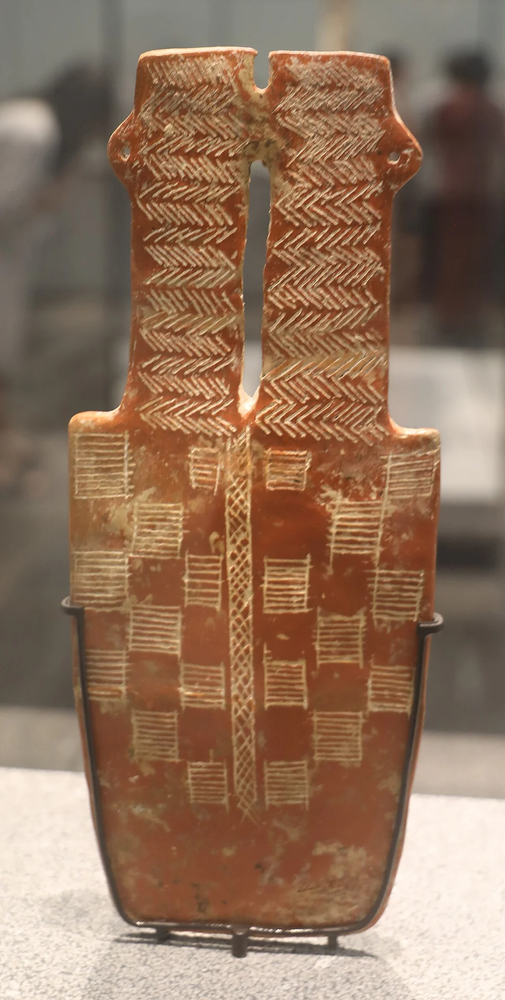
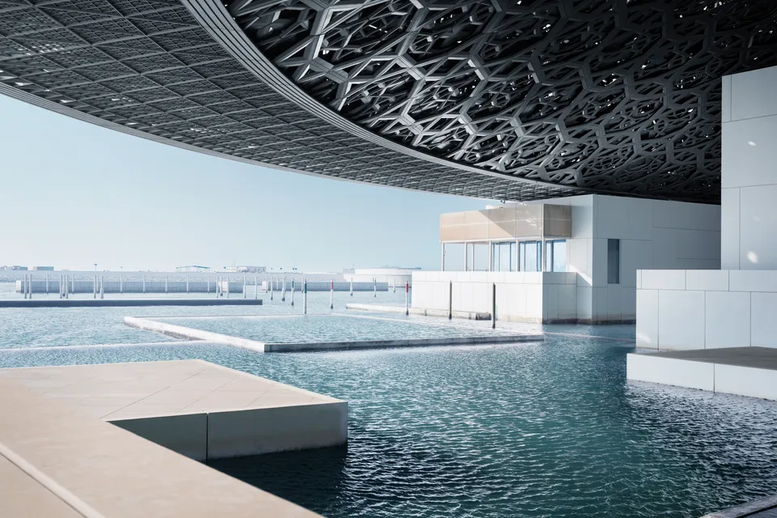

## Ради чего идти — и когда выбрать другое место

Главная причина визита — сочетание экспозиции и здания у воды. Сначала вы смотрите произведения и предметы разных культур, затем выходите в пространство под ажурным куполом. Это два разных впечатления внутри одного посещения. Не покупайте отдельную экскурсию только ради возможности увидеть купол: общественные зоны под ним входят в обычный музейный вход.

Лувр Абу-Даби — самостоятельный музей, а не уменьшенная копия парижского Лувра. Нельзя рассчитывать встретить здесь весь набор знаменитых произведений из Парижа. Заимствованные работы и временные выставки меняются: старый список «обязательных шедевров» не гарантирует, что конкретная картина будет на месте.

Если вам важны архитектура, сравнительная история и спокойное рассматривание вещей, визит оправдан. Если свободен только короткий промежуток между поездками через город, сначала посчитайте дорогу: даже эффектный купол не сокращает расстояние до Саадията. Человеку, которому сейчас интереснее пляж или прогулка по городу, не нужно идти в музей ради обязательного названия.

Louvre Abu Dhabi’s exterior © Louvre Abu Dhabi, Photography: Mohamed Somji. Архивный официальный кадр показан полностью.

## Что входит в обычный билет

[Официальная страница](https://www.louvreabudhabi.ae/visit-us) указывает **70 AED для взрослого от 18 лет**, примерно **1579 ₽**. Детям младше восемнадцати вход бесплатный; отдельные льготные категории требуют подтверждения. Это не универсальная скидка всем иностранным пенсионерам: проверяйте точное основание.

В обычный вход входят **музейные галереи, выставки и открытые общественные пространства под куполом**. Кафе и рестораны на территории не означают включённое питание. Гид, специальные занятия, каякинг и другие отдельные активности не следует добавлять к составу билета автоматически.

| Покупка | Когда подходит | Что проверить |
|---|---|---|
| Обычный вход музея | Хотите самостоятельно посмотреть галереи и купол | Дату, категорию посетителя, условия входа |
| Вход у посредника | Удобнее его способ покупки | Состав, отмену, ограничение времени и итоговую сумму |
| Экскурсия | Нужен рассказ и выбранный язык | Включён ли сам вход в музей, длительность и точку встречи |
| Museums Pass | Реально посетите ещё один или два музея | Конкретные учреждения, сроки использования и условия всех входов |
| Каяк или специальная активность | Именно это занятие — цель поездки | Включён ли музей, ограничения и погодную отмену |

Не сравнивайте цену короткой экскурсии по коллекции с полноценным входным билетом, пока не прочитали включения. Низкая сумма рядом с названием музея может относиться к дополнительной услуге.

## Посредник: что означает Skip The Line

У Tiqets проверен конкретный [Louvre Abu Dhabi: Skip The Line Ticket](https://www.tiqets.com/en/abu-dhabi-attractions-c60013/tickets-for-louvre-abu-dhabi-skip-the-line-p975300/). Карточка включает галереи, выставки, общественные зоны под куполом и аудиогид. Проход со смартфоном позволяет обойти очередь в кассу, **но не обязательный досмотр**.

У этого продукта также указаны **до трёх часов пребывания**, невозвратность и отсутствие переноса даты. Не обещайте по нему свободное пребывание на весь день. Если хотите подробный долгий осмотр, сначала сравните условия прямой покупки у музея и уточните допустимую длительность именно вашего входа.

При выборе билета проверьте, какую очередь он позволяет пропустить. Сопоставьте конечную цену, включения, необходимость аудиогида и отмену. Для бесплатной возрастной категории сначала проверьте оформление у музея, а не покупайте взрослый билет посредника по привычке.

## Музейный пасс: скидка полезна только на нужные вам посещения

Официальная система предлагает комбинации Лувра с Zayed National Museum и Natural History Museum Abu Dhabi. Это возможность связать несколько музейных визитов, но не доказательство, что вы успеете осмотреть всё за один короткий день.

До покупки выпишите учреждения, которые вы действительно хотите посетить, и свободные дни. Проверьте срок действия пасса, необходимость выбирать время каждого входа и часы всех музеев. Затем сравните итоговую корзину с отдельными билетами для вашего возраста. Без этих условий утверждение «пасс выгоднее» преждевременно.

Если свободно только три часа на Лувр, начните с обычного входа. Не добавляйте второй музей лишь ради номинальной скидки на объект, к которому не успеете доехать или который неинтересен.

## Карта и точная логистика

[Открыть подробную карту: масштаб, все точки и навигация](/maps/luvr-abu-dabi/). Север вверху; нумерация указана ниже. На обзорной картинке дальние пересадки могут не помещаться — они доступны в подробной карте через «Все точки».

| № | Точка | Ориентир и ограничение |
|---|---|---|
| 1 | [Музей](https://www.google.com/maps/search/?api=1&query=24.5336814,54.3986061) | Комплекс музея; залы и пространство под куполом. |
| 2 | [Вход от парковки](https://www.google.com/maps/search/?api=1&query=24.5330977,54.400114) | Подход к музею со стороны посетительской парковки. Досмотр обязателен. |
| 3 | [Парковка посетителей](https://www.google.com/maps/search/?api=1&query=24.53230215,54.40189839999999) | Для такси выбирайте музейный drop-off перед главным входом, а не служебную дорогу. |
| 4 | [Остановка автобуса94](https://www.google.com/maps/search/?api=1&query=24.5347715,54.4010584) | Музей подтверждает маршрут94; актуальный интервал проверяйте у перевозчика. |

### Как доехать до нужного входа

Автобус **94** подтверждён [самим музеем](https://www.louvreabudhabi.ae/en/visit-us). На карте отмечена остановка у Лувра, а не одноимённая точка в центре Абу-Даби. От неё до отмеченного входа получается около **300 м по дорожкам**: оставьте 5–10 минут пешком и отдельный запас на контроль. Это расчёт маршрута, без очереди и ожидания автобуса. Актуальный рейс проверяйте на свой день, не переносите сюда интервал городского маршрута из старого отчёта.

В такси укажите **Louvre Abu Dhabi, main entrance**. Музей разрешает посадку и высадку у главного входа со стороны посетительской парковки. Не выбирайте служебный Louvre Delivery Access. Машина довозит к входной зоне, но досмотр и проход в галереи остаются отдельным этапом. Бесплатный Cultural Express из Дубая — самостоятельный сервис, а не городской автобус 94: перед поездкой откройте его расписание на странице музея и подтвердите обратный рейс.

Расстояния округлены, время в пути зависит от пробок, погоды и открытых проходов. Метка территории может отличаться от входа: последние метры сверяйте с указателями. [Картографические данные © OpenStreetMap contributors](https://www.openstreetmap.org/copyright), ODbL.

## Если времени меньше или больше

**Около полутора часов внутри:** выберите несколько галерей и короткий выход под купол, пропустите отдельный длинный обед и дополнительные активности. Это сокращённое знакомство, а не весь музей. Дорогу на Саадият и досмотр прибавьте отдельно: полуторачасовая остановка в городском маршруте не равна полутора часам в залах.

**Около трёх часов:** основной план ниже соединяет коллекции и архитектуру. Он подходит для первого самостоятельного визита, если не задерживаться в каждом разделе.

**Полдня ради искусства:** до покупки выберите билет с подходящими условиями длительности, затем добавьте гида либо больше времени в коллекции и перерыв. Проверенный Tiqets с лимитом до трёх часов нельзя автоматически использовать для такого плана. Состав временных выставок и доступ к нужным залам уточните заранее.

## Как распределить около трёх часов

**Сначала — галереи.** Отдайте им основную часть визита: примерно полтора–два часа для первого знакомства. Это наш ориентир, который зависит от темпа. Начните с общей логики экспозиции, затем выберите несколько разделов для подробного осмотра. Пытаться прочитать каждую подпись в таком окне не нужно.

© Louvre Abu Dhabi - Photography Marc Domage. Архивный официальный кадр показывает музейное пространство; он не гарантирует сегодняшний состав конкретной витрины.

**Затем — купол, площадь и вода.** Оставьте примерно сорок пять минут на переходы, светотень и виды. Погода и время дня меняют впечатление. После тёмных залов дайте себе время спокойно выйти к свету, а не пробегайте открытые пространства перед выездом.

© Louvre Abu Dhabi - Photography Roland Halbe. Площадь под куполом входит в обычный вход; отдельная архитектурная экскурсия — дополнительный выбор.

**Остаток — запас.** Досмотр, гардероб, туалет, отдых и поиск точки обратной посадки тоже занимают время. Если у вас билет с ограничением пребывания, не расходуйте весь интервал на ожидание идеального солнечного рисунка под куполом.

Для длинной программы с гидом или ребёнком заложите другой темп и проверьте условия билета. Для короткого визита сократите число залов осознанно, не обещая себе «весь музей за час».

Если идёте ради искусства, оставьте время на отдельные предметы: форму скульптуры, материал и детали работы. Обход всех залов без остановок даст другое впечатление, чем несколько внимательно рассмотренных произведений.

Древний кипрский предмет с двумя головами, архивный кадр коллекции. Нынешний состав экспозиции может отличаться.

## Часы: галереи и купол закрываются в разное время

На актуальной [странице посещения музея](https://www.louvreabudhabi.ae/visit-us) галереи указаны **с понедельника по четверг 10:00–18:30, с пятницы по воскресенье 10:00–20:30**, последний вход — за тридцать минут. Пространства под куполом указаны до полуночи с последним входом в 23:00.

У старых FAQ и правил встречаются другие сведения о понедельнике; в карточке посредника последний вход тоже сформулирован иначе. Поэтому перед поездкой особенно внимательно подтвердите выбранную дату в действующем календаре музея и условия своего билета. Не стройте понедельничный выезд из Дубая только на старой фразе «всегда закрыт» или противоположном обещании посредника.

Поздний доступ под купол не означает, что выставки работают до полуночи. Если важны коллекции, начинайте с их окна. Отдельные галереи могут временно закрываться для монтажа; конкретные произведения и выставки проверяйте перед покупкой, а не по чужой фотографии многолетней давности.

View overlooking the sea © Louvre Abu Dhabi, Photography: Mohamed Somji. На купол и воду оставлен отдельный блок после галерей.

## Как добраться и с чем совместить

Музей расположен на острове Саадият. Для такси сохраните именно Louvre Abu Dhabi и точку обратной посадки; не путайте его с парижским музеем или другой площадкой культурного района. В [информации музея](https://www.louvreabudhabi.ae/visit-us) указан городской автобус №94. Перед поездкой проверьте остановку и текущий интервал, особенно если планируете поздний выход.

Из Дубая нужен отдельный междугородний план. Музей публикует информацию о Cultural Express; проверьте день, место посадки, возвращение и условия пользования до покупки билета. Наличие упоминания бесплатного шаттла не означает отправление от любого отеля или возможность вернуться в произвольное время.

Если выбираете готовую поездку «мечеть + Лувр», уточните, сколько времени остаётся внутри музея, входит ли его билет и предусмотрен ли рассказ в галереях. Остановка у фасада не заменяет посещение коллекции. Мечеть и музей не следует считать соседними точками одной пешей прогулки.

Удобное сочетание для спокойного дня — музей и другое занятие на Саадияте. Для первого знакомства со всем Абу-Даби оставьте запас времени на городские переезды. [Гид по ОАЭ](/uae/) поможет распределить поездку между эмиратами.

## Что подготовить до выхода

Сохраните электронный билет, правила выбранного продукта и рабочую связь. Крупную сумку может потребоваться оставить в гардеробе; ограничения уточняйте до приезда с багажом после выселения. Для экспозиций соблюдайте местные знаки съёмки: разрешение сфотографировать купол не означает разрешения использовать вспышку у любой работы.

Нужна полноценная история коллекции — выбирайте гида и язык. Хотите самостоятельный визит — проверьте доступный аудиогид и условия его использования, не предполагая русскую дорожку у любого продукта. Для ограниченного времени главный выбор остаётся понятным: обычный вход, галереи первыми и отдельный запас на пространство под куполом.
