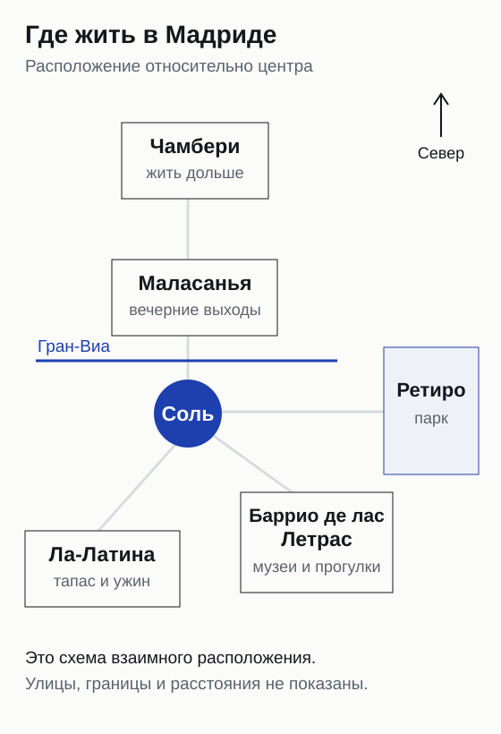
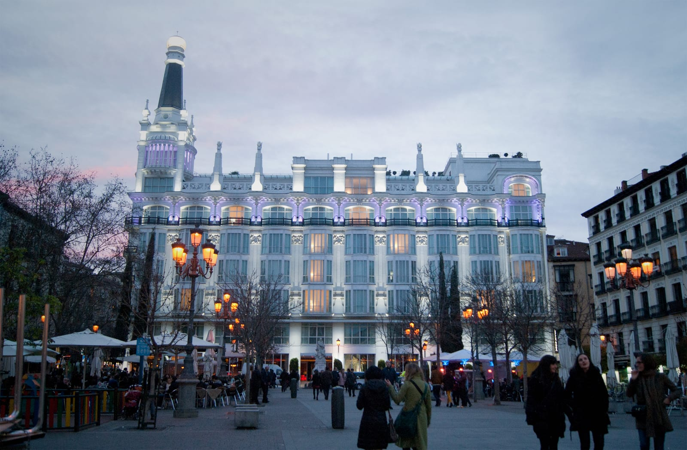
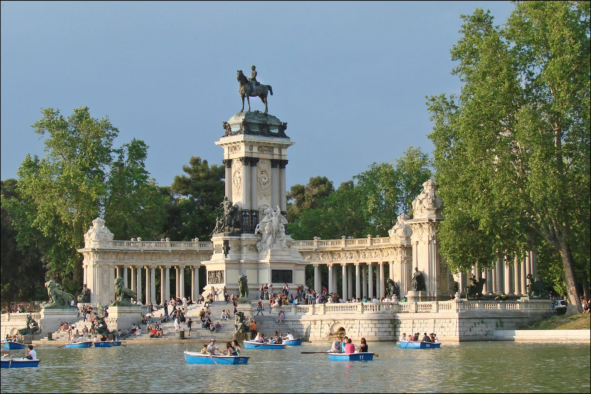
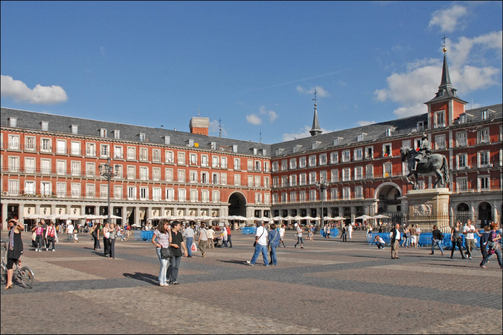
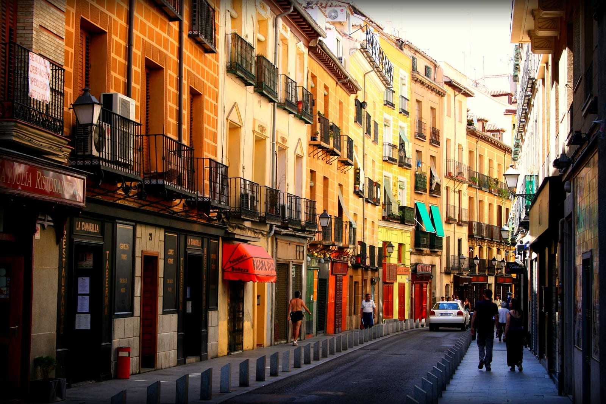
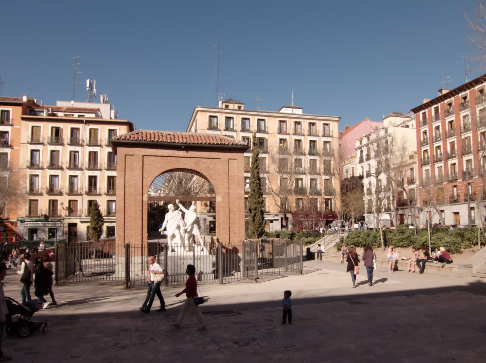
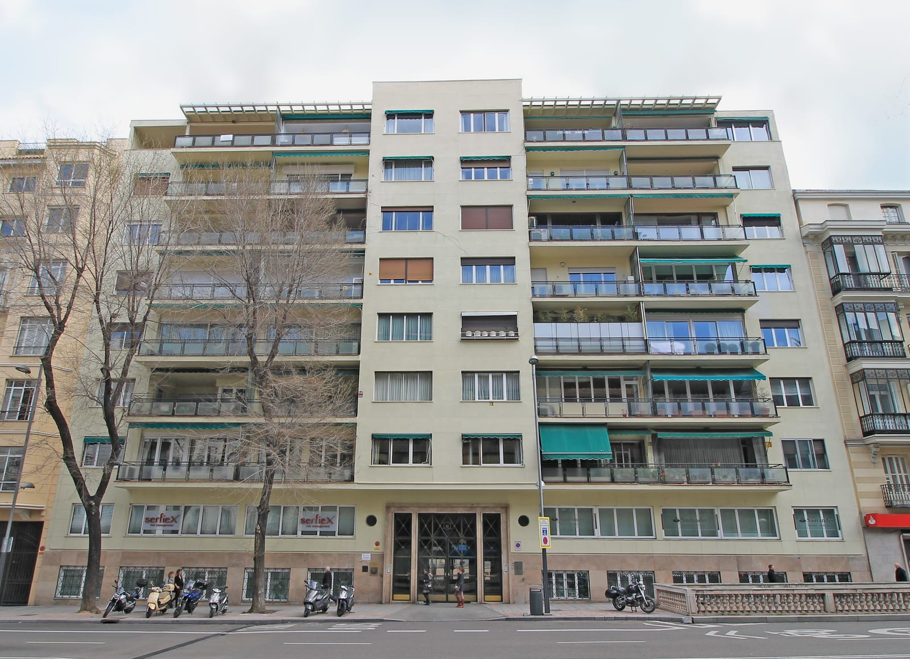

import { tpkDeep } from '../../data/affiliate.js';

Но название района не выбирает вам номер. Отель у оживлённой площади и отель за углом могут дать две разные ночи. Начните с того, как будут устроены ваши дни, затем проверьте конкретный адрес, окна и дорогу после прилёта. Это полезнее, чем искать единственный «лучший район Мадрида».

## Как быстро выбрать район под свою поездку?

**Выберите главную задачу, а не самый длинный список достопримечательностей рядом.** Для короткого визита ценнее пешая связность. Для недели в городе важнее комната, в которой можно спать и проводить время, а не оставлять чемодан до вечера.

| Сценарий | Где начинать поиск | Сколько дней я бы планировал | Главный компромисс |
|---|---|---|---|
| Первый приезд, Прадо и старый центр | Баррио де лас Летрас | 2–3 | У площади Санта-Ана и баров может быть шумно |
| Ребёнок, прогулки и парк | У Ретиро | 3–5 | Сторона парка меняет дорогу до центра |
| Один насыщенный день, магазины и прогулки | Соль / Гран-Виа | 1–2 | Поток людей и оживлённая улица под окнами |
| Тапас и вечера в старом городе | Ла-Латина | 2–4 | Кава-Баха удобна для ужина, но рискованна для чуткого сна |
| Бары, небольшие магазины, поздние выходы | Маласанья | 3–4 | Возвращаться близко, уснуть может быть сложнее |
| Более долгая поездка, обычный городской быт | Чамбери | 4–7 | До части главных мест придётся ехать |

Это варианты базы, а не шесть районов, которые нужно обойти по очереди. Для каждого из этих сценариев я бы обходился без арендованной машины: вопрос здесь в городских прогулках и транспорте. Если машина нужна для дальнейшей поездки, отдельно выясните условия подъезда и парковки выбранного отеля.

После выбора района откройте карту жилья и поставьте свои даты, число гостей и условие отмены. <a href={tpkDeep('ostrovok', 'https://ostrovok.ru/hotel/spain/madrid/', 'madrid_gde_ostanovitsya_hotel')} class="aff-cta" rel="sponsored">Выбрать отель в Мадриде</a>. Сравнивайте адрес и полный тариф, а не обещание «в центре».

*Летрас лежит между старым центром и музейной стороной города; Чамбери — севернее. Схема помогает выбрать базу, а путь от конкретного отеля нужно смотреть по улицам.*

## Баррио де лас Летрас: музеи и первый приезд

Летрас — удобный компромисс между площадью Соль и музейной осью Пасео-дель-Прадо. Можно посвятить один день старому центру, другой музеям, а вечером возвращаться в тот же квартал без смены отеля. Для первой короткой поездки это разумная отправная точка, если вы не собираетесь проводить каждый вечер на другом конце города.

Ориентиры для поиска — улицы Аточа и Уэртас, площадь Санта-Ана, сторона Пасео-дель-Прадо. Внутри района есть и маленькие улицы, и места с плотной вечерней жизнью. Санта-Ана хороша для того, чтобы выйти поужинать; это ещё не аргумент за окно прямо на площадь.

В Летрас я бы сначала сравнил два адреса: ближе к музейной оси и ближе к Санта-Ана. Первый удобнее под дневную программу, второй — под вечерний ужин. Это выбор привычного пути из отеля, а не рейтинг всего района.

*Санта-Ана в Летрас. Близость к вечерней площади полезна для прогулки, но не обещает спокойного сна.*

## Ретиро: парк рядом, но с какой стороны?

Для поездки с ребёнком парк под боком может оказаться полезнее ещё одного памятника у отеля. Есть куда выйти между музеем, обедом и отдыхом в номере. При этом «отель у Ретиро» — широкое описание: парк не точка, и адрес на его западной стороне решает другую задачу, чем адрес за восточным краем.

Если в плане Прадо, музей Тиссена и прогулки по центру, начните с музейной стороны парка. Если хотите больше времени проводить у самого Ретиро, сравните предложения с других сторон. Проверьте пеший путь от двери до нужного входа, а не расстояние от значка гостиницы до зелёного пятна на карте. Для самой прогулки есть [маршрут по Ретиро с прудом, садами и открытыми павильонами](/blog/park-retiro-madrid/).

У семейного номера есть свои вопросы: помещается ли дополнительная кровать, входит ли ребёнок в указанный тариф, есть ли лифт до нужного этажа. Снимок большой кровати этого не объясняет. И парк не делает все соседние улицы тихими: окна на поток машин остаются окнами на поток машин.

*Ретиро удобно включать в день с паузами. До входа в парк стоит проверить маршрут от самого отеля.*

## Соль и Гран-Виа: короткая поездка пешком

Эта база подходит, если времени мало и хочется сразу оказаться среди городских прогулок, магазинов и театров. Из Соль легко начать маршрут по старому центру, а Гран-Виа удобна для вечера без отдельной поездки туда и обратно. С большой программой на один день центральный адрес экономит лишние возвращения.

Плата за удобство не обязательно выражается в цене номера. Здесь приходится учитывать движение, людей, свет вывесок и состояние окон. Балкон с видом на главную улицу может быть отличным выбором для одного человека и причиной плохого сна для другого.

Поэтому сначала решите, нужен ли вам этот вид. Если нет, спрашивайте номер с другим направлением окон и читайте отзывы именно о звукоизоляции. Высокий этаж иногда помогает, но не заменяет хорошие окна и не защищает от шума соседних комнат. У отеля с красивой крышей может быть обычный номер, который вам совсем не подходит.

*Пласа-Майор — один из ориентиров для прогулки по старому центру. Это отдельная площадь, а не площадь Соль.*

## Ла-Латина: ужин важнее раннего отбоя

Ла-Латина подходит, когда поездка складывается из старых улиц, тапас и длинных вечеров. Улица Кава-Баха — понятный ориентир для еды и баров. Если хотите после ужина дойти до номера, а не продумывать обратную дорогу, такой адрес имеет смысл.

Компромисс тот же, который делает район привлекательным: вечерняя активность. Выбирать комнату над заведением и одновременно рассчитывать на ранний сон — плохая ставка. Более спокойный переулок может оказаться удачнее знаменитой улицы, даже если до ужина нужно пройти немного дальше.

Для короткой поездки с ранними подъёмами сравните Ла-Латину с Летрас по программе каждого дня. Ла-Латина выигрывает, если ужин здесь повторяется каждый вечер; один поход за тапас ещё не требует селиться рядом.

*Кава-Баха в Ла-Латине. Перед бронированием выясните, выходит ли окно номера на улицу с заведениями.*

## Маласанья: если хочется выходить вечером

Маласанья — вариант для тех, кому нужны бары, небольшие магазины и вечерние выходы севернее Гран-Виа. Площадь Дос-де-Майо помогает понять расположение квартала. Это выбор под определённый ритм поездки, а не обязательная остановка для любого первого приезда.

Смотрите, какой будет ваша обычная ночь. Если гуляете допоздна, близость жилья к вечерним улицам удобна. Если ложитесь рано, лучше проверить соседние переулки и отзывы о конкретном здании. Слова «молодёжный район» ничего не говорят о звукоизоляции вашей комнаты.

Для музеев этот адрес тоже возможен. Но если Прадо занимает главное место в программе, сначала сравните Маласанью с Летрас: меняется дорога, которую придётся повторять, а не только набор кафе вокруг комнаты.

*Дос-де-Майо — ориентир Маласаньи. Кадр площади не показывает, насколько тихо в выбранном номере.*

## Чамбери: для более долгого пребывания

Чамбери имеет смысл смотреть, когда вы едете дольше пары дней и не хотите каждый раз возвращаться в самый плотный туристический центр. Здесь полезнее выбирать адрес по своему быту: где завтракать, откуда ехать к музеям, насколько удобно добраться домой вечером. Это хороший вопрос к карте, а не повод искать «настоящий Мадрид» за пределами всех туристов.

Сразу проверьте путь к главным точкам вашей программы. Адрес, который подходит для недели с неспешными прогулками, может быть неудобен для одного дня с Прадо, дворцом и вечерним поездом. В таком случае близость к центру важнее настроения квартала.

И Чамбери не означает гарантированную тишину. На улице Понсано есть заметная ресторанная жизнь. Если хотите спать рано, проверяйте фасад, заведения снизу и свежие отзывы. Название района не освобождает от этой проверки.

*Дом на улице Альмагро в Чамбери. Здесь, как и в центре, выбор конкретного адреса важнее общего ярлыка района.*

## Стоит ли жить у Аточи или аэропорта?

**У Аточи — если ваш поезд действительно отправляется оттуда; у аэропорта — если ночёвка нужна ради перелёта.** Это транспортные задачи, а не универсальные рекомендации для прогулок. Перед бронированием проверьте вокзал в билете: слово «Мадрид» само по себе не означает Аточу.

Для позднего прилёта сначала разберитесь с заселением. Метро обычно работает с **06:00 до 01:30**, но это часы сети, а не обещание последнего поезда на вашей станции. Перед ночной поездкой проверьте работу нужной линии на свою дату. Круглосуточный аэропортовый экспресс обслуживает **T1, T2 и T4**. Ночью его городской конечный пункт — **площадь Сибелес**, до Аточи он не идёт.

Значит, «отель рядом с Аточей» не даёт прямого ночного автобуса до двери. Сравните остаток пути от Сибелес, багаж и условия позднего заезда. Если берёте гостиницу у аэропорта, проверьте её трансфер: нужный терминал, время работы и необходимость предварительной записи. Близость на карте ещё не означает пеший доступ к терминалу.

## Как район меняет дорогу из аэропорта и с вокзала

Для сравнения берём по одной станции: Antón Martín для Летрас, Retiro у северо-западной части парка, Sol, La Latina, Tribunal для Маласаньи и Iglesia для Чамбери. Это ориентиры, а не ближайшее метро для каждого отеля района. Сначала найдите адрес гостиницы: у музейной стороны Ретиро удобнее может оказаться другой вход и другая станция.

В таблице — **смены линий метро**, без пешего пути до номера. Ноль означает поездку на одной линии, а не отсутствие дороги. Это сравнение обычной сети; ремонт, часы работы и доступность лифтов нужно проверить на день поездки. Быстрейший вариант с автобусом или пригородным поездом может отличаться.

| Район и станция | От аэропортовой линии 8 | От Atocha | От Chamartín |
|---|---|---|---|
| Летрас — Antón Martín | 2: 8, 10, 1 | 0: линия 1 | 0: линия 1 |
| Ретиро — Retiro | 2: 8, 9, 2 | 1: 1, 2 | 1: 1, 2 |
| Соль — Sol | 2: 8, 10, 1 | 0: линия 1 | 0: линия 1 |
| Ла-Латина — La Latina | 2: 8, 10, 5 | 1: 1, 5 | 1: 1, 5 |
| Маласанья — Tribunal | 1: 8, 10 | 0: линия 1 | 0: линия 1 |
| Чамбери — Iglesia | 2: 8, 10, 1 | 0: линия 1 | 0: линия 1 |

С аэропортовой линии 8 пересаживайтесь на 10 в Nuevos Ministerios. Для Летрас, Соль и Iglesia следующая пересадка — Tribunal; для Ла-Латины — Alonso Martínez. К станции Retiro можно ехать через Colombia с переходом на 9, затем через Príncipe de Vergara на 2. От вокзалов для Retiro пересадка на 2 — в Sol; для La Latina переход на 5 — в Gran Vía.

У такого сравнения есть практический вывод: **приезд на поезде и прилёт — разные аргументы при выборе жилья**. Летрас и Соль дают путь без смены линии от обоих вокзалов. У Tribunal меньше пересадок с аэропортовой линии, но это не доказывает более короткую поездку до двери. С чемоданом сравнивайте также переходы внутри станций и последнюю улицу, а не только цифру в таблице.

Если прилетаете ночью, сначала вернитесь к разделу о Сибелес и позднем заселении. Дневная связность метро не решает ночной приезд. Цена проезда и путь до конкретного номера в эту таблицу не включены.

## Как проверить номер до оплаты?

**Проверяйте адрес, окна, доступ и тариф для выбранного номера.** Хороший район не исправит неудобный номер, а красивое фото холла не покажет лестницу до вашего этажа.

1. **Поставьте реальные даты и всех гостей.** Сравнивайте полную сумму за пребывание, одинаковый тип питания и условия отмены. Средняя цена района и минимальное «от» эту задачу не решают.
2. **Найдите вход в здание.** Проложите путь до двух главных точек своего дня и обратно. При ограниченной подвижности проверьте ступени и доступ к номеру отдельно.
3. **Выясните направление окон.** Улица с барами, внутренний двор и крупная дорога — разные условия. Номер во двор тоже не гарантирует тишину или хороший вид.
4. **Прочитайте свежие жалобы.** Ищите повторяющиеся детали: звук из соседних комнат, разгрузку снизу, ремонт, запахи, неработающий кондиционер. Общая оценка скрывает эти различия.
5. **Согласуйте поздний заезд.** Круглосуточная стойка и получение кода до определённого часа — разные способы заселения. Подтверждение нужно до вылета.
6. **Проверьте остаток оплаты и депозит.** Предоплата части номера не закрывает платёж при заселении. Уточните, нужна ли физическая карта и на чьё имя.

Сохраните условия выбранного тарифа вместе с подтверждением. Просьба о тихом номере полезна, но просьба не равна обязательству отеля предоставить определённую комнату. Если важное условие не подтверждают, лучше сравнить другое предложение до покупки.

## Как бронировать с российской картой?

**Для заграничного отеля на Островке смотрите тариф с полной оплатой при бронировании.** При оплате на сайте деньги списываются в рублях. Это отдельная операция: она не означает, что той же картой можно рассчитаться на стойке в Мадриде.

Частичная предоплата оставляет сумму, которую нужно внести при заезде. Даже после полной оплаты проживания отель может отдельно брать депозит или оплату дополнительных услуг. До покупки выясните эти условия у выбранного объекта, особенно если едете без карты иностранного банка.

Не путайте подтверждение брони с выполнением всех условий въезда. Документы на поездку проверяйте отдельно в [разборе шенгенской визы](/blog/schengen-visa-2026/), а условия страховки — в [гайде по страховке для Шенгена](/blog/schengen-insurance-2026/). Для выбора времени поездки и других городов полезен [гайд по Испании](/spain/).

## Что говорят постояльцы о шуме

В восьми выбранных сообщениях из двух обсуждений Reddit за 2025–2026 годы есть полезное разногласие: один человек на Гран-Виа спал с берушами, другие не заметили проблемы. Это малая выборка, представительной её считать нельзя. Она не даёт рейтинга тишины и не заменяет отзывы о вашем номере.

Различаются этажи, окна и сами гостиницы. Поэтому я бы использовал эти сообщения как список вопросов перед покупкой: куда выходят окна, есть ли бар снизу, что пишут о звукоизоляции. Переносить чужую удачную ночь на весь район или исключать всю Гран-Виа из-за чужой неудачной ночи смысла нет.

## Нужна ли машина для городской поездки?

Для шести описанных сценариев я бы обходился без машины. Иначе к выбору района добавятся парковка, подъезд к зданию и место для багажа. Если после Мадрида вы едете дальше на автомобиле, сравните получение машины перед выездом из города с арендой на все дни. В стоимость номера парковка автоматически не входит.
