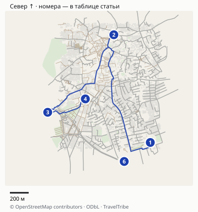
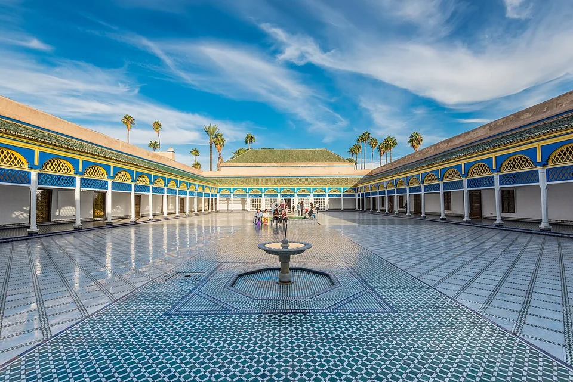
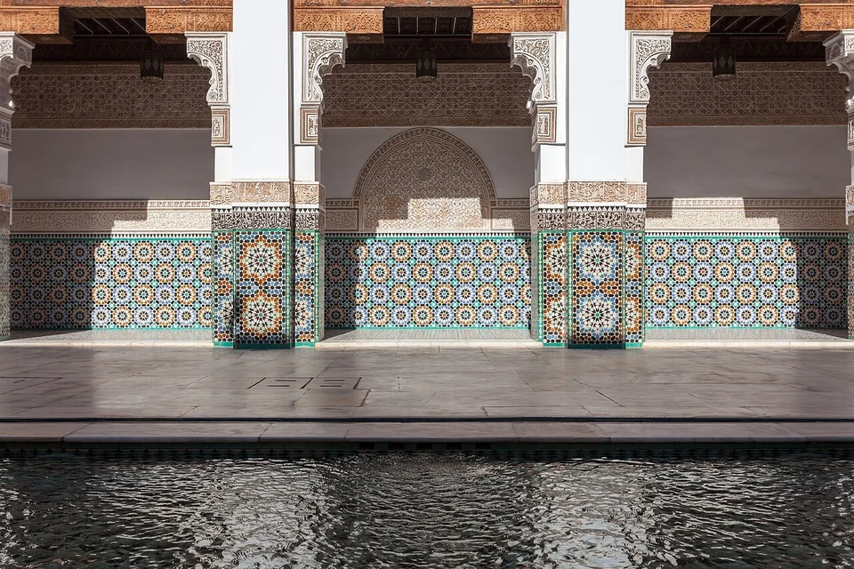
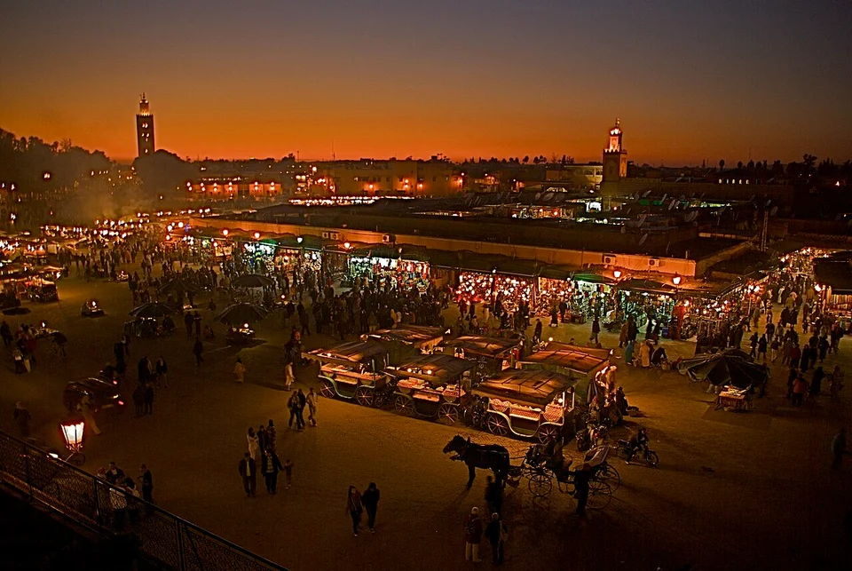
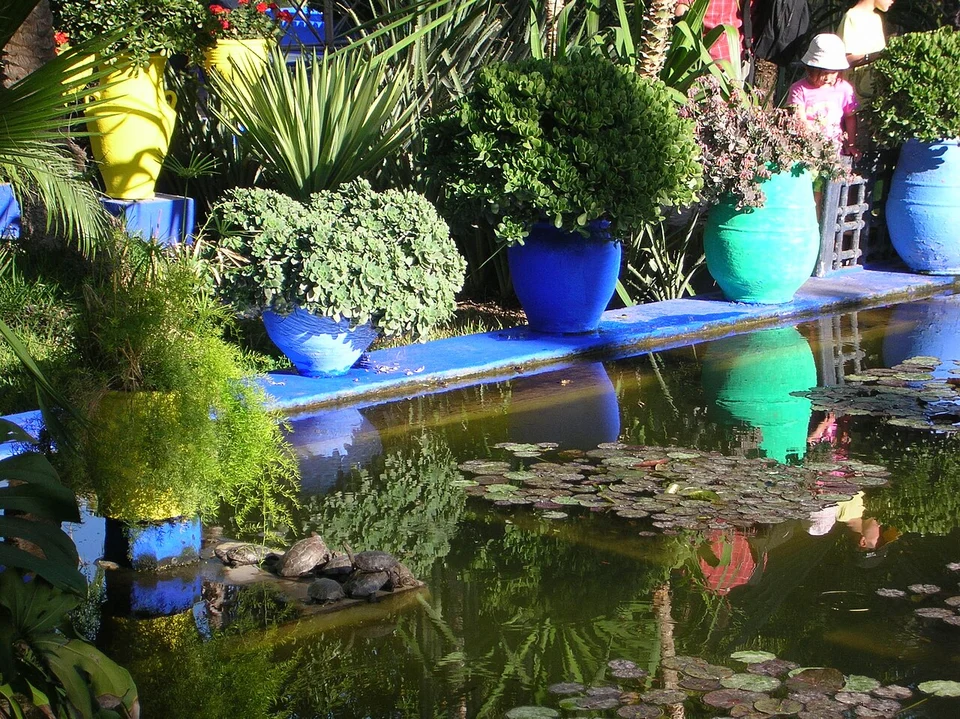

## Выберите одну из двух программ

Основной маршрут остаётся внутри старого города и у его границы. Мажорель находится в другой части Марракеша и требует отдельного переезда. Попытка поставить сад, все его музеи, Бахию, Бен-Юсеф, большой рынок и вечернюю площадь подряд оставляет мало времени на сами места.

| Часть дня | Медина: основной вариант | Если главным стал Мажорель |
|---|---|---|
| Утро | Дворец Бахия | Сад по купленному времени; один музей только при интересе |
| Середина дня | Обед и отдых | Переезд к медине, обед |
| После обеда | Бен-Юсеф и часть торговых улиц | Бен-Юсеф либо короткая прогулка по торговым улицам |
| Перед вечером | Внешний осмотр Кутубии по силам | Кутубия снаружи по силам |
| Вечер | Джемаа-эль-Фна и ужин | Джемаа-эль-Фна и ужин |

Это последовательность, не экскурсия с гарантированными минутами. Оставьте на Бахию примерно полтора часа, на Бен-Юсеф — около часа и ещё время на кассу. Для длинного обеда и отдыха предусмотрите самостоятельный блок: особенно летом прогулку не стоит растягивать на весь полдень без помещения и воды.

## Карта и точная логистика

[Открыть подробную карту: масштаб, все точки и навигация](/maps/marrakesh-za-odin-den/). Север вверху; нумерация указана ниже. На обзорной картинке дальние пересадки могут не помещаться — они доступны в подробной карте через «Все точки».

| № | Точка | Ориентир и ограничение |
|---|---|---|
| 1 | [Дворец Бахия](https://www.google.com/maps/search/?api=1&query=31.6216327,-7.9819376) | Основное утро; подъезд ориентируйте на Avenue Imam El Ghazali. |
| 2 | [Медресе Бен-Юсеф](https://www.google.com/maps/search/?api=1&query=31.6319841,-7.9860361) | Северный блок медины; доступ к входу пешком с Rue Assouel. |
| 3 | [Кутубия: снаружи](https://www.google.com/maps/search/?api=1&query=31.624534,-7.9934687) | Внешний осмотр; маршрут не ведёт немусульман в молитвенный зал. |
| 4 | [Джемаа-эль-Фна](https://www.google.com/maps/search/?api=1&query=31.62581965,-7.989238950000001) | Вечерняя точка маршрута; площадь показана целиком, не отдельный ресторан. |
| 5 | [Мажорель](https://www.google.com/maps/search/?api=1&query=31.6414746,-8.0029077) | Альтернативный утренний блок по заранее выбранному билету. |
| 6 | [Place des Ferblantiers](https://www.google.com/maps/search/?api=1&query=31.6198072,-7.9848706) | Южный ориентир встречи; конкретную точку доступной посадки согласуйте с водителем. |

### Как пройти медину и где искать такси

Пешеходный порядок **Бахия → Бен-Юсеф → внешний осмотр Кутубии → Джемаа-эль-Фна** даёт около **3,5 км по уличной сети**, без обходов дворцов и рынка. По участкам: Бахия → медресе около **1,7 км**, медресе → Кутубия около **1,3 км**, Кутубия → площадь около **500 м**. На первый переход оставьте 30–40 минут, на второй 25–35, на последний 10–15. Это редакционный запас на ориентирование, а не измеренное время в толпе.

Бахию ищите со стороны **Avenue Imam El Ghazali**, медресе — **Rue Assouel**. Метка территории дворца может быть удалена от кассы: последние метры проходите по указателям ко входу. Кутубия на карте отмечена снаружи, маршрут не обещает доступ немусульман внутрь мечети. В узких улицах медины не рассчитывайте, что такси подъедет к любому риаду: Place des Ferblantiers — южный ориентир для согласования встречи, а конкретную доступную точку определяет водитель.

Мажорель находится вне основного круга. От него до Бен-Юсефа получается около **2,4 км пешком**, оставьте 40–50 минут либо организуйте переезд к доступному краю медины и оставшийся подход. Добавление Мажореля не бесплатный крюк: сохраняйте его заранее выбранный слот и сокращайте другой блок, как в альтернативном плане выше.

Расстояния округлены, время в пути зависит от пробок, погоды и открытых проходов. Метка территории может отличаться от входа: последние метры сверяйте с указателями. [Картографические данные © OpenStreetMap contributors](https://www.openstreetmap.org/copyright), ODbL.

## Утро в Бахии: дворцы и дворы вместо списка комнат

Начните с дворца Бахия. Здесь интересны переходы между дворами, геометрия отделки, резное дерево и соотношение открытого и закрытого пространства. Не обещайте увидеть все помещения: доступные зоны могут меняться из-за работ и использования здания.

На [официальной странице Министерства культуры](https://e-services.minculture.gov.ma/en/tickets/palais-bahia) иностранный взрослый билет указан как **100 MAD**, примерно **860 ₽**; для иностранных детей 7–13 лет — **50 MAD**, около **430 ₽**. Марокканские тарифы и бесплатная пятница для соответствующей местной категории не относятся автоматически к иностранному туристу.

На [французской версии билетной страницы министерства](https://e-services.minculture.gov.ma/fr/tickets/palais-bahia) опубликованы часы посещения **09:00–17:00**. Начните около **09:00** и оставьте примерно **1,5 часа**: так Бахия укладывается в утренний блок без расчёта на вход перед закрытием. Отдельное время последнего входа на странице не указано; 17:00 не следует трактовать как разрешение купить билет в последнюю минуту. Особые закрытия и доступные залы уточняйте перед визитом.

В Бахии полезно смотреть переходы и детали отделки. Архивный кадр не подтверждает доступ ко всем залам в день вашего визита.

После Бахии не добавляйте ещё несколько южных памятников по инерции. Если гробницы Саадитов для вас важнее медресе, замените ими часть программы. Для одного дня выбор важнее полного обхода всех известных названий.

## Как пройти медину и не рассчитывать на машину у каждой двери

Сохраните офлайн карту, адрес своего риада и точки входа в памятники. Если подсказчик предлагает провести вас закрывшимся или «единственным правильным» путём, сверяйтесь с указателями и своим маршрутом.

От Бахии двигайтесь через центральную часть медины к северному блоку Бен-Юсефа, делая перерыв на обед. Если навигация начинает мешать самой прогулке, сократите торговые ответвления. За один день не нужно запоминать всю сеть переулков: важнее понимать, куда вы идёте дальше и откуда сможете выехать.

Услуги сопровождения и покупки согласовывайте до их начала. Если прохожий предлагает провести к «открытому входу», уточните, платная ли это услуга, и проверьте нужное направление по своей карте. Не считайте случайное утверждение о закрытии памятника официальным объявлением. При желании взять гида закажите конкретный маршрут и стоимость заранее.

## Бен-Юсеф: отдельный час после обеда

Медресе Бен-Юсеф интересно главным двором, резьбой, штукатурным орнаментом и более камерными пространствами. Посмотрите не только симметричный центральный кадр, но и то, как устроены верхние галереи и небольшие помещения, если они доступны. Для спокойного осмотра оставьте около часа, не включая подход и ожидание.

[Официальный сайт](https://www.medersabenyoussef.ma/en/) публикует **09:00–19:00 ежедневно**, **50 MAD** за обычный билет, около **430 ₽**, и **10 MAD** для детей младше двенадцати, около **86 ₽**. Там прямо указано: онлайн-касса находится на обслуживании, билеты продаются на входе. Не покупайте у стороннего сайта только потому, что он выглядит как обязательная официальная онлайн-система.

Для медресе оставлен самостоятельный блок, а не пять минут между покупками. С лестницами и верхними помещениями оцените доступ по своим возможностям.

После посещения выберите одну торговую прогулку по дороге к площади. Если вы не планируете покупать ковёр или кожаные изделия, нет необходимости заходить в каждую мастерскую по приглашению. Покупки требуют времени на сравнение и условия доставки; это самостоятельная часть дня, а не бесплатное дополнение ко всему маршруту.

## Кутубия — снаружи, площадь — ближе к вечеру

Кутубию включайте как внешний осмотр мечети и окружающего пространства. Внутреннее посещение для немусульман в обычной туристической программе не подразумевается. Не тратьте время на поиски «секретного туристического входа» и не выдавайте общий вид здания за обещание доступа в молитвенный зал.

На Джемаа-эль-Фна возвращайтесь ближе к вечеру. Площадь меняется: появляются новые торговые точки, еда и представления, меняются свет и плотность людей. Сначала спокойно осмотритесь, затем выбирайте место для ужина или вид с террасы.

Вечерняя площадь — причина оставить время в конце дня. На террасе заранее уточните, обязательны ли заказ и отдельная плата за выбранное место.

Фотографирование артистов и работа с уличными услугами могут предполагать оплату: спросите условия прежде, чем снимете постановочный портрет или согласитесь на рисунок хной. Не поддерживайте представления с дикими животными ради кадра. При усталости и плотной толпе выберите ресторан и спокойный обратный путь вместо дополнительного круга по площади.

## Если хочется именно в сад Мажорель

Сначала проверьте доступное время и состав билета на [официальном сайте сада](https://www.jardinmajorelle.com/en/thegarden/). Показанная цена сада — **170 MAD**, приблизительно **1462 ₽**. Берберский музей и музей Ива Сен-Лорана не следует автоматически считать включёнными в любой вход в сад: сравнивайте выбранный продукт и нужные объекты.

У сада указаны часы **08:00–18:30**, последний вход **18:00**; у соседних музейных пространств другие режимы. Наличие общего времени работы не доказывает свободный билет на выбранный час. Забронируйте подходящий вариант до перестройки дня и приезжайте к своему времени с запасом на дорогу.

На сад оставьте полтора–два часа по своему интересу; музеи потребуют дополнительного времени. После этого возвращайтесь к медине, обедайте и выбирайте один платный памятник, а не пытайтесь восстановить всю пропущенную утреннюю программу.

Растения и пруд в Мажореле. Такой утренний блок заменяет Бахию в альтернативном плане, оставляя вторую половину дня для медины.

**Нет подходящего билета?** Оставьте основной маршрут Бахия → Бен-Юсеф → площадь. Не ездите к саду только в надежде, что очередь или посредник решат вопрос. Один день в Марракеше не становится неудачным из-за отсутствия одного известного кадра.

## Гид, жильё и следующий день

Для медины полезен гид, который объясняет архитектуру и помогает пройти нужный маршрут. До покупки уточните язык, длительность, входные билеты, обязательные торговые остановки и точку окончания. Экскурсия, заканчивающаяся далеко от риада, создаёт ещё одну задачу в конце дня.

Если приезжаете с чемоданом, выбирайте жильё не только по красивому внутреннему двору: узнайте ближайший подъезд машины, помощь с багажом и позднее заселение. Для первой короткой поездки понятная точка встречи ценнее обещания «пять минут до площади» без указания пешеходного входа.

[Гид по Марокко](/blog/morocco-guide-2026/) и [страница направления](/morocco/) помогут продолжить поездку. Атласские горы, пустыню и морской берег не стоит добавлять к этому городскому дню: для них нужны отдельные маршруты и транспорт.
