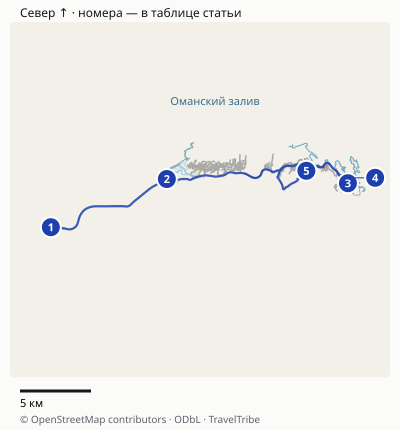
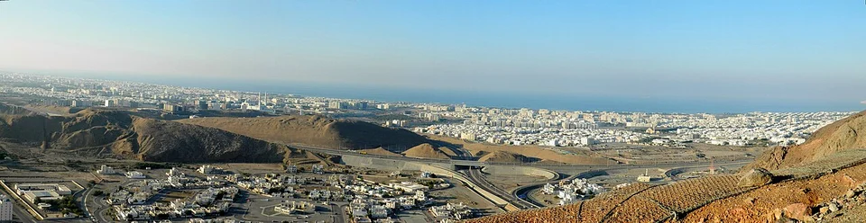
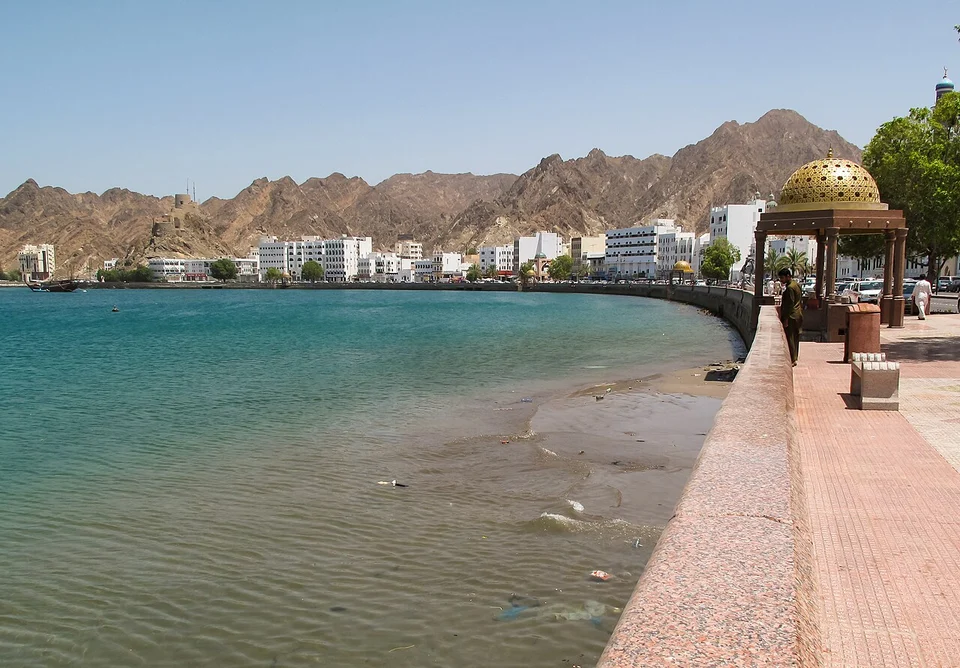
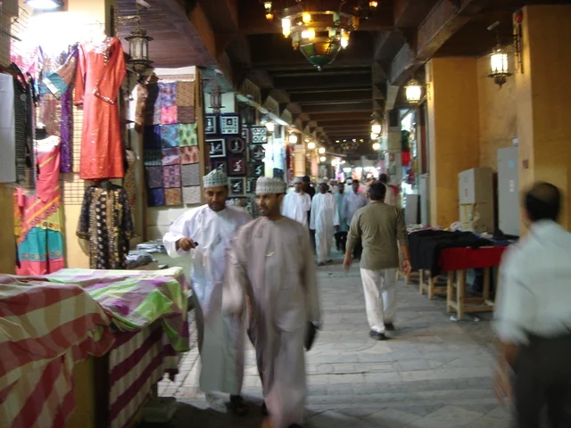

## Как устроен день

Маскат вытянут вдоль побережья и разделён горами и дорогами. Большая мечеть, район оперы и старый город — отдельные части маршрута. Пешком удобно осматривать каждую остановку, но не соединять все их одной прогулкой. Поэтому маршрут рассчитан на такси, машину с водителем или свой автомобиль, а не на непрерывную ходьбу.

| Блок дня | Что делать | Что можно сократить |
|---|---|---|
| 08:30–10:00 | Большая мечеть султана Кабуса | Сократите осмотр деталей, но не переносите вход на послеобеденное время |
| 10:00–12:00 | Переезд к опере и экскурсия либо осмотр снаружи | Внутренний тур необязателен |
| 12:00–14:00 | Обед и отдых в помещении | Не заполняйте паузу прогулкой по раскалённому асфальту |
| 14:00–16:00 | Старый Маскат: площадь у дворца, один музей по интересу | Выберите музей или короткую прогулку, а не несколько экспозиций |
| После 16:00 | Матрах: набережная, рынок, ужин | Завершите раньше, если предстоит возвращение на корабль или в аэропорт |

Это интервалы для организации дня, а не расписание экскурсии. На переезды и ожидание машины внутри блоков заложен запас; фактическая дорога зависит от адреса отеля и движения. Время заката меняется по сезону: «после 16:00» не означает, что солнце низко.

## Карта и точная логистика

[Открыть подробную карту: масштаб, все точки и навигация](/maps/maskat-za-odin-den/). Север вверху; нумерация указана ниже. На обзорной картинке дальние пересадки могут не помещаться — они доступны в подробной карте через «Все точки».

| № | Точка | Ориентир и ограничение |
|---|---|---|
| 1 | [Большая мечеть](https://www.google.com/maps/search/?api=1&query=23.5837872,58.3885182) | Для немусульман утреннее окно кроме пятницы; приезжайте к началу. |
| 2 | [Королевская опера](https://www.google.com/maps/search/?api=1&query=23.6142764,58.4686029) | Отдельная остановка; внутренний тур по опубликованному расписанию. |
| 3 | [Национальный музей](https://www.google.com/maps/search/?api=1&query=23.6116161,58.593626549999996) | Старый Маскат; карточка музейного комплекса, не обещание входа без билета. |
| 4 | [Аль-Алам: внешняя площадь](https://www.google.com/maps/search/?api=1&query=23.6150393,58.5944716) | Публичная пешеходная площадь южнее дворца; осмотр снаружи, не вход в закрытый комплекс. |
| 5 | [Рынок Матрах](https://www.google.com/maps/search/?api=1&query=23.6194656,58.5649421) | Торговые проходы у набережной; согласуйте место обратной посадки. |
| 6 | [Порт Султан Кабус](https://www.google.com/maps/search/?api=1&query=23.6291584,58.5639034) | Обзорный ориентир порта. Фактическую высадку и обязательное время возврата задаёт круизный оператор. |

### Переезды между районами

Маскат — маршрут **с машиной или несколькими такси**. Расчёт по дорожной сети для связки мечеть → опера → Национальный музей → Матрах даёт около **37 км**, без подъезда от отеля и возвращения. Отмеченные музей и дворец — территории объектов, а не гарантированные точки высадки. Конкретный вход и место встречи выбирайте по дорожным указателям и согласованию с водителем.

| Участок | Расчёт по дорогам | Запас в плане |
|---|---:|---|
| Большая мечеть → опера | Около 12 км | 25–35 минут на переезд и посадку |
| Опера → Национальный музей | Около 15 км | 30–40 минут |
| Музей → Матрах | Около 10 км | 20–30 минут; маршрут зависит от доступа и разворотов |

Это плановые резервы, а не прогноз пробок или тариф такси. В Старом Маскате музей и внешний осмотр Аль-Алама соединяйте пешком. Точка 4 находится на публичной пешеходной площади южнее дворца; она не ведёт внутрь закрытой резиденции. От отмеченной музейной зоны до площади около 600 м по пешеходному маршруту; оставьте 10–15 минут. Встречу с водителем назначайте вне территории дворца.

Для немусульман используйте консервативное окно мечети **08:30–11:00, кроме пятницы**, указанное [страницей мечети](https://sultanqaboosgrandmosque.com/). У [оперы](https://rohmuscat.org.om/en/HouseTours/Pages/Tour2026.aspx) обычные экскурсии идут с субботы по четверг, 08:30–17:30, с интервалом 20 минут. Пятничный маршрут не должен обещать обычную экскурсию в оперу. [FAQ Национального музея](https://www.nm.gov.om/en/faq) даёт по пятницам 14:00–18:00: для этого дня безопаснее планировать музей после 14:00. Если вы с круизного судна, точку портового шаттла и срок возвращения берите у своего оператора: маркер Sultan Qaboos Port обозначает портовый комплекс, не универсальные ворота выхода пассажиров.

Расстояния округлены, время в пути зависит от пробок, погоды и открытых проходов. Метка территории может отличаться от входа: последние метры сверяйте с указателями. [Картографические данные © OpenStreetMap contributors](https://www.openstreetmap.org/copyright), ODbL.

## Утро: Большая мечеть султана Кабуса

Для немусульман [официальный сайт мечети](https://sultanqaboosgrandmosque.com/) указывает посещение **08:30–11:00 ежедневно, кроме пятницы**. У туристического портала встречается начало с 08:00; для этого маршрута выбрано более позднее время оператора, чтобы не строить день на спорном получасе. Подтвердите особые условия праздников перед выездом.

Приезжайте к началу окна, а не в 10:50 в расчёте быстро проскочить. Главный зал, внутренние дворы, аркады и сад требуют времени. Не обязательно обходить каждую галерею: лучше спокойно увидеть устройство комплекса и оставить силы на остальной город.

Одежду подготовьте ещё в отеле: закрытые плечи и ноги, женщинам также платок на голову. Перед молитвенным залом снимают обувь. Не рассчитывайте, что на месте обязательно выдадут подходящий комплект или что любой платок заменит закрытую одежду. Для съёмки людей сначала спросите разрешение; указания сотрудников важнее фотоидей из чужого отчёта.

Не закладывайте посещение как безусловно бесплатное: на [туристической странице Experience Oman](https://experienceoman.om/en/destinations/muscat/sultan-qaboos-grand-mosque) опубликован платный вход. Портал указывает **8 OMR**, около **1724 ₽**. Уточните действующий билет и категории на выбранную дату. Старый отчёт с нулевыми расходами не подтверждает нынешние условия.

## До обеда: Королевская опера

От мечети двигайтесь к Royal Opera House Muscat. Если вам интересны интерьеры, выберите экскурсию по зданию. Если архитектура второстепенна, осмотрите ансамбль снаружи и используйте оставшееся время для спокойного обеда. Это отдельный выбор, а не обязанность ради списка достопримечательностей.

[Опера проводит обычные туры](https://rohmuscat.org.om/en/HouseTours/Pages/Tour2026.aspx) **с субботы по четверг, 08:30–17:30**, с отправлениями каждые двадцать минут. Взрослый билет в одно здание стоит **3,15 OMR** (около **679 ₽**), вариант с House of Musical Arts — **4,2 OMR** (около **905 ₽**). Сравните именно состав тура: экскурсия по зданию и вечерний спектакль — разные покупки. Доступ в зрительный зал может зависеть от работы площадки; закулисье не следует подразумевать автоматически.

Не добавляйте к этому же утру пляж, морскую прогулку и ещё один музей. Переезд, ожидание тура, посещение и обед займут заметную часть дня. Если куплен вечерний спектакль, перестройте вторую половину маршрута: после Матраха придётся вернуться к опере.

## После обеда: Старый Маскат

В Старом Маскате начните с площади перед дворцом Аль-Алам. Это остановка ради фасада и окружающего ансамбля: обычный туристический маршрут не включает свободный осмотр внутренних покоев. Форты Аль-Джалали и Аль-Мирани видны рядом, но вид на форт не равен разрешению войти внутрь. Не планируйте оба как гарантированные музейные посещения.

Панорамный кадр помогает понять географию Маската: это длинный городской маршрут между отдельными районами, а не одна компактная пешеходная площадь.

Для одного музейного блока удобно выбрать Национальный музей напротив дворца. Он помогает связать увиденную архитектуру с историей страны, а помещение даёт передышку от жары. Но не покупайте посещение только ради кондиционера, если экспозиции вам неинтересны: можно пообедать подольше и сократить старый город до площади.

У [Национального музея](https://www.nm.gov.om/en/faq) есть важное расхождение в официальных сведениях: англоязычный FAQ выделяет пятницу с открытием в 14:00, а основной сайт публикует более общее дневное окно. Поэтому пятничный вариант ниже ставит музей после 14:00; перед поездкой проверьте актуальную страницу посещения. Не переносите пятничные утренние планы с обычного буднего дня без проверки.

Музей указывает оплату картами Visa и Mastercard. Наличие российской карты этих систем само по себе не гарантирует оплату за рубежом; подготовьте работающий способ расчёта. Автобус №4 указан музеем как один из способов добраться, однако для полного маршрута через мечеть и оперу автобусные пересадки требуют другого запаса времени.

## Вечер: набережная и рынок Матраха

Из Старого Маската переезжайте к Матраху. Здесь удобно соединить набережную, вид на бухту, рынок и ужин. После разъездов первая половина вечера получается более пешеходной: не нужно каждые двадцать минут искать новую машину.

Матрах — заключительный район маршрута. От точки высадки можно пройти вдоль бухты и затем свернуть к рынку.

В рынке не ставьте задачу купить «что-нибудь местное» сразу у первого входа. Сначала пройдите один круг, сравните нужную вещь и уточните материал, размер и итоговую цену. Сувенирная покупка необязательна; проход по торговым рядам и запах ладана дают другое впечатление о городе, чем утренние монументальные здания.

Согласуйте точку обратной посадки заранее: «у рынка» может означать разные стороны и выезды. Сохраните адрес отеля офлайн. Если вечер жаркий и душный, сократите прогулку и оставьте время на ужин в помещении. Протяжённость прогулки выбирайте по силам, а не по обещанию обойти всю бухту.

Торговые ряды внутри рынка Матрах. Перед прогулкой удобно запомнить выход, ведущий обратно к набережной.

## Если ваш единственный день — пятница

Не приезжайте утром к мечети ради внутреннего осмотра: немусульманское посещение в пятницу не предусмотрено. Обычные экскурсии оперы тоже идут с субботы по четверг. Частный пятничный тур у оперы имеет отдельные условия предварительного заказа и минимальной группы; он не заменяет свободный дневной вход для одного человека.

Начните с позднего завтрака, затем при желании посмотрите оперу снаружи. После 14:00 запланируйте один музей в Старом Маскате, площадь у дворца и вечер в Матрахе. Так вы увидите другую часть города, не потратив утро на две закрытые для обычного визита площадки. Накануне религиозных праздников уточните режим отдельно.

## Из порта и при короткой стыковке

Для круизного захода сначала узнайте **обязательное время возвращения на борт**, способ выхода из терминала и время обратного трансфера. Начало нашего утреннего маршрута не совпадает автоматически со временем, когда разрешат сойти с корабля.

Если свободна только половина дня, разумнее оставить **Матрах → Старый Маскат → возвращение в порт**, а не ехать через весь город к мечети после её закрытия. Выберите набережную с рынком и дворцовую площадь либо один музей. Дорога из терминала и обратно входит в свободное время, а не добавляется к нему.

При пятичасовой авиастыковке не обещайте себе весь Маскат: выход из аэропорта, пограничные условия конкретного паспорта, багаж, дорога и повторный досмотр съедают существенную часть интервала. Право въезда и допустимое время выхода проверяются отдельно. Этот маршрут рассчитан на полноценный городской день.

## Самостоятельно или с водителем

Для компании и первого короткого визита водитель удобен тем, что связывает удалённые районы. До оплаты согласуйте конкретный список остановок, ожидание у объектов, возвращение и включены ли билеты. Программа «обзорный Маскат» без этих условий может означать только остановки для фотографий снаружи.

Самостоятельный вариант даёт больше свободы убрать оперу или музей. Сравнивайте цену всей цепочки поездок и ожидания с готовой экскурсией, а не только самый дешёвый первый переезд. Автобус выбирайте, если готовы сократить программу и заранее проверить пересадки; фиксировать старую стоимость такси или обещать неизменный интервал движения здесь было бы ненадёжно.

Для следующего этапа поездки используйте [гид по Оману](/blog/oman-guide-2026/) и [страницу направления](/oman/). Горы, вади и пустыню лучше вынести в отдельные дни: этот маршрут знакомит с городом и не включает дальние природные выезды.
