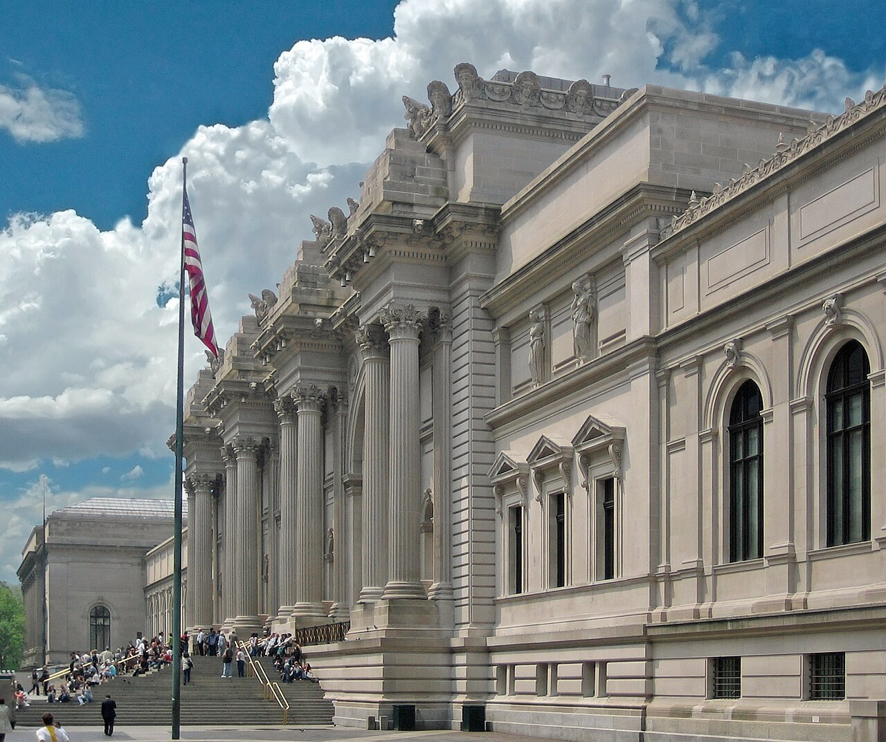
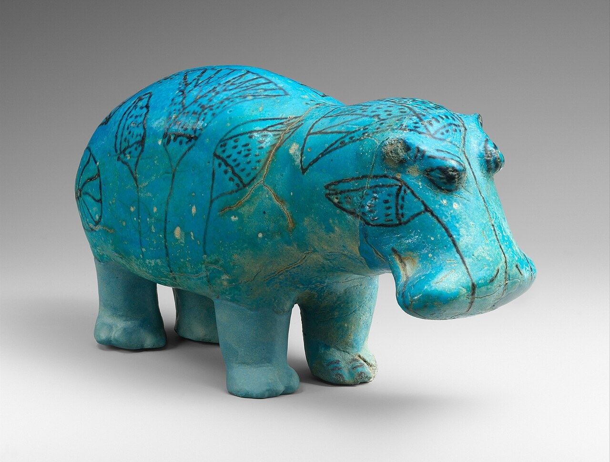
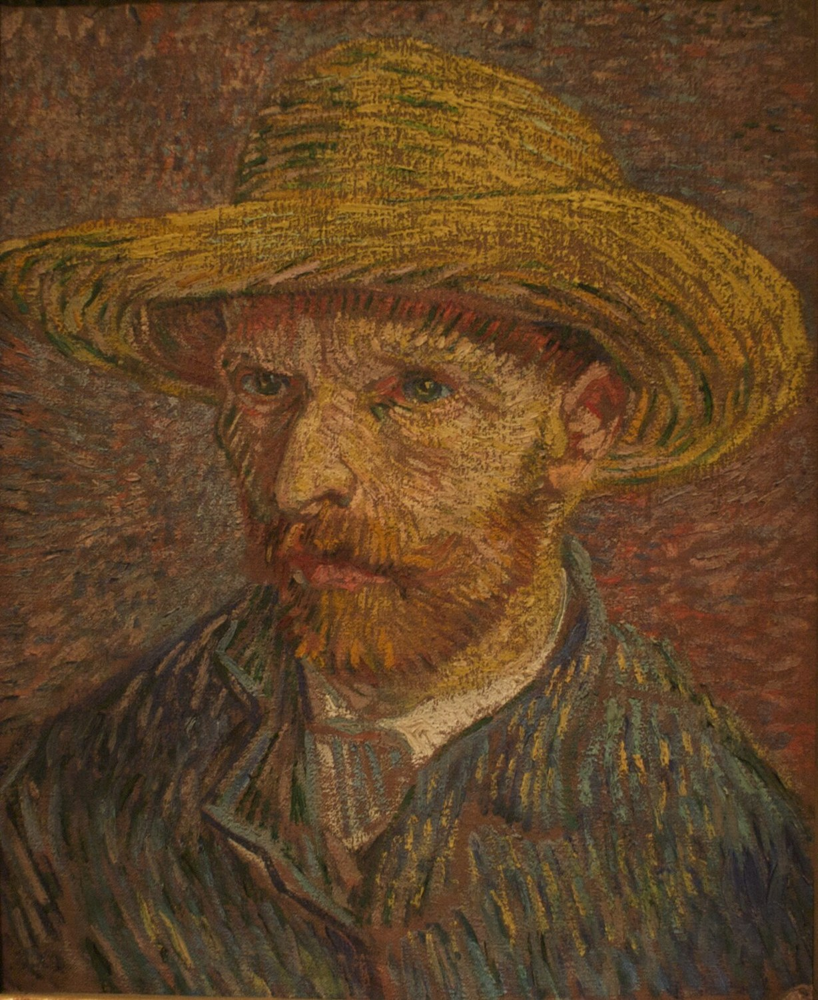
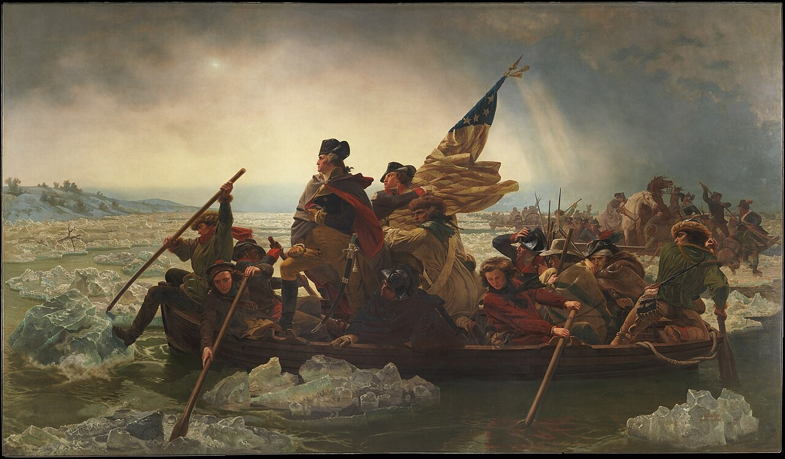

import { tpkDeep } from '../../data/affiliate.js';
export const metTour = tpkDeep('tiqets', 'https://www.tiqets.com/en/new-york-attractions-c260932/tickets-for-the-metropolitan-museum-of-art-skip-the-line-entry-guided-tour-p1086778/', 'tt_met_nyc_tour');

Самый запоминающийся зал Метрополитен-музея легко найти даже в первый раз. Введите **131** в поиск на карте музея. За стеклянной стеной увидите Центральный парк, перед ней — настоящий египетский храм. За два часа на Пятой авеню вполне можно рассмотреть храм, отыскать маленького голубого бегемота и добраться до одной картины, ради которой стоит перейти в другое крыло.

Обычный взрослый билет стоит **30 долларов**. На выбор есть [самостоятельный вход у музея](https://www.metmuseum.org/plan-your-visit) и <a href={metTour} target="_blank" rel="sponsored noopener">двухчасовая экскурсия на английском с билетом</a>. Если хочется подольше задержаться в Египте или перед Ван Гогом, выбирайте самостоятельную прогулку. На неделе Дня благодарения проверьте день ещё до покупки: **в четверг, 26 ноября 2026 года, оба здания закрыты**.

## Какой билет нужен туристу

У The Met два адреса. Храм Дендур и картины европейских художников находятся в **The Met Fifth Avenue**. Средневековые галереи и садовые дворики — в **The Met Cloisters** на севере Манхэттена. Обычный билет действует в обоих зданиях в одну и ту же дату и включает выставки. Второй день для другого здания оплачивается отдельно. Авансовая покупка обычного билета по правилам музея добровольна.

| Кто идёт | Стоимость обычного входа |
|---|---:|
| Взрослый | 30 $ |
| Посетитель от 65 лет | 22 $ |
| Студент по стандартному тарифу | 17 $ |
| Ребёнок до 12 лет включительно | Бесплатно |
| Посетитель с инвалидностью, билет в кассе | 22 $ |
| Сопровождающий, который помогает этому посетителю, билет в кассе | Бесплатно |

По [курсу Банка России на 22 ноября](https://www.cbr.ru/scripts/XML_daily.asp?date_req=22/11/2026) взрослый билет за 30 $ — около **2 466 ₽**. При оплате итог зависит от курса и комиссии банка. Для двух взрослых с двенадцатилетним ребёнком получается **60 $**. Если семья возвращается завтра ради Клойстерс, обычные взрослые билеты на второй день прибавят ещё 60 $. Правило «платите сколько хотите» действует для жителей штата Нью-Йорк и студентов штатов Нью-Йорк, Нью-Джерси и Коннектикут с подтверждающими документами. Адрес отеля в Манхэттене сам по себе такого права не даёт. [Условия и льготы The Met](https://www.metmuseum.org/plan-your-visit).

## Как добраться и когда приходить

В навигаторе укажите **1000 Fifth Avenue**. Главная лестница выходит на Пятую авеню у 82-й улицы, с восточной стороны Центрального парка. Со стороны Лексингтон-авеню удобны поезда метро 4, 5 и 6 до 86th Street. По выходе двигайтесь на запад к парку, затем на юг вдоль Пятой авеню. Если едете с западной стороны Манхэттена, сверьте автобус M79, который пересекает парк. Станция 81st Street на западной стороне находится у другого музея.

Для коляски или кресла удобнее сразу направиться ко **входу без ступеней на Пятой авеню у 81-й улицы**. Там же музей выдаёт ручные кресла по наличию. Маршруты без лестниц отмечены на [интерактивной карте](https://maps.metmuseum.org/). Если приехали с человеком, которому трудно долго стоять, сначала выберите два желанных зала и посмотрите, где между ними лифт. Так проще оценить свои силы, ещё находясь у входа.

В пятницу и субботу главное здание обычно работает с 10:00 до 21:00, в воскресенье — до 17:00. Среда — обычный выходной. На неделе 23–29 ноября к нему добавляется праздничный четверг. Для спокойного вечернего визита в эту неделю подойдут пятница или суббота. Если добираетесь из аэропорта в тот же день, оставьте запас на дорогу и сверяйте часы для своей даты на сайте музея.

## Два часа в музее — три остановки и одна развилка

Предлагаем распределить первые 45 минут между двумя египетскими залами. Затем оставьте около 20 минут на переход, поиск лифта и паузу. Последние 55 минут достанутся живописи. Это расчёт для самостоятельного маршрута после входа. На досмотр и гардероб нужно отдельное время. Если выставочный зал временно закрыт, заменить последнюю остановку проще, чем пытаться перестроить всю прогулку.

**Зал 111. Голубой бегемот Уильям.** Высматривайте небольшую фигурку из ярко-синего египетского фаянса. По бокам и спине идут тонкие чёрные линии, складывающиеся в водные растения. На фотографии легко упустить масштаб. Сначала посмотрите на фигурку издалека, затем подойдите к витрине и разберите рисунок на боку. [Карточка Уильяма в коллекции музея](https://www.metmuseum.org/art/collection/search/544227).

**Зал 131. Храм Дендур.** Здесь меняется масштаб: через несколько залов после маленькой фигурки перед вами целое святилище из песчаника. Оно стояло в Нубии. Сначала отойдите настолько, чтобы увидеть ворота и само здание на одной линии. После этого подойдите ближе к стенам и рассмотрите рельефы. Если идёте с ребёнком, предложите ему найти точку, откуда сквозь первые ворота виден второй проём. [Храм Дендур в каталоге The Met](https://www.metmuseum.org/art/collection/search/547802).

**Дальше выбирайте один зал.** Если любите портреты, идите к Ван Гогу в **825-й**. В автопортрете 1887 года интересно сравнить направление мазков на шляпе, щеке и фоне. У полотна есть оборотная сторона с другой работой художника. Музей показывает [картину на обороте холста](https://www.metmuseum.org/art/collection/search/438722) в отдельной цифровой карточке. [Автопортрет в соломенной шляпе](https://www.metmuseum.org/art/collection/search/436532).

Для любителей больших исторических картин альтернатива — **зал 760** и «Вашингтон переправляется через Делавэр». Эмануэль Лойце написал полотно в 1851 году, спустя десятилетия после изображённой переправы. Посмотрите на фигуры в лодке вблизи, затем отойдите к противоположной стене. Так виднее, как художник направляет взгляд от вёсел и льдин к фигуре Вашингтона. Перед поездкой проверьте строку *On view* в карточках выбранных произведений. [Полотно Лойце в коллекции](https://www.metmuseum.org/art/collection/search/11417).

## Когда имеет смысл экскурсия

У <a href={metTour} target="_blank" rel="sponsored noopener">двухчасовой экскурсии Tiqets</a> вход включён. Второй обычный билет к ней покупать не нужно. Гид ведёт группу на английском и выбирает экспонаты сам. Для путешественника, которому интересны рассказы о коллекции, это удобный формат. Если хотите непременно попасть к конкретной картине, заранее уточните маршрут или запланируйте самостоятельный осмотр после экскурсии.

Место встречи у этого тура находится **внутри**, в главном вестибюле, около большой статуи сидящего фараона справа от входа. Организатор просит подойти за 15 минут до начала. Для тура на 10:30 это означает встречу в 10:15 после входа. В подборке Tiqets на 22 ноября эта экскурсия предлагалась от **72 $ за человека** (около 5 918 ₽), ближайшая указанная дата — 24 ноября. Для двоих ориентир составляет от 144 $ вместо 60 $ за два обычных билета. В карточке указана бесплатная отмена до 24 часов до визита. При опоздании к группе организатор предупреждает об отсутствии возврата. Тариф и наличие мест меняются с датой. Проверьте язык, итоговую сумму для всей группы и срок бесплатной отмены при выборе сеанса.

## Стоит ли успевать в Клойстерс в тот же день

Если главная цель поездки — средневековые шпалеры или монастырские дворики, начинайте с [The Met Cloisters](https://www.metmuseum.org/plan-your-visit/met-cloisters). В ноябре это здание закрывается в 16:30 даже в пятницу и субботу. Музей оценивает прямую поездку на автобусе M4 между двумя площадками примерно в **час и 25 минут**. К этому прибавьте ожидание. Для обычного двухчасового визита обе площадки слишком далеко друг от друга.

Для длинной пятницы работает обратный порядок. Утром осмотрите Клойстерс, пообедайте, затем переезжайте на Пятую авеню, где ещё останется вечер. Сохраните билет до второго входа. При короткой остановке в Нью-Йорке лучше остаться в одном здании. Выберите три экспоната по карте и оставьте последние полчаса тому залу, из которого не захочется уходить.

Документы, связь и расходы на поездку собраны в [путеводителе по США](/usa/).
