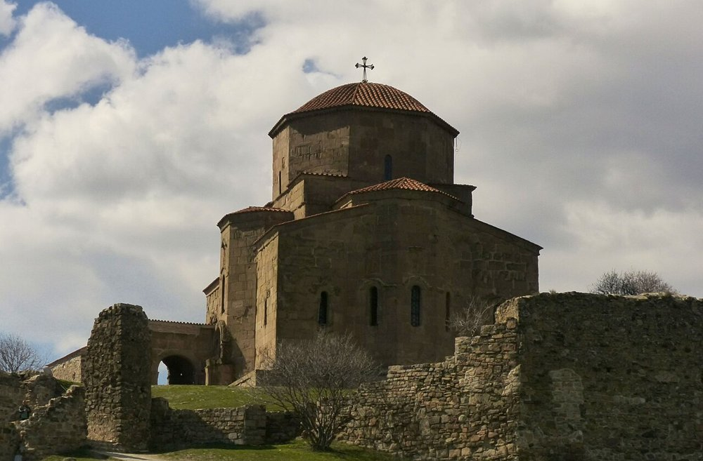
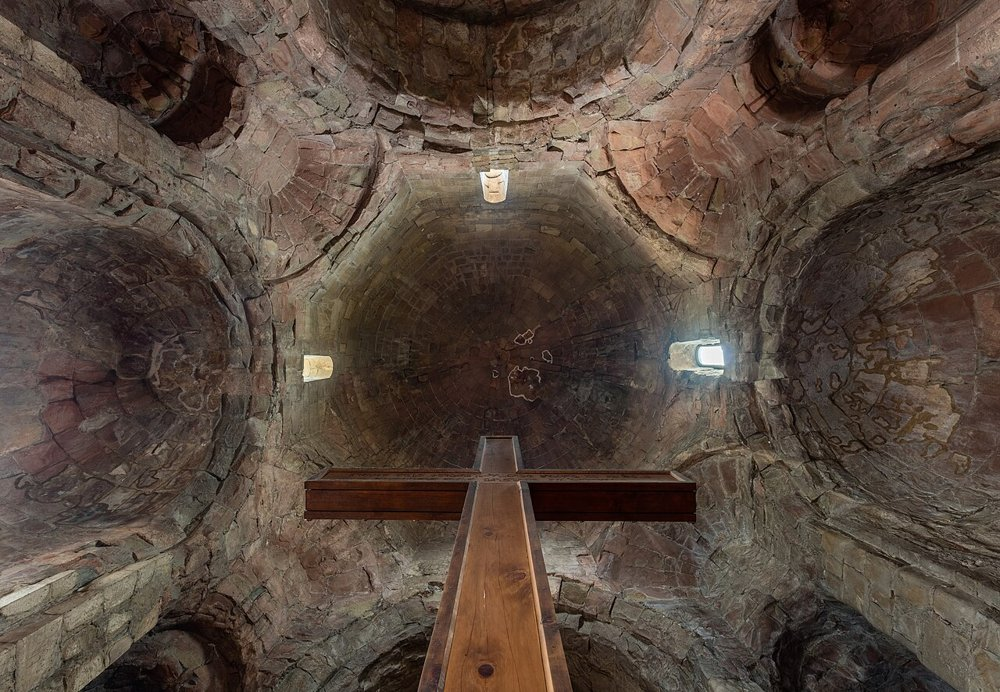
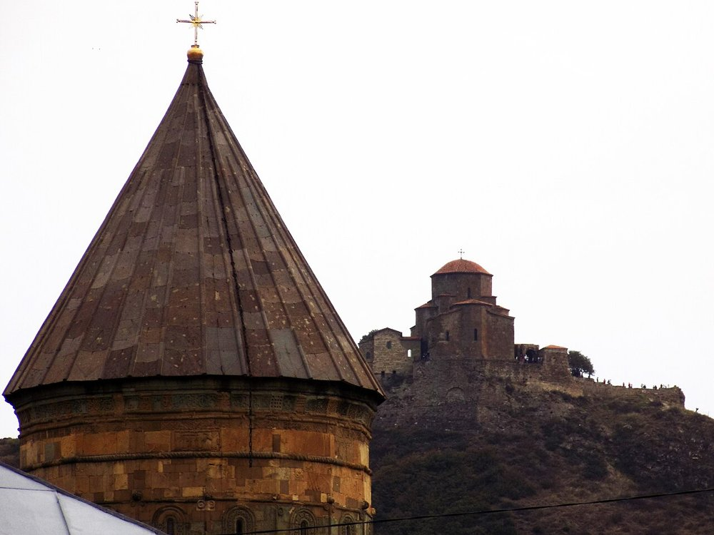
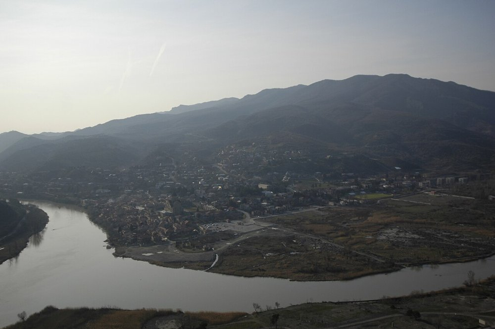

У Джвари есть ловушка: на карте монастырь нависает прямо над Мцхетой, поэтому кажется, что после прогулки по городу можно просто подняться к нему пешком. Но автомобильная дорога идёт в объезд, а удобный и открытый пеший проход нельзя считать само собой разумеющимся. **Договаривайтесь сразу о поездке туда и обратно, с ожиданием у монастыря.** Иначе красивый вид рискует закончиться поисками машины на вершине холма.

Сам Джвари стоит поездки: небольшой каменный храм над слиянием Куры и Арагви, город внизу и длинные складки гор за ним. Здесь хорошо видно, как архитектура работает вместе с ландшафтом. На монастырь оставьте **45–60 минут**, на связку с Мцхетой — **полдня**. Это ориентир для спокойного самостоятельного осмотра, не расписание организованной группы.

Если не хочется договариваться о машине, есть <a href="https://sputnik8.tpk.mx/nIkABzG2?erid=2Vtzqugsszo&amp;sub_id=tt_jvari_tour&amp;u=https%3A%2F%2Fwww.sputnik8.com%2Fru%2Fmtskheta%2Factivities%2F58962-mtsheta-dzhvari-samtavro-kolybel-gruzinskogo-hristianstva" target="_blank" rel="sponsored noopener">четырёхчасовая экскурсия из Тбилиси в Джвари, Мцхету и Самтавро</a>. Её покупают ради транспорта и сопровождения. Отдельного платного входного билета в Джвари для обычного посещения не требуется.

## Что здесь увидеть за один час

Начните с площадки у храма. Внизу встречаются **Арагви и Мтквари**, которую по-русски обычно называют Курой. Среди городских домов выделяется собор Светицховели. Сверху легче понять расположение Мцхеты, чем по схеме: реки, город и храм на высоте складываются в один маршрут.

Потом обойдите церковь по доступной территории. Не спешите сразу внутрь: снаружи заметны выступающие полукруглые части, каменная кладка и рельефы. Здесь полезнее задержаться на нескольких деталях, чем пытаться за десять минут собрать все ракурсы. Для крупного плана возьмите обычный зум телефона; подходить к краю склона ради кадра не нужно.

Внутри внимание притягивают деревянный крест, высота центрального пространства и свет из окон. Это действующий храм. Если идёт служба, отложите съёмку, уберите звук телефона и не проходите между молящимися ради симметричного кадра. Доступность отдельных участков определяется на месте.

Наш ориентир на час: сначала **15–20 минут на панораму**, затем столько же на обход здания и оставшееся время внутри. Если погода мешает стоять снаружи, не пытайтесь «добрать программу» на открытом склоне. Сам храм заслуживает внимания и без длинной фотосессии.

## Почему Джвари знаменит

Большой храм построен в конце **VI — начале VII века**. Его план называют тетраконхом: вокруг центрального пространства расположены четыре апсиды, между ними — ниши. Термин можно забыть сразу после поездки, но сам принцип помогает рассматривать здание: оно воспринимается собранным вокруг середины, а не вытянутым коридором к алтарю.

На фасадах сохранились рельефы и надписи древнегрузинским письмом асомтаврули. Имя архитектора достоверно неизвестно. Поэтому рассказ об одном знаменитом мастере стоит воспринимать осторожно, даже если его уверенно повторяет экскурсовод.

Название Джвари переводится как **«крест»**. Предание связывает место со святой Нино и крестом, установленным в IV веке. Здесь важно не перепутать историю почитаемого места с возрастом каждого предмета: нынешний деревянный крест внутри нельзя автоматически объявлять тем самым древним оригиналом.

Джвари входит в объект Всемирного наследия UNESCO **«Исторические памятники Мцхеты»** вместе со Светицховели и Самтавро. Это хороший повод соединить три остановки: на холме вы увидите ранний храм, внизу — другой масштаб церковной архитектуры и сам город. Получится содержательная половина дня без дальнего переезда по стране.

## Как добраться из Тбилиси

В навигаторе выбирайте **Jvari Monastery у Мцхеты**. В Грузии есть также город Джвари на западе страны. Одно слово в строке поиска способно отправить маршрут совсем в другую сторону; перед заказом машины посмотрите конечную точку на карте.

Из центрального Тбилиси закладывайте ориентировочно **40–60 минут на дорогу в одну сторону**, с поправкой на адрес старта и движение. Автомобильный маршрут идёт по магистрали S1 и дороге Захеси — Джвари. Для возвращения заложите сопоставимый запас, особенно если вечером у вас поезд, самолёт или спектакль.

| Способ | Когда удобен | Что уточнить заранее |
|---|---|---|
| Машина с водителем | Нужен свой темп и несколько остановок | Полная цена, ожидание у храма, заезд в Мцхету, точка возвращения |
| Самостоятельно на автомобиле | Машина уже есть для поездки по Грузии | Дорожная обстановка, парковка на месте, возвращение до темноты |
| Групповая экскурсия | Один путешественник или пара, нужен рассказ | Язык конкретного выезда, размер группы, свободное время |
| Транспорт до Мцхеты плюс отдельная машина | Хотите сначала гулять по городу | Обе части пути; билет до Мцхеты не довозит к монастырю |

Для короткого визита не стоит арендовать автомобиль только из-за Джвари, не сравнив итог с экскурсией или услугой водителя. К аренде добавляются получение и возврат машины, топливо и условия залога. Если автомобиль нужен и для остального отпуска, полезен отдельный [разбор поездки по Грузии на машине](/blog/v-gruziyu-na-mashine-2026/).

Самая полезная фраза при заказе: «Тбилиси — Джвари с ожиданием — Мцхета — Тбилиси». Дальше согласуйте длительность каждой остановки и конечный адрес. Цена «до Джвари» может относиться только к одному плечу. Скриншот согласованного маршрута сохраните до выезда.

## Можно ли подняться из Мцхеты пешком?

**Как обычный прогулочный маршрут для первой поездки — не рекомендуем.** Видимое расстояние через долину не описывает безопасную дорогу. Автомобильный путь от города к монастырю составляет примерно 13 км; на нём нельзя рассчитывать на непрерывный тротуар и удобные переходы.

В старых путеводителях встречаются короткие тропы и советы пройти через служебные территории. Подтверждённого актуального прохода у нас нет. Поэтому мы не предлагаем такой подъём ни семье с детьми, ни самостоятельному туристу, который рассчитывает добраться по описанию без проводника.

Если именно поход — цель дня, выбирайте отдельно проверенный пешеходный маршрут с местным сопровождением. Для посещения Джвари проще сохранить силы на прогулку по Мцхете. Поездка на машине подвозит близко к храму, но доступность всего комплекса для коляски или кресла из этого не следует: ступени, покрытие и помощь на месте нужно согласовать отдельно.

## Сколько стоит поездка

Вход в Джвари для обычного посетителя бесплатный. Основной расход — дорога. Единого тарифа на такси туда, ожидание и возвращение нет, поэтому цифра из чужого отчёта не заменяет предложение на ваш маршрут.

Проверенный вариант для сравнения — групповая экскурсия за **$19, примерно 1 560 ₽, за взрослого от 11 лет**. Детский билет для возраста 1–10 лет — **$15, около 1 230 ₽**. Рублёвые суммы округлены; итог списания зависит от способа оплаты.

| Состав | Расчёт экскурсии | Что добавить к бюджету |
|---|---|---|
| Один взрослый | $19 ≈ 1 560 ₽ | Дорогу к месту сбора и питание |
| Двое взрослых | $38 ≈ 3 120 ₽ | Те же расходы на двоих |
| Двое взрослых и ребёнок 1–10 лет | $53 ≈ 4 350 ₽ | Питание и возможный транспорт после возвращения |
| Компания со своим водителем | Согласованная цена машины ÷ число пассажиров | Платное ожидание, если не включено, и питание |

Эта таблица помогает сравнить одинаковые услуги. Например, предложение водителя на двоих сопоставляйте с **$38 за два взрослых места**, но только если в его сумму входят нужные остановки и возвращение. Доплата за собственный темп может быть оправданной; экскурсия удобнее, когда хочется слушать историю и не заниматься организацией.

Обед не прибавляем выдуманной фиксированной суммой. Выберите заведение по меню и добавьте реальный заказ. Свечи, покупки на сувенирных прилавках и пожертвования тоже не следует считать обязательной частью входа.

## Как выбрать экскурсию и не переплатить за ожидания

У рассмотренной программы заявлены **4 часа, группа до 20 человек и русский язык**. В стоимость входят гид, микроавтобус и вода; ужин оплачивается отдельно. Место сбора — улица Вахтанга Горгасали, 3, в Тбилиси. Забор из вашего отеля не заявлен.

В календаре есть выезд **16 ноября в 12:00**. Это конкретный доступный вариант при подготовке материала, а не обещание мест на любую будущую дату. Программа включает Джвари, Светицховели и Самтавро. Точное место завершения уточните до оплаты: название «из Тбилиси» само по себе не гарантирует возвращение к дверям гостиницы.

Перед покупкой откройте <a href="https://sputnik8.tpk.mx/nIkABzG2?erid=2Vtzqugsszo&amp;sub_id=tt_jvari_booking&amp;u=https%3A%2F%2Fwww.sputnik8.com%2Fru%2Fmtskheta%2Factivities%2F58962-mtsheta-dzhvari-samtavro-kolybel-gruzinskogo-hristianstva" class="aff-cta" target="_blank" rel="sponsored noopener">календарь экскурсии в Мцхету и Джвари</a> и проверьте дату, возрастные билеты и условия возврата. В карточке указана бесплатная отмена за 48 часов. Сохраните условия именно своей брони: они важнее пересказа в любом путеводителе.

Если вас интересует только закат у Джвари, четырёхчасовая дневная программа решает другую задачу. Здесь лучше отдельная машина с оговорённым ожиданием. А если хочется подробно рассмотреть город, спросите, сколько свободного времени оставят в Мцхете: список из трёх остановок не раскрывает темп поездки.

## Маршрут на полдня без гонки

Для самостоятельной поездки удобно сначала подняться в Джвари, затем спуститься в Мцхету. С верхней площадки вы уже увидите, где находится Светицховели, и прогулка внизу станет понятнее. При плохой видимости порядок можно поменять и подождать улучшения погоды в городе.

Наш план: выехать после завтрака, оставить час на монастырь, затем осмотреть центр Мцхеты и Светицховели, пообедать и решить, хватает ли сил на Самтавро. На весь выезд ориентировочно **4–6 часов** с дорогой. Если предпочитаете долго сидеть в кафе и заходить в мастерские, оставьте больше времени, а не сокращайте каждую остановку до фотографии у входа.

Шио-Мгвимский монастырь тоже встречается в маршрутах по окрестностям. Но добавление ещё одного объекта требует отдельного расчёта дороги. Не соглашайтесь на длинный список просто потому, что все названия стоят рядом в рекламном описании.

Семье с маленьким ребёнком разумно оставить два основных пункта: Джвари и центр Мцхеты. Запасная вода, перекус и возможность закончить раньше важнее третьего храма «для галочки». Большой отпуск лучше собирать по [гайду по Грузии](/blog/georgia-guide-2026/), а этот выезд оставить компактным.

## Ветер, сезон и фотографии

Площадка у Джвари открытая. Даже когда в городе комфортно гулять без застёгнутой куртки, наверху ветер способен быстро испортить длинную остановку. Возьмите слой, который защищает от ветра, и обувь с нескользкой подошвой. После дождя осторожнее на камнях; зимой дорожную обстановку лучше обсудить с водителем перед выездом.

Для мягкого света выбирайте утро или время ближе к закату, но не стройте весь визит вокруг фотографии из интернета. Граница между водами двух рек бывает менее заметной, облака закрывают дальние горы, а яркость изображения зависит от обработки. На наших иллюстрациях архивные кадры, а не обещание одинаковой погоды в день вашей поездки.

Закатная поездка требует заранее согласованного возвращения. Сначала узнайте, доступен ли храм в нужный час, затем планируйте съёмку: возможность стоять снаружи не гарантирует открытые двери. Подтверждённого текущего расписания монастыря у нас нет; произвольное «ежедневно до восьми» здесь было бы плохим советом.

Для посещения выбирайте одежду с закрытыми плечами и коленями; женщинам пригодится платок. Правила на входе могут уточнить служители. Не рассчитывайте, что нужную вещь обязательно выдадут бесплатно, и не превращайте место молитвы в съёмочную площадку.

## Что отмечают участники поездок

В десяти видимых отзывах Sputnik за январь–ноябрь 2026 года хвалят компактный маршрут и гидов. Июльский участник упоминает два языка, сентябрьский — нехватку времени на дегустацию. **Выборка непредставительная**, а чужой выезд не обещает одинаковые условия вам.

Уточните язык вашей группы и время на остановках. Дегустацию из отзыва не считайте включённой услугой: ориентируйтесь на подтверждение бронирования.

## Кому поездка подойдёт

Джвари удобен, если хочется увидеть за пределами Тбилиси что-то содержательное без целого дня в машине. Особенно удачна связка с Мцхетой: вид сверху и прогулка внизу объясняют друг друга. Любителю архитектуры стоит оставить время на фасады и интерьер, фотографу — на свет, семье — на спокойный темп.

Поездка разочарует, если вы ждёте большого музейного комплекса с часами экспозиций или гарантированного панорамного кадра в любую погоду. Для человека, которому тяжело стоять на ветру и ходить по неровной поверхности, важнее заранее проверить условия доступа, чем просто купить трансфер.

Перед выездом достаточно пяти проверок: **правильная точка на карте, обратная машина, время ожидания, погода и режим посещения**. После этого можно смотреть на реки и камень, а не на приложение такси. Если полдня свободны, сочетание Джвари и Мцхеты — понятный первый выезд из Тбилиси; с плотным расписанием выбирайте одну остановку и оставляйте запас на дорогу.
