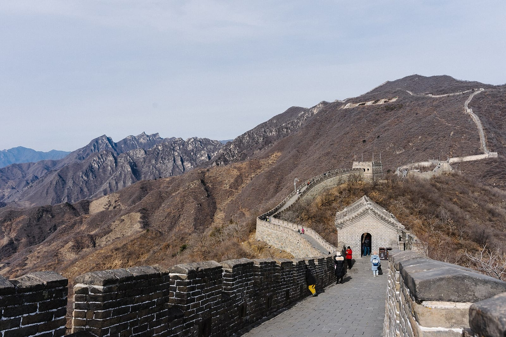
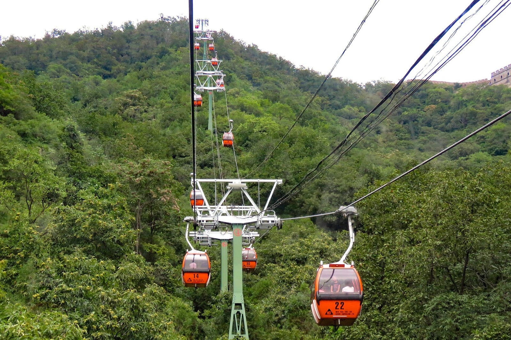
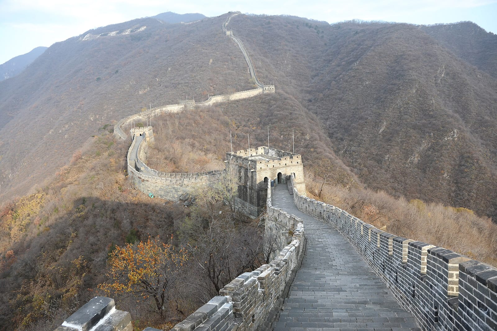

import { tpkDeep } from '../../data/affiliate.js';

export const guidedDay = tpkDeep('sputnik8', 'https://www.sputnik8.com/ru/beijing/activities/86274-velikaya-kitayskaya-stena-hram-neba-nefritovaya-fabrika-i-shou-akrobatiki', 'mutyanyuy_guided_day');

Мутяньюй стоит выбрать ради самой стены: каменных башен, лестниц и длинного гребня среди лесистых гор. Здесь можно сократить подъём канатной дорогой и подобрать прогулку по силам. Но кабина не превращает весь участок в ровную смотровую, а обещание «без толп» не входит ни в один билет.

## Самостоятельно или с русским гидом?

**Если главная цель — свободно гулять по стене, выбирайте самостоятельный день или транспорт без дополнительной программы.** Так не придётся делить время между Мутяньюй, магазинами и городскими достопримечательностями. Обратную дорогу при этом нужно организовать самому.

Русская экскурсия удобнее тем, кто хочет сопровождение и несколько мест за день. У проверенного <a href={guidedDay} rel="sponsored noopener" target="_blank" data-cta="mutyanyuy_guided_day">выезда в Мутяньюй с Храмом Неба и акробатическим шоу</a> есть важные ограничения: входные билеты оплачиваются отдельно, в программу включены нефритовая фабрика и чайная церемония. Это комбинированный день, а не только трансфер к стене. Подробнее о составе и длительности — ниже.

Для первого знакомства без спортивной цели разумно начать с закрытой канатной дороги и короткого отрезка у башен 14–15. Длинный подъём к башне 20 выбирайте по состоянию ног и запасу времени, а не ради обязательной фотографии с самой дальней точки.

## Что посмотреть на стене и как построить прогулку

Участок интересен чередованием видов. С открытой дорожки видна линия стены по хребту; у башни можно рассмотреть кладку, бойницы и изгибы следующего подъёма. Не пытайтесь пройти всё по одному общему времени из путеводителя: ступени, остановки и очередь на спуск меняют темп.

Оператор предлагает два полезных для первого визита варианта:

| План | Последовательность | Кому подходит |
|---|---|---|
| Короткая прогулка | Северный вход, закрытая канатная дорога к башне 14, башня 15 и возвращение | Если важнее виды, чем большой набор высоты |
| Длинный выход | Участок у башни 14, движение к башне 20, возвращение к подъёмнику у 14 | Если готовы к лестницам и оставили запас на обратный путь |

В длинном варианте спуск начинается после возвращения к башне 14. Дойти до 20-й и считать прогулку законченной нельзя: до кабины ещё нужно вернуться. Не рассчитывайте, что подъёмник ждёт последнего гуляющего.

В опубликованной памятке оператора для дневного посещения открыт участок **башен 1–20**. Упоминание большего общего числа башен в стороннем описании не даёт права пройти дальше ограждения. Ночной билет тоже не следует выводить из обычного дневного расписания: для него нужны отдельная программа и свои условия.

Для самой прогулки запланируйте несколько часов, а для выезда из Пекина — день целиком. Это ориентир для планирования, не измеренное автором время маршрута. Не ставьте после стены ранний поезд или перелёт без отдельного запаса на дорогу.

## Канатная дорога, кресла и тобогган — разные покупки

В Мутяньюй легко купить не тот обратный спуск. **Закрытая канатная дорога и компания кресельного подъёмника с санной трассой — разные операторы. Их билеты не взаимозаменяемы.** Если купили закрытые кабины туда-обратно, возвращайтесь ими же.

Тобогган — спуск в тележке по жёлобу. Его не стоит считать обязательным завершением любой прогулки: выбор зависит от условий работы, ограничений самого аттракциона и вашего желания. Если хотите подняться одним способом, а спуститься другим, до оплаты проверьте два отдельных права проезда. Общая надпись «канатная дорога включена» не отвечает на этот вопрос.

В счёте за посещение различайте четыре части:

| За что платите | Что уточнить |
|---|---|
| Вход в туристическую зону | Дата и документ конкретного гостя |
| Внутренний шаттл | Поездка внутри комплекса; он не довозит из Пекина |
| Подъём и спуск | Какая компания, один путь или оба, где возвращаться |
| Дорога из города | Точка отправления, ожидание и обратный трансфер |

Льгота на вход не означает такую же льготу на шаттл или подъёмник. Для ребёнка сверяйте условия каждого компонента; нельзя переносить правила бесплатного прохода китайских детей на всех иностранных гостей.

## Как добраться из Пекина

Мутяньюй находится в деревне Mutianyu, посёлке Bohai, районе Huairou. В поиске транспорта используйте именно **Mutianyu / 慕田峪长城**, а не общее название Великой Китайской стены: оно может привести к другому участку.

Официальный портал Пекина описывает общественный маршрут: **916 Express от Dongzhimen до Huairou Beidajie**, затем местный **H23, H3 или H71** до туристической зоны Мутяньюй. Это поездка с пересадкой, после которой остаётся разобраться с внутренним подходом к стене.

До выезда проверьте обратную пересадку и часы местного автобуса. Из приведённой схемы нельзя вывести, что автобус ходит в любое время до закрытия стены. Такси на последнем отрезке тоже не отменяет необходимости вернуться в Пекин.

Для машины с водителем заранее согласуйте не только поездку туда, но и место ожидания, время отъезда и цену обратного пути. Слово «трансфер» в карточке билета может означать внутренний шаттл, городской туристический автобус или индивидуальную машину — сравнивать их по одному названию нельзя.

Поездку из аэропорта рассматривайте только после решения вопроса о выходе в город и времени до следующего рейса. [Разбор пересадки в Пекине](/blog/peresadka-v-pekine/) нужен для этого раньше, чем покупка экскурсии. Мутяньюй не стоит превращать в обязательную остановку на короткой стыковке.

## Паспорт, бронирование и часы

Билет оформляется на реальный документ гостя; на вход берите **оригинал паспорта**, использованного при бронировании. Оператор указывает возможность брони за **15 дней**, один билет на документ в день. У посредника проверяйте его отдельный порядок подтверждения и получения ваучера.

Для самостоятельной поездки [откройте бронирование на официальном сайте Мутяньюй](https://en.mutianyugreatwall.com/reservation-center/tickets). До оплаты проверьте выбранные услуги и доступный способ расчёта: наличие английской страницы само по себе не подтверждает приём вашей иностранной карты.

С **16 марта по 15 ноября** опубликованы часы **7:30–18:00 в будни**, **7:30–18:30 в субботу и воскресенье**. С **16 ноября по 15 марта — 8:00–17:30**. Продажа прекращается за час, контроль билетов — за полчаса до закрытия. Приходить к кассе в последний момент — плохой план даже без очереди.

Это не дополнительное время на прогулку после закрытия. Обратный подъёмник, шаттл и дорога к машине должны поместиться в ваш вечер. Перед зимним выездом отдельно учитывайте погоду и состояние ступеней, а не только более короткий рабочий день.

## Сезон, дети и физическая нагрузка

На фотографиях зелёный и безлистный Мутяньюй выглядят по-разному — это разные сезоны одного участка. Дата поездки влияет и на вид, и на одежду. Для выбора времени в Китае пригодится [гайд по регионам и месяцам](/blog/china-guide-2026/); прогноз на день выезда всё равно нужен отдельно.

Для семьи удобство начинается с короткого маршрута и понятного возвращения. Кабина помогает подняться, но не убирает лестницы со стены. Если ребёнок устал у первой башни, возможность развернуться полезнее желания выполнить длинный маршрут. Коляску не стоит планировать как транспорт по всему гребню лишь потому, что в карточке продавца есть общая отметка доступности.

Наденьте обувь с цепкой подошвой и возьмите воду. Одежду выбирайте для открытого горного участка, где придётся и идти, и ждать. При скользких ступенях или сильном ветре сокращение прогулки разумнее попытки добраться до дальней башни любой ценой.

Не рассчитывайте на гарантированно пустую стену к открытию. В видимом отзыве проверенной русской экскурсии путешественница отдельно жалуется на большое число посетителей. Один отзыв не измеряет загруженность каждого дня, но обещание прогулки без людей он точно не поддерживает.

## Что входит в проверенную русскую экскурсию

У выезда Sputnik8 с посещением Мутяньюй заявлены русскоязычное сопровождение, транспорт и вода, мини-группа до десяти участников. **Вход на стену, Храм Неба, акробатическое шоу и обед не входят в базовую цену услуги.** Уточните, какой именно набор подъёмников подразумевает отдельная доплата за стену.

В программе есть нефритовая фабрика и чайная церемония. Тем, кто хочет провести весь день на стене, такой состав не подойдёт. Тем, кто предпочитает несколько организованных остановок с русским гидом, он может быть удобен — после проверки полной суммы и длительности.

Есть и конкретное расхождение: в шапке указано **девять часов**, а опубликованные пункты программы идут **с 08:00 до 19:00**. До оплаты согласуйте реальное окончание и место высадки. Наличие доступной даты в календаре не решает это противоречие и не гарантирует, что день уложится до вашего вечернего рейса.

Выбирайте по главной цели: **стена и свой темп — самостоятельная поездка; весь день с сопровождением — экскурсия с понятными остановками и доплатами**. В обоих случаях сначала решите, как поднимаетесь и возвращаетесь, затем покупайте соответствующие билеты.
