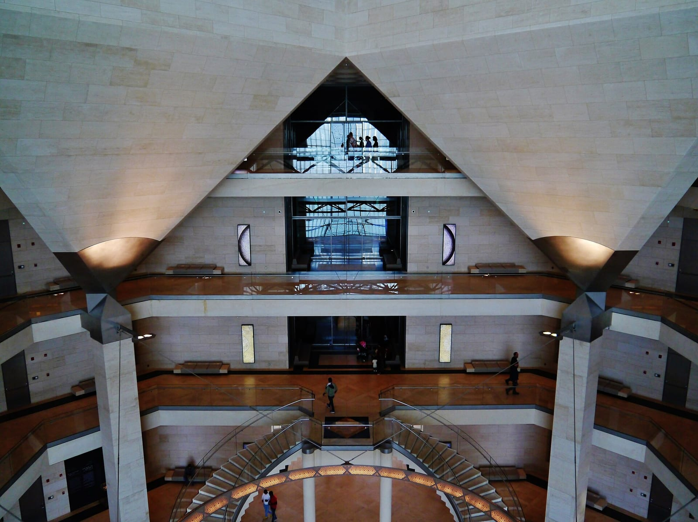
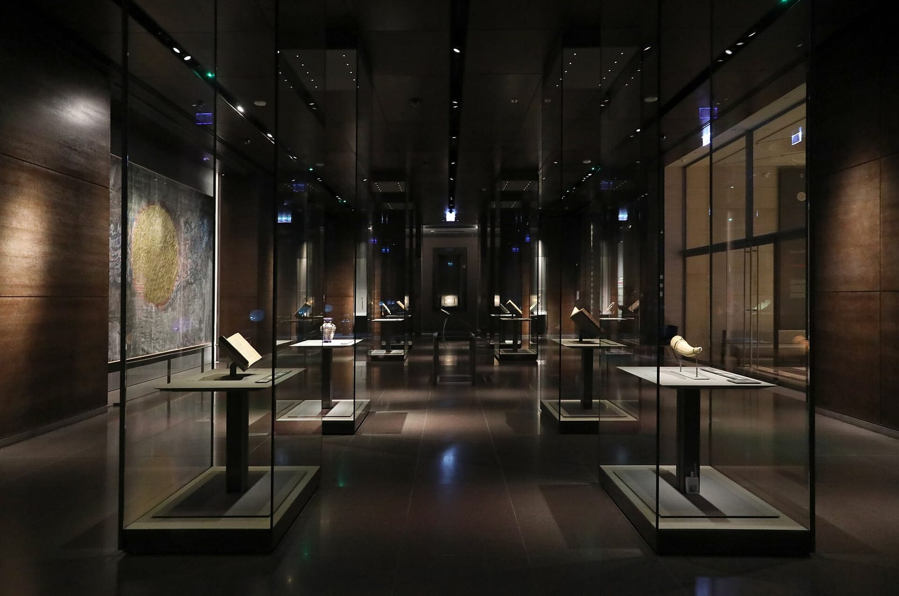
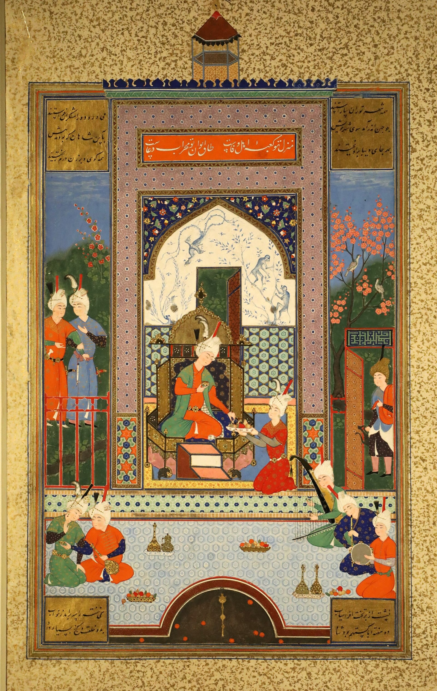
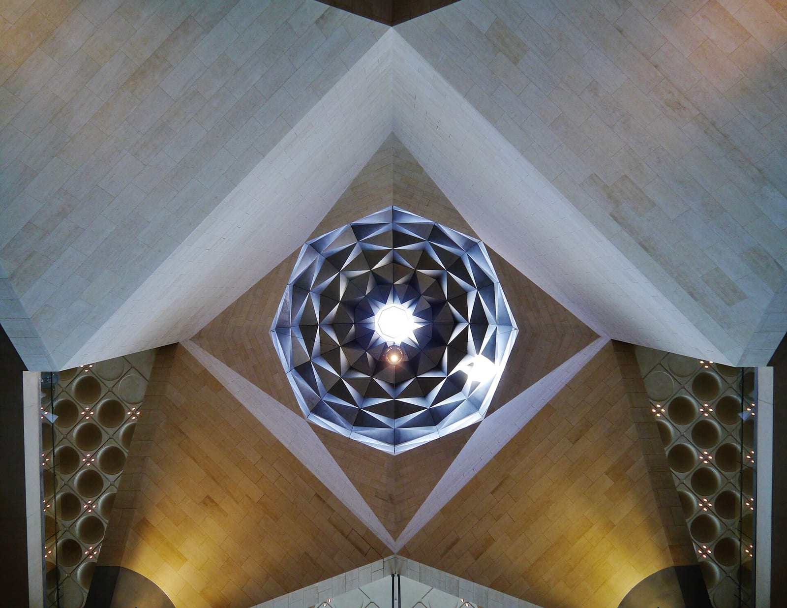

**В Музей исламского искусства в Дохе стоит идти на два часа или дольше — ради коллекции, света в огромном атриуме и прогулки у залива.** Главная ошибка при планировании — оставить музей на среду: в этот день MIA закрыт. В пятницу он открывается только в 13:30. Парк рядом работает круглосуточно, но доступ в парк не означает доступ в залы.

MIA — Museum of Islamic Art, музей на набережной Корниш. Он подойдёт тем, кто любит архитектуру, украшения, старые книги, керамику и необычные исторические предметы. Здесь можно собрать интересный короткий маршрут, даже если вы не различаете династии и никогда не читали историю исламского искусства. Для поездки на несколько часов сначала определите, что важнее: пять произведений, фотография интерьера или прогулка вдоль воды.

[Проверить официальный билет MIA](https://qm.org.qa/tickets/select-tickets/?exhibition-deeplink=mia-plus-special-exhibitions) можно у Qatar Museums. Выбирайте нужную дату и категорию посетителя: актуальный тариф на будущий день пока не подтверждён, поэтому старые суммы из путеводителей здесь не приводим.

## Почему этот музей заслуживает отдельного посещения

MIA открылся в 2008 году; его спроектировал Бэй Юймин, известный также как I. M. Pei. Собрание охватывает VII–XX века и три континента, от Испании до Китая. Среди вещей есть предметы религиозной жизни, дворцовые заказы и повседневная утварь. Поэтому название «исламское искусство» не стоит понимать как выставку только о религии или только о Катаре.

Интереснее смотреть на связи между вещами: как менялись орнаменты, зачем дорогую книгу делали с золотыми буквами, как художник превращал обычный сосуд в предмет роскоши. У витрины полезно читать не всю этикетку подряд, а три строки: где предмет появился, когда и из чего сделан. Так даже незнакомое имя правителя перестаёт мешать осмотру.

После обновления музей вновь открылся 5 октября 2022 года. Постоянная экспозиция включает 18 галерей, организованных по темам, эпохам и географии. Для первого визита не обязательно пытаться равномерно осмотреть каждую. Начните с вводной галереи, затем выберите рукописи, науку или декоративное искусство — то, что действительно хочется рассматривать.

## Как выбрать день и купить билет

На момент проверки 18 ноября 2026 года музей публикует такое расписание. Время местное, Дохи; перед визитом сверяйте [официальную страницу посещения](https://mia.org.qa/en/visit/), особенно в праздники.

| День | Часы работы |
|---|---|
| Суббота, воскресенье, понедельник, вторник | 09:00–19:00 |
| Среда | Закрыто |
| Четверг | 09:00–21:00 |
| Пятница | 13:30–19:00 |

Для спокойного осмотра в четверг удобно оставить вечер: продлённые часы дают больше свободы после дневной прогулки. Это совет по расписанию, а не гарантия пустых залов. В пятницу не назначайте музей первой утренней остановкой. Если в распоряжении только среда, выбирайте другой музей с проверенным расписанием или оставляйте прогулку вокруг MIA.

По правилам музея билет действует на **один вход в выбранный день**, не возвращается и не обменивается. Обычный вход включает постоянную коллекцию и временные выставки. Билет можно получить на месте или заранее через официальный сайт; онлайн выбирается время. Поэтому перекус и длинную прогулку по парку разумнее поставить после окончательного выхода из залов.

Перед оплатой проверьте название Museum of Islamic Art, дату, категорию каждого участника и итог заказа. Не переносите условия возврата стороннего продавца на официальный билет. Сообщение об отсутствии билетов на одной дате также не доказывает, что музей распродан на неделю: сначала проверьте, открыт ли он в этот день.

## Как добраться и сколько времени оставить

На карте и в приложении такси задавайте **Museum of Islamic Art, Doha**, а не просто «музей Катара». У Национального музея Катара другое здание и другая экспозиция. Сверьте конечную точку с картой на сайте MIA до подтверждения поездки.

Такси удобно, если времени мало, на улице жарко или вы едете с ребёнком. Музей указывает стоянку такси внутри парковочной зоны; машину также можно поймать на Корнише за главными воротами. На собственной машине учитывайте ограниченное число мест: во время крупных событий в MIA Park парковку закрывают. Гарантировать место у входа нельзя.

Если выбираете общественный транспорт, стройте маршрут до конкретного входа и отдельно смотрите последний пеший участок. Точка метро на карте не означает, что вы окажетесь сразу у музейной двери. Прогулка под солнцем, поиск выхода со станции и переходы занимают время сверх поездки в вагоне.

На сам музей администрация рекомендует **не меньше двух часов**. Наш ориентир для всей остановки — около трёх часов вместе с входным контролем и короткой прогулкой после осмотра; дорога из вашего района добавляется отдельно. При авиапересадке сначала посчитайте доступное городское время по [гиду о пересадке в Дохе](/blog/peresadka-v-dokhe/). Музейное расписание не решает вопросы въезда, багажа и возвращения к рейсу.

## Маршрут по музею на два часа

Это редакционный план первого знакомства, а не норматив скорости. Порядок можно менять по текущей навигации и доступности залов. Если заинтересует временная выставка, отдайте ей часть времени вместо попытки добавить ещё один час к уже плотной программе.

| Время | Остановка | На что смотреть |
|---|---|---|
| Первые 15 минут | Атриум и рассказ об архитектуре | Лестница, свет сверху, окно на залив |
| Следующие 30 минут | Вводная галерея | Несколько главных произведений и их происхождение |
| Следующие 35 минут | Рукописи и галереи знания | Почерк, материалы, научные приборы |
| Ещё 25 минут | Выбранная эпоха или регион | Сходства и различия стекла, металла, тканей |
| Последние 15 минут | Возвращение к понравившейся вещи | Рассмотреть деталь, которую сначала пропустили |

Во вводной галерее удобно выбрать собственный «якорь»: один предмет, ради которого вы готовы задержаться. Затем ищите похожий материал или форму в других залах. Такой способ помогает не превратить музей в череду витрин, которые быстро сливаются в памяти.

Галереи 4 и 5 посвящены обучению, науке и технологии. Это хороший поворот маршрута для тех, кому после рукописей хочется понять практическую сторону истории. С детьми можно устроить простое задание: найти предмет, который помогал человеку измерять, считать или ориентироваться, и вместе прочитать его описание.

## Пять вещей, которые стоит научиться замечать

**Лист Голубого Корана.** Золотые строки на окрашенном в синий цвет пергаменте впечатляют даже без знания арабского. Рассмотрите ритм букв и свободное пространство. Происхождение и датировку этой рукописи исследователи продолжают обсуждать: не стоит привязывать её к одной бесспорной истории.

**Ваза Кавура.** Это стеклянный сосуд из Дамаска середины XIV века, украшенный эмалью и золотом. Интересно сравнить тонкий материал с плотным рисунком: на расстоянии вещь может восприниматься совсем иначе, чем вблизи.

**Астролябия аль-Худжанди.** В собрании есть подписанный латунный инструмент 984–985 годов. Здесь особенно хорошо видно соседство науки и мастерства: попробуйте разглядеть деления и устройство деталей, а затем прочитайте объяснение их назначения.

**Страница «Шахнаме» шаха Тахмаспа.** Миниатюра XVI века соединяет текст и живопись. Начните с общей композиции, затем приблизьтесь к человеческим фигурам и мелким цветовым деталям.

**Османские доспехи.** Комплект конца XV — начала XVI века даёт совсем другой масштаб, чем страница книги. Сравните поверхности металла, соединения и то, как декоративная работа соседствует с защитной функцией.

Эти произведения представлены в каталоге музея. Перед поездкой проверьте текущую экспозицию, если ради одного предмета готовы менять маршрут: наличие в собрании не гарантирует, что вещь всегда выставлена.

## Архитектура: куда смотреть помимо витрин

Снаружи здание кажется собранным из простых светлых объёмов. Известняковая облицовка меняется вместе со светом и тенью; внутри строгую геометрию продолжают узоры, лестница и купол. На осмотр атриума стоит оставить время до коллекции, пока внимание ещё не устало.

Поднимите голову: свет проходит через верхнее отверстие и ложится на грани купола. Ниже находится круглая металлическая люстра, перекликающаяся с изгибом двойной лестницы. Северное окно высотой 45 метров открывает вид через залив. Это три разные фотографии — вверх, в глубину атриума и наружу — вместо десятка почти одинаковых кадров лестницы.

На телефон начинайте с обычной камеры, затем сравните с широкоугольной. Следите, чтобы вертикали не заваливались, а люди в кадре помогали показать масштаб. Эти приёмы не требуют штатива и позволяют снимать, не перекрывая проход. Для портрета выбирайте разрешённое место у естественного света и не задерживайте других посетителей.

## Одежда, фотографии и посещение с детьми

В музей приходят с закрытыми плечами и коленями; при неподходящей одежде во входе могут отказать. На досмотре проверяют сумки. Небольшую можно взять с собой, крупную нужно оставить в предусмотренном месте. Не рассчитывайте без отдельного уточнения использовать музей как камеру хранения большого аэропортового багажа.

Личная некоммерческая съёмка при имеющемся освещении разрешена, если у конкретной выставки или произведения не указано обратное. **Вспышка, штатив и селфи-палка запрещены.** Перед фотографией проверяйте знак у витрины; в залах нельзя есть и пить.

Дети младше 12 лет должны постоянно находиться со взрослым. Для первого визита лучше выбрать несколько предметов разного типа, чем требовать прочитать все подписи. После книги предложите найти сосуд, после сосуда — доспех: смена масштаба помогает удержать интерес. Это вариант семейного маршрута, а не обещание специальной детской программы.

Общественные пространства музея доступны посетителям на колясках; на стойке обслуживания есть ограниченное число кресел для использования внутри. Если нужна конкретная помощь, свяжитесь с музеем заранее. Само наличие оборудования не означает, что оно свободно в любую минуту.

## После залов: парк, залив и вечерний город

MIA Park открыт круглосуточно. Здесь можно продолжить прогулку вдоль воды, посмотреть на West Bay и сделать паузу после закрытых залов. Круглосуточный режим парка не распространяется автоматически на кафе, прокат, выставки или отдельные мероприятия.

По набережной можно дойти к скульптуре **«7» Ричарда Серры**. Она собрана из семи стальных пластин и открыта в 2011 году; художника для этой работы рекомендовал сам Бэй Юймин. После музейных миниатюр и стекла это хорошая смена масштаба — большое произведение на открытом воздухе, рядом с водой.

Наш совет — не назначать парк обязательным продолжением в жаркий полдень. Перенесите длинную прогулку на более комфортное время, а внутри выделите больше внимания коллекции. Сочетание музея, Корниша и вечернего Сук-Вакифа поможет собрать день без второго большого музея; остальные остановки выбирайте по [гиду по Катару](/qatar/).

## Кому выбрать другой план

Если хочется прежде всего разобраться в истории самого Катара, сначала сравните MIA с Национальным музеем. Если нужны только виды и воздух, достаточно прогулки по набережной и парку по действующим правилам доступа. Если до возвращения в аэропорт осталось мало времени, не пытайтесь вместить полную музейную программу в короткое окно.

В одной [дискуссии посетителей на Reddit](https://www.reddit.com/r/qatar/comments/1d1qhko/which_museum_is_more_recommended_to_visit_qatar/), прочитанной 18 ноября 2026 года, мнения о двух музеях расходятся: одних привлекают история страны и её подача, других — собрание искусства и архитектура MIA. Это одна открытая ветка, а не репрезентативный опрос; точная дата её публикации не установлена. Для решения полезнее ответить себе, хочется ли сегодня читать историю страны или рассматривать вещи из разных культур.

Перед выходом проверьте четыре пункта: **музей открыт, дата билета верная, одежда подходит, обратная дорога помещается в ваш день**. Затем выберите пять интересных вещей и оставьте время вернуться к одной из них. Так у визита будет своя тема, а время не уйдёт только на переходы между витринами.
