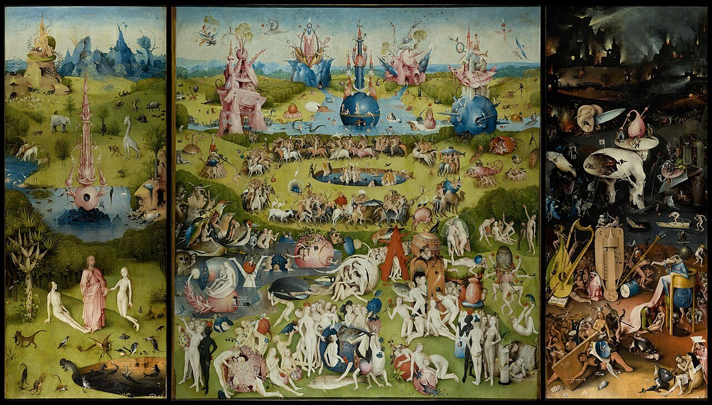
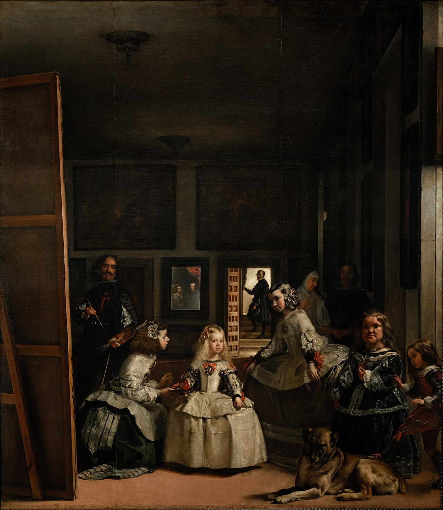
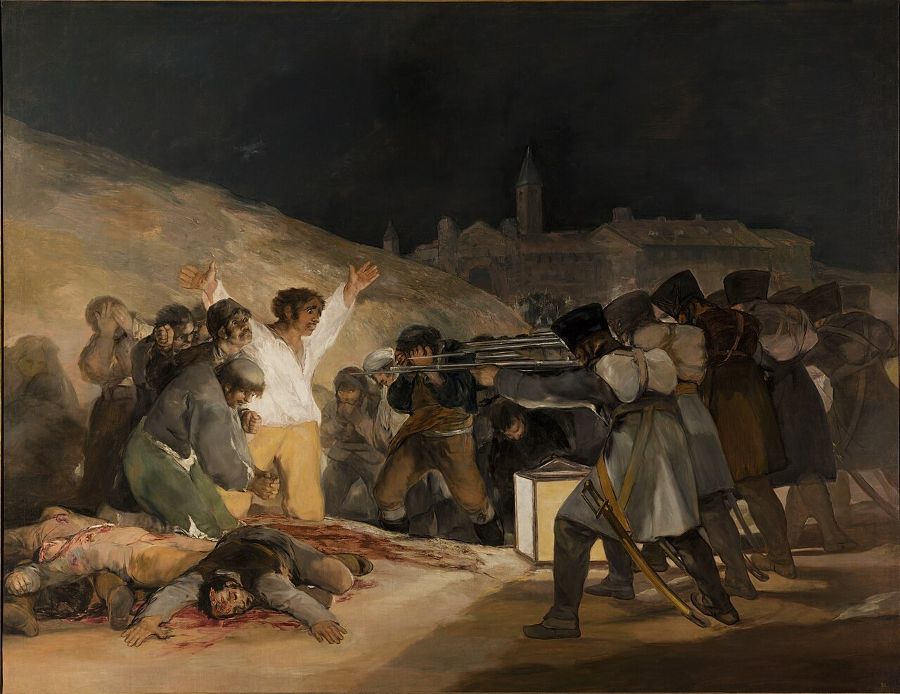
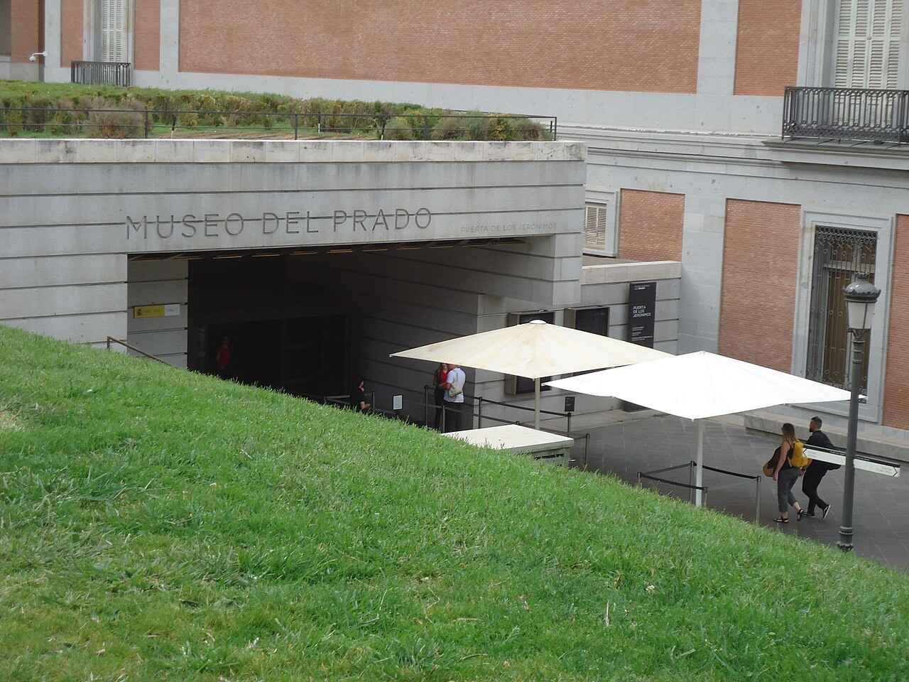

import { tpkDeep } from '../../data/affiliate.js';
export const pradoTicket = tpkDeep('tiqets', 'https://www.tiqets.com/en/madrid-attractions-c66254/tickets-for-prado-museum-p974035/', 'tt_prado_madrid_ticket');

В Прадо пускают бесплатно последние два часа, но после очереди может остаться всего 20 минут перед картинами. Если первым делом хотите увидеть «Менины», запомните **зал 12 на первом этаже**. Ради Босха и Гойи можно остаться на нулевом: «Сад земных наслаждений» в зале **56A**, «Третье мая» в **64**. Обе работы можно посмотреть за короткий визит без перехода между этажами.

Обычный вход стоит **15 €** в [кассе музея](https://entradas.museodelprado.es/). У <a href={pradoTicket} target="_blank" rel="sponsored noopener">Tiqets есть билет в постоянную коллекцию через вход Херонимос</a>. На 23 ноября на карточке была указана цена **18 €**. Сравните итог на выбранную дату. Если знаете, что хотите смотреть, берите обычный билет. Экскурсия имеет смысл, когда хочется разобраться, как Веласкес включил в сцену себя и зрителя и почему у Босха на одной картине три разных мира.

## Когда стоит заплатить и когда идти бесплатно

| Сценарий | Цена для взрослого | Что учесть |
|---|---:|---|
| Самостоятельный вход в коллекцию | 15 € | В официальной кассе выбирайте «Colección». У выставок с ограничением по числу посетителей отдельный сеанс |
| Обычный вход и аудиогид | 20 € | Аудиогид стоит 5 €. Сверьте язык в форме заказа |
| Бесплатный вечер | 0 € | Понедельник — суббота с 18:00 до 20:00. Воскресенье и праздники с 17:00 до 19:00 при обычном расписании |
| Билет Tiqets в коллекцию | 18 € по карточке на 23 ноября | Показываете билет на телефоне у Херонимос. Проход через контроль безопасности сохраняется |

По [курсу Банка России, действовавшему 23 ноября](https://www.cbr.ru/scripts/XML_daily.asp?date_req=23/11/2026) билет за 15 € стоил примерно **1 355 ₽**, билет за 18 € — **1 626 ₽**. Для двоих ориентир 30 € у музея против 36 € у посредника. Банк и продавец могут считать сумму по другому курсу.

Для первого визита с несколькими обязательными залами стоит взять обычный билет на начало дня. Если после прогулки по городу хочется увидеть одну-две конкретные работы и нормально постоять в очереди, подойдёт бесплатный вечер. Для временной выставки с отдельными сеансами в официальной кассе открывайте **Colección + Exposiciones** и проверяйте название экспозиции. Для выставок с вечерней скидкой ищите **Exposiciones en horario de precio reducido**. Для этого тарифа действует скидка 50%, а список выставок и исключения зависят от даты. [Официальный регламент тарифов Прадо](https://content3.cdnprado.net/doclinks/pdf/visita/resolucion2020_normativa03_2026.pdf).

В условиях Tiqets билет указан как невозвратный. На той же странице есть инструкция, как запросить смену даты через музей, но в разделе условий переноса он отмечен как недоступный. Если день поездки ещё может измениться, проверьте условия конкретного заказа до оплаты. <a href={pradoTicket} target="_blank" rel="sponsored noopener">Смотреть условия билета и выбрать дату</a>.

## Сколько времени останется после очереди

По регламенту Прадо впускает посетителей **до 30 минут перед закрытием**, а просит выходить из залов **за 10 минут**. Если в будний день вы прошли контроль в 18:30, до 19:50 остаётся 80 минут на картины и переходы. Если вошли у границы допуска в 19:30, остаётся около 20 минут. В воскресенье при обычном расписании сдвиньте оба примера на час раньше. Время считайте от прохода, потому что продолжительность очереди меняется. [Регламент посещения Прадо](https://content3.cdnprado.net/doclinks/pdf/visita/normativaMNP_2026-03-12.pdf).

- **До 20 минут.** Выберите одну работу и сразу спросите дорогу к залу. За «Менинами» поднимайтесь на первый этаж. Если важнее Босх, оставайтесь на нулевом.
- **45–80 минут.** На нулевом этаже посмотрите Босха в 56A и Гойю в 64. Оставьте время на выход и очередь у гардероба, если сдавали вещи.
- **Два часа в залах.** Начните с того, ради чего пришли. После «Менин» спуститесь к Босху и Гойе. На каждую остановку можно заложить 20–25 минут. В остаток входят переходы, пауза и одна работа по пути.

В декабрьской и январской поездке важны исключения. **24 и 31 декабря, а также 6 января** музей работает с 10:00 до 14:00 по обычному праздничному регламенту. **25 декабря, 1 января и 1 мая** закрыт. Обычные два часа бесплатного посещения в сокращённые дни отменяются. [Часы и исключения](https://www.esmadrid.com/en/tourist-information/museo-del-prado).

## Три картины и детали, которые стоит рассмотреть

### Босх, «Сад земных наслаждений», зал 56A

Триптих легко читать слева направо. Начните со спокойной левой створки, потом сравните её с перенаселённой центральной панелью. Справа найдите музыкальные инструменты среди тёмных сцен. Отойдите на шаг и попробуйте увидеть, как при совершенно разном настроении створки продолжают друг друга по линии горизонта. Если на Босха осталось десять минут, начните с линии горизонта, а потом выберите по одной детали на каждой створке.

### Веласкес, «Менины», зал 12

В центре стоит инфанта Маргарита. Слева видно художника с кистью, а позади группы на стене висит маленькое зеркало. Попробуйте проследить, куда смотрят Веласкес, девочка и фигуры рядом. Зеркало замечают последним, хотя именно оно помогает понять, почему персонажи так часто смотрят в вашу сторону. Потом переведите взгляд с зеркала на светлый проём в глубине зала. Эта диагональ добавляет картине глубины.

### Гойя, «Третье мая 1808 года в Мадриде», зал 64

Сначала посмотрите, откуда идёт свет. Фонарь на земле освещает людей перед солдатами. У человека в белой рубахе видны лицо и раскрытые руки, лица стрелков художник скрывает. Если времени хватает, сравните с «Вторым мая». Эти полотна рассказывают о соседних днях, но меняют точку зрения с уличной схватки на расстрел. На [плане Прадо](https://servicios.museodelprado.es/doclinks/pdf/visita/plano/m/2025/plano_ing.pdf?v=20250314) «Третье мая» отмечено в зале 64. Перед поездкой сверяйте объявления о временных закрытиях.

## Как найти вход и спланировать остальной день

В навигаторе ищите **Museo Nacional del Prado**, Paseo del Prado. Со стороны площади Сибелес удобна станция **Banco de España, L2**, с юга — **Estación del Arte, L1**. У музея несколько дверей. Кассы Гойи ищите со стороны Calle Felipe IV. Для билета Tiqets ориентир **Puerta de Jerónimos**. Музей может направлять посетителей к разным входам в зависимости от загрузки. Уточните у сотрудника, в какой очереди стоят за бесплатным билетом, прежде чем вставать в конец.

Для посетителей с ограниченной мобильностью Херонимос — вход с приоритетом. Музей принимает предварительные обращения по доступности на accesibilidad@museodelprado.es. До 18 лет вход бесплатный. В 12–17 лет возраст нужно подтвердить документом в кассе. При индивидуальном посещении детям младше 12 лет подтверждать возраст не нужно. Посетитель младше 14 лет должен быть со взрослым весь визит. [Правила Прадо](https://content3.cdnprado.net/doclinks/pdf/visita/normativaMNP_2026-03-12.pdf).

Большую сумку лучше оставить в гостинице. Вещи, которые не проходят через сканер, нельзя пронести в музей или сдать в гардероб. Сумки от 40 см, которые проходят досмотр, нужно оставить в бесплатном гардеробе. В залах постоянной коллекции и временных выставок съёмка запрещена. Сфотографировать интерьер можно в вестибюле Херонимос, Зале муз и клуатре. Билет рассчитан на один вход. Если хочется кофе или прогулки в [парке Ретиро](/blog/park-retiro-madrid/), оставьте их на потом. А если музеи займут два дня, посмотрите, [в каком районе Мадрида искать жильё](/blog/madrid-gde-ostanovitsya/), чтобы оба раза дойти пешком.
