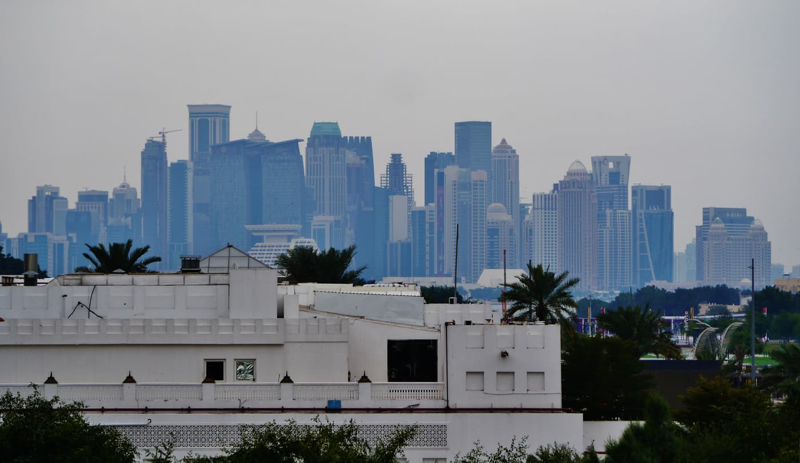
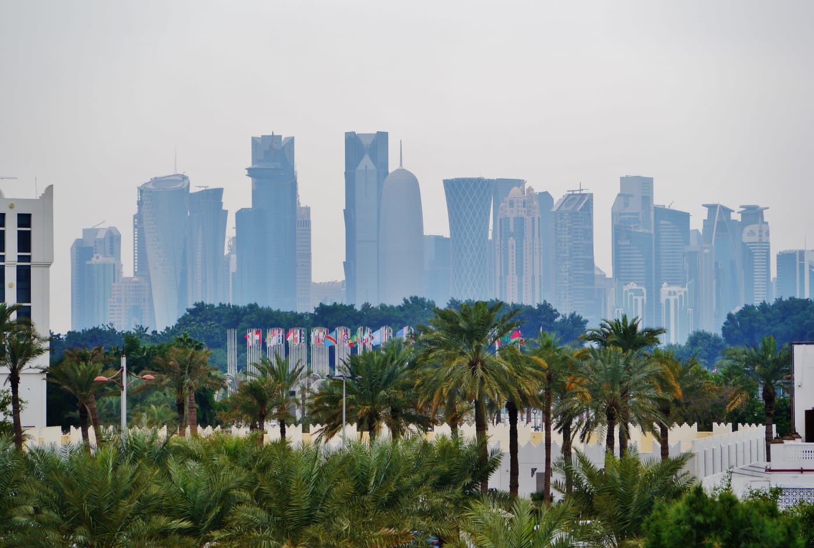
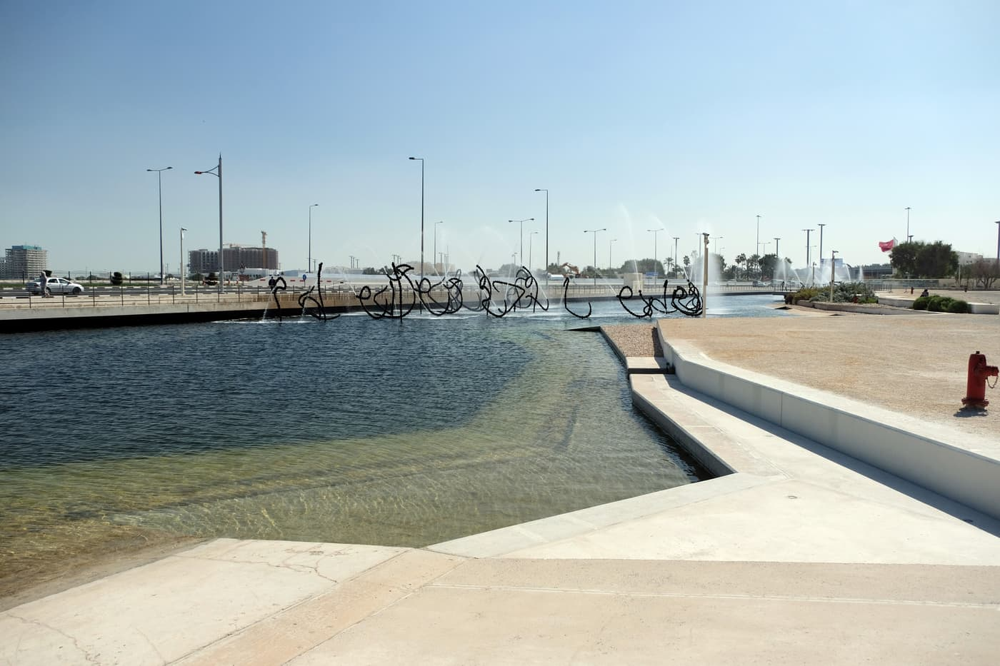
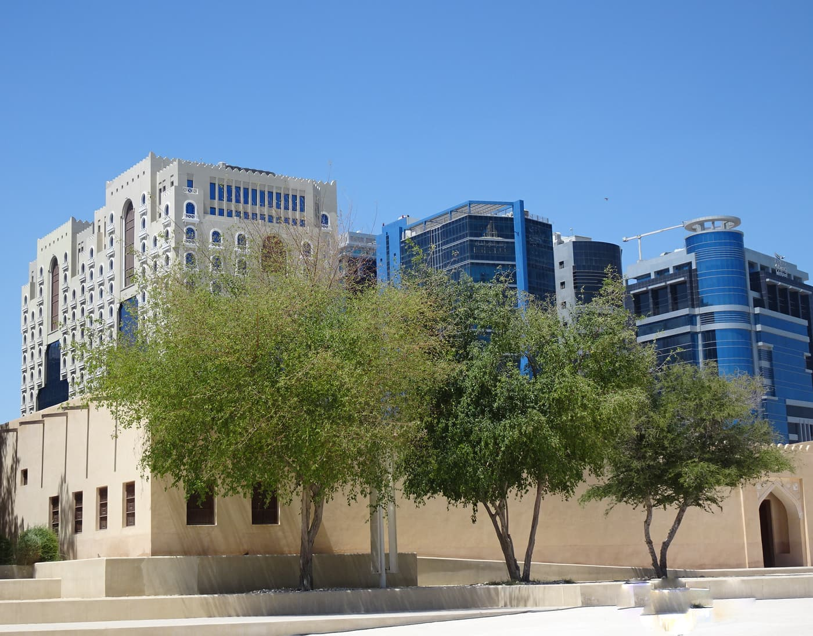

**В Национальном музее Катара можно узнать, как жемчуг из Персидского залива попал на ковёр, заказанный индийским махараджей.** В галерее «Жемчуг и праздники» стоят инструменты, которыми торговец сортировал жемчуг по размеру. Здесь же выставлен ковёр из Бароды. Такой маршрут подойдёт тем, кто впервые в Дохе и хочет понять, чем жили на полуострове до появления нефтяных доходов.

Первым делом выберите день. Во вторник музей закрыт, в четверг работает дольше обычного. [Официальный билет Qatar Museums](https://qm.org.qa/tickets/select-tickets/?exhibition-deeplink=nmoq-plus-special-exhibitions) действует на один вход в выбранную дату и включает выставки музея. Перед оплатой проверьте название **National Museum of Qatar (NMoQ)**. У Музея исламского искусства другой вход, другая коллекция и другой выходной.

## В какой день идти и сколько времени оставить

У расписания есть деталь, которая меняет весь вечер. За 45 минут до закрытия музей прекращает вход и начинает освобождать галереи. Если на дверях указано 19:00, начинать знакомство с коллекцией в 18:15 уже поздно. Даже если вы приехали с электронным билетом и сразу нашли нужную дверь.

| День | Работа музея | Когда начинают освобождать залы |
|---|---|---|
| Воскресенье, понедельник, среда, суббота | 09:00–19:00 | 18:15 |
| Вторник | Выходной | Галереи закрыты |
| Четверг | 09:00–21:00 | 20:15 |
| Пятница | 13:30–19:00 | 18:15 |

Последний столбец рассчитан по [правилу музея](https://nmoq.org.qa/en/visit/). Например, в четверг можно начать осмотр в 18:00, выделить на залы два часа и выйти до начала их закрытия. В среду те же билеты на самолёт и тот же свободный вечер дадут совсем другую прогулку. А пятничное утро лучше оставить под другие планы.

Для первого посещения мы бы выделили около двух часов внутри, отдельно от дороги, поиска входа и остановки поесть. Это редакционная оценка для маршрута с несколькими остановками. Если любите досматривать фильмы до финальных титров или пришли на временную выставку, выгоднее выбрать утреннее окно и оставить следующий пункт программы открытым. Музей предупреждает, что на время работ отдельные галереи могут закрывать. Особенно важно уточнить это, если едете ради одного предмета.

## Как найти вход и зачем смотреть на здание со двора

В метро Дохи вам нужна станция **National Museum** на золотой линии. Для такси вводите английское название целиком. Если в приложении конечной точкой оказался *Museum of Islamic Art* на набережной, исправьте адрес до заказа машины. Обратный путь тоже лучше построить заранее, особенно вечером в четверг, когда часы музея и ваше привычное расписание транспорта могут расходиться.

Архитектор Жан Нувель взял за образец пустынную розу — природное образование из сросшихся кристаллов. На фотографиях издали видны большие светлые диски, а во дворе внимание переключается на старый дворец шейха Абдаллы бин Джасима Аль Тани. Соседство двух зданий объясняет замысел яснее, чем отдельный снимок фасада. Музей о появлении современного государства окружает место, где часть его истории происходила на самом деле.

Для прогулки вокруг здания оставьте дневной свет. Если собираетесь приехать поздно, зайдите во двор до галерей, пока ещё видны силуэты города. При коротком визите ходить вокруг всего комплекса необязательно. Один взгляд через двор на старую застройку даст больше контекста для следующего часа, чем серия фотографий с одинакового расстояния.

## Что смотреть внутри, если вы здесь впервые

Одиннадцать галерей собраны в три главы. Начало посвящено формированию полуострова и его природной среде, середина — жизни людей у моря и в пустыне, последняя часть — истории современного Катара. Удобно заранее выбрать по одному предмету или сюжету в каждой главе. Тогда у перехода между залами понятно, что вы уже увидели и на что ещё хотите потратить время.

**Начало полуострова.** Попробуйте начать с фильма о геологическом прошлом Катара. Среди реконструированных обитателей древних вод есть панцирная рыба *Qataraspis deprofundis*. Этот зал задаёт масштаб времени. Вышедший из моря полуостров, морской промысел и торговля жемчугом в следующих галереях оказываются частями одной истории. С ребёнком можно начать с простого задания — найти в фильме рыбу и посмотреть, чем она отличается от современных.

**Жизнь на суше и у воды.** Перейдите от карты к повседневным вещам. Шатёр помогает представить дом, который приходилось собирать и переносить; городские сцены показывают торговлю, дворы и рынки. В фильме Абдеррахмана Сиссако товары прибывают в город на судах доу с моря и на верблюдах из пустыни. Обратите внимание, где сходятся два маршрута. Именно об этих связях рассказывают предметы, которые по отдельности легко принять за красивые старые вещи.

**Современная история.** В последней главе меняется вопрос: как страна, чьи жители жили промыслом и торговлей, стала государством, которое турист видит за окнами? Если времени осталось немного, не начинайте очередной длинный фильм. Лучше оставить несколько минут на хронологию и затем вернуться к виду на город. [Описание галерей](https://nmoq.org.qa/en/visit/galleries/) можно открыть и после посещения, чтобы восстановить имена и порядок событий.

## Жемчужный ковёр из Бароды и работа ловцов жемчуга

[Ковёр из Бароды](https://qm.org.qa/en/stories/all-stories/baroda-carpet/) изготовили в Индии с использованием тысяч мелких жемчужин из Персидского залива. Подойдите к нему после витрины торговца. У продавца сохранились приспособления для измерения и сортировки: различия в размере, едва заметные издалека, имели цену. А теперь посмотрите на поверхность ковра. Труд по добыче и отбору жемчуга становится виден даже без точной цифры, сколько бусин нашито на полотно.

В этом же разделе идёт фильм Миры Наир «Дыхание». Историю сезонного промысла режиссёр рассказывает через семью: мужчина уходит в море, его жена остаётся ждать на берегу. После такого рассказа иначе воспринимаются украшения, музыкальные инструменты и праздничная одежда в соседних витринах. Возвращение ловцов означало окончание месяцев разлуки. Если располагаете временем только на один фильм, для знакомства с этой частью коллекции мы бы выбрали именно его.

## Как работает билет и что взять с собой

Билет привязан к дате, пройти по нему можно один раз. По [правилам NMoQ](https://nmoq.org.qa/en/visit/visitor-guidelines/) обмен и возврат не предусмотрены. Если хотите пообедать вне музея, безопаснее сделать это до первого входа или после осмотра. Покупка с расчётом «выйдем посередине и вернёмся по тому же коду» оставляет семью у турникета с лишней проблемой.

Билет продаётся и на месте. При покупке на сайте сначала выбирают билет, затем дату. Сохраните подтверждение так, чтобы QR-код открылся без подключения к сети. Цену и доступные интервалы смотрите после выбора даты. Если календарь не загрузился, по одной ошибке виджета трудно понять, раскуплены ли билеты. Если день поездки фиксирован, узнайте у музея о продаже в кассе до выезда.

Плечи и колени должны быть закрыты. Большие сумки попросят оставить в гардеробе. Для личного снимка в разрешённом зале можно воспользоваться телефоном, вспышку нужно выключить. Штатив и селфи-палку лучше оставить в отеле. У отдельной работы могут действовать дополнительные ограничения, поэтому перед съёмкой посмотрите на значок у витрины.

## Какой музей выбрать за одну пересадку

Если в городе всего несколько часов, выберите одну задачу. Здесь проще разобраться в истории Катара, жемчужном промысле и жизни до нефтяного бума. За рукописями, керамикой и искусством разных стран лучше идти в [Музей исламского искусства](/blog/muzey-islamskogo-iskusstva-doha/). Во вторник национальный музей закрыт, а в среду закрыт MIA. Одно название в закладках может спасти весь план.

Начните расчёт от времени, к которому нужно вернуться в аэропорт. Учтите выход из терминала, дорогу в обе стороны и прохождение контроля. Из остатка вычтите время от станции до входа. Если получилось всего сорок минут, не покупайте невозвратный билет, ожидая успеть пройти все три главы. Варианты на разную длину стыковки разобраны в [гиде по пересадке в Дохе](/blog/peresadka-v-dokhe/).

## Если идёте с ребёнком или хотите спокойной прогулки

Два фильма, дворец и один предмет, который ребёнок выбрал сам, — вполне полноценный визит. Начните с древних животных, затем предложите поискать инструменты торговца и решить, как отсортировать жемчужины без электронных весов. Так не придётся читать вслух каждую табличку. Если ребёнку некомфортно в затемнённых залах с большим экраном, пропустите показ и перейдите к витринам. При планировании паузы помните про однократный вход.

Тем, кто приехал ради архитектуры, стоит поменять пропорции: больше времени отвести двору и видам со стороны старого дворца, а внутри выбрать одну главу. И наоборот, если главная цель — ковёр, спросите при входе, доступна ли галерея *Pearls and Celebrations* сегодня. Это полезнее, чем идти по всем одиннадцати залам и только в конце узнать о закрытом участке.

Для вечера в Дохе наиболее гибок четверг. Утро пятницы лучше провести в другом месте. Перед покупкой билета проверьте три вещи: открыта ли нужная галерея, остаётся ли время до начала освобождения залов и сможете ли вы воспользоваться билетом именно в эту дату.
