Фотографии показывают сами места; часть кадров сделана в другой сезон. Они не подтверждают погоду или программу встречи 2027 года.

## Город, архитектура и короткая дорога

### 1. Казань — прогулки и татарская кухня

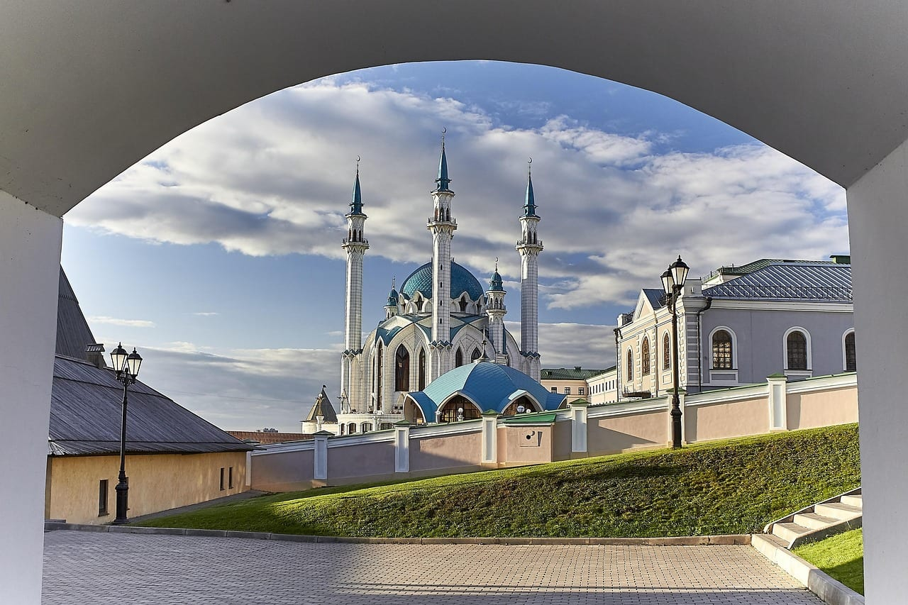

Для пары или семьи, которой нужен город с понятным центром: Кремль, Старо-Татарская слобода и перерывы на горячую еду. Планируйте день так, чтобы чередовать улицу и помещения: сильный мороз способен сократить прогулки.

Из Москвы — самолёт примерно 1,5–2 часа либо ночной поезд. **Условный бюджет на двоих за четыре ночи — 104–116 тыс. ₽** при исходных ценах и резервах ниже; платные шоу и банкет отдельно. Это расчёт, не готовый тур. Если главная цель — развлечения на улице весь день, погода может помешать.

<a href="https://aviasales.tpk.mx/JCSPlC17?erid=2Vtzqxkn4LF&amp;sub_id=ny2027_kazan&amp;u=https%3A%2F%2Fwww.aviasales.ru%2Fsearch%2FMOW1512KZN1" target="_blank" rel="sponsored noopener">Перепроверить перелёт Москва — Казань на свои даты</a>. Это общий поиск маршрута, а не бронь по сумме из примера.

### 2. Калининград — Балтика без обещания снега

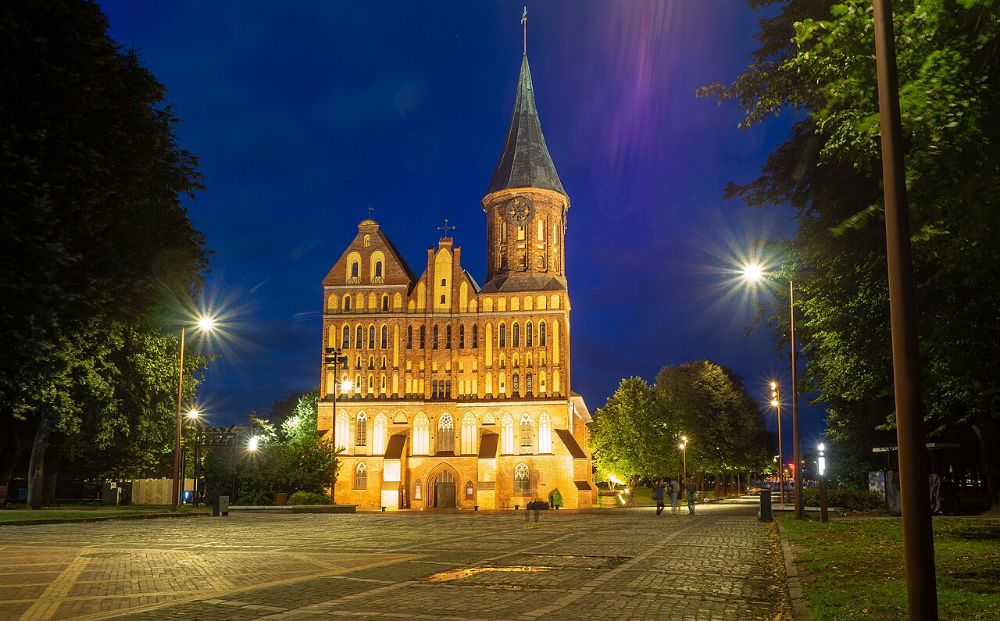

Подходит любителям архитектуры, музеев и прогулок у зимнего моря. Город можно дополнить одним выездом в Зеленоградск или Светлогорск; пытаться объехать всё побережье за короткие каникулы необязательно.

Прямой перелёт из Москвы занимает около трёх часов. **Условный расчёт на двоих за четыре ночи — 165–183 тыс. ₽**: в найденных котировках именно дорога дороже казанской. Оттепель, дождь и ветер обычнее сказочных сугробов. Выбирайте жильё рядом с дневным маршрутом, чтобы не зависеть от постоянного такси.

<a href="https://aviasales.tpk.mx/JCSPlC17?erid=2Vtzqxkn4LF&amp;sub_id=ny2027_kaliningrad&amp;u=https%3A%2F%2Fwww.aviasales.ru%2Fsearch%2FMOW1512KGD1" target="_blank" rel="sponsored noopener">Перепроверить перелёт Москва — Калининград на свои даты</a>. Сравнивайте одинаковый багаж и время прибытия.

### 3. Петербург — культурные каникулы

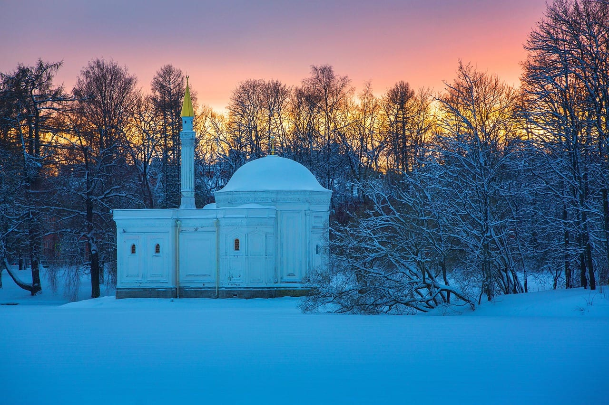

Для тех, кому интереснее театр, дворцы и музеи, чем обязательный уличный концерт. Из Москвы удобно ехать скоростным или ночным поездом; заложите примерно четыре часа только на скоростной участок, а дорогу до отеля считайте отдельно.

В [опубликованном четырёхдневном пакете](https://lira-servis.ru/tury-v-sankt-peterburg/prazdnichnye/na-novyy-god-i-rozhdestvo/) 31.12–03.01 показаны 19 624 ₽ с человека по акции и 22 300 ₽ стандартно, при размещении вдвоём. Для двоих — ориентировочно 39,2–44,6 тыс. ₽ за сам пакет, не всю поездку. Уточните питание, дорогу и банкет. Главный минус — сырой ветер и очереди на популярные сеансы.

### 4. Кострома — сказка с ребёнком после полуночи

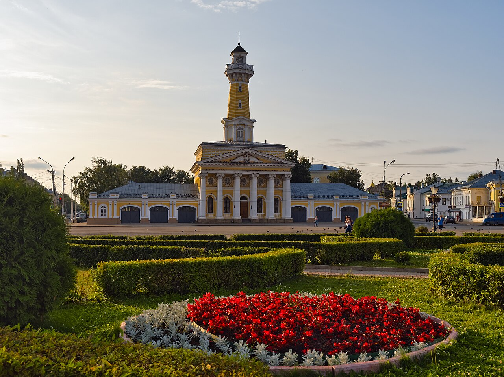

Подходит семье, которая хочет тематическую программу со Снегурочкой, а не ночное гулянье. Из Москвы — поезд или автомобиль; ориентир 4–6 часов зависит от рейса и дороги.

Пример на **5–7 января: 207 350 ₽ за двух взрослых и ребёнка 2–12 лет**, в [семейной программе](https://travel-s-child.ru/tours/russia/67107/) с отелем, двумя завтраками, тремя обедами и экскурсиями. Дорога и ужины отдельно. Это дорогой организованный вариант, а не минимальная цена Костромы. Для короткой самостоятельной поездки посчитайте жильё и отдельный детский сеанс заново; сначала проверьте доступность программы.

### 5. Турция — городской праздник вместо пляжа

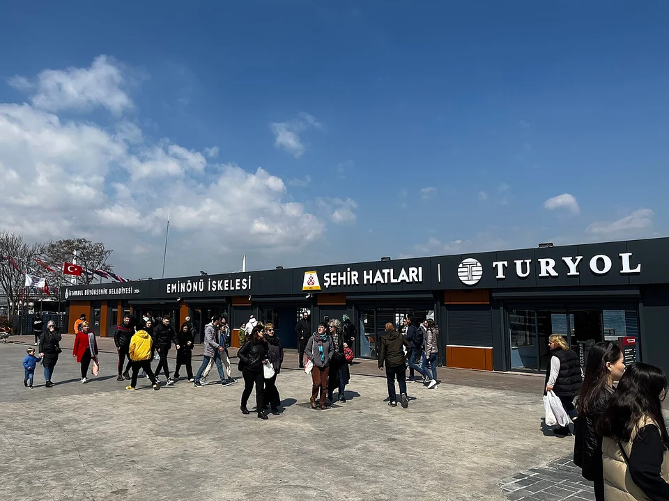

Для прогулок, кухни и смены обстановки выбирайте Стамбул; зимнюю поездку на побережье стройте вокруг отеля и его программы, а не ежедневного купания. Прямой перелёт из Москвы до Стамбула — ориентировочно 4–5 часов.

Медианы пакетов 3★/4★ — **147–214 тыс. ₽ на двоих, 6–8 ночей**; дешёвая выборка преимущественно стамбульская. Главный риск — купить морской курорт, ожидая летней погоды.

## Снег, лес, катание и северное сияние

### 6. Шерегеш — когда катание важнее банкета

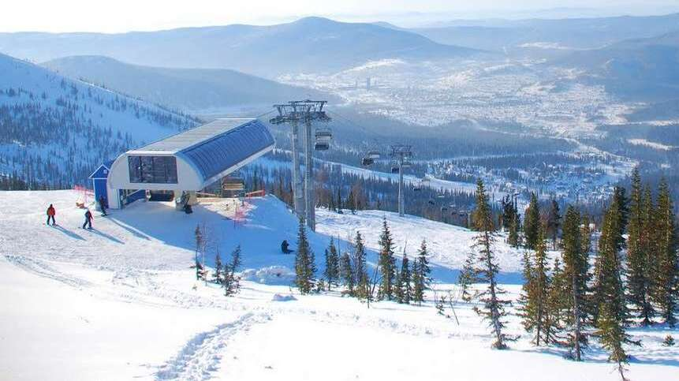

Для тех, кто собирается выходить на склон несколько дней. Новичку важны инструктор и учебный сектор, опытному лыжнику — дорога от жилья к нужным подъёмникам. Мороз и ветер могут ограничить катание; фрирайд не становится безопасным из-за репутации курорта.

Через Новокузнецк нужно сочетать перелёт с отдельным трансфером. В другом маршруте, [пакете из Барнаула](https://youtravel.me/tours/19089/новый_год_в_шерегеше_4_дня), 30.12–02.01 заявлено **от 76 тыс. ₽ на двоих на поездку**: коттедж, завтраки, фуршет и наземная перевозка. Путь из Барнаула занимает 6–8 часов. Перелёт туда, ски-пасс, прокат и часть питания оплачиваются сверх этой суммы.

### 7. Карелия — одна база и короткие выезды

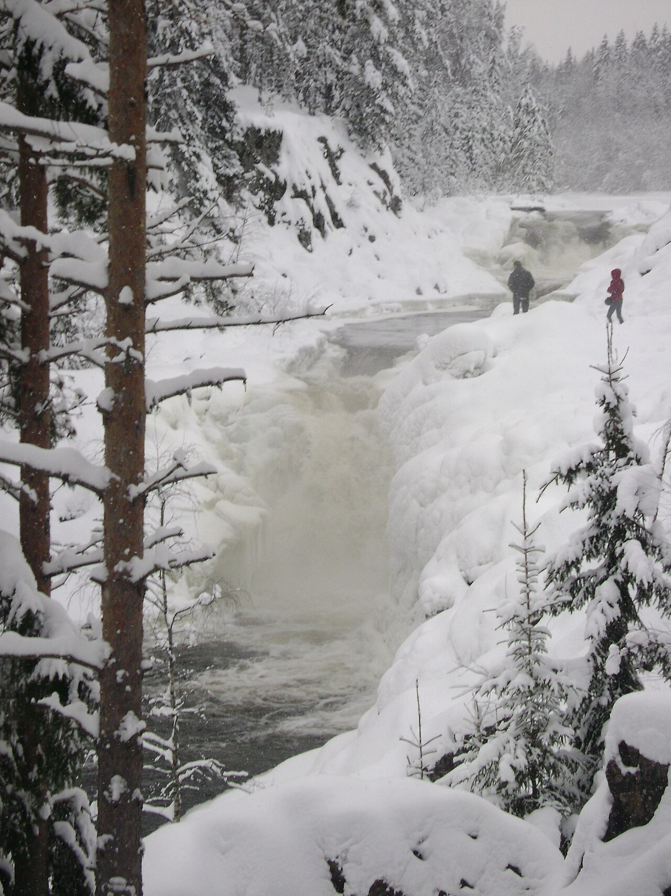

Для спокойного отдыха выбирайте дом с понятным зимним подъездом; для экскурсионного — городскую базу. Сортавала удобна для Рускеалы, Петрозаводск — для другого набора поездок. Не все достопримечательности республики близки друг к другу.

Дорога из Москвы — ночной поезд и дальнейший трансфер. [Пакет 31.12–03.01](https://karelia-lines.ru/novyj-god-v-karelii/karelskij-novyj-god.html) с тремя ночами, завтраками, обедами и местной программой стоит **от 97,8 тыс. ₽ на двоих**. Поезд, ужины и необязательный банкет отдельно. Это ориентир экскурсионного отдыха, не аренды тихого дома. Главные ограничения — транспорт и переменчивая погода; выходить на лёд по чужим фотографиям нельзя.

### 8. Мурманск — несколько попыток увидеть сияние

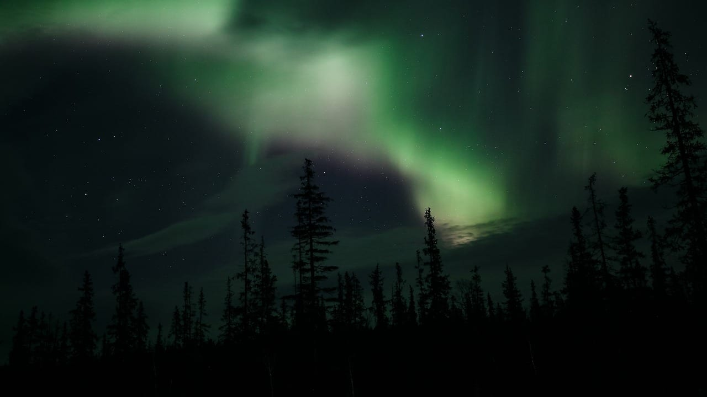

Для путешественников с гибким расписанием. Городская база позволяет переждать метель, а за сиянием выезжать несколько вечеров. Териберка — погодозависимое дополнение; не ставьте её непосредственно перед обратным рейсом. Из Москвы — примерно три часа самолётом.

В [одной четырёхдневной программе](https://north4you.com/tury/novyj-god) экскурсии без отеля стоят **133,8 тыс. ₽ на двоих 1–4 января и 99,8 тыс. ₽ 7–10 января**. Разница — 34 тыс. ₽ до перелёта и жилья. Это сравнение дат одной программы, не всего рынка. Облака и ветер способны изменить планы, а [NOAA](https://www.spaceweather.gov/content/tips-viewing-aurora) не обещает сияние даже в тёмную ночь.

### 9. Алтай — пейзаж и отдых в одной долине

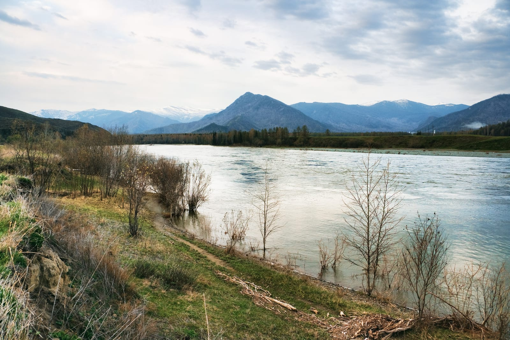

Подходит тем, кто хочет провести несколько дней среди гор, а не ежедневно менять гостиницу. Для первого зимнего знакомства удобнее выбрать одну базу и выезды с местным водителем. На длинных дорогах оставьте запас на снег и мороз.

До Горно-Алтайска из Москвы — примерно 4–5 часов полёта, затем наземный путь. [Опубликованная пятидневная программа](https://youtravel.me/tours/66517/новый_год_и_рождество_на_алтае_2027) 31.12–04.01 начинается **от 158,8 тыс. ₽ на двоих**. Авиабилеты и новогодний банкет отдельно. Главный минус — зависимость дальних выездов от состояния дорог; красивый летний снимок не описывает зимнюю проходимость.

## Море и заграница: от короткого перелёта до большого отпуска

### 10. Египет — отель, бассейн и экскурсии

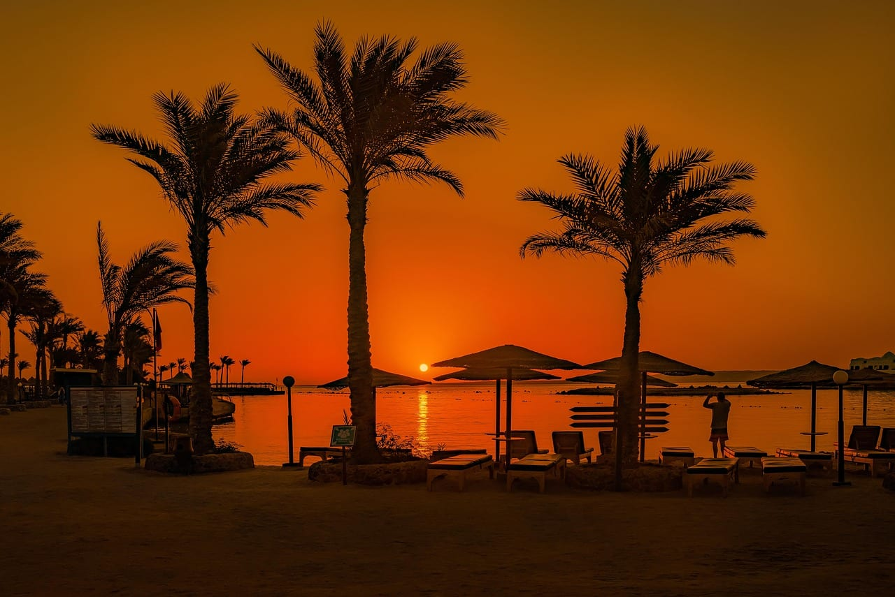

Для смены зимы без самого длинного перелёта. До курортов из Москвы — ориентировочно шесть часов самолётом и трансфер. Выбирайте конкретный пляж: ветер, понтон и подогрев бассейна важнее общего обещания «первая линия».

Октябрьский ориентир между медианами 3★ и 4★ — **192–217 тыс. ₽ за пакет на двоих, 6–8 ночей**. Это не доступная сейчас бронь. Уточняйте питание и обязательный праздничный ужин. Направление не подходит тому, кто рассчитывает на гарантированную тропическую жару и каждый день без ветра.

### 11. Таиланд — пляж, ради которого стоит лететь надолго

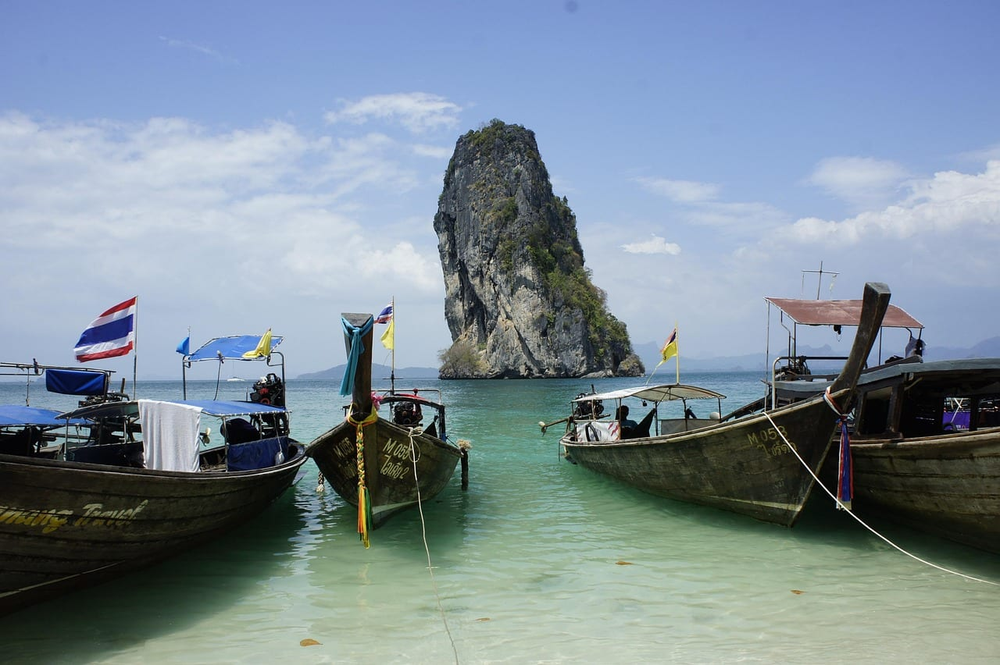

Для тёплого моря и неспешного пляжного отпуска. Прямой перелёт из Москвы занимает ориентировочно 9–10 часов; после него остаётся трансфер, который на праздники может затянуться.

Страновой ориентир медиан — **366–398 тыс. ₽ за двоих на 6–8 ночей**. Сравнивайте конкретные пляжи и дорогу до них. Район проживания и возможность ходить к морю пешком способны оказаться важнее звезды отеля. Для короткой поездки длинная дорога — главный компромисс.

[Новый год в Таиланде](/blog/novyy-god-tailand-2027/): подробности выбора курорта и пляжа.

### 12. Хайнань — море без обещания тайской жары

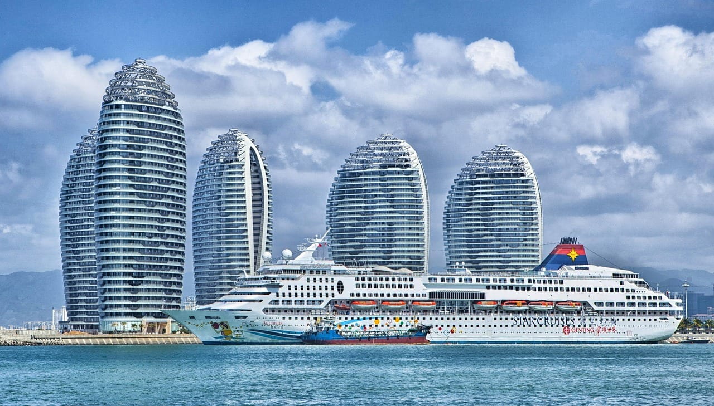

Подходит тем, кому важны прогулки у воды, пляжная база и мягкая зима. Выбирайте бухту и условия купания конкретного отеля: слова «тропический остров» не гарантируют одинаковую погоду на любом берегу. При доступном прямом рейсе из Москвы ориентир перелёта — около десяти часов.

Медианы 3★/4★ — **172–185 тыс. ₽ на двоих, 6–8 ночей**; категории относятся к разным выборкам. Проверяйте питание, трансфер и документы под свой маршрут. Главный минус — море может оказаться прохладнее ваших ожиданий.

### 13. ОАЭ — прогулки и городской праздник

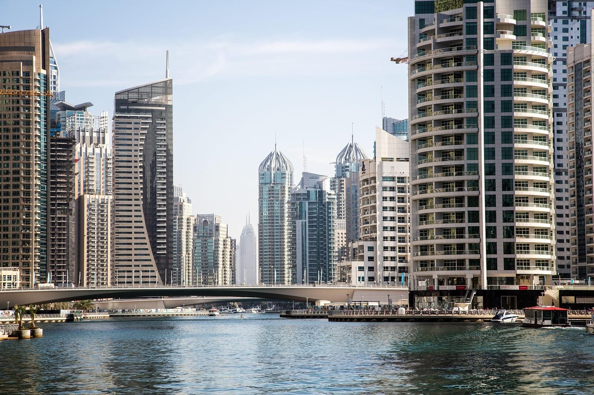

Для городской среды, ресторанов и прогулок у моря. Перелёт из Москвы — ориентировочно 5–6 часов, но дорога из аэропорта и после праздничного ужина зависит от района. Не выбирайте гостиницу только по расстоянию на карте до известного салюта.

Октябрьский ориентир — **238–242 тыс. ₽ на двоих за 6–8 ночей**, между медианами 3★ и 4★. Бюджет еды и программа вечера зависят от тарифа. Уточняйте доступ к выбранной площадке и обратный транспорт. Море зимой не гарантирует комфортное купание для каждого, а центр праздника может быть шумным и переполненным.

### 14. Вьетнам — сначала выбрать побережье

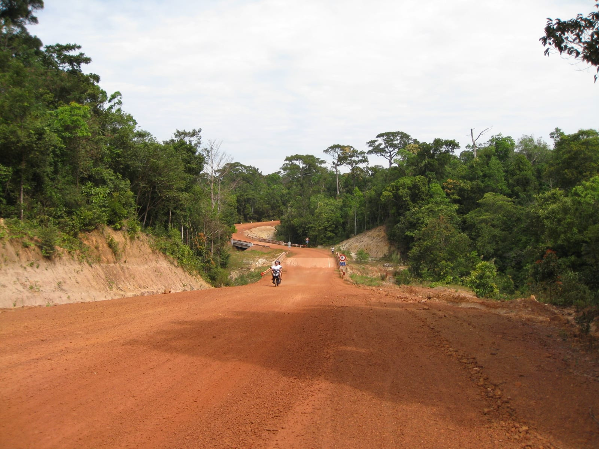

Для пляжного отдыха не стоит выбирать страну без конкретного курорта: Фукуок и Нячанг могут давать разную сезонную картину. Из Москвы закладывайте примерно десять–двенадцать часов только на прямой перелёт, если такой рейс есть на ваши даты.

Страновая вилка медиан — **326–331 тыс. ₽ за двоих на 6–8 ночей**. Она не гарантирует ту же сумму на выбранном острове. Сверьте море, питание, трансфер и условия отмены. Главный риск — купить подходящий отель на неподходящем для вашего отдыха побережье.

[Новый год во Вьетнаме](/blog/novyy-god-vietnam-2027/): как выбрать курорт и сценарий отдыха.

### 15. Маврикий — длинный отпуск с большим бюджетом

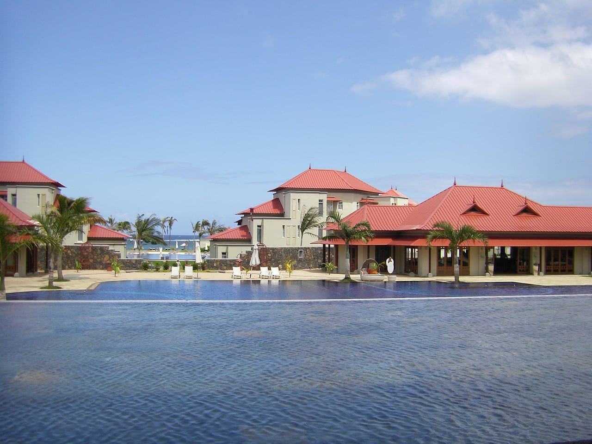

Для тех, кто хочет совместить пляж и природные выезды и готов к длинной дороге. Перелёт планируйте со стыковкой и запасом на неё; зимний сезон на острове не исключает ливней и циклонных ограничений.

В [двух опубликованных вариантах](https://www.quinta.ru/mauritius/tours/new-year-on-mauritius/) на 29.12–08.01 указаны стартовые суммы на двоих за десять ночей: **от €11 580 (ориентировочно 1,14 млн ₽) и от €14 760 (ориентировочно 1,45 млн ₽)** по опубликованному курсу продавца на 10 ноября. Включены отели, часть питания, праздничный ужин, трансферы и программа. Международный перелёт отдельно; это дорогие примеры, не нижняя цена острова. Для одного выезда можно отдельно спланировать [Шамарель: пески и водопад](/blog/shamarel-mavrikiy/).

## Сравнение основных сценариев

Все суммы ниже ориентировочные. Условные городские расчёты и опубликованные пакеты имеют разный состав; напрямую ранжировать их как полную цену отпуска нельзя.

| Направление | Формат | Бюджет, ориентировочно | Дорога из Москвы | Кому подходит | Главный минус |
|---|---|---|---|---|---|
| Казань | Город | 104–116 тыс. ₽, расчёт на двоих, 4 ночи* | Самолёт 1,5–2 ч или ночной поезд | Парам, семьям | Мороз и затраты на программу |
| Калининград | Город и Балтика | 165–183 тыс. ₽, расчёт на двоих, 4 ночи* | Самолёт около 3 ч | Любителям прогулок | Ветер и дорогая дорога |
| Шерегеш | Лыжи | От 76 тыс. ₽ на двоих за 4-дневный пакет из Барнаула; дорога до Барнаула и катание отдельно | Перелёт 4–5 ч до Новокузнецка, затем трансфер; барнаульский пакет — другой маршрут | Тем, кто едет кататься | Длинный трансфер |
| Карелия | Природа | От 97,8 тыс. ₽ на двоих, 31.12–03.01, 3 ночи; поезд и ужины отдельно | Ночной поезд и трансфер | Любителям леса | Пакет с экскурсиями не равен тихому дому |
| Мурманск | Сияние | 99,8–133,8 тыс. ₽ на двоих за 4-дневную экскурсионную программу; без жилья и перелёта | Самолёт около 3 ч | Гибким путешественникам | Сияние не гарантировано |
| Кострома | С детьми | 207 350 ₽, семья 2+1, ребёнок 2–12 лет, 05–07.01; дорога и ужины отдельно | Поезд или авто, примерно 4–6 ч | Семьям с детьми | Тематическая программа может быть дорогой |
| Египет | Море | 192–217 тыс. ₽ за пакет на двоих, 6–8 ночей** | Прямой перелёт около 6 ч и трансфер | Тем, кто хочет сменить зиму | Ветер и прохладные вечера |
| Таиланд | Тропики | 366–398 тыс. ₽ за пакет на двоих, 6–8 ночей** | Прямой перелёт около 9–10 ч и трансфер | Тем, кому важно тёплое море | Длинная дорога |

*Расчётный сценарий на 31.12–04.01: билеты Trip.com 10 ноября, жильё — ориентир из октябрьской статистики Суточно.ру. На питание задан резерв 16–24 тыс. ₽ на двоих на поездку, на местные расходы — 4–8 тыс. ₽ в Казани и 8–12 тыс. ₽ в Калининграде. Резервы — допущения редакции, не цены ресторанов и такси; платные шоу и банкет в них не заложены. Сценарий нужно пересчитать по доступному жилью. Багаж в найденных авиакотировках не подтверждён.

**Медианы 3★/4★ [Вантгоу](https://tour.wantgo.ru/zhurnal/gaydy-i-marshruty/kuda-poekhat/kuda-poekhat-na-novyy-god): поиски 29.09–29.10, вылет 26.12–03.01 из Москвы, двое, 6–8 ночей, топливный сбор включён. Не рыночный минимум; питание и доплаты проверяйте отдельно.

## Даты, отпуск и расчёт бюджета

Для стандартной пятидневки новогодние выходные продлятся **с 31 декабря 2026 года по 10 января 2027 года включительно — 11 дней**. Первый рабочий день — 11 января. Для сменной работы график иной. Даты подтверждены [официальным сообщением Росгидромета о решении правительства](https://www.meteorf.gov.ru/press/newsactual/45104/).

Если согласовать отпуск на 28–30 декабря, получится отдыхать с 26 декабря по 10 января: 16 календарных дней. Это расчёт пятидневки, не обещание экономии. Можно уехать раньше праздничного пика, но экономию нужно проверить на одинаковых билетах и номерах.

Формула: дорога туда-обратно + жильё + питание + местный транспорт + развлечения + обязательные доплаты. В Казани сценарий складывается из 58,6 тыс. ₽ за два одиночных авиабилета, 25 720 ₽ жилья и резервов. В Калининграде — из 121,8–128,4 тыс. ₽ авиабилетов, 18 880 ₽ жилья и резервов. Это умножение наблюдавшейся цены одного пассажира на два, не проверенная доступность двух мест.

У обоих примеров одинаковые четыре ночи, но жильё взято из октябрьской статистики сервиса, а еда и местные расходы — заданный бюджетный лимит. Он не является замером ресторанных цен. Проверьте его на своих привычках; питание на всю поездку, платные активности и багаж нужно согласовать с вашим тарифом. Даже у простого [лондонского fish & chips](/blog/fish-and-chips-london/) рыба и картошка могут оказаться отдельными позициями: такой же разбор состава полезен для каждой строки отпуска.

Динамика тоже должна относиться к одному объекту: разница 34 тыс. ₽ у арктической программы доказана её датированной таблицей. Заявленные в октябрьском обзоре +3% — средняя аренда в выборке, не рост всех расходов на Новый год. Общего обещания снижения цены после праздника здесь нет.

## Подводные камни новогоднего бронирования

Проверьте семь условий:

1. Минимальное число ночей и разрешённые даты заезда.
2. Обязательный gala dinner: цена для каждого взрослого и ребёнка.
3. Возвратный депозит и способ его внесения.
4. Отмену: срок, часовой пояс, удержание и возврат денег.
5. Состав тарифа: питание, уборка, местные сборы, дополнительные места.
6. Позднее заселение и транспорт после вечернего прибытия.
7. Действия при закрытии дороги, отмене активности или задержке рейса.

## Кому не подходит и десять способов избежать лишних трат

**Не выбирайте** Мурманск ради гарантированного сияния; Калининград ради обязательных сугробов; Шерегеш без желания кататься; удалённый карельский дом без решения вопроса транспорта; Египет ради гарантированной жары; Таиланд при непереносимости длинного перелёта. Для ребёнка, который тяжело переносит дорогу, короткий маршрут важнее знаменитого названия.

Десять практических приёмов:

1. Сейчас сравните три набора дат: до праздника, с новогодней ночью, после 10 января.
2. В каждом сравнении оставьте одинаковые ночи, багаж и питание.
3. Включите уведомления о цене на конкретный маршрут.
4. Бронируйте отменяемое жильё, если транспорт ещё не выбран.
5. Проверяйте окончательную стоимость перед оплатой, а не только карточку поиска.
6. Удалённому отелю противопоставьте жильё рядом с нужной прогулкой: посчитайте такси.
7. Для лыж заранее сравните собственное снаряжение и прокат вместе с багажом.
8. Детские сеансы и инструкторов согласуйте до невозвратных покупок.
9. Не экономьте на подходящем зимнем транспорте и страховом покрытии выбранных активностей.
10. Не ставьте длинную зимнюю экскурсию непосредственно перед обратным рейсом.

## Пять деталей, которые меняют выбор, и чек-лист покупки

Стоит помнить пять вещей: море в названии направления не означает купание; полярная ночь не означает круглосуточную непроглядную темноту; яркая Луна не отменяет сияние; январская поездка на Байкал не гарантирует безопасный прозрачный лёд; медиана цены — не сумма, по которой обязан продаваться ваш тур. О неоднородности льда предупреждает [МЧС](https://38.mchs.gov.ru/deyatelnost/press-centr/novosti/4920941): старое наблюдение не заменяет оперативную сводку на даты поездки.

**Перед покупкой отметьте семь пунктов:**

- Даты и число ночей совпадают во всех бронях.
- Итог посчитан на всех путешественников.
- Дорога проверена до самого жилья.
- Паспорта и въездные условия подходят каждому участнику.
- Доплаты, отмена и депозит понятны.
- Есть план на плохую погоду.
- Главная активность доступна на нужную дату.

Выберите два подходящих направления и сравните их на одинаковых условиях. Покупайте поездку, которая сохраняет смысл даже без идеальной погоды, салюта или свободного столика в самом известном ресторане.
