import { aviasalesRoute, tpkDeep } from '../../data/affiliate.js';

export const sydneyFlight = aviasalesRoute('MOW', 'SYD', 'ny_2027_australia_flight', 11);
export const tokyoFlight = aviasalesRoute('MOW', 'TYO', 'ny_2027_japan_flight', 11);
export const capeTownFlight = aviasalesRoute('MOW', 'CPT', 'ny_2027_southafrica_flight', 11);
export const stays = tpkDeep('ostrovok', 'https://ostrovok.ru/', 'ny_2027_stays');

**Лучшее место для Нового года зависит от самой ночи.** Сидней и Фуншал выбирают ради зрелища над водой, Вену — ради музыки и прогулок, Рио — ради пляжного праздника, Токио — ради другого отношения к началу года. Самая дорогая ошибка — купить поездку в красивый город и обнаружить, что на нужную площадку нет входа, а после полуночи не получается вернуться в отель.

Здесь речь о ночи **с 31 декабря 2026 на 1 января 2027 года**. У части городов есть программа именно этой встречи года; у остальных ниже описан устойчивый сценарий, а конкретное шоу, расписание и условия входа нужно подтвердить перед оплатой. Уличный праздник, ресторанный ужин и круиз — разные покупки.

## Как выбрать место для новогодней ночи

| Место | Ради чего ехать | Что решить первым | Главный компромисс |
|---|---|---|---|
| Сидней | Мост, Опера и салют над гаванью | Конкретная смотровая и её вход | Долгое ожидание на месте |
| Фуншал, Мадейра | Фейерверк над бухтой | Берег, склон или ресторан | Уклон улиц и обзор из номера |
| Рио-де-Жанейро | Копакабана и праздник у океана | Жильё и возвращение с пляжа | Очень большая толпа |
| Эдинбург | Hogmanay и музыка | Билет на нужное мероприятие | Погода и разные входные билеты |
| Вена | Вальс и праздничный старый город | Улица или вечер в зале | Не пляж и не главный салют |
| Лондон | Фейерверк на Темзе | Официальный билет | Перекрытия и вход по зоне |
| Мадрид | Двенадцать виноградин на Соль | Площадь или ужин рядом | Ограниченная вместимость |
| Рейкьявик | Местные костры и городские фейерверки | Вечерний пеший маршрут | Зимняя погода |
| Кейптаун | Лето, музыка и поездка по Капскому полуострову | Городской вечер или загородный фестиваль | Нужен отдельный транспорт |
| Сингапур | Ночная панорама Marina Bay | Берег или забронированная площадка | Встречу 2027 нельзя планировать по старому сайту |
| Гонконг | Бухта Виктория и городская ночь | Сторона бухты и возврат | Вид из отеля не гарантирован названием района |
| Бангкок | Река, ужин и большая вечеринка | Речной берег, центр или круиз | Переезды между ними съедают вечер |
| Токио | Первое посещение храма | Храмовый визит или вечеринка | Нет единого городского сценария |
| Нью-Йорк | Обратный отсчёт на Таймс-сквер | Готовность долго стоять в секторе | Мало свободы уйти и вернуться |
| Дубай | Шоу среди небоскрёбов | Точная точка обзора | Бронь ужина не равна виду на шоу |

Для поездки с детьми начните с ранней программы Сиднея или дневной части праздника в Вене. Для пары, которой важны ужин и прогулка, удобнее Фуншал или Мадрид. Если цель — оказаться внутри большой толпы в полночь, Рио, Эдинбург и Таймс-сквер дают разные версии такого опыта.

## 15 мест для встречи Нового года

### 1. Сидней — Новый год вокруг гавани

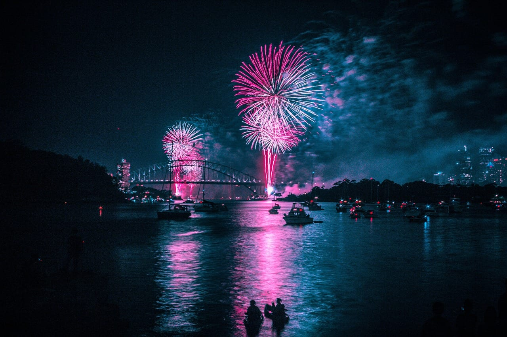

Сидней подходит тем, для кого сам салют — цель путешествия. Гавань работает как огромная сцена: в одном кадре могут оказаться мост Харбор-Бридж, Оперный театр и вода. Но вид зависит от берега и площадки, а не от слова «гавань» в описании отеля.

На 31 декабря предусмотрены **Calling Country в 21:00 и главное шоу в полночь**. Площадки бывают бесплатными и билетными; у многих нет повторного входа. Для Forecourt у Оперы вход бесплатный, но требуется бронирование: его открывают **26 декабря в 10:00 по времени Сиднея**, максимум шесть билетов на человека. По этому билету нужно войти **с 12:00 до 15:00**: позднего прихода к вечернему шоу нет. Бронирование не обещает, что билет достанется каждому.

**Как устроить вечер:** выберите одну площадку, её время входа и путь пешком до транспорта. Circular Quay по официальному плану закрыт для входа на станцию с 15:00 до полуночи; ближайшая станция на карте может не быть рабочим вариантом. Если не готовы занять место надолго, покупайте конкретный ужин или круиз с оговорённым обзором. Перелёт ищите после проверки документов и входа: <a href={sydneyFlight} rel="sponsored noopener" target="_blank" data-cta="ny_2027_australia_flight">билеты в Сидней на декабрь</a>.

### 2. Фуншал — салют над бухтой Мадейры

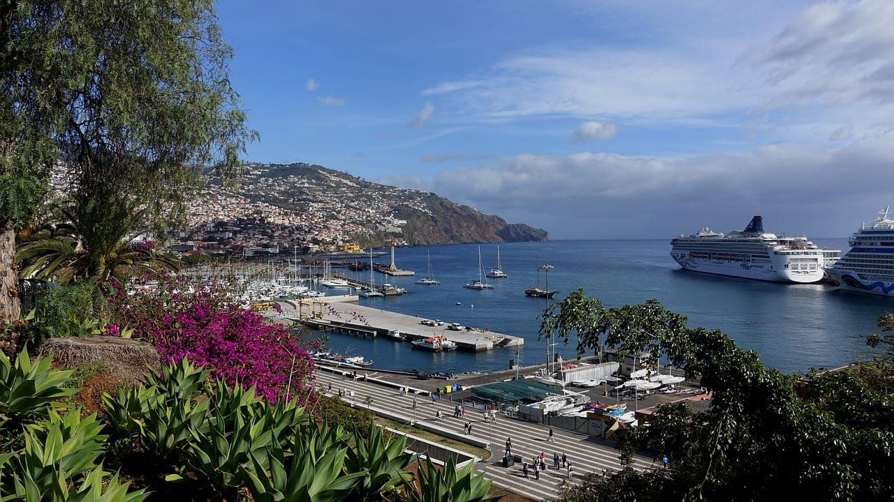

Фуншал — выбор для тех, кому хочется связать новогоднюю ночь с прогулками по острову. Дома поднимаются амфитеатром над бухтой, поэтому здесь есть несколько способов смотреть праздник: с набережной, со склонов или с террасы. Высокое положение номера помогает лишь тогда, когда окно обращено к нужной части бухты и обзор не перекрыт.

Официальный праздничный сезон Мадейры идёт **с 1 декабря 2026 по 10 января 2027 года**. Центральный новогодний сюжет — фейерверк в Фуншале. Для поездки на несколько дней это удобнее, чем прилёт только ради одного вечера: остаётся время на город и остров.

**Как устроить вечер:** подберите место встречи полуночи вместе с жильём. Возвращение по крутым улицам после долгого вечера — существенная часть выбора. Если берёте ресторан, запросите подтверждение именно вида из своей зоны посадки. Мадейра даёт зимнюю Атлантику и зелёные пейзажи; обещать пляжное купание всем гостям нельзя.

### 3. Рио-де-Жанейро — большая ночь на Копакабане

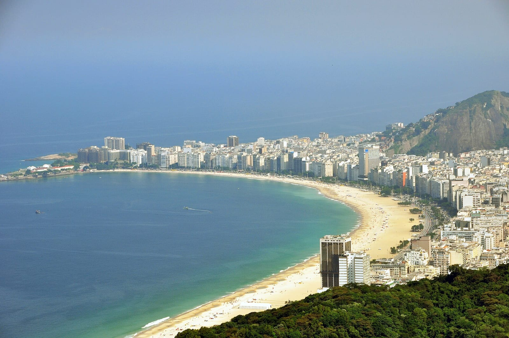

Рио выбирают ради общего праздника у океана: белая одежда, пляж и обратный отсчёт среди людей. Это сценарий для тех, кого большая толпа радует сама по себе. Для тихого романтического ужина потребуется отдельное заведение или терраса; песок Копакабаны не превращается в камерный курортный пляж.

Ежегодная традиция не подтверждает автоматически состав артистов, длительность салюта и транспортную схему встречи 2027 года. Не переносите на свою ночь прошлогоднюю цену специального билета метро и часы перекрытий.

**Как устроить вечер:** сначала решите, откуда уйдёте с пляжа и где ночуете. Пешая близость жилья полезнее обещания «такси приедет после салюта». Для большой компании назначьте место встречи за пределами самого плотного потока. Не рассчитывайте спокойно сменить несколько удалённых площадок после полуночи. Дневную программу по стране удобнее собирать через [Бразилию](/brazil/), а ночь оставить одному району.

### 4. Эдинбург — ехать на Hogmanay

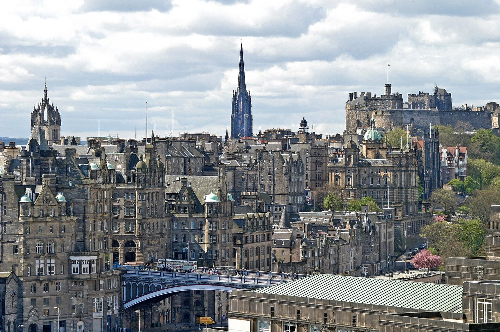

Эдинбург подходит тем, кому нужен музыкальный праздник на несколько дней. **Hogmanay запланирован с 29 декабря 2026 по 1 января 2027 года**: в его программе есть факельное шествие, предновогодний вечер, уличная ночь и события первого января. Это не одно мероприятие с универсальным входом.

Главная развилка — уличная вечеринка или отдельный концерт. Не покупайте билет только по названию фестиваля: проверьте площадку, возрастные ограничения и разрешён ли повторный вход. Состав артистов важен именно у выбранного события.

**Как устроить вечер:** оставьте дневную прогулку по старому городу, затем приходите в свою входную зону с запасом. Вечер на улице требует непромокаемой одежды и обуви, в которой удобно долго стоять. Для семьи сравните детскую программу с возрастными условиями большой ночи; слово «фестиваль» само по себе не делает любой билет семейным. Ветреная погода может изменить план, поэтому ночной трансфер и запасной вечер в помещении нужны до выхода из отеля.

### 5. Вена — вальс вместо охоты за салютом

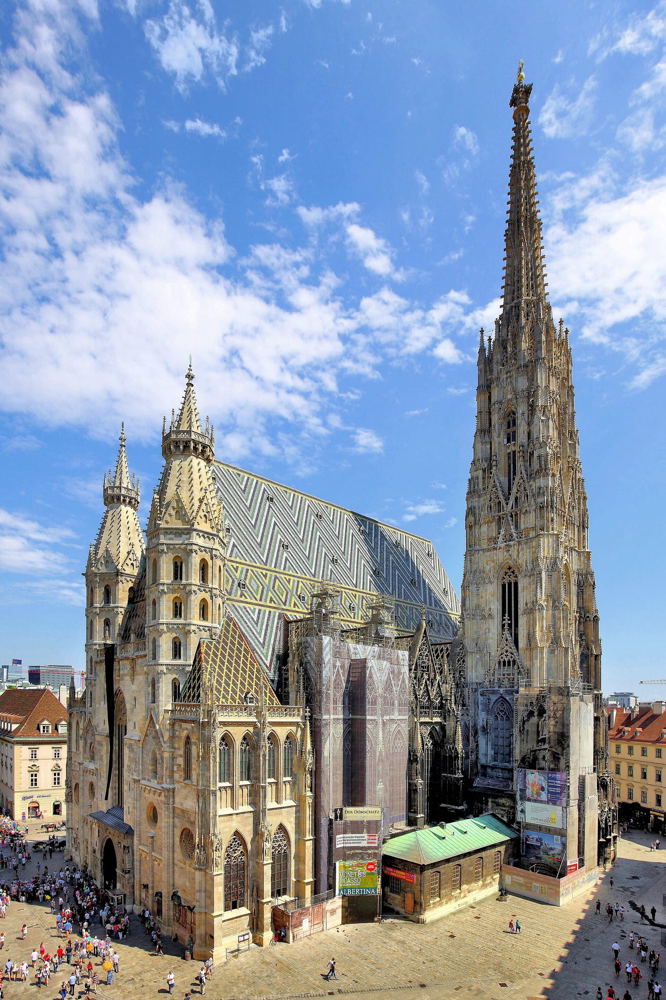

Вена — удачный выбор, если праздник хочется провести на улицах старого города и продолжить за музыкой или ужином. **Silvesterpfad 31 декабря 2026 года проходит с 14:00 до 02:00**, вход на уличный маршрут свободный. В программе — разные музыкальные площадки и вальс; это возможность выбрать свою часть вечера, а не занимать единственную точку ради короткого шоу.

Маршрут связывает, в частности, Freyung, Graben и Stephansplatz. На 1 января 2027 года предусмотрена трансляция Новогоднего концерта с **11:15** на Stephansplatz и Riesenradplatz. Такая трансляция не равна билету в Musikverein.

**Как устроить вечер:** выберите дневную прогулку, ужин и одну ближайшую праздничную зону. Если хочется концертного зала, бронируйте конкретное выступление отдельно. Не берите собственную пиротехнику: город прямо запрещает её на Silvesterpfad. Вена подходит для музыки и гуляний; ехать сюда исключительно за огромным фейерверком — неверное ожидание.

### 6. Лондон — фейерверк с официальным билетом

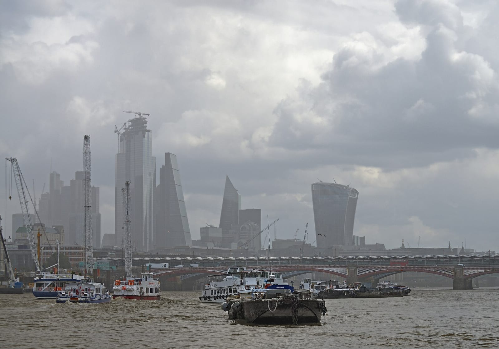

Лондон — вариант для тех, кто хочет увидеть новогоднее шоу на Темзе и готов организовать вечер заранее. На официальный фейерверк встречи 2027 года нужен билет. Продажа первой партии открылась **23 октября 2026 года**; организатор указывает Ticketmaster как официальный канал.

Билетная зона, ресторан у реки и прогулка по набережной дают разные права доступа. Не рассчитывайте прийти к London Eye в 23:30 и найти свободное место рядом с купившими билет. Советы про бесплатные холмы тоже требуют проверки: привычная смотровая может иметь отдельные ограничения.

**Как устроить вечер:** читайте инструкцию своей цветовой зоны и выбирайте подход с правильной стороны реки. После перекрытия мостов короткий путь на обычной карте может исчезнуть. Жильё подбирайте по возвращению из сектора, а не по расстоянию до центра Лондона. Главный минус — вечер с жёсткой логистикой; если хочется свободно ходить между барами, выбирайте другой формат ночи.

### 7. Мадрид — двенадцать виноградин на Пуэрта-дель-Соль

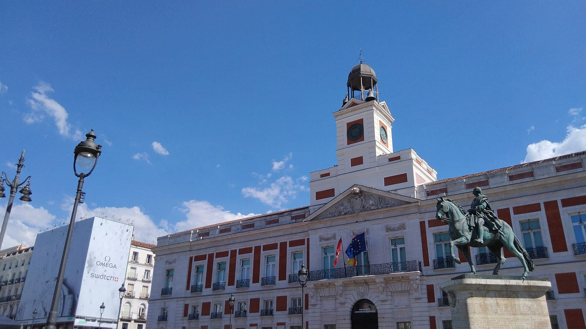

Мадрид подходит для городского Нового года с длинным ужином и испанской традицией: **двенадцать виноградин под двенадцать ударов часов**. Главная точка — Пуэрта-дель-Соль. Площадь не вмещает всех желающих: официальный туристический портал называет вместимость около 15 тысяч человек и советует приходить за несколько часов.

Здесь легко ошибиться последовательностью: поздний ресторанный ужин и гарантированный вход на заполненную площадь не складываются сами собой. Выберите, что важнее: стол или место в толпе. Есть и репетиция Preuvas вечером 30 декабря — другой вечер, полезный для знакомства с ритуалом.

**Как устроить вечер:** поселитесь там, откуда удобно идти пешком, а не рассчитывайте на короткую поездку через центр. Для выбора района пригодится [разбор жилья в Мадриде](/blog/madrid-gde-ostanovitsya/). Прогулку по [Ретиро](/blog/park-retiro-madrid/) оставьте на день: она не заменяет новогоднюю программу площади.

### 8. Рейкьявик — костры и фейерверки местных жителей

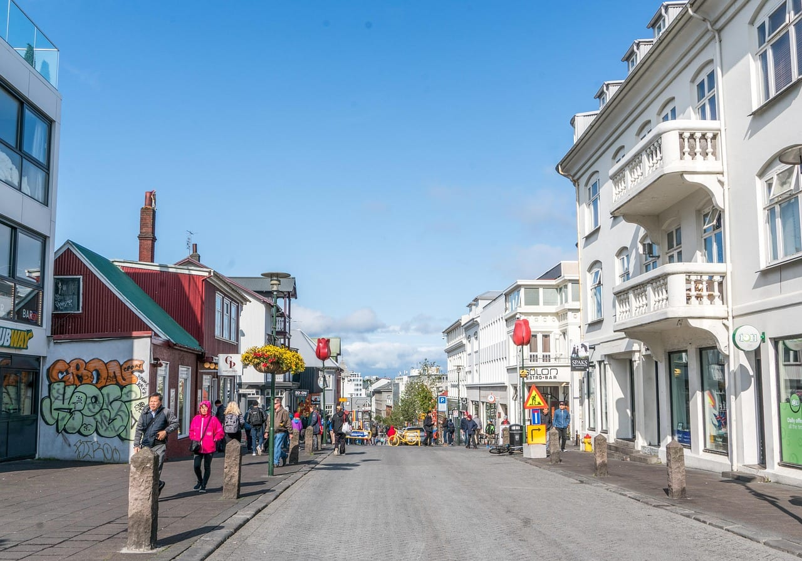

Рейкьявик привлекает тем, что праздник ощущается частью жизни города. Новогодние костры и фейерверки здесь связаны с местными сообществами; не стоит искать один главный муниципальный салют по образцу Сиднея. Вечерняя телевизионная комедийная программа собирает исландцев дома, поэтому относительная тишина на улицах до полуночи не означает, что праздник закончился.

Конкретные костры и порядок доступа выбирайте по городской программе своего года. Если хочется смотреть фейерверки с возвышенности, проверьте пешую дорогу, покрытие и возможность уйти с детьми раньше.

**Как устроить вечер:** небольшой маршрут от ужина к выбранной точке, тёплая водостойкая одежда и ночёвка без длинного переезда. Северное сияние не входит в новогодний билет: облачность и активность могут оставить вас без него. Экскурсию за город планируйте отдельно от самой ночи; [маршрут по Исландии](/blog/iceland-five-places/) поможет не смешать городские гуляния с большой зимней дорогой.

### 9. Кейптаун — лето и музыкальный вечер

Кейптаун выбирают, когда новогодняя ночь — часть длинной поездки с океаном, Капским полуостровом и винодельнями. Здесь важно различать вечер в городе и фестиваль за его пределами. На 31 декабря 2026 года городской туристический портал анонсирует **Secrets of Summer NYE на площадке The Ostrich в Philadelphia**. Наличие слова Cape Town в афише не означает пеший выход из отеля на Waterfront.

Если вам нужен спокойный ужин и вид на город, выбирайте конкретное заведение. Если нужен большой музыкальный фестиваль — подходящий билет, возрастную категорию и организованный возврат.

**Как устроить вечер:** не ставьте утром 1 января длинный автомобильный маршрут после ночного праздника. Оставьте день с лёгкой программой; природные выезды разнесите по другим датам. До покупки перелёта сравните всю поездку по [гайду ЮАР](/blog/south-africa-guide-2026/), затем <a href={capeTownFlight} rel="sponsored noopener" target="_blank" data-cta="ny_2027_southafrica_flight">посмотрите билеты в Кейптаун</a>.

### 10. Сингапур — ночная панорама Marina Bay

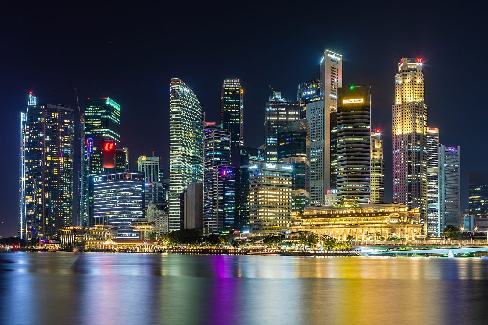

Сингапур подходит тем, кто хочет провести ночь у воды среди небоскрёбов и соединить её с несколькими городскими днями. Основной ориентир — Marina Bay. Но официальный сайт, на котором написано **Countdown 2026**, описывает встречу предыдущего года; его расписание и транспортный план нельзя автоматически относить к 31 декабря 2026 года.

До подтверждения программы встречи 2027 выбирайте обратимые бронирования. Платный ужин на крыше имеет смысл, если организатор подтверждает вид, время доступа и состав пакета. Обычная бронь номера в районе бухты такого подтверждения не даёт.

**Как устроить вечер:** остановитесь на одной стороне бухты и заранее выберите дорогу назад. Попытка переходить к другой популярной точке в последний час снижает шансы найти удобное место. Для дневной программы можно оставить [Gardens by the Bay](/blog/gardens-by-the-bay/); билет в оранжереи и доступ к новогодней площадке — разные вопросы.

### 11. Гонконг — встречать год у бухты Виктория

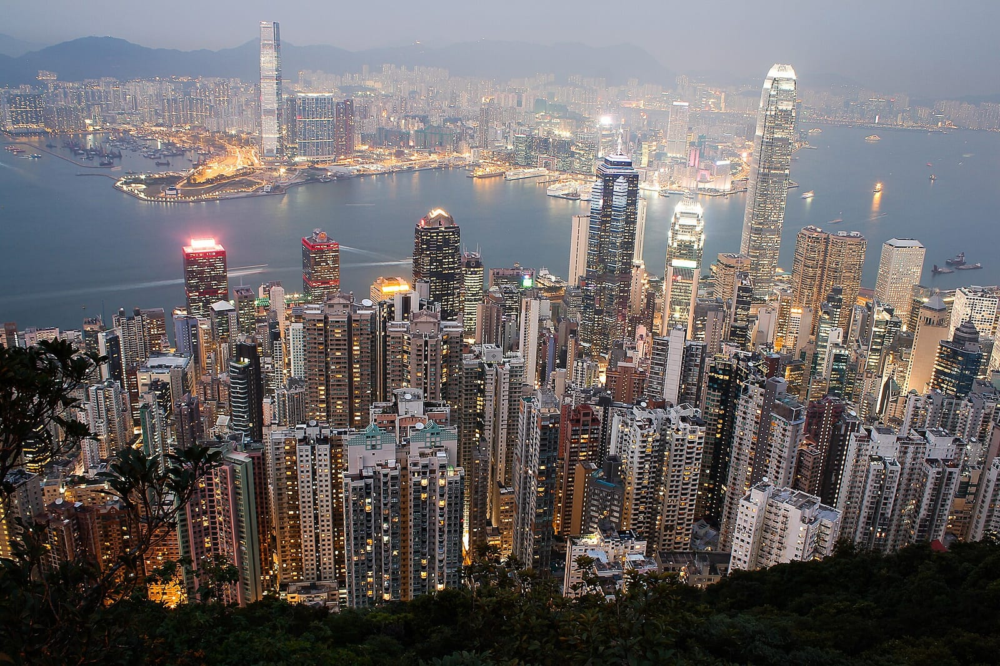

Гонконг даёт городской Новый год на фоне одной из самых узнаваемых бухт мира. В официальном календаре Countdown стоит на **31 декабря 2026 — 1 января 2027 года**. Календарная запись ещё не определяет длину шоу, все смотровые и транспортные ограничения.

Главная развилка — оставаться на Коулуне или на острове Гонконг. Выбирайте берег вместе с жильём и забронированным ужином. Переехать через бухту после полуночи — отдельный план, а не гарантированное продолжение прогулки.

**Как устроить вечер:** дневной [подъём на Пик Виктория](/blog/pik-viktoriya/) и вечер у воды лучше разделить запасом времени. Пик не стоит считать запасной бесплатной площадкой в последнюю минуту: у него собственные очереди и дорога вниз. Если покупаете ресторанный пакет, уточните, из какой части заведения видна бухта и закреплено ли это место за вашим столом.

### 12. Бангкок — река, ужин или большая вечеринка

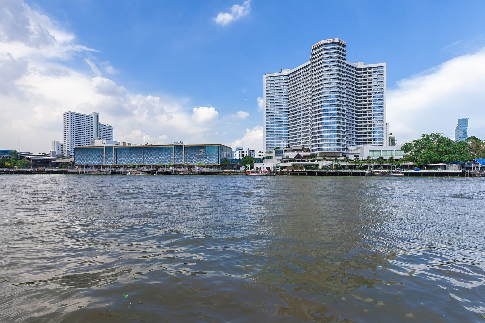

Бангкок подходит тем, кто хочет добавить к новогоднему вечеру еду, реку и жизнь большого города. План строится вокруг одной из трёх идей: берег Чаупхраи, праздник в центральной торговой части или заранее купленный круиз. Смешать их все за несколько часов трудно даже в обычный день.

Название прошлогоднего countdown у ICONSIAM или centralwOrld не подтверждает программу 2027 года. До покупки уточните дату, состав шоу, вход и способ возвращения у организатора выбранной площадки. У речного круиза существенны именно пирс, время посадки и место высадки.

На дни вокруг праздника есть дополнительная причина остаться в городе: Bangkok Art Biennale запланирована **с 29 октября 2026 по 28 февраля 2027 года**. Площадки включают храмы, музеи и общественные пространства; часы конкретной выставки в праздничный день проверяются отдельно.

**Как устроить вечер:** выберите один район, ранний ужин и маршрут до отеля. Если пересекаете реку, предусмотрите возвращение без предположения, что любой причал работает всю ночь. Номер с видом на воду выбирайте по фотографии конкретного типа комнаты, а не по общей галерее отеля. Пляжную часть отпуска добавляйте отдельно через [гайд Таиланда](/blog/thailand-guide-2026/).

### 13. Токио — первое посещение храма в новом году

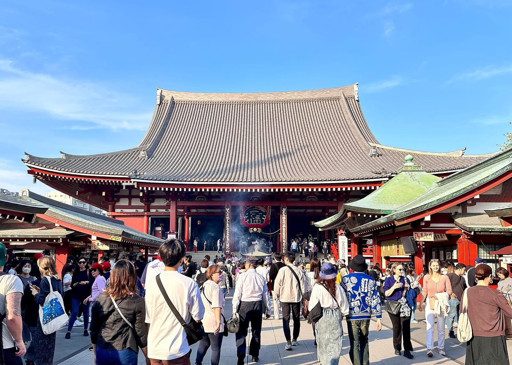

Токио — выбор для тех, кому хочется другой традиции. **Hatsumode** — первое посещение синтоистского святилища или буддийского храма в новом году. Это не обязательная вечеринка на городской площади: люди могут отправиться в храм в ночь на 1 января или в первые дни года.

Мэйдзи-дзингу и Сэнсодзи — разные места и разные маршруты; выберите одно, изучите его новогодний порядок и приготовьтесь к очереди. Не переносите часы работы с обычного дня или с программы января 2026 года. Не вся праздничная Япония работает по привычному туристическому графику.

**Как устроить вечер:** оставьте храмовому визиту время без следующего жёсткого бронирования. Дневные музеи и рестораны проверяйте отдельно на праздничные закрытия. Если ваша цель — клубная ночь, ищите конкретную вечеринку, а не подменяйте ею hatsumode. Для дальнейшего маршрута есть [гайд Японии](/blog/japan-guide-2026/); <a href={tokyoFlight} rel="sponsored noopener" target="_blank" data-cta="ny_2027_japan_flight">перелёты в Токио на декабрь</a> имеет смысл смотреть после выбора дат всей поездки.

### 14. Нью-Йорк — Таймс-сквер для тех, кто готов ждать

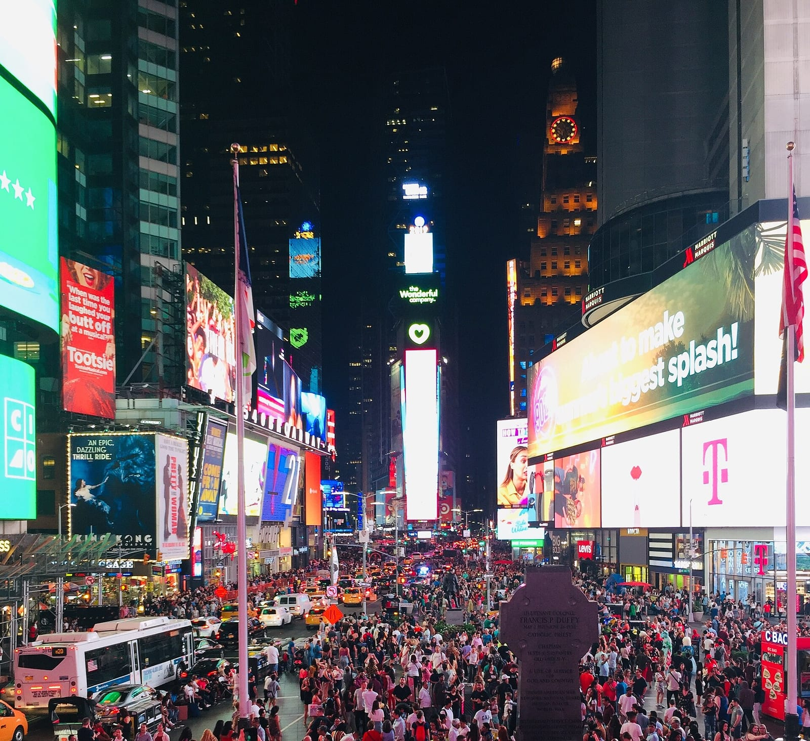

Таймс-сквер — вариант ради одного узнаваемого момента: обратного отсчёта и спуска шара. Общая уличная встреча года бесплатная; билет в ресторан или частную вечеринку не равен месту в публичном секторе. Предложения «единого прохода» по множеству заведений особенно внимательно сравнивайте с действительными условиями доступа.

Главный вопрос здесь не цена, а готовность долго оставаться на одном месте. Выйти поужинать и вернуться в тот же заполненный сектор не получится. Это существенный минус для семьи с маленькими детьми и для любого, кому нужен свободный вечер с прогулками.

**Как устроить вечер:** выбирайте Таймс-сквер осознанно, а не как случайную остановку после ресторана. Схему входов и транспорта берите из инструкции организатора на свою ночь; старый список выступающих не описывает встречу 2027 года. Для более свободного сценария лучше ужин или отдельное событие с понятным местом и временем, без обещания уличного обзора.

### 15. Дубай — выбирать точку обзора, а не название города

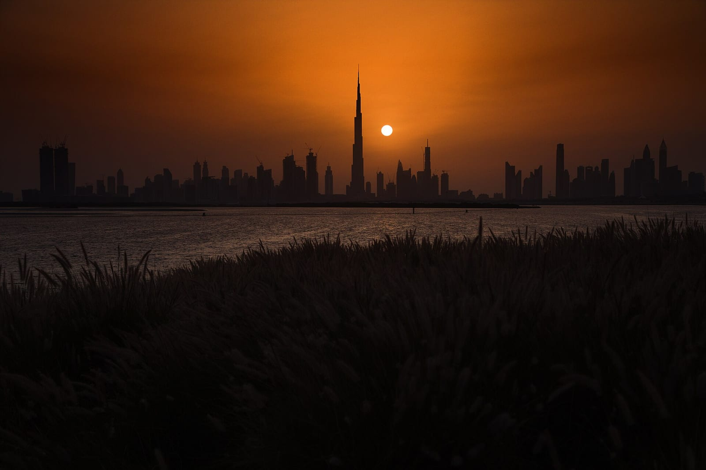

Дубай подходит тем, кто хочет соединить городскую поездку с большим вечерним шоу. Но «Новый год в Дубае» может означать разные районы и совершенно разные виды. Бронь ресторана у Бурдж-Халифы, отель на побережье и круиз по Марине не описывают одну и ту же ночь.

Для встречи 2027 года проверьте именно программу и вход выбранной площадки. Рекламная фотография башни не гарантирует, что её видно с каждого стола; слово «видовой» без направления обзора почти ничего не решает. Дорога до ресторана после перекрытий тоже входит в стоимость удобства.

**Как устроить вечер:** сначала выберите конкретное место, затем отель на удобной стороне и только после этого дополнительную программу. Не ставьте два удалённых бронирования в один вечер. Если важно море, сравните весь отпуск, а не только ночь 31 декабря; для этого есть [гайд ОАЭ](/blog/uae-guide-2026/).

## Что бронировать и в каком порядке

**Сначала документы и право на поездку, затем место встречи полуночи, потом жильё и перелёт.** Билет на городской праздник не заменяет визу, а одобренная виза не гарантирует место на заполненной площадке. Для направлений со сложными документами не оплачивайте невозвратную программу в расчёте на обещанный срок решения.

Для выбранной ночи проверьте четыре вещи:

- **Вход:** точная площадка, категория билета, время и разрешён ли повторный проход.
- **Вид:** какая часть шоу видна из вашего сектора, номера или с конкретного стола.
- **Возвращение:** рабочая станция, подход к ней и запасной пеший маршрут.
- **Отмена:** что происходит при изменении программы и чем возвращается оплата.

Для жилья сравнивайте полный счёт за одинаковое число ночей: номер, обязательный праздничный ужин, трансфер и условия отмены. Дешёвый отель с неудобной дорогой может испортить единственную ночь, ради которой вы прилетели. <a href={stays} rel="sponsored noopener" target="_blank" data-cta="ny_2027_stays">Подобрать жильё в выбранном городе</a> лучше после решения о площадке; в общем поиске укажите город и свои даты.

На 1 января оставьте неторопливый день. Ранний вылет, автомобильный переезд и экскурсия с жёстким временем сбора плохо сочетаются с ночью, в которой вы хотите дождаться полуночи без часов в руках.
