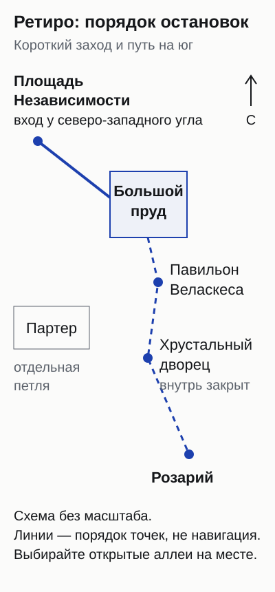
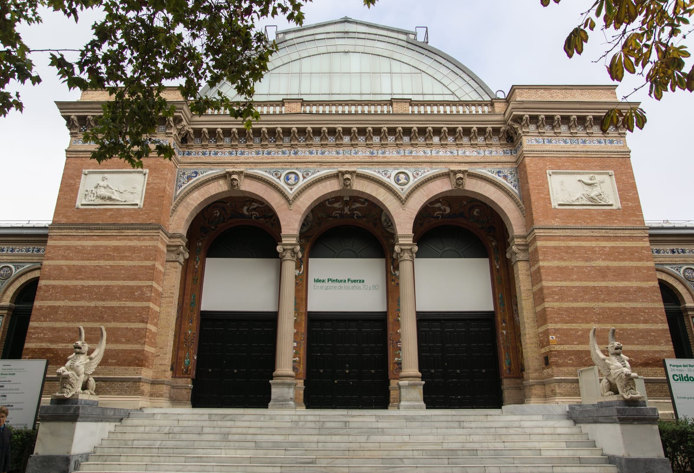
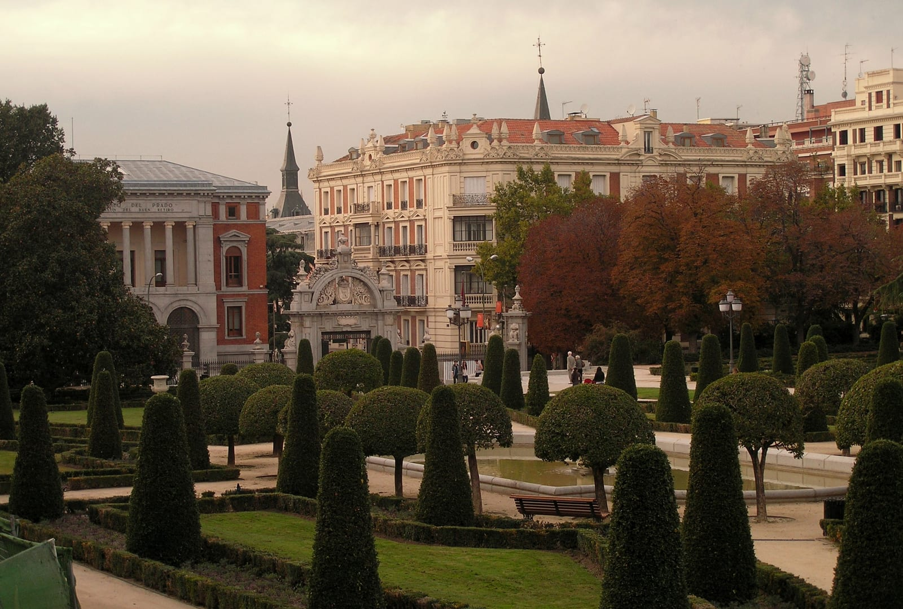
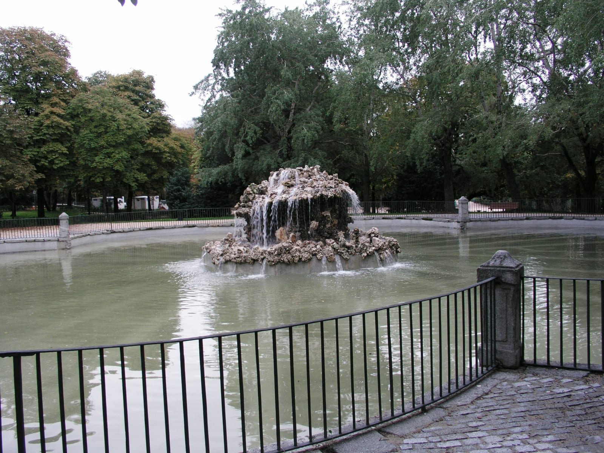
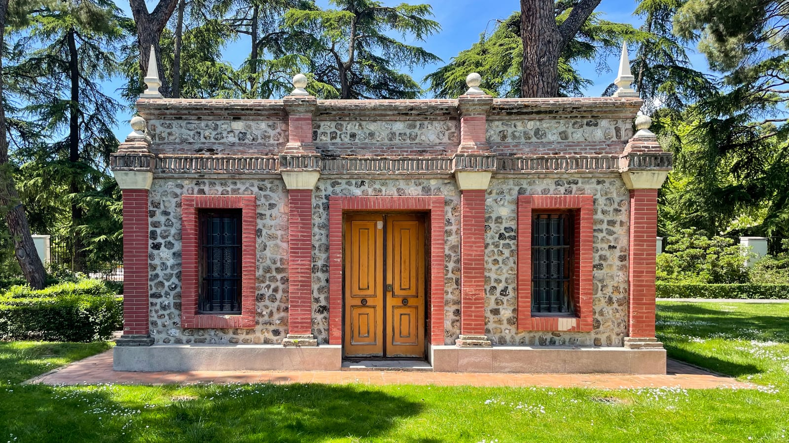

import { tpkDeep } from '../../data/affiliate.js';

Ретиро удобно соединить с Прадо или оставить на отдельное неспешное утро. Если в Мадриде всего один день и музеи важнее парков, хватит короткого захода к пруду. Обходить весь парк ради галочки незачем: лодки, выставка и дальние сады легко займут время, которое вы хотели провести в музее.

## Какой маршрут выбрать?

Начните с того, сколько времени остаётся **до следующего дела**, а не до закрытия парка. Павильон, розарий и лодочная касса закрываются раньше аллей: вечерняя прогулка не гарантирует доступа к ним.

| Ваш план | Что включить | Что оставить на другой раз |
|---|---|---|
| Час перед музеем или ужином | Вход со стороны площади Независимости, большой пруд, монумент Альфонсо XII, выход к своей следующей точке | Лодку, очередь на выставку и южные сады |
| Полтора–два часа для первого знакомства | Пруд → павильон Веласкеса → окрестности Хрустального дворца, если проход открыт → Партер | Длинный обед и лодку поверх всего маршрута |
| Полдня с остановками | Основную прогулку плюс один дополнительный план: лодку, выставку или сады Сесилио Родригеса | Попытку успеть все три дополнения без запаса |

Это варианты распределения времени, не норматив ходьбы. С ребёнком, в жару или с остановками на фотографии выбирайте меньше точек. При закрытом проходе возвращайтесь на разрешённую аллею: красивый круг на карте не важнее ограждения на месте.

*Короткий заход заканчивается у большого пруда; пунктир показывает продолжение на юг. Линии задают порядок точек, а не путь по аллеям. При закрытом проходе оставайтесь на разрешённых аллеях.*

## Большой пруд: начать здесь или взять лодку?

Большой пруд — Estanque Grande — подходит как первая цель: здесь легко решить, продолжать ли прогулку по садам или остаться у воды. На противоположном берегу стоит монумент Альфонсо XII. Для самого вида лодка не нужна: берега и памятник входят в обычную бесплатную прогулку.

**Лодка оплачивается отдельно**, максимум на четыре человека, сеанс — 45 минут. Дети младше 14 лет должны быть со взрослым. Билет можно искать в кассе или через Madrid Móvil в разделе Madrid Deporte → Entradas de uso libre → Barcas de Recreo → Retiro. Посадка, ожидание и дорога до причала добавляются к этим 45 минутам.

Лодочный прокат работает днём с перерывом: утренний блок начинается в 10:00 и заканчивается в 14:00, второй — с 15:15; окончание зависит от сезона. Не оставляйте лодку на последние минуты перед закатом. Текущую цену и свободный сеанс смотрите при выборе билета: бесплатный вход в парк не делает прокат бесплатным.

Если после Ретиро у вас билет в музей на фиксированное время, лодка становится отдельным выбором. Проще отказаться от одной дальней точки, чем пытаться вернуть потерянный час быстрым шагом.

## Что открыто у Хрустального дворца и павильона Веласкеса?

Хрустальный дворец — Palacio de Cristal — **закрыт на реставрацию до 2027 года**. Парк вокруг него и доступ внутрь здания — разные вещи. Интерьер и выставку внутри не включайте в обязательную программу. Реставрационные ограждения могут изменить и привычный вид снаружи, поэтому фотографию стеклянного павильона без строительных работ нельзя воспринимать как обещание того, что вы увидите сейчас.

Для выставки подходит соседний **Palacio de Velázquez**. Павильон вновь принимает посетителей с 24 июня 2026 года; вход бесплатный. С октября по март часы — 10:00–18:00, с апреля по сентябрь — 10:00–21:00. Залы освобождают за десять минут до закрытия. Бывают праздничные исключения и перерывы между экспозициями, поэтому для визита именно на выставку проверьте день её работы.

*Павильон Веласкеса — отдельное здание: закрытие Хрустального дворца не означает закрытия обоих павильонов.*

На прогулке можно носить обычный городской рюкзак, но вход на выставку имеет собственные ограничения: в павильон допускают сумки не больше 40 × 30 × 10 см, рюкзак носят спереди. Чемодан не стоит брать в парк в расчёте затем зайти с ним в зал. Между поездом и заселением сначала решите, где оставить багаж.

## Партер, маленькие водоёмы и сады: что добавить к пруду?

Партер — вариант для завершения основной прогулки с возвращением к западной стороне парка. Здесь меняется сам рисунок пространства: вместо свободных берегов — геометрия посадок и подстриженные деревья. Если устали, закончите маршрут здесь, без обязательного похода во все остальные сады.

*Партер добавляет к прогулке другой вид сада, даже если на цветение роз вы не попали.*

Ретиро не сводится к одному большому пруду. У небольших фонтанов и водоёмов можно сделать короткую паузу, не добавляя ещё одну крупную остановку с расписанием. Название «пруд Ретиро» на чужой фотографии тоже требует внимания: это не всегда Estanque Grande с лодками.

*Estanque de las Campanillas — небольшой водоём, а не лодочный прокат большого пруда.*

Сады **Cecilio Rodríguez** разумно оставить как дополнительную прогулку, если есть силы и открыт вход. Не стройте единственный детский план вокруг одного сада: отдельную часть парка могут временно оградить. Закрытый вход лучше заменить доступной аллеей, а не искать проход вслед за другими посетителями.

*Сады Сесилио Родригеса — дополнение к основному маршруту, если вы пришли без спешки.*

Розарий La Rosaleda больше подходит тем, кто приехал ради цветов: основной период цветения — май–июнь. Для осенней прогулки выбирайте его как сад, без обещания весеннего количества роз. У розария собственные часы: с октября по март 10:00–18:00, с апреля по сентябрь 10:00–20:00.

## Самостоятельно или с русским гидом?

**Для прогулки и пруда экскурсия не обязательна.** Парк бесплатный, а маршрут можно сократить в любой момент. Этот вариант удобнее, если вы идёте между музеями, с ребёнком или пока не знаете, сколько времени останется.

Гид полезнее, когда хочется связного рассказа об истории парка и его памятниках на русском. У Sputnik8 есть пешеходная экскурсия «Парк Ретиро»: два часа, группа от одного до восьми человек, **около 11 200 ₽ (€120) за всю группу**. В стоимость входит работа гида, личные расходы оплачиваются отдельно. Эта сумма не цена входа в парк и не стоимость на каждого участника.

За одинаковые €120 пара платит €60 на человека, группа из четырёх — €30, из восьми — €15. Это только распределение цены гида: транспорт, лодки и покупки в него не добавлены. Для одного человека вся цена остаётся €120.

<a href={tpkDeep('sputnik8', 'https://www.sputnik8.com/ru/madrid/activities/24653-park-retiro', 'tt_retiro_guide')} target="_blank" rel="sponsored noopener">Посмотреть даты экскурсии по Ретиро с русским гидом</a>

Перед оплатой согласуйте маршрут с учётом реставрации Хрустального дворца. Упоминание здания в описании экскурсии не означает доступ внутрь. Лодки и другие дополнительные услуги не считайте включёнными без прямого подтверждения организатора. Способ оплаты тоже проверьте в заказе: возможность рассчитаться любой российской картой здесь не подтверждена.

## Как добраться и когда приходить?

Для начала у северной стороны удобна станция **Retiro, линия 2**; у восточной стороны есть **Ibiza, линия 9**. Если совмещаете прогулку с музеями, проверьте путь от **Estación del Arte, линия 1**, до выбранного входа. Станция и вход должны соответствовать вашему маршруту: парк большой, а возвращаться за забытым багажом через него неудобно.

Обычные часы парка — **06:00–22:00 с октября по март** и **06:00–24:00 с апреля по сентябрь**. Это часы общего доступа, а не павильонов, садов и проката. При сильном ветре и другой опасной погоде парк могут закрывать. Ограждения и указания сотрудников важнее заранее составленного плана.

Если живёте рядом, короткий заход утром или вечером позволяет не совмещать все впечатления за один раз. Для жилья сравните [районы Мадрида и стороны Ретиро](/blog/madrid-gde-ostanovitsya/); для маршрута по стране — [путеводитель по Испании](/spain/). Для первой прогулки выберите вход, главную остановку у пруда и удобный выход. Остальные точки добавляйте по времени и открытым проходам.
