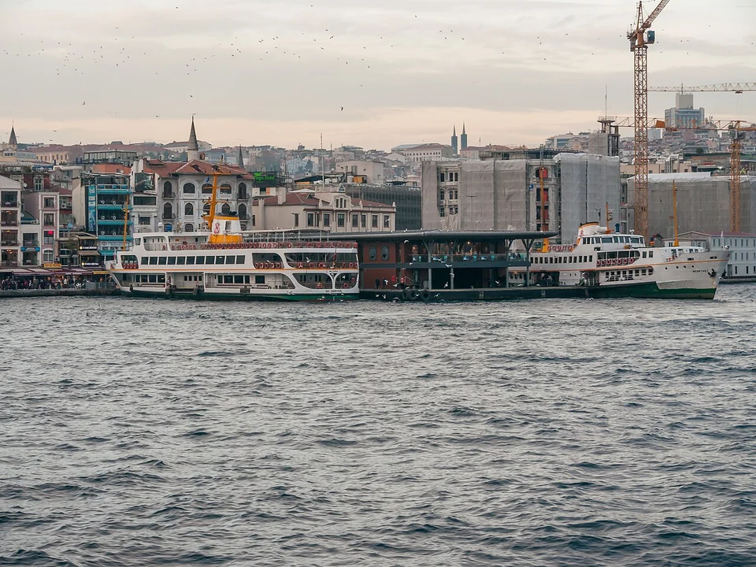
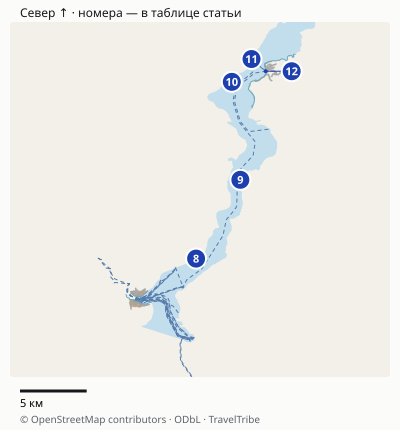
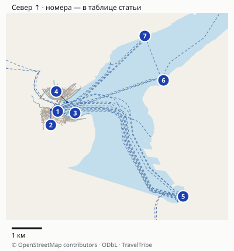
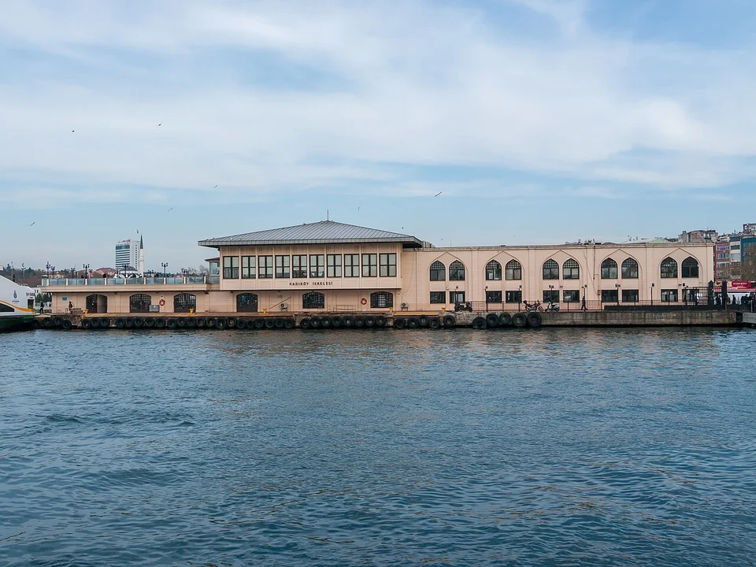
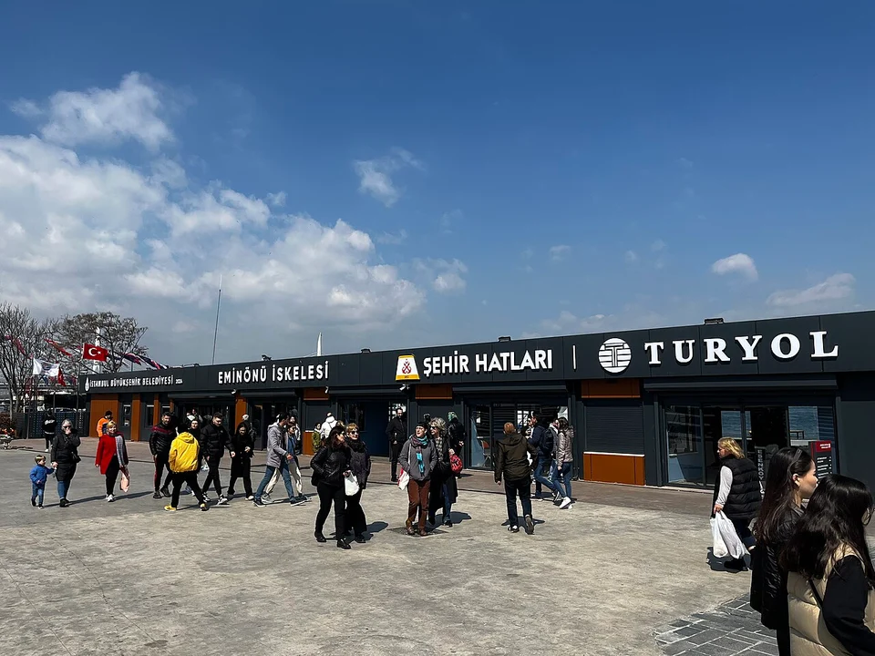

## Какой вариант выбрать

| Задача | Подходящий вариант | Главное ограничение |
|---|---|---|
| Переплыть на другой берег и продолжить прогулку | Обычный рейс Eminönü–Kadıköy или Eminönü–Üsküdar | Это транспортная переправа, не длинная экскурсия по проливу |
| Посмотреть берега Босфора без отдельного дневного выезда | Kısa Boğaz Turu | У тура своё отправление и отдельный тариф |
| Доехать по проливу до Анадолу-Кавагы с длительной остановкой | Uzun Boğaz Turu | Большая часть дня занята рейсом и остановкой |
| Ужин, музыка или определённый язык гида | Частный прогулочный круиз | Нужно отдельно проверить программу, питание и оператора |

Если в городе всего два дня, обычная переправа с прогулкой по азиатскому берегу часто проще вписывается в программу. Не покупайте длинный тур только потому, что «больше маршрута за билет»: он вытеснит другие планы этого дня.

## Городской паром: прогулка, которая приводит в нужный район

**Эминёню → Кадыкёй.** Выбирайте, если хотите совместить воду с рынком, кафе и прогулкой в Кадыкёе. Перед посадкой проверьте конечную остановку и оператора: у транспортного узла несколько разных пристаней. После высадки не обязаны немедленно возвращаться тем же судном — обратная поездка будет отдельным рейсом и оплатой.

**Эминёню → Ускюдар.** Подходит для знакомства с другим участком азиатского берега и прогулки у воды. Это короткое пересечение, а не поездка до северных районов Босфора. Для следующего участка можно выбрать наземный транспорт по своему маршруту; транспортная карта не превращает цепочку в бесплатное продолжение одного билета.

**Каракёй → Кадыкёй.** Удобная альтернатива, если вы начинаете день в районе Галаты и не хотите сначала переходить к Эминёню. Выбирайте причал по отправной точке, а не по рекомендации, будто один из них единственный «правильный» для всех туристов.

Название района не заменяет название причала и оператора. У большой набережной ищите табло нужного направления.

У этих маршрутов вид на воду — часть обычного перемещения по городу. За подробным рассказом об особняках и дворцах нужен отдельный экскурсионный продукт либо собственный подготовленный маршрут. Не обещайте аудиогид и остановки у всех достопримечательностей на каждом городском пароме.

## Карта и точная логистика

Обзор всего пролива. Городские причалы 1–7 показаны отдельно ниже, чтобы не смешивать соседние кассы и перевозчиков.

[Открыть подробную карту: масштаб, все точки и навигация](/maps/paromy-stambula/). Север вверху; нумерация указана ниже. На обзорной картинке дальние пересадки могут не помещаться — они доступны в подробной карте через «Все точки».

| № | Точка | Ориентир и ограничение |
|---|---|---|
| 1 | [Эминёню: Şehir Hatları](https://www.google.com/maps/search/?api=1&query=41.0183472,28.973161) | Городская линия; причальная зона отличается от касс соседних перевозчиков. |
| 2 | [Эминёню: Turyol](https://www.google.com/maps/search/?api=1&query=41.0188274,28.9704378) | Другой перевозчик: билет и продукт надо проверять отдельно. |
| 3 | [Эминёню: Boğaz](https://www.google.com/maps/search/?api=1&query=41.0178692,28.974023350000003) | Здание Şehir Hatları Boğaz İskelesi; конкретный тур/посадочную очередь сверяйте по табло. |
| 4 | [Каракёй](https://www.google.com/maps/search/?api=1&query=41.0211009,28.9768149) | Причальная зона; на табло нужны оператор, линия и направление. |
| 5 | [Кадыкёй: Şehir Hatları](https://www.google.com/maps/search/?api=1&query=40.9930645,29.0225349) | Причал с названием Karaköy/Eminönü; не путать с Turyol. |
| 6 | [Ускюдар](https://www.google.com/maps/search/?api=1&query=41.0276035,29.014792) | Причал на азиатском берегу; нужную линию сверяйте до посадки. |
| 7 | [Бешикташ:Şehir Hatları](https://www.google.com/maps/search/?api=1&query=41.0408253,29.0074193) | Не соседний причал Dentur Avrasya. |
| 8 | [Ортакёй](https://www.google.com/maps/search/?api=1&query=41.0472063,29.0256609) | Посадочный пункт короткого тура; проход судна не означает остановку на прогулку. |
| 9 | [Канлыджа](https://www.google.com/maps/search/?api=1&query=41.1002818,29.065224) | Остановка длинного тура согласно операторскому расписанию. |
| 10 | [Сарыер](https://www.google.com/maps/search/?api=1&query=41.1662756,29.0575868) | Остановка длинного тура. |
| 11 | [Румели-Кавагы](https://www.google.com/maps/search/?api=1&query=41.1816433,29.075199) | Остановка длинного тура перед азиатским конечным пунктом. |
| 12 | [Анадолу-Кавагы](https://www.google.com/maps/search/?api=1&query=41.1734279,29.0878695) | Конечный пункт длинного тура; возвращение по выбранному рейсу, не произвольный hop-on/off. |

### Как найти своего перевозчика на набережной

На карте отдельно отмечены **Şehir Hatları и Turyol в Эминёню**, а также здание **Boğaz İskelesi**. Соседняя касса с надписью Bosphorus Tour не означает тот же продукт. Для городской поездки к Кадыкёю проверьте на табло **Şehir Hatları → Kadıköy**; в обратную сторону ищите Karaköy / Eminönü. Причал в Кадыкёе с таким названием отмечен отдельно от терминалов островных линий.

Длинный тур проходит по цепочке **Eminönü → Beşiktaş → Üsküdar → Kanlıca → Sarıyer → Rumeli Kavağı → Anadolu Kavağı**. На карте отмечены эти пристани; время отправления, береговую остановку и возвращение смотрите в разделе длинного тура ниже.

Приходите в причальную зону за **20–30 минут** до выбранного отправления: это наш запас на поиск кассы и очереди, не правило ранней регистрации оператора. Конкретную посадочную очередь тура подтверждайте по табло и у сотрудника; маркер здания не гарантирует неизменные ворота. Короткий тур не превращайте в поездку со свободными выходами на каждой остановке без подтверждения билета. Линии на карте показывают географию причалов; картографическая паромная линия не доказывает наличие рейса в нужный час.

Расстояния округлены, время в пути зависит от пробок, погоды и открытых проходов. Метка территории может отличаться от входа: последние метры сверяйте с указателями. [Картографические данные © OpenStreetMap contributors](https://www.openstreetmap.org/copyright), ODbL.

## Пример: утром в Кадыкёй, обратно к Галате

На [маршрутной странице Kadıköy–Karaköy–Eminönü](https://sehirhatlari.istanbul/tr/seferler/ic-hatlar/istanbul-ici-hatlar/kadikoy-karakoy-eminonu-163) опубликована связка: **Eminönü 10:35 → Kadıköy 10:55**, затем **Kadıköy 13:00 → Karaköy 13:25**. Это пример утреннего городского плана по действующей таблице, не гарантия рейса при отмене; перед поездкой проверьте дату и примечания к нужной строке.

Между рейсами остаётся около двух часов на прогулку и еду в Кадыкёе. Возвращение в Каракёй удобно для продолжения дня у Галаты. Если нужно вернуться к Эминёню, та же опубликованная обратная строка идёт туда к 13:30. Оплатите каждую посадку отдельно и выберите конкретное направление на табло. Не отправляйтесь на прогулку к далёкой Моде, если хотите сохранить короткую двухчасовую остановку без спешки.

## Как работает Istanbulkart

На городских рейсах Şehir Hatları тариф указан для **İstanbulkart**. Пополните баланс до подхода к турникету, затем приложите карту и дождитесь подтверждения прохода. Если не уверены в списании, спросите сотрудника до повторного прикладывания. Для обратного рейса нужен отдельный запас денег.

[Муниципальный туристический портал](https://www.visit.istanbul/en/istanbul-card) указывает покупку и пополнение карты в автоматах BELBİM и официальных точках. Не рассчитывайте, что любой автомат примет именно вашу банковскую карту или что приложение зарегистрируется без требований к номеру и данным. Для первой поездки понятнее заранее разобраться с физической картой и местным способом пополнения.

В [тарифной таблице перевозчика](https://sehirhatlari.istanbul/tr/ucret-tarifeleri) полный тариф Karaköy–Kadıköy / Eminönü–Kadıköy указан как **65,21 TRY**, около **109 ₽**, а Üsküdar–Eminönü — **58,52 TRY**, около **98 ₽**. Для других маршрутов сумма отличается.

Скидочные и пересадочные категории не переносите на обычную анонимную туристическую карту. Перевозчик отдельно связывает пересадочную льготу с персонализированной Istanbulkart. На части дистанционных линий действует возврат разницы через устройство на выходе; это не универсальное правило для каждой переправы и каждого типа карты. Для двух названных центральных направлений не планируйте дополнительный возврат как обязательную экономию.

Ночные рейсы имеют отдельные условия тарификации. Не используйте дневную сумму для поздней поездки без проверки и не рассчитывайте, что паромы работают всю ночь каждый день. Городское расписание зависит от конкретной линии.

## Короткий тур по Босфору

Ищите название **Kısa Boğaz Turu** на [странице Şehir Hatları](https://sehirhatlari.istanbul/tr/seferler/bogaz-turlari/kisa-bogaz-turu-181). Опубликованное отправление: **14:40 из Eminönü**, далее **14:55 Üsküdar**, **15:10 Ortaköy**. Это время отправлений по точкам посадки, а не список длительных выходов на берег.

Оператор в [официальном описании от 10 мая 2023 года](https://sehirhatlari.istanbul/tr/duyurular/baharin-mujdesi-erguvan-turlarimiz-basliyor-2124) указывает для короткого тура **около двух часов**. При отправлении из Эминёню в 14:40 это даёт **ориентировочное возвращение около 16:40** — редакционный расчёт, а не опубликованное время прибытия. В действующей таблице отдельного времени возвращения нет, а повторяющиеся блоки не являются дополнительными рейсами. Перед покупкой подтвердите у кассы возвращение именно к вашей пристани; не ставьте обязательную встречу сразу после расчётного окончания прогулки. Орта-Кёй в таблице — точка посадки, а не обещанный конец прогулки.

[Иностранный тариф короткого тура](https://sehirhatlari.istanbul/tr/ucret-tarifeleri/bogaz-turlari-78) — **340 TRY**, приблизительно **570 ₽**. Местная цена в соседней колонке ниже и не является универсальным туристическим тарифом. Детские условия уточняйте по возрасту и гражданству: пустая ячейка иностранной категории не даёт основания автоматически делить взрослую цену пополам.

Тур выбирайте как конкретный экскурсионный рейс. До очереди уточните место продажи и способ оплаты билета; не рассчитывайте пройти на него по тому же списанию Istanbulkart, что и на обычную переправу. Билет частного продавца у набережной также не становится билетом Şehir Hatları из-за похожего названия «Босфор».

## Длинный тур до Анадолу-Кавагы

На [официальной странице Uzun Boğaz Turu](https://sehirhatlari.istanbul/tr/seferler/bogaz-turlari/uzun-bogaz-turu-91) показан следующий полный дневной круг:

**Eminönü 10:35 → Beşiktaş 10:50 → Üsküdar 11:05 → Kanlıca 11:35 → Sarıyer 12:05 → Rumeli Kavağı 12:15 → Anadolu Kavağı 12:25.**

Обратное отправление из Анадолу-Кавагы — **15:00**, возвращение в Эминёню — **16:40**. Между ними остаётся остановка на берегу. Это около шести часов между первым отправлением и возвращением, без дороги к причалу, очереди и обратного пути в отель.

Иностранный билет **туда и обратно — 640 TRY**, около **1073 ₽**. Не подменяйте его опубликованной в другой колонке местной ценой. Если хотите выйти раньше и возвращаться самостоятельно, сначала выясните, какое право на обратный проезд даёт конкретный билет и где ещё будет рейс. Не превращайте тур в произвольный hop-on hop-off без подтверждения таких условий.

На остановке можно пообедать и пройтись по посёлку. Подъём к видовым точкам необязателен: оцените уклон, обувь и время обратной посадки. Зафиксируйте причал и час возвращения до того, как уйдёте от воды; следующий удобный рейс не следует подразумевать автоматически.

Кадыкёй — пример городского назначения. Он не входит автоматически в маршрут длинного тура до Анадолу-Кавагы.

## Что проверить у причала

Сначала сверяйте **оператора → название линии → направление → время → тип билета**. Затем занимайте очередь. Уточните, откуда отправляется ваш рейс: причалы и посадочные зоны меняются, а на карте несколько соседних точек могут называться одинаково.

На холодный или ветреный день возьмите дополнительный слой одежды. Открытая палуба не гарантирована каждому пассажиру и может быть менее удобной, чем салон. Не занимайте проходы ради съёмки и следуйте указаниям экипажа при посадке.

На Эминёню рядом видны вывески Şehir Hatları и Turyol. Название оператора и нужную линию проверьте до очереди.

## Погода, отмена и запасной путь

Şehir Hatları предупреждает об отменах из-за погоды и технических причин. Перед выездом к причалу проверьте [объявления оператора](https://sehirhatlari.istanbul/tr/duyurular). Действующий зимний период объявлен с 7 сентября 2026 года по 27 июня 2027 года; старый сохранённый PDF может содержать другое сезонное расписание.

Если обычную переправу отменили, перестройте дорогу через работающий наземный или рельсовый транспорт. Вариант через Marmaray имеет смысл для перемещения между берегами, но он не заменяет прогулку по Босфору. Проверяйте его работу и нужные станции отдельно. При отмене экскурсионного тура выбирайте другую городскую программу, а не пытайтесь обязательно выйти на воду в неподходящую погоду.

Частный круиз рассматривайте ради конкретной услуги: языка гида, ужина, времени заката или небольшой группы. Сравнивайте включения, точку посадки и правила отмены; слово «круиз» не гарантирует питание и свободный выбор столика. Для планирования других дней пригодится [гид по Турции](/turkey/).
