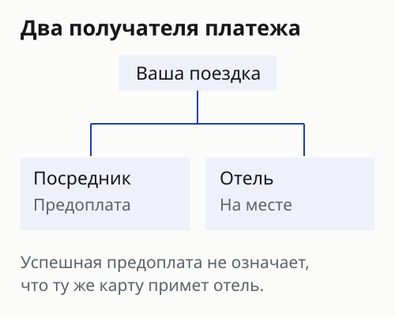
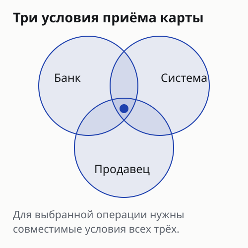
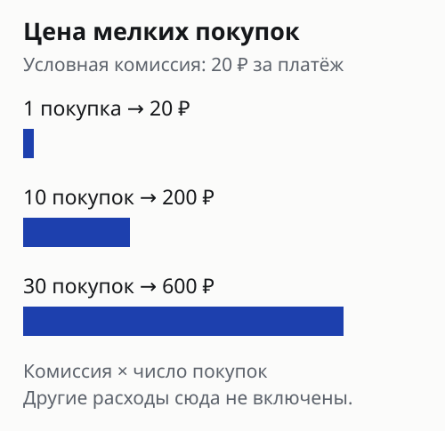
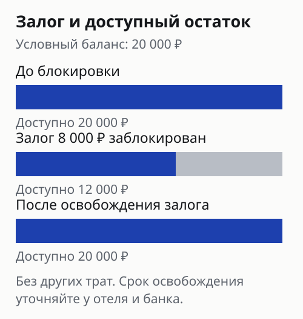

import AffiliateNote from '../../components/post/AffiliateNote.astro';

Оплатить зарубежный отель российской картой через посредника и расплатиться этой же картой на стойке отеля — разные задачи. Бронь может быть оплачена заранее, а депозит, городской сбор или ужин потребуют другого способа расчёта. Поэтому готовиться к поездке лучше с перечня расходов: что оплатите дома, что останется на месте и чем замените основной способ при отказе.

Российские Visa и Mastercard для зарубежного терминала не подходят. Иностранная карта, виртуальная карта, «Мир», UnionPay и наличные решают разные части задачи. Ни логотип платёжной системы, ни успешная покупка у другого путешественника не подтверждают работу вашей карты в конкретном банкомате или отеле.

<AffiliateNote />

Для поездки в Португалию пример расходов на месте есть в [гиде по дворцу Пена](/blog/dvorets-pena-sintra/). В нём отдельно указаны вход, шаттл и условия возврата тарифа.

## Что подготовить под свою поездку

Сначала откройте подтверждения билетов и проживания. Выделите неоплаченные суммы, залоги и расходы первого дня. Затем подберите способ для каждого платежа. Для короткого отдыха с оплаченной гостиницей открывать новый банковский счёт может быть незачем. Для самостоятельного маршрута с арендой машины и несколькими отелями ограничения карты становятся гораздо важнее стоимости её выпуска.

| Задача | Что проверить до вылета |
|---|---|
| Оплатить билеты и жильё заранее | Кто принимает деньги, валюта окончательного списания, условия возврата |
| Заселиться в отель | Оплачена ли вся бронь; чем внести депозит и местные сборы |
| Платить в магазинах и кафе | Принимается ли конкретная карта; нужен ли физический пластик или поддерживаемый мобильный кошелёк |
| Снять наличные | Подходящий банк, лимит операции, комиссии банкомата и эмитента |
| Получить деньги при отказе карты | Доступный резервный способ, документы, связь и время получения |

Сохраните ответы отеля и прокатчика. Формулировка «принимаем Visa» ещё не отвечает, подойдёт ли неименная виртуальная или предоплаченная карта для залога. Если нужна кредитная карта на имя водителя, наличие денег на другой карте эту проблему не решит. Получить ясный ответ до поездки проще, чем менять бронь на стойке.

Если рассматриваете виртуальную карту, <a href="https://platipomiru.com/?utm_source=traveltribe&utm_medium=cpa&utm_content=blog_pay_abroad_plan" rel="sponsored noopener">сверьте условия сервиса со своим списком платежей</a>. Стоимость и ограничения этого варианта разобраны ниже; подтверждение от отеля он не заменяет.

## Какие карты работают за границей

Карты Visa, выпущенные российскими банками, не обслуживаются за пределами России: это прямо предусмотрено решением [Visa](https://usa.visa.com/about-visa/newsroom/press-releases.releaseId.18871.html). [Mastercard](https://investor.mastercard.com/investor-news/investor-news-details/2022/Mastercard-Statement-on-Suspension-of-Russian-Operations/default.aspx) также приостановила поддержку карт российских банков в своей сети. Наличие валютного счёта у такой карты не меняет страну её выпуска.

Иностранную Visa или Mastercard выбирайте по условиям банка и своим задачам. Уточните доступность оформления для нерезидента, документы, обслуживание, пополнение из России, интернет-платежи и получение кодов подтверждения. Обещание посредника «сделаем за день» не заменяет решения банка об открытии счёта. Поездку за картой считайте вместе с билетами, жильём и возможным повторным визитом. До открытия иностранного счёта проверьте, какие обязанности по уведомлению и отчётности применимы к вам. Порядок и исключения собраны на [сайте ФНС](https://www.nalog.gov.ru/rn77/related_activities/accounting/recording_individuals/notice/).

UnionPay проверяют по банку-эмитенту, стране и операции. Знак UnionPay на банкомате относится к поддержке системы, но сам по себе не подтверждает обслуживание всех выпущенных в России карт. До оформления запросите у своего банка ограничения, а в стране поездки найдите конкретные банкоматы или торговые точки. Общую карту присутствия платёжной системы нельзя превращать в обещание работающего маршрута.

Apple Pay и Google Pay — способы использовать подходящую карту. Само добавление карты в телефон не снимает ограничения её эмитента и продавца. У виртуального продукта отдельно проверяйте поддержку нужного кошелька и вашего устройства; карта для онлайн-подписок может не подходить для оплаты телефоном в кафе.

## «Мир»: проверяйте банк и операцию, а не список стран

Для «Мира» особенно важна связка «страна — банк обслуживания — действие». Снятие наличных в одном банке не означает, что картой получится оплатить любой ресторан в этой стране. Два проверенных примера показывают разницу.

| Страна и карта | Подтверждённый способ | Комиссия и ограничение |
|---|---|---|
| Армения, «Мир» российского банка | Получение наличных в банкоматах и через POS-терминалы ВТБ (Армения) | Банк указывает 1%; в банкомате до 150 000 драм (около 34 340 ₽) за операцию. Тариф и суточные ограничения эмитента проверяйте отдельно |
| Казахстан, «Мир» иностранного для Казахстана банка | Тенге в банкоматах и кассах ВТБ (Казахстан); покупки в точках с подходящими POS-терминалами «Мир» | Банк подтверждает эти каналы в FAQ; единой комиссии для всех российских эмитентов там нет |

В Армении POS в этой услуге — **получение наличных через терминал банка**, а не подтверждение оплаты в магазинах. При обращении в банк предусмотрена идентификация; для моментальной или виртуальной карты потребуется подтверждение принадлежности в банковском приложении. Условия и адреса смотрите у [ВТБ (Армения)](https://www.vtb.am/ru/card/cash-out-mir-arca). Для Казахстана используйте [FAQ банка](https://www.vtb-bank.kz/individuals/chasto-zadavaemye-voprosy-faq/) и его список подходящих точек.

Это примеры конкретных каналов, а не полный перечень стран. Если едете в другое место, найдите подтверждение именно для своей карты и нужной операции. QR-оплата из банковского приложения тоже требует отдельной проверки: возможность оплатить выбранный QR-код не означает, что пластик «Мир» принимается в обычном терминале рядом.

Пример покупки билета на месте — [Метрополитен-музей в Нью-Йорке](/blog/metropoliten-muzey-nyu-york/). Обычный билет можно купить в кассе, а экскурсию на английском бронируют на выбранный сеанс.

## Виртуальная карта: сколько стоит удобство

Виртуальная карта удобна для интернет-платежей, а при поддержке мобильного кошелька — для части расходов в поездке. Перед выпуском проверьте эмитента, разрешённые страны и валюты, возврат остатка и ограничения продавца. Снятие наличных не следует из наличия номера карты.

У «Плати по всему миру» выпуск «Для подписок» стоит 2990 ₽, «Для путешествий» — 3990 ₽; со второго года обслуживание стоит столько же. У этих двух тарифов успешная операция — $0,25 (около 21 ₽), неуспешная — $0,50 (около 41 ₽). При возврате суммы пополнения предусмотрено удержание 10%; возврат продавцом — отдельный случай с комиссией 2%. Пополнение идёт по внутреннему курсу сервиса. Рублёвые эквиваленты — ориентир для сравнения; сервис применяет собственный курс. Возможность оплаты у нужного продавца проверяйте отдельно: наличие карты не гарантирует успешный платёж.

В <a href="https://kb.platipomiru.com/nachalo-raboty/usloviya-kart.html?utm_source=traveltribe&utm_medium=cpa&utm_content=blog_pay_abroad_terms" rel="sponsored noopener">правилах карт</a> есть и неоднозначность: таблица указывает конвертацию не-USD до 3%, а подробный пункт описывает дополнительный фиксированный сбор. До оплаты выпуска запросите расчёт для своей валюты и тарифа. По этим правилам выпуск иногда занимает до трёх рабочих дней, а наличные можно снимать только пластиковой картой.

<a href="https://platipomiru.com/?utm_source=traveltribe&utm_medium=cpa" class="aff-cta" rel="sponsored noopener">Проверить условия карты для своей поездки</a>. Сравните тариф с расходами, которые действительно остались после оплаты билетов и жилья. При небольшом бюджете разовая стоимость выпуска может перевесить удобство. Не пополняйте карту на весь отпуск до проверки нужного способа оплаты и условий возврата.

## Как посчитать полную стоимость платежей

Сумма расходов складывается из выпуска и обслуживания карты, наценки в курсе пополнения, комиссий за операции, конвертации и возможного снятия наличных. Надпись «пополнение без комиссии» ничего не говорит о выгодности курса. Сравнивайте, сколько рублей нужно отдать, чтобы продавец получил одну и ту же сумму в своей валюте.

| Расход | Как включить в расчёт |
|---|---|
| Выпуск и обслуживание | Фиксированная сумма за нужный срок использования |
| Пополнение | Рубли к списанию за одинаковую сумму на балансе |
| Покупки | Комиссия за одну операцию × предполагаемое число покупок |
| Конвертация | Отдельно для расходов не в валюте карты |
| Наличные | Комиссия эмитента плюс сбор владельца банкомата, если предусмотрены |
| Возврат остатка | Удержание и курс по действующим правилам |

Расчётный пример: если карта берёт фиксированные 20 ₽ за покупку, тридцать покупок добавят 600 ₽. Это условный тариф для объяснения формулы, не предложение банка. Он показывает, почему одна крупная предоплата и ежедневные мелкие покупки дают разную стоимость использования карты. Для реального сравнения подставьте свой тариф и валюту списания.

Возвратный депозит считайте отдельно от расходов: он временно уменьшает доступные деньги. Если гостиница блокирует залог, заранее уточните сумму, способ внесения и порядок освобождения. Не расходуйте остаток баланса до выяснения, сколько денег потребуется на следующие заселения.

## Бронь из России и оплата на месте

Сервис может принять российскую карту за зарубежное проживание, потому что платёж проходит через его платёжного партнёра. При выборе «оплата в отеле» платить придётся получателю на месте. Поэтому после заказа проверьте подтверждение: что оплачено, что включено, что останется доплатить и кто отвечает за возврат.

В [разборе Trip.com](/blog/trip-com-2026/) отдельно показана разница между предоплатой и оплатой в гостинице. Сравнить условия другого посредника поможет [обзор Островка](/blog/ostrovok-2026/). Отель за рубежом можно оплатить заранее, но это не подтверждает работу российской карты в иностранном банкомате.

Если иностранная карта нужна именно для бронирования, перед выпуском <a href="https://platipomiru.com/?utm_source=traveltribe&utm_medium=cpa&utm_content=blog_pay_abroad_booking" rel="sponsored noopener">уточните у сервиса поддержку выбранного продавца</a>. Виртуальная карта для предоплаты может не подойти для залога при заселении.

Для авиабилетов проверьте перевозчика, маршрутную квитанцию, багаж и правила обмена. Удобный способ оплаты не исправляет неудобную пересадку или невозвратный тариф. Перед покупкой через поисковик посмотрите, на каком сайте заканчивается заказ: именно продавец будет принимать деньги и обрабатывать обращение. Подробности — в [гайде по Авиасейлс](/blog/aviasales-2026/).

## Наличные и банкоматы: запас под конкретный маршрут

Размер наличного резерва зависит от неоплаченных расходов. Выпишите дорогу из аэропорта, еду, связь и следующий переезд, которые сможете оплатить без карты. Добавьте расходы на период, пока решаете возможную проблему с банком. Универсальный совет взять одинаковую сумму на неделю не учитывает ни страну, ни предоплаченное проживание.

Проверьте правила вывоза валюты из России и ввоза в каждую страну маршрута, включая пересадки с выходом через границу. Не переносите лимит снятия денег со счёта на правила их перевозки. Эти ограничения регулируют разные действия. Актуальные условия смотрите у таможенных органов перед вылетом.

У банкомата прочитайте комиссию до подтверждения. Если он предлагает списать сумму в валюте вашей карты, это может быть DCC — конвертация на стороне владельца устройства. [Visa](https://www.visa.co.uk/travel-with-visa/dynamic-currency-conversion.html?fsource=stcweb) требует показывать обе суммы, курс и наценку, оставляя выбор держателю. Отказ от DCC не отменяет комиссию за снятие и конвертацию вашего банка. Сопоставьте оба варианта, а при непонятном экране отмените операцию.

## Если платёж отклонён

Сначала посмотрите статус операции в приложении: отказ, ожидание и списание требуют разных действий. При неизвестном результате не повторяйте один платёж много раз. Сохраните сумму, валюту, время, название продавца и сообщение об ошибке; с этими данными проще обратиться к банку или сервису.

Проверьте баланс с запасом на комиссии, лимиты, разрешение интернет-покупок и необходимость подтверждения. Если карта работает в магазине, но не принимается отелем для залога, проблема может быть в типе карты или правилах объекта. Второй терминал не исправит такое ограничение.

Используйте подготовленный резерв. Для денежного перевода заранее проверьте доступность направления, документы получателя и реальный способ выдачи. Не считайте старое название сервиса в путеводителе подтверждением того, что он продолжает переводить деньги из России. Доступ к банковскому номеру и поддержке сохраните отдельно; выбрать связь поможет [гайд по eSIM и роумингу](/blog/esim-zagranicey-2026/).

## Перед вылетом

1. Выпишите все оставшиеся платежи, включая залоги и местные сборы.
2. Получите от отеля и прокатчика подтверждение подходящего типа карты.
3. Проверьте страну выпуска, банк, канал оплаты и разрешённые валюты.
4. Посчитайте выпуск, пополнение, покупки, наличные и возврат остатка вместе.
5. Сохраните адреса подходящих банкоматов и контакты поддержки.
6. Подготовьте резерв, доступный без основной карты и телефона.
7. Скачайте подтверждения бронирований и проверьте доступ к банковским кодам.

Для выбранной виртуальной карты <a href="https://platipomiru.com/?utm_source=traveltribe&utm_medium=cpa&utm_content=blog_pay_abroad_departure" rel="sponsored noopener">ещё раз проверьте действующий тариф</a> и сохраните условия пополнения и возврата. Если условия не подходят вашему маршруту, вернитесь к другим способам из списка выше.

Для [поездки в Грузию](/blog/pay-georgia-2026/) пригодится отдельный разбор местных расчётов. Для любого другого маршрута начинайте с того же вопроса: какая конкретно сумма, кому и каким способом должна быть оплачена. Такой список позволяет выбрать карту по своей поездке и увидеть недостающий способ до вылета.
