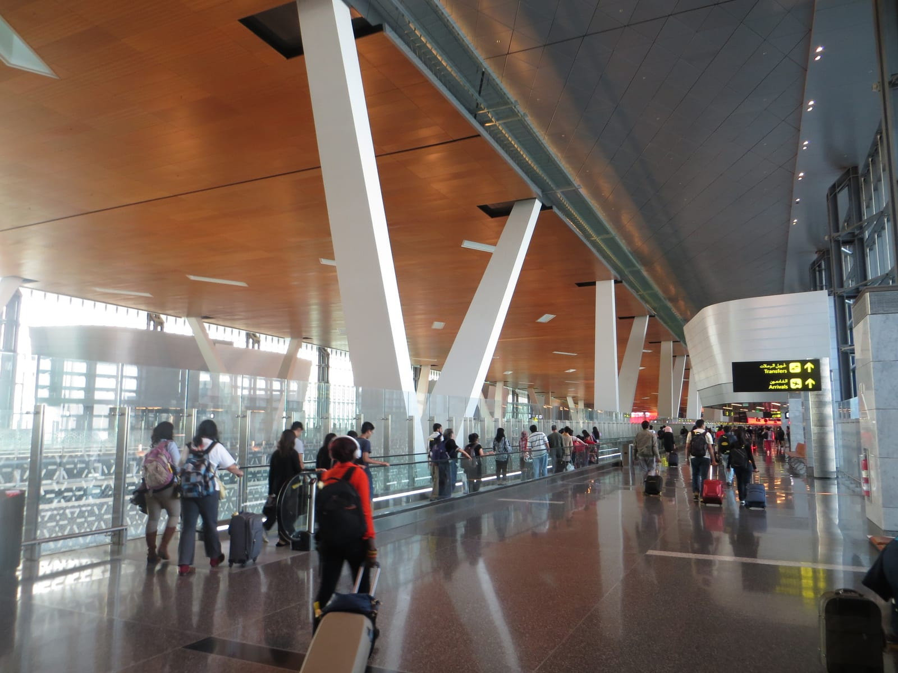
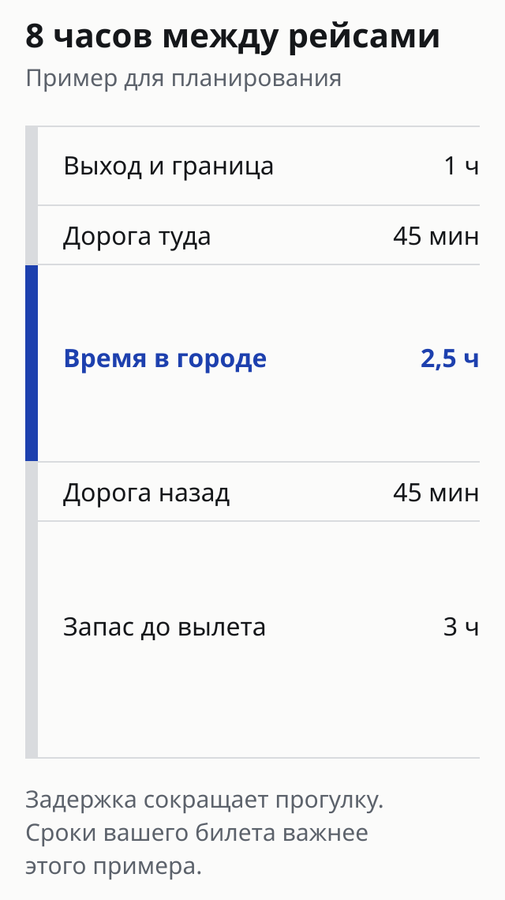
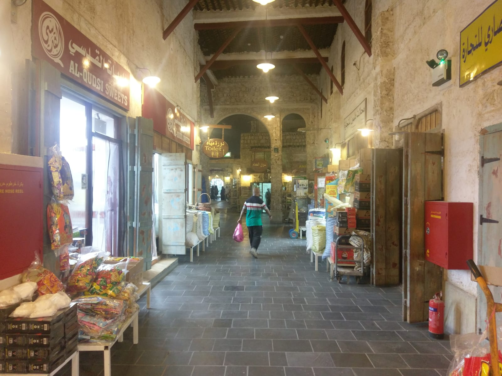
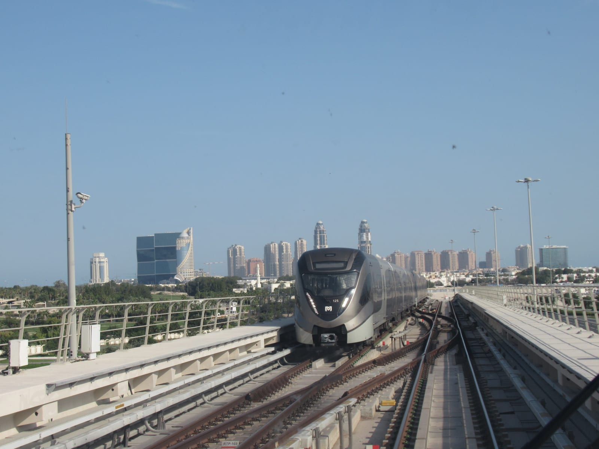

import { aviasalesRoute, ostrovokCity } from '../../data/affiliate.js';

export const flights = aviasalesRoute('MOW', 'DOH', 'peresadka_doha_flights');
export const hotels = ostrovokCity('qatar', 'doha', 'peresadka_doha_hotels');

**При пересадке в Дохе можно выйти в город, если вы имеете право въехать в Катар и успеваете вернуться к своему рейсу.** Шесть часов в билете сами по себе этого не доказывают. Из интервала между рейсами нужно вычесть выход из самолёта, границу, дорогу в обе стороны и запас на следующий вылет.

При короткой стыковке оставайтесь в терминале. При длинной дневной — считайте время для одного компактного маршрута. Ночью сначала решите вопрос со сном: бесплатное размещение Qatar Airways зависит от билета и тарифа, а не только от длины пересадки.

## Сначала проверьте билет и багаж

Сравните коды аэропортов в маршрутной квитанции: статья относится к **Hamad International Airport, DOH**. Затем проверьте, оформлена ли пересадка одним билетом и до какого аэропорта зарегистрирован чемодан. Ответ виден на багажной бирке и в условиях перевозки, а не в обещании «всё куплено на одном сайте».

При сквозной регистрации не идите получать чемодан только ради прогулки. При раздельных билетах и багаже до Дохи может понадобиться въезд, выдача вещей и новая регистрация. Сначала уточните этот порядок и крайний срок приёма багажа у перевозчика; только потом считайте часы на город.

Если билеты ещё не куплены, можно <a href={flights} rel="sponsored noopener">сравнить перелёты Москва — Доха</a>. Открывается поиск Москва — Доха: для стыковочного маршрута добавьте свой конечный пункт и проверьте единый билет. Дешевизна двух отдельных рейсов не включает цену нового билета при пропущенном продолжении.

Интерьер терминала Хамад. Снимок сделан в 2014 году и не показывает сегодняшнюю очередь или актуальное расположение вашего выхода.

## Можно ли выйти с российским паспортом

На 12 октября 2026 года форма **Visit Qatar** для паспорта РФ, без резидентства в странах GCC и дополнительных виз, показывает возможность **безвизового въезда**. В этом результате указан паспорт, действительный минимум **три месяца с даты прибытия**. Это ответ для выбранных условий: другой паспорт или иной статус нужно проверить отдельно.

Откройте [визовую форму Visit Qatar](https://visitqatar.com/intl-en/plan-your-trip/visas) перед поездкой и сверяйте требования с перевозчиком. При выходе из транзитной зоны вы проходите обычный въездной контроль; билет с пересадкой не заменяет разрешение на въезд. Держите под рукой следующий билет и подтверждение размещения, если собираетесь ночевать в городе. Не считайте бронирование отеля гарантией допуска через границу.

Визовый FAQ рекомендует медицинскую страховку для поездки в Катар. Проверьте, действует ли ваш полис при выходе в город и включает ли нужные медицинские расходы: слово «транзит» в билете не отвечает за условия страхования. Для пересадки без прохождения границы задайте перевозчику отдельный вопрос о документах именно на ваш маршрут.

## Сколько времени действительно остаётся на прогулку

Ниже — **расчётный сценарий**, а не статистика очередей в DOH. Возьмём 1 час на выход и въездной контроль, по 45 минут на каждую поездку и возвращение в аэропорт за 3 часа до вылета. Получается:

**Время на город = пересадка − 1 час − 1,5 часа дороги − 3 часа запаса.**

  <table>
    <thead><tr><th>Между рейсами</th><th>Остаток в этом примере</th><th>Решение</th></tr></thead>
    <tbody>
      <tr><td data-label="Между рейсами">4 часа</td><td data-label="Остаток в этом примере">Запаса на город нет</td><td data-label="Решение">Остаться в терминале</td></tr>
      <tr><td data-label="Между рейсами">6 часов</td><td data-label="Остаток в этом примере">30 минут</td><td data-label="Решение">Прогулка не оправдывает дорогу</td></tr>
      <tr><td data-label="Между рейсами">8 часов</td><td data-label="Остаток в этом примере">2,5 часа</td><td data-label="Решение">Один район без плотной программы</td></tr>
      <tr><td data-label="Между рейсами">10 часов</td><td data-label="Остаток в этом примере">4,5 часа</td><td data-label="Решение">Короткий маршрут с едой и паузами</td></tr>
      <tr><td data-label="Между рейсами">12 часов</td><td data-label="Остаток в этом примере">6,5 часа</td><td data-label="Решение">Можно совместить прогулку и отдых</td></tr>
    </tbody>
  </table>

Запас в три часа — редакционный выбор для примера, а не объявленное аэропортом единое правило. Если билет требует более ранней регистрации, берите его срок. Если первый рейс задержался на час, вычтите час из прогулки. Если изменился выход или нужно сдавать багаж заново, пересчитайте весь остаток. Отрицательный результат не исправляют ускоренной поездкой на такси.

## Один маршрут: Сук-Вакиф, затем набережная

Для первого короткого выхода выберите **Сук-Вакиф** и прилегающий центр. В оставшееся время можно добавить Корниш — набережную залива. Если времени мало, останьтесь в одном месте: получасовая погоня за второй точкой быстро съедает смысл прогулки.

Установите время разворота до того, как закажете еду или отправитесь дальше. Например, при вылете в 18:00 и выбранном возвращении к 15:00 начните дорогу обратно не позднее 14:15 при принятом в расчёте 45-минутном переезде. Это арифметический пример; используйте фактическую оценку дороги и добавьте запас, если она выросла.

Сук-Вакиф удобно оставить единственной целью короткого выхода. Часы отдельных лавок и ресторанов нужно проверить на свой день.

Метро связывает аэропорт Хамад с городом; линии сходятся на **Msheireb**. Уточните нужную пересадку, время последнего поезда и путь от станции до выбранного места. Не приравнивайте время в вагоне к пути от выхода самолёта до столика в кафе. По ночам не рассчитывайте на круглосуточное метро без проверки расписания.

Красная линия метро Дохи. Перед выходом из аэропорта проверьте, работает ли метро в оба нужных вам момента — туда и обратно.

Такси даёт более прямую дорогу, но не убирает пробки и очередь на границе. Для короткой пересадки пустыня и дальние районы — отдельная поездка: не добавляйте их к рынку только потому, что карта кажется небольшой. В жару сокращайте пешую часть, выбирайте паузы в помещении и не тратьте последний запас на длинную прогулку вдоль залива.

## Ночь и отель: что именно может быть бесплатным

**Complimentary Transit Accommodation Qatar Airways не положен каждому пассажиру с длинной пересадкой.** В опубликованных условиях нет подходящего продолжения, продаваемого или выполняемого Qatar Airways, в первые восемь часов после прилёта; хотя бы один рейс должен продаваться и выполняться самой Qatar Airways. Остальные рейсы могут выполняться партнёром, но должны продаваться Qatar Airways. Для части тарифов возможна доплата; предоставление размещения остаётся решением перевозчика.

Запросите проверку права по своей брони **не позднее трёх дней до вылета в Доху**. После подтверждения выдают ваучер. Если времени осталось меньше, страница предлагает обратиться к стойке трансфера в Хамаде; это возможность спросить, а не обещание номера по прибытии. В программу включены отель и обратный трансфер, но подтверждённое размещение само по себе не гарантирует въезда.

Платная остановка в городе — другое решение. Сначала посчитайте время на дорогу, заселение и выезд: из восьми ночных часов может остаться совсем мало сна. При самостоятельной ночёвке можно <a href={hotels} rel="sponsored noopener">сравнить отели Дохи</a>, затем уточнить у конкретного объекта позднее заселение, ранний выезд и длительность трансфера. Городской поиск не означает отель внутри транзитной зоны.

Если выходить не хочется, уточните доступный отдых в терминале и расположение своего следующего выхода. Для отеля или зоны сна внутри аэропорта важно, с какой стороны границы находится объект и допускает ли ваша пересадка доступ туда. Не покупайте городской номер, ожидая попасть в него без въезда в Катар.

## Экскурсия Discover Qatar и последние проверки

Discover Qatar предлагает транзитные городские экскурсии при пересадке **от шести часов**. Это минимальное условие программы: оно не делает любой самостоятельный выход при шестичасовой стыковке разумным. Перед оплатой проверяйте продолжительность выбранного тура, время встречи, право на въезд и следующий вылет.

На странице оператора стойка Transit Tours находится в **Duty Free Plaza South, за эскалаторами**; туда же направляют за помощью с последним бронированием. Не считайте старую цену экскурсии или рассказ о бесплатном автобусе условием сегодняшней программы. Стоимость и доступность нужно смотреть для своего тура и даты.

Перед выходом сохраните посадочный талон, время следующего вылета, маршрут назад и сведения о багаже. При возвращении сразу проходите нужные формальности и идите к своему выходу. Если один из этих пунктов неясен, оставайтесь в аэропорту и выясните его у стойки трансфера.

Для другого хаба правила будут иными: отдельно разобраны [пересадка в Стамбуле](/blog/peresadka-v-stambule/), [в Пекине](/blog/peresadka-v-pekine/) и [в Шанхае](/blog/peresadka-v-shankhae/). Их визовые условия и бесплатные программы нельзя переносить на Доху.
