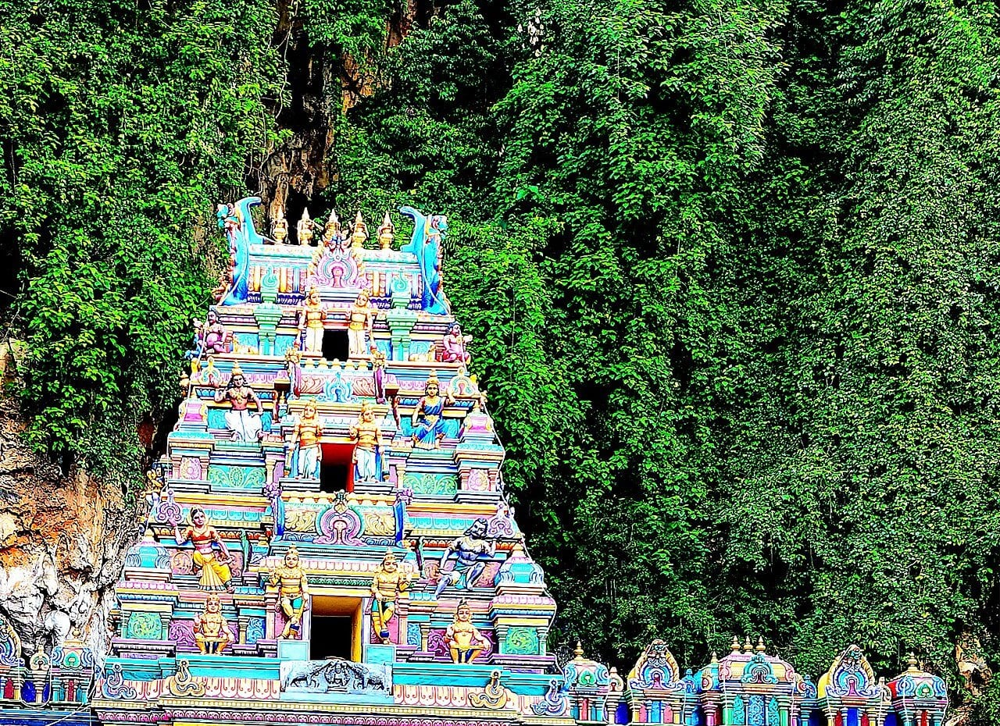
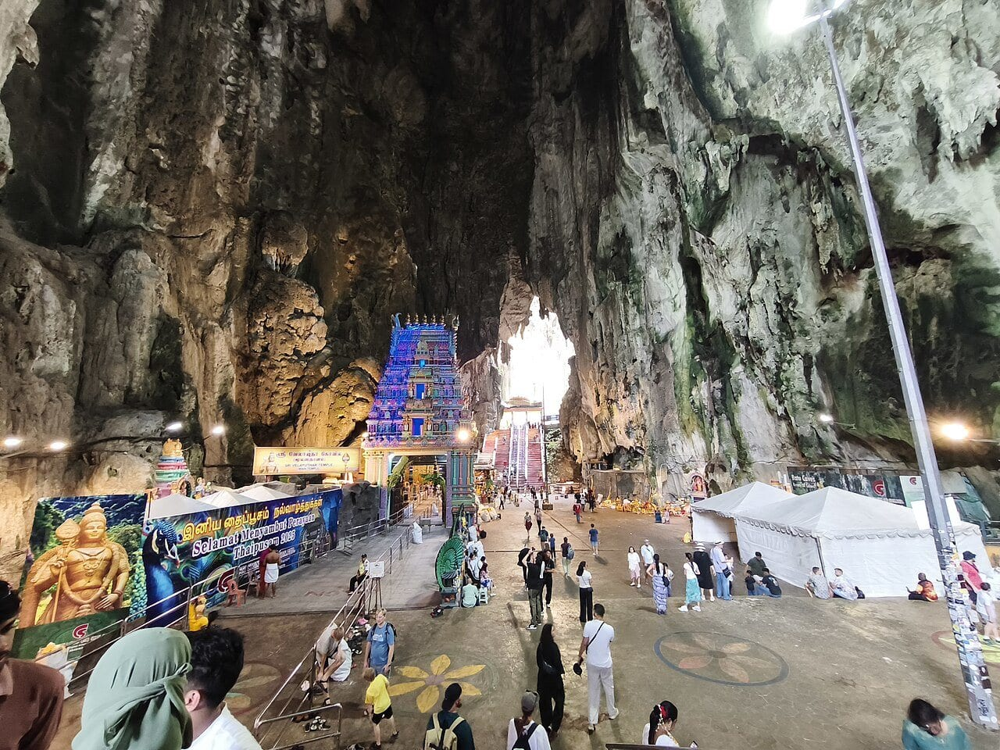
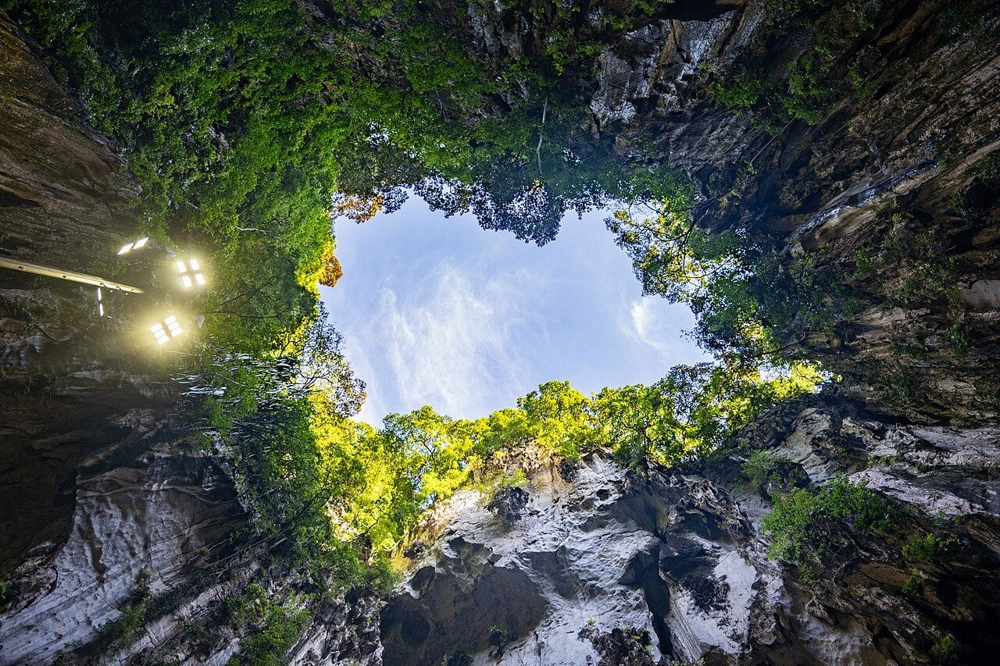
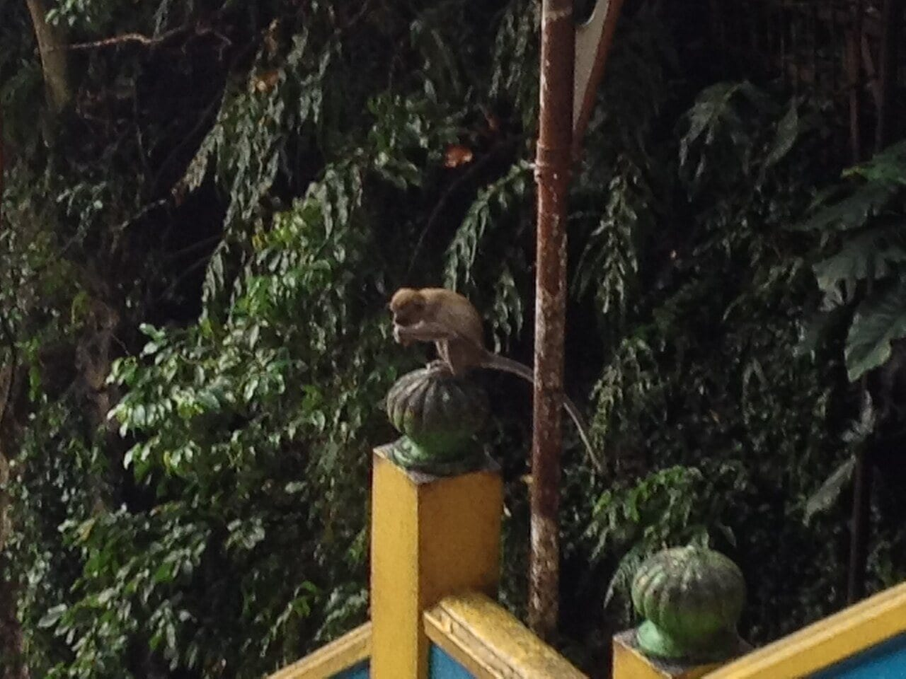

У пещер Бату легко ошибиться в двух вещах: купить экскурсию, думая, что это обязательный входной билет, и приехать на станцию без обратного расписания. **Главная храмовая пещера бесплатна, а поезд KTM ходит по расписанию с заметными интервалами.** Самая известная часть маршрута — 272 цветные ступени — остаётся пешей при любом способе приезда.

На сам комплекс разумно оставить **полтора–два часа**, на выезд из центрального Куала-Лумпура — **полдня**. Это оценка спокойного посещения с остановками, без большого религиозного праздника. Идти стоит ради сочетания высокой природной пещеры, действующих индуистских святынь и яркой архитектуры у скалы.

Для первого знакомства сразу с несколькими районами есть <a href="https://tripster.tpk.mx/cicJCuPT?erid=2VtzqxMZpjc&amp;sub_id=tt_batu_tour&amp;u=https%3A%2F%2Fexperience.tripster.ru%2Fexperience%2F80934%2F" target="_blank" rel="sponsored noopener">пятичасовая автомобильная экскурсия с Бату, Куала-Лумпуром и Путраджайей</a>. Она полезна тем, кому нужны сопровождение и общий городской маршрут. Для самостоятельного входа в главную пещеру покупать её не требуется.

## Зачем ехать: что скрывается за радужной лестницей

На фотографии обычно видны лестница и золотая статуя Муругана. Но смысл подъёма раскрывается наверху: за входом находится большой природный зал, внутри которого стоят храмовые постройки. Здесь меняется масштаб — фигурки людей и украшенные крыши оказываются под высокой каменной оболочкой.

Комплекс посвящён индуистской религиозной традиции и связан с почитанием Муругана. Во время Тайпусама сюда приезжают паломники. В такой день привычный туристический сценарий с быстрым подъёмом и поездом обратно может не работать: маршрут и доступ нужно уточнять по объявлениям организаторов и транспорта на конкретную дату.

Бату интересны даже путешественникам, которые обычно быстро устают от храмов. У прогулки три разных сюжета: монументальная скала снаружи, многолюдная лестница и пространство пещеры. При этом это действующая святыня: уважение к молящимся важнее свободной точки для портрета.

## Что здесь бесплатно и за что могут попросить деньги

Tourism Malaysia указывает бесплатный вход в главную пещеру в справке с тарифами на май 2026 года; два проверенных туристических справочника также подтверждают бесплатность. Перед поездкой учитывайте объявления на месте, особенно в праздники.

Основной маршрут ведёт от площади по цветной лестнице в **Temple Cave**, которую также называют Cathedral Cave. В справочниках и на картах название Batu Caves может обозначать весь комплекс, поэтому ищите именно эту пещеру, если хотите увидеть известный зал наверху.

Рядом есть отдельные пространства, в том числе **Ramayana Cave** с сюжетами «Рамаяны» и **Cave Villa**. У них свои входы и условия. Не воспринимайте кассу одной из этих зон как обязательную кассу всего комплекса. До оплаты посмотрите, какой объект указан на билете, и решите, хотите ли вы его добавлять.

| Что выбираете | За что платите | Кому подходит |
|---|---|---|
| Главная храмовая пещера | Вход бесплатный; дорога и покупки отдельно | Первое знакомство, ограниченное время |
| Дополнительная пещера или экспозиция | За конкретную отдельную зону по её кассовому тарифу | Тем, кто хочет расширить прогулку |
| Экскурсия из города | За программу и сопровождение по условиям организатора | Тем, кому важны объяснения и несколько остановок |

**Dark Cave не включайте в обязательный план без свежего подтверждения доступа.** Её упоминание на туристической странице или в старом отзыве ещё не означает, что экологическая экскурсия проводится в день вашего приезда. Основную прогулку можно полноценно построить вокруг Temple Cave.

## Как добраться на KTM и не ждать обратный поезд час

Для поездки по железной дороге ориентир — **KL Sentral → Batu Caves** на KTM Komuter. Конечная станция Batu Caves находится у комплекса; после выхода следуйте к храмовой территории и большой статуе. KTM — отдельная пригородная железная дорога: искать поезд нужно по указателям этого оператора, а не по любой линии метро внутри транспортного узла.

На [странице расписаний KTM](https://www.ktmb.com.my/TrainTime.html) выбирайте нужный тип дня. С 14 ноября 2026 года опубликовано новое расписание для выходных и государственных праздников. Например, поезд **08:22 из KL Sentral прибывает в Batu Caves в 08:51**. Обратно предусмотрен рейс **11:00 → 11:29**. Это конкретный пример из документа оператора, а не обещание ежедневного движения по этим часам.

Практичный план на такой выходной: приехать на вокзал заранее, осмотреть комплекс примерно с девяти, закончить спуск к 10:40 и вернуться к поезду. Если хотите дополнительные пещеры и долгий обед, выбирайте более позднее возвращение. В том же расписании есть отправления из Batu Caves в 10:00 и 12:00: опоздание на несколько минут может заметно удлинить поездку.

Перед выходом из гостиницы сохраните **обратную часть расписания** и проверьте сообщения KTM. Время в PDF не учитывает задержки и ваш путь от номера до платформы. Тариф уточняйте у оператора для нужной пары станций; обещать старую цену из путеводителя здесь было бы ненадёжно.

На такси или через сервис заказа машины задавайте точку у **Batu Caves**, с точным адресом входа. Проверьте конечную стоимость и место высадки. Обратная поездка заказывается отдельно, если вы не договорились с водителем об ожидании. Машина удобна компании и людям, которым сложно делать пересадки, но лестницу она не сокращает.

## Маршрут на полтора–два часа

Начните на площади у подножия. Здесь удобнее всего рассмотреть статую и всю лестницу, оценить поток людей и подготовиться к подъёму. Уберите еду в сумку, освободите руки, проверьте воду. Если кому-то в компании лестница не подходит, договоритесь о понятном месте встречи внизу заранее.

Поднимайтесь в своём темпе, оставляя проход. Число ступеней известно, а время подъёма индивидуально: жара, влажность, остановки и физическая форма влияют сильнее любого обещания «пять минут наверх». Для фотографии лучше остановиться на удобной площадке, не занимая лестничный проход.

Внутри сначала дайте глазам привыкнуть к свету и оглядитесь. Интереснее всего соотношение естественного свода и небольших храмов под ним. Затем двигайтесь по открытой посетителям части к участкам, где сверху проникает дневной свет. Не заходите за ограждения и следуйте указаниям у религиозных помещений, в том числе о снятии обуви.

На обратном пути оставьте силы на спуск. Мокрые ступени требуют внимания; не смотрите в экран во время движения. После лестницы решите, нужен ли перекус или дополнительная платная зона. Так проще соблюсти свой запас времени, чем сначала купить несколько билетов и торопиться наверху.

## Когда приезжать и что надеть

Для обычного дня наш выбор — **утреннее посещение**, ориентировочно с восьми до десяти. Это редакционная рекомендация по нагрузке и планированию, а не подтверждённое расписание всех помещений комплекса. Утро не гарантирует пустой лестницы: сюда приезжают туристические группы и паломники.

Лучше сразу надеть одежду, закрывающую плечи и колени. Лёгкие длинные брюки или юбка избавят от необходимости разбираться с накидкой на месте. Удобная обувь должна держаться на ноге; гладкая подошва особенно неудобна после дождя. Возьмите небольшую бутылку воды и сумку, которую можно закрыть.

Если идёт сильный дождь, не начинайте подъём только ради соблюдения минутного плана. Переждите в разрешённом укрытии или перенесите визит. Пещера защищает от прямого солнца, но дорога к ней и лестница остаются открытыми. Большой рюкзак, чемодан и тяжёлая фототехника добавляют лишнюю нагрузку.

## Обезьяны и дети: где нужна внимательность

Макаки возле храмов — дикие животные. Не кормите их, не пытайтесь погладить и не подносите еду ради кадра. Уберите открытые пакеты, перекус и небольшие свободно висящие вещи; держите дистанцию и не загоняйте животное в угол. Ребёнку эти правила лучше объяснить ещё внизу.

Для семьи главное решение — готов ли каждый участник к подъёму и спуску. Коляска не решает маршрут по 272 ступеням. С маленьким ребёнком можно разделить посещение между взрослыми или ограничиться нижней территорией. Не обещайте обязательный подъём всем, пока не оцените лестницу и самочувствие на месте.

В отзыве на выбранную автомобильную экскурсию посетительница описывает удачную поездку с двумя восьмилетними детьми. Это полезный пример семейного опыта, но он не подтверждает, что программа подойдёт малышу или человеку с ограниченной подвижностью. При заказе сообщите организатору возраст детей, потребность в кресле и допустимую нагрузку.

## Бюджет: самостоятельный выезд или пять часов с гидом

У самостоятельного посещения простая структура расходов: **бесплатный вход в главную пещеру + дорога туда и обратно + еда и необязательные покупки**. Платные боковые зоны добавляйте только по желанию. Сумму за весь выезд нельзя честно вывести из одной цены на вход: поезд и машина дают разные расходы, а гостиницы находятся в разных районах.

<a href="https://tripster.tpk.mx/cicJCuPT?erid=2VtzqxMZpjc&amp;sub_id=tt_batu_tour&amp;u=https%3A%2F%2Fexperience.tripster.ru%2Fexperience%2F80934%2F" target="_blank" rel="sponsored noopener">Экскурсия «Малайзия с нуля: Куала-Лумпур, Бату Кейвс и Путраджайя»</a> на дату проверки стоит **180 евро за группу от одного до четырёх человек — ориентировочно 16 400 ₽**. Для двоих это около **8 200 ₽ на человека**, для четверых — около **4 100 ₽**. Программа автомобильная, длится пять часов, проводится на русском языке.

Сравнивайте её с вашим планом на несколько остановок: кроме Бату в описании есть площадь Независимости, «Река жизни» и Розовая мечеть в Путраджайе. Если нужен только храмовый комплекс, самостоятельная поездка позволяет провести там столько времени, сколько хочется. Если интересны разные районы и рассказ гида, общий маршрут избавляет от самостоятельной сборки переездов.

Обед и прокат саронга оплачиваются отдельно. Перед оплатой уточните точку встречи, дополнительные входы и порядок расчёта остатка. Трансфер из аэропорта и все возможные сборы здесь не заявлены как включённые. На дату проверки продавец указывает **предоплату 38%** и **бесплатную отмену за 48 часов**. Условия и цену необходимо сверить для выбранного дня.

Рублёвые суммы ориентировочные. Курс банка и способ оплаты могут изменить фактическое списание.

## С чем совместить Бату и кому лучше выбрать другой план

После утреннего выезда удобно вернуться в город на обед, а вторую половину дня оставить району KLCC. Если хотите подняться на [башни Петронас](/blog/bashni-petronas/), бронируйте их временной слот с достаточным запасом после Бату: пригородный поезд и дорога из гостиницы не должны превращать прогулку в соревнование с часами.

Путраджайя — другая часть большой поездки, а не соседняя остановка пешком. Самостоятельно объединять её с Бату имеет смысл, только если вас устраивает день с переездами. Для более спокойного знакомства можно ограничиться пещерой и одним районом Куала-Лумпура. Сезон и общий план можно сверить на [странице Малайзии](/malaysia/).

Бату не лучший выбор для короткой пересадки с жёстким сроком возвращения в аэропорт. Также стоит пересмотреть план, если для вас обязателен полностью безлестничный доступ в главный зал, тяжело переносится жара или хочется гарантированно тихого пространства. Нижняя территория остаётся отдельным вариантом, но это другое впечатление, чем посещение пещеры наверху.

Перед выездом проверьте пять вещей: обратный поезд или машину, удобную одежду, воду, готовность всех участников к ступеням и отсутствие большого праздника, меняющего доступ. Тогда главным событием утра будет сам храмовый зал, а не ожидание транспорта после него.
