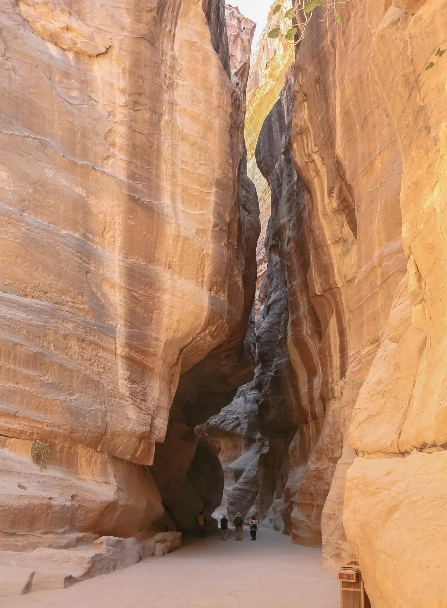
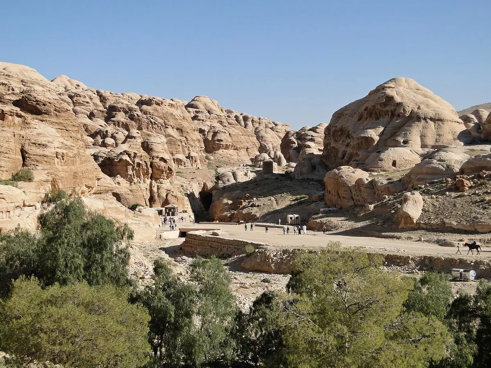
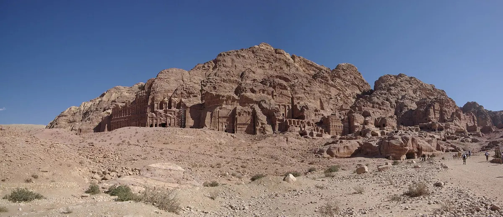
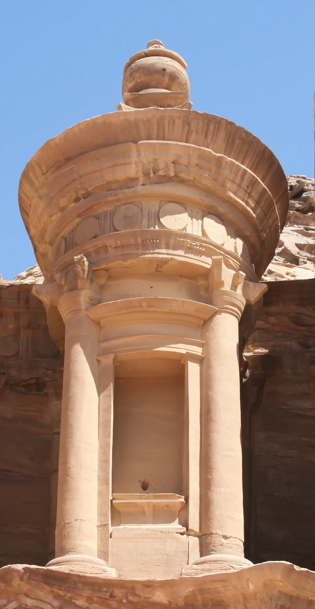

import { tpkDeep } from '../../data/affiliate.js';

## Сокровищница или целый город

Петра начинается задолго до знаменитого фасада, а после него продолжается ещё несколько километров. Для первого дня полезно выбрать один из трёх планов:

| План | Что увидите | Какое ограничение принять |
|---|---|---|
| До Сокровищницы и обратно | Подход, Сик, главный фасад | Древний город за фасадом останется на другой раз |
| Основной маршрут | Сик, Сокровищница, театр, гробницы и городская часть | Ходьба в обе стороны с остановками, нужен большой запас дня |
| С добавлением Ад-Дейра | Ещё и монастырь высоко над основной долиной | Отдельный подъём и возвращение; не обязательная финальная галочка |

На [главном маршруте PDTRA](https://visitpetra.jo/en/Trail/1) указаны **3,9 км в одну сторону**, от Visitor Center до Каср-эль-Бинт. Это **около 7,8 км туда-обратно** до дополнительных ответвлений. Оператор даёт 1 час 30 минут — 1 час 45 минут на прямое прохождение в одну сторону без остановок. Для реального осмотра с фотографиями и отдыхом нужно заметно больше: эти цифры нельзя превращать в обещание «вся Петра за полтора часа».

Сокровищница находится раньше конца главного маршрута. Если идёте только до неё, не нужно брать на себя полный километраж. Но и проездной билет на электрокар не доказывает, что вся оставшаяся территория доступна без ходьбы.

## Билет и прогулка с гидом

На [странице тарифов PDTRA](https://visitpetra.jo/en/Petrafees) вход для посетителя, который **остаётся в Иордании хотя бы на одну ночь**, стоит **50 JOD на день** — около **5720 ₽**, **55 JOD на два дня** — примерно **6290 ₽**, **60 JOD на три дня** — около **6870 ₽**. Два и три дня идут **подряд**, а не выбираются произвольно на протяжении отпуска.

Для посетителя **без ночёвки в Иордании** указан тариф **90 JOD**, около **10 300 ₽**. Поэтому совет «всем иностранцам билет 50» неполон: сначала определите свою категорию. Детям младше 12 лет дневной вход бесплатный, нужен документ для подтверждения возраста. Условия Jordan Pass рассматривайте отдельно, если собираете весь маршрут по стране; его покупка не делает любую программу в Петре включённой автоматически.

У двухдневного билета небольшая доплата: **5 JOD**, около **570 ₽**, по сравнению с однодневным. Если живёте рядом две ночи, это сильный довод разделить осмотр и прийти вторым утром со свежими силами. Но в полный бюджет войдут дополнительная ночь, питание и ваше время; дешёвая доплата к входу не означает бесплатный второй день путешествия.

Самостоятельно можно идти по опубликованному главному маршруту и выбирать точки разворота. Если нужен рассказ на русском, есть <a href={tpkDeep('tripster', 'https://experience.tripster.ru/experience/83102/', 'petra_ru_walk')} target="_blank" rel="sponsored noopener">прогулка по Петре с русскоязычным гидом</a>: **150 € за группу до трёх человек**, примерно **13 670 ₽**, продолжительность **2,5 часа**.

В программе Сик, Сокровищница, театр, Королевские гробницы и улицы города. **Входные билеты оплачиваются отдельно, Ад-Дейр не включён.** В календаре были доступные дни 26–31 октября; для 26 октября показаны утренние и дневные старты. Поздний сеанс выбирайте с учётом сезонного времени закрытия и длительности маршрута.

Для трёх взрослых с ночёвкой в стране один день входа и эта экскурсия дают ориентир **30 830 ₽ на группу**: 150 € плюс 3 × 50 JOD. Дорога, еда и прочие услуги сверху. Цены в долларах из текста продавца не подменяют текущие официальные суммы в динарах. Успешная оплата нами не проверялась.

## Когда приходить и где ночевать

Точка входа — **Petra Visitor Center в Вади-Мусе**. Отель рядом с главным входом удобен для раннего начала и второго захода. Перед оплатой проверьте на карте пешеходный путь от гостиницы к входу в комплекс. Поездка из Аммана в день осмотра съедает значительную часть времени: PDTRA даёт ориентир около **трёх часов по Desert Highway** и четырёх по King's Highway.

С [2 октября 2026 года по 1 марта 2027 года](https://visitpetra.jo/en/Openinghours) для территории и центра посетителей указаны часы **06:30–17:00**. Летний режим с 2 марта по 1 октября — **06:00–18:00**. Не переносите расписание летнего отчёта на зимнюю прогулку. Время офиса Малой Петры также не описывает главный вход.

Для первого полного дня приходите рано, выбирайте обратное время заранее и оставляйте запас до закрытия. Не пытайтесь выжать ещё один подъём из последнего часа: обратная дорога не исчезает от того, что на карте близко красивое название.

Если планируете автобус, проверьте конкретную дату и точку отправления у перевозчика. На [официальной странице дороги](https://visitpetra.jo/en/GettingtoPetra) есть варианты сообщения, но опубликованный общий ориентир — не подтверждённая бронь места и не гарантия текущего расписания.

## Что рассмотреть в ущелье Сик

Ущелье Сик длиной примерно **1,2 км** постепенно сужает поле зрения. Вы то видите высокий просвет неба, то почти одни стены. Не нужно проходить его на скорости в ожидании единственного известного кадра: по дороге можно заметить следы того, как древний город управлял водой.

PDTRA описывает водопроводные каналы по обеим сторонам: с одной стороны шёл трубопровод, с другой — вырубленный в камне канал. Дамба направляла паводковую воду в обход; нынешнее сооружение построено в 1964 году на месте древнего. Эти детали объясняют жизнь поселения убедительнее впечатления, будто город целиком существовал ради красивых гробниц.

По пути обращайте внимание на проходящих людей и обслуживающий транспорт, не перекрывайте узкое место надолго ради портрета. Паузы для фотографий лучше делать там, где можно спокойно отойти в сторону, а не создавать затор в самом узком просвете.

## За Сокровищницей: театр и Королевские гробницы

**Аль-Хазне, или Сокровищница**, открывается в конце Сика. Название легко принять буквально, но фасад связан с погребальным памятником; PDTRA осторожно связывает его с царём Аретой IV, а не объявляет это доказанной единственной версией. Высота фасада — около **39,5 м**. Останьтесь посмотреть на уровни архитектуры после первой фотографии: масштаб деталей лучше читается, когда рядом видны люди.

Популярный верхний ракурс не стоит считать обязательным продолжением. Не соглашайтесь на неясный «секретный проход» только потому, что вас уверяют в его короткой длине. Пользуйтесь разрешёнными маршрутами, уточняйте их статус в центре посетителей и не отдавайте остаток сил незапланированному подъёму.

Дальше начинается городская часть. **Театр** был набатейским и позже расширялся при римлянах: его нельзя автоматически приписать исключительно римскому периоду. У **Королевских гробниц** рассмотрите фасады и проследите, как они расположены в скальном массиве. Чтобы осмотреть их внимательнее, понадобится время сверх прямого прохода по дну долины.

Колоннадная улица помогает увидеть Петру городом, а не одной декорацией. В опубликованном описании главного маршрута отмечены её перестройка в римское время и разрушения при землетрясении 363 года. Сегодняшний вид сочетает сохранившееся и восстановленное: не все стоящие колонны дошли до нас нетронутыми.

## Нужно ли идти к монастырю Ад-Дейр

Ад-Дейр — другой крупный скальный фасад, дальше основного маршрута и выше долины. Его нельзя включить в обычную прогулку мысленно, как соседнюю комнату музея. К подходу добавляются подъём, остановки и возвращение.

Выделите ему большой отдельный блок, лучше второе утро, если первый день ушёл на главный город. На месте уточните открытие нужной тропы. Обратный вход через Малую Петру не рассматривайте как универсальный короткий путь: там другая логистика и свой пешеходный маршрут, которые нужно отдельно согласовать.

Если тяжело на главном пути, монастырь разумно оставить. Это не неудача путешествия: внимательно осмотренные Сик, театр и гробницы дают больше, чем торопливый подъём в состоянии, когда вы думаете только о возвращении.

## Что оплатить и подготовить отдельно

У PDTRA электрокар **от Visitor Center до Сокровищницы** указан как **15 JOD в одну сторону**, около **1720 ₽**, или **25 JOD туда-обратно**, примерно **2860 ₽**. Это конкретный участок, а не транспорт по всем достопримечательностям и не подъём к Ад-Дейру. Наличие машины, часы и посадку уточняйте перед тем, как строить вокруг неё весь день.

Ночная программа — отдельный продукт; по условиям оператора она требует дневного билета. Старые дни недели из путеводителей здесь не повторяются: если она нужна, проверяйте свежий календарь отдельно и не путайте ночное представление с дополнительным временем свободного осмотра города.

Возьмите воду, еду на выбранную продолжительность, защиту от солнца, устойчивую обувь и тёплый слой для раннего старта. Телефон должен выдержать дорогу, фотографии и возвращение; маршрут и контакт гостиницы сохраните офлайн. Основной контроль в течение дня — хватит ли времени и сил вернуться по пройденному пути.

На [странице Иордании](/jordan/) можно продолжить планирование сезона и страны. Для самой Петры прежде решите длительность: одна внимательная прогулка и второе утро часто удобнее попытки вместить каждый фасад в один длинный заход.
